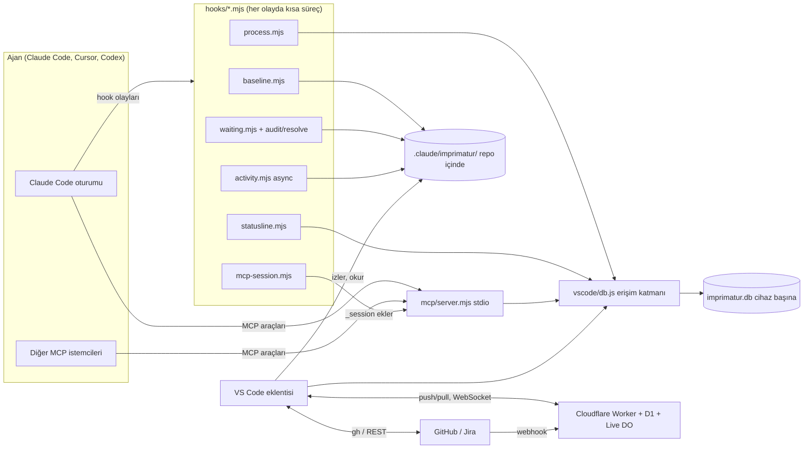
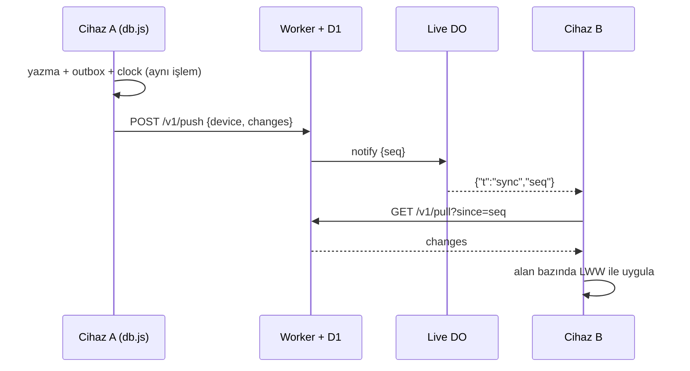

<!-- Generated by Imprimatur from its database; edit in the Imprimatur panel (Mimari/Ürün). -->

# Mimari Tasarım Dokümanı

## İçindekiler

1. [Genel bakış ve amaç](#overview)
2. [Bileşenler ve sınırları](#components)
3. [Yerel veritabanı ve veri modeli](#database)
4. [Dosya tabanlı inceleme verisi](#review-data)
5. [Hook'lar ve akışlar](#hooks)
6. [MCP sunucusu](#mcp)
7. [Panel ve görünümler](#panel)
8. [Canlı güncellemeler](#live)
9. [Cihazlar arası eşitleme](#sync)
10. [Takip aracı eşitlemesi](#tracker)
11. [Süreç kontrolleri](#process-checks)
12. [Model çağrıları ve maliyet](#model-calls)
13. [Güvenlik](#security)
14. [Kurulum ve dağıtım](#deployment)
15. [Test stratejisi](#testing)
16. [Bilinen sınırlar](#limits)
17. [Tasarım dokümanları ↔ Markdown dosyaları (docs sync)](#docs-sync)

## 1. Genel bakış ve amaç

Imprimatur, kodlama ajanlarının (öncelikle Claude Code; MCP üzerinden Cursor ve Codex de) bir repoda yaptığı işi kullanıcının gözü önünde tutan yerel bir araçtır. Bugün (0.45.0) üç işi birlikte yapar:

1. **İnceleme:** ajanın Markdown (varsayılan `md`, `mdx`) düzenlemeleri kullanıcı **Accept** diyene kadar editörde ve Markdown önizlemesinde "izlenen değişiklik" gibi işaretli kalır. Git'e bağlı değildir: stage ya da commit işareti kaldırmaz.
2. **Bekleyenler:** ajanın kullanıcıdan beklediği her şey (soru, izin, "test et", 👉 satırları) oturumlar arasında tek listede toplanır ve kendiliğinden güncel tutulur.
3. **Kayıtlar:** görevler ve kayıtları (todo, soru, cevap, karar, not, fixme, ADR, PDR, test) ile bu iki tasarım dokümanı Imprimatur'un kendi veritabanında yaşar; ajan onlara MCP araçlarıyla, kullanıcı VS Code panelinden erişir.

### Temel mimari kararlar

- **Yerel önce:** asıl kaynak cihaz başına tek SQLite dosyası (`node:sqlite`). Bulut yalnız isteğe bağlı eşitleme ve canlı haber kanalıdır; veri sunucuda birleşmez, cihazlarda birleşir.
- **Hook + eklenti + MCP:** Claude Code hook'ları olayları yakalar ve dosyaya ya da veritabanına yazar; VS Code eklentisi bunları gösterir; MCP sunucusu ajanın yazma yoludur. Üçü de aynı erişim katmanını (`vscode/db.js`) ve aynı yardımcı modülleri (`vscode/*.js`) kullanır.
- **Bağımlılıksız çalışma zamanı:** hook'lar, MCP sunucusu ve eklenti yalnız Node yerleşikleriyle koşar (`npm install` gerektirmez). Geliştirme bağımlılıkları yalnız paketleme ve testler içindir.
- **Markdown kayıt yok:** TODO.md, `docs/design`, `PRODUCT.md`, `docs/testing` veritabanına aktarıldı ve kaldırıldı. Tasarım dokümanları veritabanından `docs/ARCHITECTURE.md` ve `docs/PRODUCT.md` olarak üretilir ama asıl kaynak veritabanıdır.
- **Açık kaynak, tek repo:** [halilural/imprimatur](https://github.com/halilural/imprimatur), MIT. Eklenti kimliği `halilural.imprimatur`, ayar ve komut öneki `imprimatur.`.

### Bu doküman

Bu doküman sistemin bugünkü hâlini anlatır, tarihçeyi anlatmaz. Her bölüm dayandığı kayıtlara (ADR, karar) bağlıdır. Bir ADR eklenip doküman güncellenmezse süreç kontrolü (`docUpdate`) ajanı uyarır.

## 2. Bileşenler ve sınırları

Sistem altı parçadan oluşur. Sınırları, kimin neye yazdığına göre çizilir.

### Parçalar

| Parça | Yer | Görev | Sınır |
|---|---|---|---|
| Hook'lar | `hooks/*.mjs` | Claude Code olaylarını yakalar: düzenleme öncesi kopya, bekleyenler, etkinlik, süreç kontrolleri, MCP oturumu, durum satırı | Aracı asla engellemez (süreç kontrolleri hariç, o da açıkça "block" ise); her hata `exit 0` |
| İnceleme verisi | `<repo>/.claude/imprimatur/` | Kopyalar, düzenleme tarihçesi, bekleyen günlükleri, etkinlik, arşiv | Repo içinde ama git'e girmez (global gitignore) |
| Veritabanı | `vscode/db.js` + `imprimatur.db` | Görevler, kayıtlar, sürümler, dokümanlar, eşitleme ve takip aracı kuyrukları | SQL yalnız `db.js`'te |
| MCP sunucusu | `mcp/server.mjs` | Ajanın kayıtlara tek yazma yolu; 10 araç | Yalnız veritabanına dokunur |
| VS Code eklentisi | `vscode/` (paketlenmiş: `vscode/dist/extension.js`) | Editör/önizleme işaretleri, Imprimatur paneli, Agent Setup, eşitleme, takip aracı, canlı bağlantı, doküman dışa aktarma | `extensionKind: workspace`; güvenilmeyen klasörde model, `gh` ve repo betiği başlatmaz |
| Eşitleme sunucusu | `cloud/` | Cihazlar arası değişiklik günlüğü (D1), canlı haber (Durable Object), GitHub webhook | Veriyi birleştirmez; yalnız sıralar ve haber verir |

Ortak modüller (`vscode/diff.js`, `waiting.js`, `audit.js`, `tasks.js`, `records.js`, `model.js`, `config.js`) hem hook'larda (`createRequire` ile) hem eklentide kullanılır; bu yüzden hook'lar eklentinin paketine değil, repodaki kaynak dosyalara bağlıdır.

## 3. Yerel veritabanı ve veri modeli

### Motor ve yer

- Node'un yerleşik `node:sqlite` (`DatabaseSync`): native modül yok, tek evrensel `.vsix`. Eklenti VS Code'un Node'unda (Node 24), hook'lar ve MCP sunucusu sistem Node'unda (≥ 22.13) çalışır. `node:sqlite` yüklenemezse açık hata verilir; JSON yedeği ya da sessiz geri dönüş yoktur.
- Cihaz başına **tek dosya**, bütün repolar için: Linux/WSL `$XDG_DATA_HOME/imprimatur/imprimatur.db` (varsayılan `~/.local/share/imprimatur/`), macOS `~/Library/Application Support/imprimatur/`, Windows `%LOCALAPPDATA%\imprimatur\`. `IMPRIMATUR_DB` yolu ezer; `node --test` altında her zaman geçici dosya kullanılır, gerçek veritabanına dokunulmaz.
- `/mnt/<sürücü>/` üstünde açılmaz: WAL'in paylaşımlı belleği WSL/Windows sınırında bozulur.
- Repo içinde değildir: dal değiştirmek kayıtları değiştirmez, git'e girmez.

### Eşzamanlılık

Her bağlantı `journal_mode=WAL`, `synchronous=NORMAL`, `busy_timeout=5000`, `foreign_keys=ON` ile açılır. Eklenti tek uzun bağlantı, her hook süreci kısa bir bağlantı, MCP sunucusu kendi bağlantısını tutar. Her yazma kısa bir `BEGIN IMMEDIATE` işlemidir: kayıt, sürüm satırı ve eşitleme kuyruğu aynı işlemde yazılır. Yeni dosyanın WAL'e ilk geçişi 5 sn yeniden denenir. Testler 12 sürecin aynı anda yeni dosyayı açıp yazmasını kapsar.

### Şema (sürüm 4, `PRAGMA user_version`)

`MIGRATIONS` dizisi sırayla, tek `BEGIN IMMEDIATE` içinde uygulanır; kodun bildiğinden yeni bir veritabanı salt okunur açılır.

1. **Çekirdek (4 tablo):**
   - `repos(uid, root UNIQUE, origin, name)`: `root` git kökü; `origin` normalize edilmiş remote (ssh ve https aynı yazılır).
   - `tasks(uid, repo_id, key, title, status, epic_id, summary)`: `key` `#57` ya da Jira anahtarı (`PROJ-12`), özel görevler `ADR`, `PDR`, `TEST`; `status` `open|active|done|dropped`; `summary` tek satırlık "nerede kaldık".
   - `records(uid, task_id, kind, owner, status, pointer, title, body, position, parent_id, links)`: `kind` 9 tür; `owner` `C` (ajan) / `K` (kullanıcı); 👉 `pointer` görev başına en fazla bir (kısmi tekil indeks) ve yalnız açık kayıtta; `position` REAL (araya ekleme yeniden numaralamasız); `parent_id` cevabın sorusu.
   - `record_versions(record_id, at, actor_kind, actor, op, before, after)`: her değişikliğin kim (`agent|user|hook|import`, oturum ya da istemci), ne zaman ve hangi alanlarla yaptığı.
2. **Eşitleme:** `meta`, `outbox(entity, key, field, value, at)`, `clock(entity, key, field, at, device)`.
3. **Takip aracı:** `tracker_outbox` (kapat/yeniden aç kuyruğu, deneme ve geri çekilme alanları), `tracker_state` (her issue'nun son çekilen durumu). Cihaza özeldir, eşitlenmez.
4. **Tasarım dokümanları:** `documents(repo_id, kind architecture|product, title)`, `doc_sections(doc_id, key, title, body, position, status current|superseded)`, `doc_section_records` (bölüme katkı veren kayıtlar), `doc_versions`.

### Değişmezler

- Kayıt ve bölüm **silinmez**: kayıt `dropped`, bölüm `superseded` olur; sürüm geçmişi tam kalır, yabancı anahtarlar kopmaz.
- Her satırın rastgele `uid`'i vardır: yerelde `id`, cihazlar arasında `uid` kullanılır.
- Görev `done`/`dropped` olunca epic'teki o göreve ait açık satır aynı işlemde kapanır (bkz. Takip aracı eşitlemesi).
- Bölüm gövdesi en çok 40.000, başlığı 300 karakter; anahtar slug (`a-z0-9-`, ≤ 64).

### Gecikme

Panel sorguları indeksli ve `LIMIT`'li: 10.000 kayıtta < 1 ms; açılış (pragmalar + sürüm kontrolü) < 5 ms; hazır sorgular bağlantı başına önbellekte. Her yazma `PRAGMA data_version` ile birlikte okunabilen bir değişiklik damgası üretir; panel bunu canlı güncelleme için kullanır.

## 4. Dosya tabanlı inceleme verisi

Ajan düzenlemesinin incelemesi veritabanında değil, repodaki `.claude/imprimatur/` klasöründe dosya olarak tutulur: hook'lar düzenlemeden önce çok hızlı yazmalı, veri repoya ve dosyaya göre bölünmüş olmalı ve eski veri kendiliğinden arşivlenebilmelidir. Klasör global gitignore'dadır.

| Yol | Yazan | İçerik |
|---|---|---|
| `baseline/<yol>` | `baseline.mjs` | Dosyanın incelemedeki ilk hâli (yeni dosyada boş). Accept satırları buraya yazar, Accept all siler. |
| `history/<yol>.jsonl` | `baseline.mjs` | Her ajan düzenlemesi için `{t, session, tool, prompt, intent, title, transcript, toolUseId, branch, before}`. Accept all'dan sonra da kalır. |
| `pending/<tool_use_id>.json` | `baseline.mjs` | Bash komutu öncesi, komutta adı geçen dosyaların içeriği ve dal; komut sonrası karşılaştırılır, 6 saatten eskisi süpürülür. |
| `waiting/<oturum>.jsonl` | `waiting.mjs`, `audit.mjs`, `resolve.mjs`, eklenti | Bekleyen maddeler ve olaylar: `question`, `command`, `verify`, `input`, kapatan `answer`/`step`/`done`, adım işareti `check`. |
| `activity/<oturum>.jsonl` | `activity.mjs` | Her araç çağrısı için kısa satır: `{t, session, id, tool, kind, what, out, ms, agent, agentId, failed}`. |
| `calls.jsonl` | eklenti (`calls.js`) | Transcript'ten okunan çağrı bilgisi (dal, Edit/Write girdisi, başarısızlık) ve eski satırların çağrı eşleşmesi; Claude Code transcript'leri 30 günde sildiği için kalıcı kopya. |
| `descriptions.jsonl` | eklenti (`describe.js`) | Model yazdığı tek cümlelik düzenleme açıklamaları `{toolUseId, file, text}`. |
| `todo-done.json`, `scanned.json`, `setup-history.json`, `process.json` | eklenti, hook'lar | Önbellek ve durum dosyaları. |
| `archive/<YYYY-MM-DD>/` | eklenti (`archive.js`) | Aynı düzende gzip'li eski satırlar; `zcat` ile okunur. |

### İlkeler

- **Kalıcılık:** işaretler yalnız Accept ile kalkar; stage, commit, yeniden açma etkilemez. Eklenti `.claude/imprimatur/**`'ı izler, git'i izlemez.
- **Kendiliğinden düzelme:** eski ya da eksik veri yeniden yazılmaz, onarım betiği yoktur. Düzeltme okuma anında yapılır, kalıcı bilgi ayrı dosyada (`calls.jsonl`) tutulur.
- **Doğruluk:** Edit/Write'ın gerçek sonucu transcript'teki çağrıdan kurulur; bir sonraki `before` ile farkı ayrı bir "Outside change" satırı olur, elle ya da git'le gelen değişiklik ajana yazılmaz. Bash'in sonucu bilinemez (transcript'te yalnız komut vardır).
- **Arşiv:** günde bir kez (açılıştan 30 sn sonra, saatte bir kontrol) `imprimatur.archive.afterDays` (varsayılan 7) günden eski düzenlemeler kabul edilmiş sayılır ve arşive taşınır; açık maddesi olmayan eski bekleyen günlükleri de. Açık istek asla kapatılmaz. Dosya yalnız okunduğu hâliyle duruyorsa yeniden yazılır; git işlemi sürerken çalışmaz; iki pencere `archive/.lock` ile ayrılır.

## 5. Hook'lar ve akışlar

Hook'lar ya `~/.claude/settings.json`'a (`npm run setup`) ya da Claude Code plugin'inin `hooks/hooks.json`'ına kayıtlıdır; ikisi aynı listeden üretilir ve aynı anda kurulmaz. Her hook ayrı bir Node sürecidir (~65 ms, 43 ms'si Node açılışı); Claude Code eşleşen hook'ları paralel çalıştırır.

| Olay | Eşleşme | Hook | İş |
|---|---|---|---|
| PreToolUse | `Edit\|Write\|Bash` | `baseline.mjs` | Kopya (yoksa) + tarihçe satırı; Bash için `pending/` |
| PostToolUse / PostToolUseFailure | `Bash` | `baseline.mjs` | Komut sonrası karşılaştırma; başarısız komutun yaptığı değişiklik de kaydedilir |
| PreToolUse / PostToolUse | `AskUserQuestion` | `waiting.mjs` | Soru ve cevabı |
| PermissionRequest, Notification (`agent_needs_input`, `elicitation_*`) | | `waiting.mjs` | İzin ve girdi istekleri |
| UserPromptSubmit | | `waiting.mjs` → `resolve.mjs` | Kullanıcının cevabı; arka planda Haiku hangi açık adımların karara bağlandığını seçer |
| Stop | | `waiting.mjs` → `audit.mjs`, `process.mjs` | Tur sonu: Haiku denetimi; süreç kontrolleri |
| PreToolUse | `mcp__imprimatur__.*`, `mcp__plugin_imprimatur_imprimatur__.*` | `mcp-session.mjs` | Girdiye `_session` ekler, `allow` döner |
| PostToolUse / PostToolUseFailure | `*` (async) | `activity.mjs` | Ajanın her işi tek satır |
| SessionStart, PreToolUse, PostToolUse (düzenleme, Bash, MCP yazma araçları) | | `process.mjs` | Süreç kontrolleri (repo açtıysa) |

Ayrıca `statusline.mjs` Claude Code'un durum satırıdır (hook değil, `statusLine` ayarı).

### Ana akışlar

1. **Düzenleme:** ajan Edit/Write çağırır → `baseline.mjs` düzenlemeden önce kopyayı ve tarihçe satırını yazar → eklenti dosya değişikliğini görür, dosyayı kopyayla karşılaştırır ve işaretler.
2. **Tur sonu:** Stop'ta `waiting.mjs` soruları kapatan `step` satırını yazar ve `audit.mjs`'i arka planda başlatır. Haiku açık adımları ve ajanın son mesajını okur: biten, cevaplanan ya da yeniden sorulan adımları işaretler; mesajın gerçekten istediğini kısa adımlar olarak yazar (👉 satırları kelimesi kelimesine). Denetim yalnız açık madde varken ya da cevap bir şey isterken çalışır; düz rapor model çağırmaz.
3. **Kullanıcı mesajı:** UserPromptSubmit `answer` satırını yazar, `resolve.mjs` Haiku'ya "bu mesaj hangi adımları karara bağladı?" diye sorar; bir görevi anan mesaj (`LATD-13977`, ya da yalnız `13977`) diğer oturumlardaki o göreve ait adımları da değerlendirir.
4. **Görev bitti:** veritabanında `done` olan görevin, görev son değişmeden önce açılmış adımları her oturumda kapanır (`todo-done.js`, her Stop'ta ve grafik çiziminde).

### Kurallar

- Hook'lar aracı engellemez: her yol `exit 0`. Süreç kontrolleri bile kendi hatalarında hiçbir şey yapmaz.
- Model çağrıları hook'u bekletmez: ayrık arka plan süreci olarak başlar.
- `IMPRIMATUR_CHILD=1` ile başlayan model oturumlarında Imprimatur hook'ları hiçbir şey yazmaz.
- Dil ve dosya uzantıları: hook argümanı > `IMPRIMATUR_LANG` > plugin seçenekleri (`CLAUDE_PLUGIN_OPTION_*`) > veritabanı klasöründeki `config.json`.

## 6. MCP sunucusu

`mcp/server.mjs` ajanların görev ve kayıtlara **tek** okuma/yazma yoludur. Claude Code (kullanıcı kapsamı ya da plugin), Cursor (`~/.cursor/mcp.json`) ve Codex (`~/.codex/config.toml`) aynı sunucuyu ve araçları görür.

### Taşıma ve protokol

- stdio, bağımlılıksız: satır başına bir JSON-RPC mesajı; stdout yalnız MCP, günlük stderr'e; stdin kapanınca çıkar. SDK yoktur, `npm install` adımı gerekmez.
- İki protokol dönemi: 2026-07-28 (`server/discover`, her istekte `_meta` ile protokol sürümü ve `clientInfo`; keşif sonucu `ttlMs: 3.600.000`, `cacheScope: "public"`) ve eski `initialize` el sıkışması.
- Sunucu `instructions` alanıyla araçların birlikte nasıl kullanılacağını bir kez söyler ("oturum başında `where_we_left_off`" vb.).

### Araçlar (10)

| Araç | Tür | İş |
|---|---|---|
| `where_we_left_off` | okuma | Bitmemiş görevler, her birinin 👉'ı ve açık kayıt sayısı |
| `task_list` | okuma | Görevler, son güncellenen önce |
| `task_get` | okuma | Görev ve kayıtları; varsayılan açık kayıtlar + 👉, 50'şer, gövde 500 karakter; `status: "all"`, `kind`, `limit/offset`, `full` |
| `task_upsert` | yazma | Görev aç/güncelle (başlık, durum, özet, epic) |
| `record_add` | yazma | Kayıt ekle (görev yoksa açılır); `pointer: true` 👉'ı taşır |
| `record_update` | yazma | Verilen alanları değiştir, her değişiklik sürümlenir |
| `pointer_set` | yazma | 👉'ı açık bir kayda taşı |
| `search` | okuma | Başlık/gövdede metin; `repo: "*"` bütün repolar |
| `doc_get` | okuma | Mimari ya da ürün dokümanının içindekileri; `section` ya da `full` ile gövdeler |
| `doc_section_upsert` | yazma | Bölüm yaz/güncelle, katkı veren kayıtları bağla |

Araçlar bilerek az ve geneldir (tür başına araç yok): her tanım ajanın bağlamına girer. Sonuç kısa bir metin özeti ve tam `structuredContent` (+ `outputSchema`) olarak döner; aracın kendi hatası `isError` ile ve ne yapılacağını söyleyen bir mesajla döner (model düzeltir), bilinmeyen araç `-32602`.

### Repo ve kimlik

- Repo: `repo` argümanı, yoksa `CLAUDE_PROJECT_DIR`, yoksa sunucunun çalışma klasörü; git köküne çözülür. MCP `roots` kullanılmaz.
- Claude Code MCP sunucusuna oturumu söylemez: `mcp-session.mjs` PreToolUse'da girdiye `_session` ekler (`updatedInput` girdinin tamamını değiştirdiği için kopyalayarak) ve `allow` döner, çünkü araçlar yalnız Imprimatur veritabanına dokunur. Sürüm satırının aktörü `<clientInfo.name>:<oturum>` olur (ör. `claude-code:adddf…`).

## 7. Panel ve görünümler

### Editör ve Markdown önizlemesi

- Eklenti kopyası olan her dosyayı kopyayla karşılaştırır: ortak baş/son kırpılır, satır LCS, değişen satırlarda kelime LCS. Tek kelime değiştiyse kelime işareti; birden çok kelime değiştiyse eski cümle satırın üstünde CodeLens olarak (editör API'si gerçek satır ekleyemez). Eklenen satır yeşil, silinen blok önceki satırda kırmızı işaret.
- Önizlemeye markdown-it eklentisi verilir: değişiklik blok düzeyinde işaretlenir, eski metin üstte okunur kırmızı kutuda; sağ kenarda overview ruler benzeri çentikler (`preview-markers.js`).
- **Accept** Markdown birimi başınadır (blok sınırları VS Code'un markdown-it'inden): editörde CodeLens, önizlemede blok üstünde bağlantı (`vscode://halilural.imprimatur/accept?…`, `registerUriHandler`). Accept yalnız kopyaya yazar, dosya metnine dokunmaz; görünüm sıradaki değişikliğe kayar.
- `imprimatur.showIn`: `preview` (varsayılan), `both`, `editor`; `imprimatur.editorAlsoFor` glob'ları. Fark sekmelerinde (Working Tree) işaret çizilmez. Mermaid farkı `imprimatur.mermaidDiff` ile açılır (varsayılan kapalı).

### Imprimatur paneli (tek webview, `imprimatur.graph`)

Altı sekme; yalnız görünen sekmenin HTML'i çizilir:

| Sekme | Kaynak | İçerik |
|---|---|---|
| Ana sayfa | `tasksView.js` | İlerleme, her görevin nerede kaldığı, sende bekleyen ilk 5, görev tablosu |
| Görevler | `tasksView.js` | Durumlara göre görev listesi (bu repo ya da bütün repolar); görev sayfası: 👉, bekleyenler ve cevap kutusu, todo'lar, hızlı ekleme (`?` soru, `!` karar, `#` not, `@ben` kullanıcının todo'su), kararlar, ADR, PDR, testler, etkinlik |
| Bende bekleyenler | `tasksView.js` + `waiting.js` | Kullanıcıyı bekleyen her şey, göreve göre; tur sonu istekleri onay kutulu adımlar olarak |
| Mimari / Ürün | `docsView.js` | İçindekiler, işlenmiş Markdown, katkı veren kayıtlar, düzenle, eskimiş say, bölüm geçmişi |
| Ajan değişiklikleri | `graph.js` | Agent Change Graph: her düzenleme bir satır, görev başına renkli şerit, ajanın diğer işleri türe göre süzülür |

Görünüm kurucuları saftır: veritabanı bağlantısı alır, model ya da HTML döndürür; birim testleri VS Code olmadan koşar. Panel klavyeyle kullanılır (j/k, Enter, x, a, /, Esc). Kullanıcının yazmaları veritabanına aktörü `user` olarak gider.

### Agent Change Graph

- Satırlar `history/**.jsonl`'dan; şerit Claude oturumu değil **görev**: dosya `docs/todos/<anahtar>/` altında, düzenleme anındaki dal (`<tür>/<n>-ad` → `#n`), aynı turda yazılan kayıtların görevi, istekteki anahtar; yoksa "No task".
- Açıklama sırası: modelin tek cümlesi → Bash açıklaması → ajanın aynı mesajdaki sözü (`narration.js`) → en yakın başlık + ilk değişen satır.
- Hover yalnız durum hücresinden açılır; Markdown düzenlemesini önizlemenin review görünümünde gösterir. Sağ tık VS Code'un kendi menüsüdür (Accept this edit, Open diff, Go to change).
- Performans: dosya başına önbellek (boyut + mtime anahtarı), sayımlarda kelime diff'i yok; tam yenileme dirtywork'te 430 → 34 ms.

### Kenar çubuğu

Etkinlik çubuğunda Imprimatur simgesi: paneli bir sekmede açan satırlar (rozet bekleyenleri sayar) ve **Agent setup** ağacı: repoda ve home'da ajanı etkileyen her dosya (Claude Code, Cursor, Copilot, AGENTS.md, Gemini, Windsurf, Cline, Aider, git hook'ları), araç ve türe göre gruplu, son bakıştan beri yeni/değişen/silinen işaretli; ne zaman devreye girdiği, sağlık kontrolleri, repolar arası sapma, git geçmişi ve birleşik ayarlar (hook sırası, geçerli izinler). Salt okunurdur.

## 8. Canlı güncellemeler

Hedef: bir değişiklik yazıldığı anda panelde görünsün. Üç katman vardır.

### Aynı makine

- `watch.js` veritabanı dosyasını (ve `-wal`, `-shm`) klasör üzerinden `fs.watch` ile izler. **İlk olay hemen** işlenir, olaylar sürdükçe en çok 50 ms'de bir, sonda bir kez daha. İzleyici hata verirse (klasör silindi, izleyici sınırı) en çok 5 sn'de bir yeniden kurulur.
- Tek bir **değişiklik kapısı** (`PRAGMA data_version` + eklentinin kendi işlemleri) izleyiciye, yedek yoklamaya ve eklentinin kendi yazmalarına ortaktır: bir değişiklik bir kez çizilir.
- Panel görünürken 500 ms'de bir değişiklik damgasına bakılır (izleyici bir olayı kaçırırsa yedek). Panel gizliyken yoklama yoktur.
- `.claude/imprimatur/**` değişiklikleri: editör ve grafik hemen; `waiting/` ve açıklama değişiklikleri son yazmadan 1 sn sonra (sürekli yazılıyorsa en geç 3 sn'de bir) tek yenileme. Önizleme yalnız kopya/tarihçe değişince, 700 ms sakinlikten sonra yenilenir.
- Ölçüm: dosya izleyicisi 25–49 ms; hedef ~50 ms. Entegrasyon testi başka bir süreçten yazılan kaydın panele 500 ms içinde ulaştığını doğrular.

### Cihazlar arası

- Eşitleme kuruluysa eklenti host'u başına bir WebSocket: `GET /v1/live`, aynı Bearer token. Worker'daki `Live` Durable Object (SQLite tabanlı, WebSocket Hibernation; `ping`'e uyanmadan `pong`) bir cihaz push ettikten sonra herkese `{"t":"sync","seq","device"}` yollar; eklenti hemen çeker. Hedef 0,3–1,5 sn.
- Yeniden bağlanma 1 sn'den 30 sn'ye üstel ve rastgele; her bağlanışta çekme (en çok 10 sn'de bir). 30 sn'de bir ping ölü bağlantıyı bulur.
- Bağlıyken zamanlı eşitleme 5 dakikada bir, bağlı değilken dakikada bir; yerel değişiklikten birkaç saniye sonra da itilir.
- Eski Worker (`/v1/live` yok, 404/501): eklenti bir kez fark eder, dakikalık eşitlemeyle devam eder. Reddedilen token 5 dakikada bir yeniden denenir.

### GitHub

Her repoda `issues` webhook'u `POST /v1/github`'a gelir; imza `X-Hub-Signature-256` (HMAC-SHA256, `GITHUB_WEBHOOK_SECRET`) sabit zamanlı karşılaştırılır. Worker bağlı eklentilere `{"t":"tracker","repo"}` yollar, eklenti o repo için takip aracı eşitlemesini saniyeler içinde çalıştırır. Daha önce görülmüş teslimat (kimliği ya da gövde özeti, son 500) yok sayılır. 5 dakikalık çalışma yedek olarak kalır.

## 9. Cihazlar arası eşitleme

Kullanıcının iki makinesi (iş ve kişisel) aynı görev listesini görür. Yerel veritabanı asıl kaynak kalır; bulut yalnız değişiklik günlüğüdür.

### Yerel taraf

- Her yerel yazma aynı işlemde `outbox(entity, key, field, value, at)` ve `clock`'a düşer. Uzaktan uygulanan değişiklik outbox'a düşmez (yankı yok).
- **Eşitlenen alanlar:** repo `name`; görev `title, status, summary, epic, pointer`; kayıt `task, kind, owner, status, title, body, position, parent, links, created_at`; doküman bölümü `title, body, position, status, records`.
- **Anahtarlar** cihazdan bağımsızdır: repo = normalize origin (origin'siz repo eşitlenmez), görev = origin + anahtar, kayıt = `uid`, bölüm = origin + doküman türü + bölüm anahtarı.
- **Çakışma:** alan bazında son yazan kazanır (`clock` alan başına son yazma zamanını ve cihazı tutar). Bir makinedeki değişiklik başka makinede değişmiş farklı bir alanı geri almaz.
- **Yer tutucular:** gelen repo bu makinede henüz açılmamışsa `origin:<remote>` köklü yer tutucu repo açılır; kullanıcı repoyu açınca gerçek kökü benimser. Aynı remote'un iki klonu varsa yalnız ilk görülen eşitlenir.
- Ebeveyni henüz gelmemiş değişiklikler bekletilir (en çok 5.000 değişiklik, 3 çekme boyunca).
- Uygulanan uzak değişiklik sürüm satırı yazar (aktör `import`, `sync:<cihaz>`).

### Sunucu (`cloud/`)

- Cloudflare Worker + D1, tek tablo `changes(seq, device, entity, key, field, value, at)`. `POST /v1/push` (en çok 1.000 değişiklik, 1 MB gövde), `GET /v1/pull?since=&device=&limit=1000` (`{changes, last, more}`).
- Yetki: `Authorization: Bearer <SYNC_TOKEN>` (Worker secret), SHA-256 özetleri üzerinden sabit zamanlı karşılaştırma.
- 100.000 karakteri aşan değer kısaltılarak (sonunda "…") gönderilir; yazan makine tam hâlini tutar. Bu yüzden bölüm gövdesi 40.000 karakterle sınırlıdır.
- Sunucu birleştirme yapmaz ve `changes` tablosunu sıkıştırmaz; yeni bir makine bütün günlüğü baştan oynatır.

### İstemci

Eklenti açılışta, dakikada bir (canlı bağlıyken 5 dakikada bir), canlı haber gelince ve yerel değişiklikten birkaç saniye sonra eşitler; `Imprimatur: Sync Now` zorlar. `npm run sync` terminalden; `--setup <url>` ayarı yazar, token'ı `IMPRIMATUR_SYNC_TOKEN`'dan ya da gizli istemle alır, mevcut her şeyi kuyruğa koyar; `--off` kuyruğa almayı durdurur. Ayar veritabanı klasöründeki `config.json`'da (`0600`).

## 10. Takip aracı eşitlemesi

Görev durumu GitHub Issues ya da Jira ile iki yönlü eşitlenir; epic satırları görevleriyle birlikte kapanır.

### Epic zinciri (veritabanında, eşitlemeden bağımsız)

Görev `done` ya da `dropped` olunca, aynı yazma işleminde epic'in o göreve ait açık kayıtları kapanır: `links.issue` görevin anahtarı olan ya da başlığı anahtarla başlayan (`#56 …`, `[#56 …](url)`, `PROJ-12 …`) kayıtlar `done` olur ve "#56 bitti (tarih)" notu alır; epic'in 👉'ı bu satırdaysa sıradaki açık kayda geçer. Görev yeniden açılınca satırlar kapalı kalır. `scripts/stale-epic-lines.mjs` bitmiş görevlerin açık kalmış satırlarını salt okunur listeler.

### Hangi araç

- **GitHub:** `#N` görevler, origin'i github.com olan repoda, `gh` oturumu açıksa.
- **Jira:** `PROJ-12` biçimli anahtarlar; `config.json` `{"tracker": {"jira": {"baseUrl", "email"}}}` ve token `IMPRIMATUR_JIRA_TOKEN` (ya da `0600` dosyada `tracker.jira.token`); `baseUrl` https olmalı.
- Başka bir araç (Linear vb.) yeni bir anahtar biçimi ve kendi push/pull'u olarak eklenir.

### Imprimatur → araç (push)

- `db.upsertTask` durum değişikliğini `tracker_outbox`'a koyar (cihaza özel, eşitlenmez: değişikliği yapan cihaz iter).
- `done` → issue tamamlandı olarak kapanır, `dropped` → not planned, yeniden açma → reopen; Jira'da Done / Won't Do geçişleri adla bulunur.
- Her push sabit bir yorum bırakır ("Imprimatur: tamamlandı", "bırakıldı", "yeniden açıldı"): görevin metninden hiçbir şey dışarı çıkmaz.
- Geçici hatalar (ağ, 5xx, 429, rate limit) geri çekilmeyle bekler ve deneme hakkı yemez; diğer hatalar sayılır, 5 denemeden sonra satır bırakılır. Başka pencerenin üstlendiği satır (`claimed_at`, `claimant`) ona bırakılır; arada görevin durumu değiştiyse satır düşer.

### Araç → Imprimatur (pull)

- Yalnız son çekmeden beri **durumu değişen** issue'lar işlenir (`tracker_state`); bir reponun ilk çekmesi durumları kaydeder, görev değiştirmez.
- Kapanan/yeniden açılan issue görevin durumunu aktör `tracker:<sağlayıcı>` ile değiştirir (epic satırlarını kapatır, push kuyruğuna girmez: döngü yok).
- Görevi olmayan açık GitHub issue'su görev olur (`imprimatur.tracker.createTasks`, çalışma başına en çok 50).

### Zamanlama

Açılışta, 5 dakikada bir, durum değişikliğinden birkaç saniye sonra ve GitHub webhook haberiyle hemen; `Imprimatur: Sync with Issue Tracker` zorlar; güvenilmeyen klasörde çalışmaz. `npm run tracker` (`--all`, `--dry-run`, `--no-create`) terminalden.

## 11. Süreç kontrolleri

Geliştirme sürecinin kuralları (eskiden her repoya kopyalanan `.claude/hooks/*.sh`) Imprimatur'un global hook'unda (`hooks/process.mjs` → `vscode/process.js`) tek yerde çalışır.

### Açma ve ayar

- Repo, commit'lenen `.claude/imprimatur.json` ile açar (**Imprimatur: Turn On Process Checks for This Repo** yazar). Dosya yoksa hiçbir kontrol çalışmaz.
- Her kontrol `"block"` (aracı ya da turu durdur), `"warn"` (ajana söyle, devam et) ya da `false`; dosyada olmayan anahtar varsayılanı alır.
- Bir kontrolün kendi hatası ajanı durdurmaz (`exit 0`); Stop'ta `stop_hook_active` döngüyü önler.

### Kontroller

| Olay | Kontrol | Varsayılan | Ne yapar |
|---|---|---|---|
| SessionStart | `whereWeLeftOff` | açık | Bitmemiş görevler ve 👉'ları veritabanından (en çok 4.000 karakter) |
| PreToolUse Bash | `hookBypass` | block | `git --no-verify`, `commit -n`, `HUSKY=0` |
| PreToolUse düzenleme | `mainGuard` | block | `main`'de yalnız izin verilen yollar (varsayılan `^docs/`) |
| PreToolUse düzenleme | `designFirst` | warn | `<tür>/<n>-…` dalında görevin ADR/PDR'si yokken kod |
| PostToolUse düzenleme | `docsToc` | warn | `docs/**/*.md` değişince reponun içindekiler betiği (yalnız güvenilen repoda) |
| PostToolUse düzenleme | `unopenedSources` | warn | Pazar araştırmasında "açılmadı" işaretli kaynak |
| PostToolUse Bash | `issueCreate`, `issueFields` | warn | `gh issue create` sonrası epic, pano, milestone, Imprimatur görevi |
| PostToolUse MCP | `sweep` | warn | Görev bitti ama issue açık (takip aracı eşitlemesi çalışırken susar) |
| Stop | `status` | block | Cevapta "Neredeyiz" bölümü yok |
| SessionStart, Bash | `branchFinish` | warn | Birleşmiş ama bırakılmış dallar |
| PostToolUse MCP, Stop | `docUpdate` | warn | Eklenen/değişen ADR ya da PDR'ye hiçbir doküman bölümü bağlı değil |

Repoya özel kurallar (em dash yasağı, deploy, migration vb.) kapsam dışıdır, repoda kalır.

## 12. Model çağrıları ve maliyet

Imprimatur küçük bir modele (Haiku) yalnız sözel yargı gereken yerde başvurur; kural yetiyorsa model çağrılmaz.

### Nasıl çağrılır

`vscode/model.js` tek yoldur: `claude -p --model haiku`, araçsız, MCP'siz, ayar dosyasız (`--setting-sources ""`, `--strict-mcp-config`, `--tools ""`), oturum kaydetmeden, geçici bir klasörde ve `IMPRIMATUR_CHILD=1` ile (Imprimatur hook'ları o oturumda yazmaz). Kullanıcının Claude aboneliğiyle çalışır; API anahtarı istemez. Dil `IMPRIMATUR_LANG` / `imprimatur.language`.

### Nerede

| Yer | Ne zaman | Model yoksa |
|---|---|---|
| Tur sonu denetimi (`audit.js`) | Stop'ta, yalnız açık madde varken ya da cevap bir şey isterken (👉, `?`, "test et") | Kural tabanlı okuma (👉, `?`, istek ifadeleri) |
| Sohbet senkronu (`resolve.mjs`) | Her kullanıcı mesajından sonra, açık adım varsa | `?` ile biten adımlar cevaplanmış sayılır |
| Düzenleme açıklaması (`describe.js`) | Yalnız ajanın sözü 4 kelimeden kısaysa ve satır grafikte gösterilirken (en yeni 40 satır, aynı anda en çok 2) | En yakın başlık + ilk değişen satır |
| Geçmiş taraması (`history.js`) | Kullanıcı istediğinde ya da projede ilk açılışta; aynı anda 4 çağrı | Yalnız 👉 satırları |
| Agent Setup "Explain last change" | İstendiğinde, commit + yola göre önbellekli | Yok |

### Maliyet ilkeleri

- Ölçüm (2026-10-09): her hook ~65 ms; MCP araç tanımları ~1,4k token ve Claude Code bunları ertelemeli yükler; asıl maliyet arka plan Haiku çağrılarıydı (investment'ta günde ~100 açıklama + her tur sonu denetimi). Açıklamaların 40'tan 38'i ajanın sözüyle karşılanabildiği için model yalnız kalan durumlarda çağrılır.
- SessionStart bağlamı 4.000 karakterle sınırlıdır (Claude Code 10.000'de keser).
- Görev şeridi gibi deterministik bilgiler modele sorulmaz (metindeki `#n` anahtarı kullanılır).
- Güvenilmeyen klasörde eklenti hiçbir model çağrısı başlatmaz.
- `--bare` ya da doğrudan API değerlendirildi, kullanılmıyor: API anahtarı ister, abonelikle çalışmaz.

## 13. Güvenlik

### VS Code eklentisi

- **Workspace Trust:** `capabilities.untrustedWorkspaces.supported = "limited"`. Güvenilmeyen klasörde değişiklikleri ve kayıtları gösterir ama model çağrısı (`claude`), `gh` ya da repo betiği başlatmaz (`trust.js` her iş türü için bir kez günlüğe yazar). Hook'lar VS Code dışında çalışır ve kendi kararlarını verir.
- **extensionKind `workspace`:** uzak/WSL bağlantısında eklenti dosyaların ve veritabanının olduğu makinede çalışır. Sanal çalışma alanları desteklenmez.
- **Webview:** `localResourceRoots: []` (yerel dosya yüklenmez, her şey satır içi); CSP `default-src 'none'; style-src 'unsafe-inline'; script-src 'nonce-…'; form-action 'none'; base-uri 'none'`. Doküman gövdeleri `html: false` ile işlenir, bağlantılar yalnız http(s), mailto ve sayfa içi çapalar. Veri `postMessage` ile taşınır.
- Önizlemedeki Accept bağlantıları `vscode://halilural.imprimatur/accept?…` URI işleyicisinden geçer. Bekleyen adımların 📄 bağlantısı repo dışındaki dosyayı açmaz.

### Sırlar

- Eşitleme token'ı ve Jira token'ı veritabanı klasöründeki `config.json`'da, dosya modu `0600`. Token komut satırında verilmez (kabuk geçmişi), ortam değişkeninden ya da gizli istemle alınır.
- Worker: `SYNC_TOKEN` ve `GITHUB_WEBHOOK_SECRET` Worker secret'ı; Bearer ve HMAC imzası SHA-256 özetleri üzerinden sabit zamanlı karşılaştırılır. Webhook yeniden oynatması teslimat kimliği ve gövde özetiyle (son 500) engellenir.
- Takip aracına giden yorumlar sabittir: görev ya da kayıt metni dışarı sızmaz.
- Agent Setup sağlık kontrolü gizli bilgi bulursa yalnız satırını söyler, değeri asla yazmaz.

### Hook'lar ve süreç kontrolleri

- MCP araçları izinsiz çalışır (`allow`), çünkü yalnız Imprimatur'un veritabanına dokunur.
- Reponun kendi betikleri (ör. `docsToc` için `scripts/docs-toc.mjs`) yalnız kullanıcının VS Code komutuyla güvendiği repolarda çalışır: liste repo dışında, veritabanı klasöründe (`trusted-repos.json`). Betik yolu repo içinde gerçek bir dosya olmalı (bağlantılar çözülür, `-` ile başlayan yol reddedilir).
- Doküman dışa aktarımı repo dışına (`docs/` ya da dosya repo dışına giden bir bağlantıysa) ve elle yazılmış dosyanın üstüne yazmaz.

## 14. Kurulum ve dağıtım

### Makinede kurulum: `npm run setup`

Repo klonunda (Node 22+, git, VS Code 1.100+, `claude` CLI) tek komut:

- `~/.claude/settings.json`'a hook'ları ekler (önce yedek; bizimkiler betik adıyla bulunur, yol ya da dil değiştiyse güncellenir, başkalarınınkine dokunulmaz).
- Durum satırı yoksa `hooks/statusline.mjs`'i durum satırı yapar.
- MCP sunucusunu Claude Code'a (kullanıcı kapsamı, `claude mcp add`), kuruluysa Cursor ve Codex'e kaydeder (dosyanın geri kalanı bayt bayt korunur). Node < 22.13 ise kaydetmez, nedenini yazar.
- Eklentiyi paketler ve kurar; `--lang`, `--show-in` VS Code makine ayarlarına; `--lang`/`--exts` veritabanı klasöründeki `config.json`'a yazılır.
- `--dry-run`, `--no-extension` seçenekleri vardır.

Hook'lar ve MCP sunucusu **repo klonundan** çalışır: bu makinede `~/projects/imprimatur`'un main checkout'u canlı koddur; main'e birleşen değişiklik bir sonraki hook çağrısında devrededir. Eklenti ise paketlenip kurulana kadar eski sürümde kalır.

### Claude Code plugin

- `.claude-plugin/plugin.json` (sürümü eklentininkiyle aynı, MCP sunucusu satır içi, `${CLAUDE_PLUGIN_ROOT}`) ve `hooks/hooks.json`, `scripts/plugin.mjs` ile kurulumla aynı hook listesinden üretilir; test, commit'lenen dosyalar farklıysa kırılır.
- `claude plugin marketplace add halilural/imprimatur` + `claude plugin install imprimatur@imprimatur`. Plugin VS Code eklentisini ve durum satırını getirmez.
- `npm run setup -- --plugin` klonu marketplace olarak ekler, plugin'i kurar, ayar dosyasındaki hook'ları ve kullanıcı kapsamı MCP sunucusunu çıkarır (önce yedek). Plugin açıkken düz `setup` hook yazmaz: aynı hook iki kez çalışmaz.

### VS Code eklentisi

`npm run package`: `scripts/build.mjs` esbuild ile tek `vscode/dist/extension.js` üretir (`vscode` ve Node yerleşikleri dışarıda), sonra `vsce` ile `dist/imprimatur-<sürüm>.vsix`. Paket dosya listesi elle tutulur; eksik dosyayı test yakalar. Marketplace ve Open VSX yayını henüz yok (#1).

### Eşitleme sunucusu

Kullanıcının kendi Cloudflare hesabında bir kez: `wrangler d1 create`, `d1 migrations apply`, `secret put SYNC_TOKEN` (ve webhook için `GITHUB_WEBHOOK_SECRET`), `wrangler deploy` (Durable Object göçü deploy ile uygulanır). Sonra her makinede `npm run sync -- --setup <url>`. Webhook komutlarını `node scripts/github-webhooks.mjs` yazdırır, kendisi çalıştırmaz.

### Sürümleme

Tek sürüm numarası (`vscode/package.json`, bugün 0.45.0) eklentiye ve plugin'e ortaktır. İş kısa ömürlü dalda yapılır, kalite yeşilse doğrudan main'e birleşir (PR açılmaz), ardından `chore: <sürüm>` commit'i.

## 15. Test stratejisi

### Birim testleri (`npm test`)

- `node:test`, bağımlılıksız (`markdown-it` yalnız önizleme testleri için). `test/` altında 44 test dosyası; her modülün kendi testi var: diff, önizleme, grafik, bekleyenler, denetim, hook'lar (gerçek JSON girdisiyle), veritabanı, MCP, eşitleme, canlı bağlantı, takip aracı, süreç kontrolleri, dokümanlar, Agent Setup, plugin dosyaları, paket listesi.
- Saf tasarım test edilebilirliği sağlar: görünüm kurucuları (`tasksView`, `docsView`) veritabanı alır, HTML döndürür; `sync.js`, `live.js`, `tracker.js`, `watch.js` VS Code'a bağlı değildir, sahte WebSocket, saat ve `gh` ile sürülür. Worker (`cloud/src/server.js`) Node'da `node:sqlite` üstünde D1 yerine test edilir.
- Testler gerçek veritabanına asla dokunmaz: `node --test` altında `dbPath()` geçici dosya verir ve test sürecinin başlattığı hook'lara da geçer.
- Eşzamanlılık: 12 sürecin aynı anda yeni veritabanını açıp yazması.
- Veri denetimi ve "grafik doğruluğu" testleri gerçek veriden çıkan hataların gerilemesini önler.

### Entegrasyon testleri (`npm run test:integration`)

`@vscode/test-cli` + `@vscode/test-electron` ile gerçek VS Code'da: etkinleşme ve komutlar, kayıt komutları, doküman sekmeleri, ve başka bir süreçten yazılan kaydın panele 500 ms içinde ulaşması.

### Elle testler

Editör işaretleri ve önizleme gibi görsel davranışların elle testleri `TEST` görevinde test kaydı olarak durur (MT-AR-001…012, #6). Ölçümler (gecikme, CPU) gerçek repolarda (dirtywork, investment, interview, groundwork) yapılır ve ilgili kayda yazılır.

## 16. Bilinen sınırlar

### İnceleme

- Fark sekmelerinde (Working Tree) işaret yok: git zaten renklendirir.
- Bash düzenlemeleri yalnız komutta adı geçen dosyalar için görülür; glob (`sed -i *.md`) ve değişkenli yol (`$R/x.md`) kaçar. Bash düzenlemesinin gerçek sonucu bilinemez.
- Numaralı liste numaraları karşılaştırılmaz; çitli kod bloklarının içindeki değişiklikler işaretlenmez (tarihçe yine sayar).
- Önizleme blok düzeyindedir (kelime işareti yok); silinen tablo satırı önizlemede görünmez.
- Kopya ile dosya arasındaki her fark işaretlenir, kullanıcının aynı dosyadaki kendi düzenlemesi de; paralel bir oturumun aynı dosyayı düzenlemesi "Outside change" görünebilir.
- Tarihçe her düzenlemede metnin tamamını yazar: belgeler için küçük, büyük dosyada büyür. LCS O(n·m): binlerce satırı değişen dosyada yavaş (üst sınırda orta kısım tek blok gösterilir).
- Mermaid farkı yalnız `flowchart`/`graph`; iki Mermaid önizleme eklentisi aynı pencerede çakışabildiği için varsayılan kapalı.

### Veri ve eşitleme

- #45 öncesi hata veren Bash komutlarının düzenlemeleri kayıtlı değildir, geri gelmez.
- Origin'i olmayan repo eşitlenmez; aynı remote'un iki klonundan yalnız ilki eşitlenir.
- 100.000 karakteri aşan değer diğer makinelere kısaltılmış gider.
- Worker'ın `changes` tablosu sıkıştırılmaz; yeni makine bütün günlüğü oynatır. Tek kişilik kullanım için tasarlandı.
- Eşitleme ve takip aracı eşitlemesi eklenti açıkken çalışır (ya da `npm run sync` / `npm run tracker` ile).

### Kapsam

- Hook'lar yalnız Claude Code içindir; Cursor ve Codex yalnız MCP araçlarını kullanır (inceleme, bekleyenler ve etkinlik onlarda yok).
- Takip aracı yalnız GitHub Issues ve Jira; pano Status alanı ve Linear yok.
- Bağlam bütçesi (kalem kalem token) henüz yok (#29).

## 17. Tasarım dokümanları ↔ Markdown dosyaları (docs sync)

`vscode/docs-sync.js` (#73) veritabanındaki mimari/ürün dokümanını `<docs dir>/ARCHITECTURE.md` ve `PRODUCT.md` ile aynı metne getirir; Imprimatur repoya ne zaman gelirse gelsin (dosya yok, elle yazılmış dosya, taşımadan sonra silinmiş dosya) aynı sonuç.

- **Klasör:** `.claude/imprimatur.json` `{"docs": {"dir": "docs/design"}}`, yoksa `docs`. `{"docs": {"sync": false}}` kapatır.
- **Durum:** doküman başına son senkronun özeti `meta` tablosunda (`docsync:<repoId>:<kind>`: dosya yolu, bölüm başına başlık+gövde hash'i, varsa çakışmalar); makineye özel.
- **Kural (bölüm anahtarı başına):** aynı → bir şey yok; yalnız dosya değişti → DB alır (actor `import:file`); yalnız DB değişti → dosya yazılır; ikisi de ya da taban yok ve farklı → çakışma, hiçbir taraf yazılmaz, `--take file|db` çözer. Dosyadan silinen ve DB'de değişmemiş bölüm superseded; DB'de superseded ama dosyada düzenlenmiş bölüm çakışma.
- **Benimseme:** HEADER'sız dosya `##` başlıklarından bölüm olur (ilk `#` başlık, öncesi `overview`, `<!-- toc -->` atılır), o dosyadan içe aktarılmış kayıtlar `links.source` + `links.area` ile bölüme bağlanır, aslı `.claude/imprimatur/docs-backup/`'a yazılır. Yalnız repo `docs` anahtarıyla katıldıysa ya da elle (CLI, `npm run import`). `--rev <commit>` dosyaları git'ten okur ve önce o sürümün design/product kayıtlarını içe aktarır.
- **Okuma güvenliği:** yönetilen dosya `` + ardından `## n. Başlık` ile bölünür (fence takibi yok); DB'nin kendi metni bölümlerine geri okunmuyorsa (`roundTrips`) o doküman senkronlanmaz, `unreadable` söylenir.
- **Tetik:** SessionStart ve dosya düzenlemesinden sonra süreç kontrolü `docSync`; MCP `doc_section_upsert` sonrası (cevapta `file`); eklentide DB değişince, dosya kaydedilince ve açılışta; `npm run docs -- sync [repo] [--dry-run] [--take file|db] [--rev R]`.
- **İçe aktarıcı (#59) düzeltmeleri:** `docs/design/PRODUCT.md` → PDR, `README.md` kayıt değil, üretilmiş dosya kaynak değil; daha önce başka türde/task'ta kaydedilen kayıt `<uid>@<task>` ile doğru task'a taşınır (eskisi `moved_to` ile dropped).
- **Sağlık (#74):** `db.docHealth` + çakışmalar → `where_we_left_off` `docs`/`docs_problem` ve SessionStart satırı; `docUpdate` bağsız ADR/PDR'yi ve bağlı bölümü kayıttan sonra değişmemiş ADR/PDR/kararı söyler.
