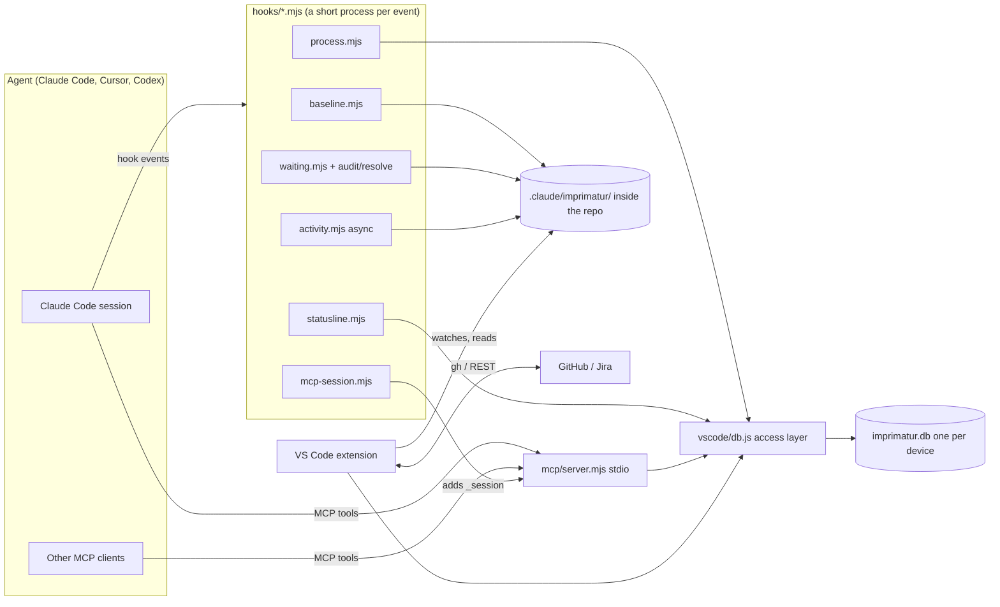
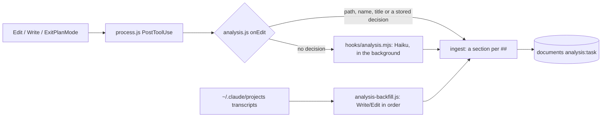

<!-- Generated by Imprimatur from its database; edit in the Imprimatur panel (Architecture/Product). -->

# Architecture Design Document

## Contents

1. [Overview and purpose](#overview)
2. [Components and their boundaries](#components)
3. [Local database and data model](#database)
4. [File-based review data](#review-data)
5. [Hooks and flows](#hooks)
6. [MCP server](#mcp)
7. [Panel and views](#panel)
8. [Live updates](#live)
9. [Issue tracker sync](#tracker)
10. [Process checks](#process-checks)
11. [Model calls and cost](#model-calls)
12. [Security](#security)
13. [Installation and distribution](#deployment)
14. [Test strategy](#testing)
15. [Known limits](#limits)
16. [Design documents ↔ Markdown files (docs sync)](#docs-sync)
17. [Agent setup audit (agnix)](#agent-setup-audit)
18. [Audit: is the finding in effect (#78)](#audit-effect)
19. [Recommendations: project best-practice review (#86, #87)](#best-practice-review)
20. [One-time backfill of the design documents](#docs-backfill)
21. [History scan and TODO.md task tracking](#history-scan-todo)
22. [Panel design layer: theme variables, icons, mascot](#ui-design)
23. [Task analyses](#task-analysis)
24. [Understanding debt: read marks and the unread count (#92)](#unread)
25. [/study: study mode (#95)](#study)

## 1. Overview and purpose

Imprimatur is a local tool that keeps the work coding agents do in a repo in front of the user (primarily Claude Code; Cursor and Codex too, through MCP). Today (0.45.0) it does three jobs together:

1. **Review:** an agent's Markdown edits (`md` and `mdx` by default) stay marked like "tracked changes" in the editor and in the Markdown preview until the user says **Accept**. It is not tied to Git: staging or committing does not remove the marks.
2. **Waiting on you:** everything the agent expects from the user (questions, permissions, "test this", 👉 lines) is collected in one list across sessions and kept current automatically.
3. **Records:** tasks and their records (todo, question, answer, decision, note, fixme, ADR, PDR, test), plus these two design documents, live in Imprimatur's own database; the agent reaches them through MCP tools, the user through the VS Code panel.

### Core architectural decisions

- **Local first:** the source of truth is one SQLite file per device (`node:sqlite`). `db.js` has an optional plugin hook (config.json "plugins"; a plugin hears every write through `onChange` in a savepoint, can answer `adoptRepo`, hears `onOrigin`, and its `activate` gets the extension's API; `vscode/loop.js` `runLoop` runs timed jobs). Anything that leaves the device lives in such a plugin, not in this repo.
- **Hook + extension + MCP:** Claude Code hooks capture events and write to a file or to the database; the VS Code extension shows them; the MCP server is the agent's write path. All three use the same access layer (`vscode/db.js`) and the same helper modules (`vscode/*.js`).
- **Dependency-free runtime:** hooks, the MCP server and the extension run on Node built-ins only (no `npm install` needed). Development dependencies are only for packaging and tests.
- **No Markdown ledger:** TODO.md, `docs/design`, `PRODUCT.md` and `docs/testing` were imported into the database and removed. The design documents are generated from the database as `docs/ARCHITECTURE.md` and `docs/PRODUCT.md`, but the database is the source of truth.
- **Open source, one repo:** [halilural/imprimatur](https://github.com/halilural/imprimatur), MIT. Extension id `halilural.imprimatur`, setting and command prefix `imprimatur.`.

### This document

This document describes the system as it is today, not its history. Each section is linked to the records it rests on (ADRs, decisions). If an ADR is added and the document is not updated, the process check (`docUpdate`) warns the agent.

## 2. Components and their boundaries

The system has five parts. The boundaries are drawn by who writes what.

### Parts

| Part | Location | Job | Boundary |
|---|---|---|---|
| Hooks | `hooks/*.mjs` | Capture Claude Code events: pre-edit copy, waiting items, activity, process checks, MCP session, status line | Never block the tool (except process checks, and only when they say "block" explicitly); every error is `exit 0` |
| Review data | `<repo>/.claude/imprimatur/` | Copies, edit history, waiting logs, activity, archive | Inside the repo but kept out of git (global gitignore) |
| Database | `vscode/db.js` + `imprimatur.db` | Tasks, records, versions, documents, issue-tracker queues | SQL only in `db.js` |
| MCP server | `mcp/server.mjs` | The agent's only write path to the records; 12 tools | Touches only the database |
| VS Code extension | `vscode/` (bundled: `vscode/dist/extension.js`) | Editor/preview marks, the Imprimatur panel, Agent Setup, issue tracker, document export | `extensionKind: workspace`; in an untrusted folder it starts no model, no `gh` and no repo script |

`db.js` also has an optional plugin hook (config.json "plugins"; a plugin hears every write through `onChange` in a savepoint, can answer `adoptRepo`, hears `onOrigin`, and its `activate` gets the extension's API; `vscode/loop.js` `runLoop` runs timed jobs). Nothing that leaves the device is part of this repo.

The shared modules (`vscode/diff.js`, `waiting.js`, `audit.js`, `tasks.js`, `records.js`, `model.js`, `config.js`) are used both by the hooks (through `createRequire`) and by the extension; that is why the hooks depend on the source files in the repo, not on the extension's bundle.

## 3. Local database and data model

### Engine and location

- Node's built-in `node:sqlite` (`DatabaseSync`): no native module, one universal `.vsix`. The extension runs on VS Code's Node (Node 24); hooks and the MCP server run on the system Node (≥ 22.13). If `node:sqlite` cannot be loaded, it fails with a clear error; there is no JSON backup and no silent fallback.
- **One file per device**, for all repos: Linux/WSL `$XDG_DATA_HOME/imprimatur/imprimatur.db` (default `~/.local/share/imprimatur/`), macOS `~/Library/Application Support/imprimatur/`, Windows `%LOCALAPPDATA%\imprimatur\`. `IMPRIMATUR_DB` overrides the path; under `node --test` a temporary file is always used and the real database is never touched.
- It is not opened under `/mnt/<drive>/`: WAL's shared memory breaks across the WSL/Windows boundary.
- It is not inside the repo: switching branches does not change the records, and nothing goes into git.

### Concurrency

Every connection opens with `journal_mode=WAL`, `synchronous=NORMAL`, `busy_timeout=5000`, `foreign_keys=ON`. The extension keeps one long connection, each hook process a short one, and the MCP server its own. Every write is a short `BEGIN IMMEDIATE` transaction: the record and its version row are written in the same transaction, and a plugin's `onChange` runs inside that transaction's savepoint. A new file's first switch to WAL is retried for 5 s. Tests cover 12 processes opening and writing a new file at the same time.

### Schema (version 4, `PRAGMA user_version`)

The `MIGRATIONS` array is applied in order inside a single `BEGIN IMMEDIATE`; a database newer than the code knows is opened read-only.

1. **Core (4 tables):**
   - `repos(uid, root UNIQUE, origin, name)`: `root` is the git root; `origin` is the normalized remote (ssh and https are written the same).
   - `tasks(uid, repo_id, key, title, status, epic_id, summary)`: `key` is `#57` or a Jira key (`PROJ-12`), special tasks are `ADR`, `PDR`, `TEST`; `status` is `open|active|done|dropped`; `summary` is the one-line "where we left off".
   - `records(uid, task_id, kind, owner, status, pointer, title, body, position, parent_id, links)`: `kind` has 9 values; `owner` is `C` (agent) / `K` (user); the 👉 `pointer` is at most one per task (partial unique index) and only on an open record; `position` is REAL (insertion without renumbering); `parent_id` is the answer's question.
   - `record_versions(record_id, at, actor_kind, actor, op, before, after)`: who changed what, when and in which fields (`agent|user|hook|import`, session or client).
2. **Meta:** `meta`, a small key-value table.
3. **Issue tracker:** `tracker_outbox` (the close/reopen queue, with try and backoff fields), `tracker_state` (the last pulled state of each issue). Device-specific.
4. **Design documents:** `documents(repo_id, kind architecture|product, title)`, `doc_sections(doc_id, key, title, body, position, status current|superseded)`, `doc_section_records` (records that contribute to a section), `doc_versions`.

### Invariants

- Records and sections are **never deleted**: a record becomes `dropped`, a section becomes `superseded`; the version history stays complete and foreign keys never dangle.
- Every row has a random `uid`: `id` is used locally, `uid` is the stable identity outside this database.
- When a task becomes `done`/`dropped`, the open row for that task in the epic is closed in the same transaction (see Issue tracker sync).
- A section body is at most 40,000 characters, a title at most 300; the key is a slug (`a-z0-9-`, ≤ 64).

### Latency

Panel queries are indexed and `LIMIT`ed: < 1 ms at 10,000 records; opening (pragmas + version check) < 5 ms; prepared statements are cached per connection. Every write produces a change stamp that can be read with `PRAGMA data_version`; the panel uses it for live updates.

## 4. File-based review data

The review of an agent edit is kept not in the database but as files in the repo's `.claude/imprimatur/` folder: hooks must write very fast before an edit, the data must be split by repo and by file, and old data must be archivable on its own. The folder is in the global gitignore.

| Path | Written by | Content |
|---|---|---|
| `baseline/<path>` | `baseline.mjs` | The file's first state in the review (empty for a new file). Accept (per line) writes here, Accept all deletes it. |
| `history/<path>.jsonl` | `baseline.mjs` | For each agent edit: `{t, session, tool, prompt, intent, title, transcript, toolUseId, branch, before}`. Stays after Accept all. |
| `pending/<tool_use_id>.json` | `baseline.mjs` | Before a Bash command: the contents of the files named in the command, and the branch; compared after the command, and anything older than 6 hours is swept. |
| `waiting/<session>.jsonl` | `waiting.mjs`, `audit.mjs`, `resolve.mjs`, the extension | Waiting items and events: `question`, `command`, `verify`, `input`, the closing `answer`/`step`/`done`, and the step mark `check`. |
| `activity/<session>.jsonl` | `activity.mjs` | A short line per tool call: `{t, session, id, tool, kind, what, out, ms, agent, agentId, failed}`. |
| `calls.jsonl` | the extension (`calls.js`) | Call information read from the transcript (branch, Edit/Write input, failure) and the call matching of old lines; a permanent copy, because Claude Code deletes transcripts after 30 days. |
| `descriptions.jsonl` | the extension (`describe.js`) | One-sentence edit descriptions written by the model, `{toolUseId, file, text}`. |
| `todo-done.json`, `scanned.json`, `setup-history.json`, `process.json` | the extension, hooks | Cache and state files. |
| `archive/<YYYY-MM-DD>/` | the extension (`archive.js`) | Old lines in the same layout, gzipped; read with `zcat`. |

### Principles

- **Persistence:** marks go away only with Accept; staging, committing or reopening has no effect. The extension watches `.claude/imprimatur/**`, not git.
- **Self-healing:** old or missing data is not rewritten, and there is no repair script. The fix happens at read time, and lasting information is kept in a separate file (`calls.jsonl`).
- **Accuracy:** the real result of an Edit/Write is built from the call in the transcript; its difference from the next `before` becomes a separate "Outside change" line, so a change that came by hand or through git is not written to the agent. The result of a Bash command cannot be known (the transcript has only the command).
- **Archive:** once a day (30 s after startup, checked hourly), edits older than `imprimatur.archive.afterDays` (default 7) days are treated as accepted and moved to the archive, and so are old waiting logs with no open item. An open request is never closed. A file is rewritten only if it still stands as it was read; it does not run while a git operation is in progress; two windows are kept apart by `archive/.lock`.

## 5. Hooks and flows

Hooks are registered either in `~/.claude/settings.json` (`npm run setup`) or in the Claude Code plugin's `hooks/hooks.json`; both are generated from the same list and are not installed at the same time. Each hook is a separate Node process (~65 ms, 43 ms of it Node startup); Claude Code runs matching hooks in parallel.

| Event | Match | Hook | Job |
|---|---|---|---|
| PreToolUse | `Edit\|Write\|Bash` | `baseline.mjs` | Copy (if missing) + history line; `pending/` for Bash |
| PostToolUse / PostToolUseFailure | `Bash` | `baseline.mjs` | Comparison after the command; the change made by a failed command is recorded too |
| PreToolUse / PostToolUse | `AskUserQuestion` | `waiting.mjs` | The question and its answer |
| PermissionRequest, Notification (`agent_needs_input`, `elicitation_*`) | | `waiting.mjs` | Permission and input requests |
| UserPromptSubmit | | `waiting.mjs` → `resolve.mjs` | The user's answer; in the background Haiku picks which open steps it settled |
| Stop | | `waiting.mjs` → `audit.mjs`, `process.mjs` | End of turn: the Haiku audit; process checks |
| PreToolUse | `mcp__imprimatur__.*`, `mcp__plugin_imprimatur_imprimatur__.*` | `mcp-session.mjs` | Adds `_session` to the input, returns `allow` |
| PostToolUse / PostToolUseFailure | `*` (async) | `activity.mjs` | One line for every action of the agent |
| SessionStart, PreToolUse, PostToolUse (edits, Bash, MCP write tools) | | `process.mjs` | Process checks (if the repo opted in) |

`statusline.mjs` is also Claude Code's status line (not a hook, the `statusLine` setting).

### Main flows

1. **Edit:** the agent calls Edit/Write → `baseline.mjs` writes the copy and the history line before the edit → the extension sees the file change, compares the file with the copy and marks it.
2. **End of turn:** on Stop, `waiting.mjs` writes the `step` line that closes the questions and starts `audit.mjs` in the background. Haiku reads the open steps and the agent's last message: it marks steps that are done, answered or asked again, and writes what the message really asks for as short steps (👉 lines word for word). The audit runs only when there is an open item or the reply asks for something; a plain report makes no model call.
3. **User message:** UserPromptSubmit writes the `answer` line, and `resolve.mjs` asks Haiku "which steps did this message settle?"; a message that names a task (`LATD-13977`, or just `13977`) also evaluates the steps of that task in other sessions.
4. **Task done:** for a task that is `done` in the database, the steps opened before the task last changed are closed in every session (`todo-done.js`, on every Stop and when the graph is drawn).

### Rules

- Hooks do not block the tool: every path is `exit 0`. Even the process checks do nothing on their own errors.
- Model calls do not make a hook wait: they start as a detached background process.
- In model sessions started with `IMPRIMATUR_CHILD=1`, Imprimatur hooks write nothing.
- Language and file extensions: hook argument > `IMPRIMATUR_LANG` > plugin options (`CLAUDE_PLUGIN_OPTION_*`) > `config.json` in the database folder.
- `db.js` has an optional plugin hook (config.json "plugins"; a plugin hears every write through `onChange` in a savepoint, can answer `adoptRepo`, hears `onOrigin`, and its `activate` gets the extension's API; `vscode/loop.js` `runLoop` runs timed jobs).

## 6. MCP server

`mcp/server.mjs` is the **only** read/write path agents have to tasks and records. Claude Code (user scope or plugin), Cursor (`~/.cursor/mcp.json`) and Codex (`~/.codex/config.toml`) see the same server and tools.

### Transport and protocol

- stdio, dependency-free: one JSON-RPC message per line; stdout carries only MCP, logs go to stderr; it exits when stdin closes. There is no SDK and no `npm install` step.
- Two protocol eras: 2026-07-28 (`server/discover`, the protocol version and `clientInfo` in `_meta` on every request; the discovery result has `ttlMs: 3,600,000`, `cacheScope: "public"`) and the old `initialize` handshake.
- The server's `instructions` field tells once how the tools are used together ("`where_we_left_off` at the start of a session", etc.).

### Tools (11)

| Tool | Type | Job |
|---|---|---|
| `where_we_left_off` | read | Unfinished tasks, each one's 👉 and the number of open records |
| `task_list` | read | Tasks, most recently updated first |
| `task_get` | read | A task and its records; by default open records + 👉, 50 at a time, body 500 characters; `status: "all"`, `kind`, `limit/offset`, `full` |
| `task_upsert` | write | Open/update a task (title, status, summary, epic) |
| `record_add` | write | Add a record (the task is opened if missing); `pointer: true` moves the 👉 |
| `record_update` | write | Change the given fields; every change is versioned |
| `pointer_set` | write | Move the 👉 to an open record |
| `search` | read | Text in titles/bodies; `repo: "*"` for all repos |
| `doc_get` | read | The table of contents of the architecture or product document; bodies with `section` or `full` |
| `doc_section_upsert` | write | Write/update a section, link contributing records |
| `setup_audit` | write | Audit the agent setup with agnix, reconcile the findings into `AUDIT` records; `global`, `dry_run` |

The tools are deliberately few and general (no tool per kind): every definition enters the agent's context. A result comes back as a short text summary plus the full `structuredContent` (+ `outputSchema`); a tool's own error comes back with `isError` and a message that says what to do (the model corrects it), an unknown tool is `-32602`.

### Repo and identity

- Repo: the `repo` argument, otherwise `CLAUDE_PROJECT_DIR`, otherwise the server's working folder; resolved to the git root. MCP `roots` is not used.
- Claude Code does not tell the MCP server the session: `mcp-session.mjs` adds `_session` to the input on PreToolUse (by copying, since `updatedInput` replaces the whole input) and returns `allow`, because the tools touch only the Imprimatur database. The actor of a version row becomes `<clientInfo.name>:<session>` (e.g. `claude-code:adddf…`).

## 7. Panel and views

### Editor and Markdown preview

- For every file that has a copy, the extension compares the file with the copy: the common head/tail is trimmed, then a line LCS, then a word LCS on the changed lines. If a single word changed it gets a word mark; if several words changed, the old sentence shows above the line as a CodeLens (the editor API cannot insert real lines). An added line is green, a deleted block is a red mark on the previous line.
- The preview gets a markdown-it plugin: the change is marked at block level, the old text is read in a red box above it, and notches like an overview ruler sit on the right edge (`preview-markers.js`).
- **Accept** works per Markdown unit (block boundaries come from VS Code's markdown-it): a CodeLens in the editor, a link above the block in the preview (`vscode://halilural.imprimatur/accept?…`, `registerUriHandler`). Accept writes only to the copy and never touches the file text; the view moves on to the next change.
- `imprimatur.showIn`: `preview` (default), `both`, `editor`; `imprimatur.editorAlsoFor` globs. No marks are drawn in diff tabs (Working Tree). The Mermaid diff is turned on with `imprimatur.mermaidDiff` (off by default).

### The Imprimatur panel (a single webview, `imprimatur.graph`)

Six tabs; only the visible tab's HTML is rendered:

| Tab | Source | Content |
|---|---|---|
| Home | `tasksView.js` | Progress, where each task left off, the first 5 items waiting on you, the task table |
| Tasks | `tasksView.js` | Task list by status (this repo or all repos); task page: 👉, waiting items and the answer box, todos, quick add (`?` question, `!` decision, `#` note, `@me` the user's todo), decisions, ADR, PDR, tests, activity |
| Waiting on you | `tasksView.js` + `waiting.js` | Everything waiting on the user, by task; end-of-turn requests as steps with checkboxes |
| Architecture / Product | `docsView.js` | Contents, rendered Markdown, contributing records, edit, mark superseded, section history |
| Agent changes | `graph.js` | The Agent Change Graph: one row per edit, a colored strip per task, the agent's other actions filtered by type |

The view builders are pure: they take a database connection and return a model or HTML; unit tests run without VS Code. The panel is usable by keyboard (j/k, Enter, x, a, /, Esc). What the user writes goes to the database with the actor `user`.

### Agent Change Graph

- Rows come from `history/**.jsonl`; the strip is the **task**, not the Claude session: the file under `docs/todos/<key>/`, the branch at the time of the edit (`<type>/<n>-name` → `#n`), the task of the records written in the same turn, the key in the request; otherwise "No task".
- Order of the description: the model's one sentence → the Bash description → the agent's words in the same message (`narration.js`) → the nearest heading + the first changed line.
- The hover opens only from the status cell; it shows a Markdown edit in the preview's review view. The right click is VS Code's own menu (Accept this edit, Open diff, Go to change).
- Performance: a per-file cache (size + mtime key), no word diff in the counts; on a real repository a full refresh went from 430 to 34 ms.

### Sidebar

The Imprimatur icon in the activity bar: rows that open the panel in a tab (the badge counts the items waiting on you) and the **Agent setup** tree: every file in the repo and in home that affects the agent (Claude Code, Cursor, Copilot, AGENTS.md, Gemini, Windsurf, Cline, Aider, git hooks), grouped by tool and type, with new/changed/deleted since the last look marked; when each one takes effect, health checks, drift between repos, git history and merged settings (hook order, effective permissions). It is read-only.

## 8. Live updates

Goal: a change shows up in the panel the moment it is written. This is all local to the machine.

### Database file watcher

- `watch.js` watches the database file (and `-wal`, `-shm`) through its folder with `fs.watch`. **The first event is handled immediately**; while events continue, at most once every 50 ms, and once more at the end. If the watcher fails (folder deleted, watcher limit), it is set up again at most every 5 s.
- A single **change gate** (`PRAGMA data_version` + the extension's own transactions) is shared by the watcher, the backstop poll and the extension's own writes: a change is drawn once.
- While the panel is visible, the change stamp is checked every 500 ms (the backstop, in case the watcher misses an event). There is no polling while the panel is hidden.
- Changes under `.claude/imprimatur/**`: the editor and the graph at once; `waiting/` and description changes are refreshed once, 1 s after the last write (at most every 3 s if writes keep coming). The preview is refreshed only when a copy or history changes, after 700 ms of quiet.
- Measured: the file watcher takes 25 to 49 ms; the target is about 50 ms. An integration test checks that a record written from another process reaches the panel within 500 ms.

### Panel redraw

On a change the panel redraws only the visible tab. A write by a plugin (see the plugin hook in the Database section) goes through the same change gate, so it is drawn like any other write.

## 9. Issue tracker sync

A task's status is synced both ways with GitHub Issues or Jira; epic rows close together with their tasks.

### Epic chain (in the database, independent of any sync)

When a task becomes `done` or `dropped`, in the same write the epic's open records for that task are closed: records whose `links.issue` is the task's key, or whose title starts with the key (`#56 …`, `[#56 …](url)`, `PROJ-12 …`), become `done` and get a note "#56 done (date)"; if the epic's 👉 is on that row it moves to the next open record. When the task is reopened the rows stay closed. `scripts/stale-epic-lines.mjs` lists, read-only, the open rows of finished tasks.

### Which tracker

- **GitHub:** `#N` tasks, in a repo whose origin is github.com, when a `gh` session is open.
- **Jira:** keys shaped like `PROJ-12`; `config.json` `{"tracker": {"jira": {"baseUrl", "email"}}}` and the token in `IMPRIMATUR_JIRA_TOKEN` (or `tracker.jira.token` in a `0600` file); `baseUrl` must be https.
- Another tracker (Linear etc.) is added as a new key shape with its own push/pull.

### Imprimatur → tracker (push)

- `db.upsertTask` puts a status change into `tracker_outbox` (device-specific: the device that made the change pushes).
- `done` → the issue closes as completed, `dropped` → not planned, reopening → reopen; in Jira the Done / Won't Do transitions are found by name.
- Every push leaves a fixed comment ("Imprimatur: completed", "Imprimatur: dropped", "Imprimatur: reopened"): nothing from the task's text leaves the machine.
- Transient errors (network, 5xx, 429, rate limit) wait with backoff and do not use up an attempt; other errors are counted, and after 5 attempts the row is given up. A row claimed by another window (`claimed_at`, `claimant`) is left to it; if the task's status changed in the meantime, the row is dropped.

### Tracker → Imprimatur (pull)

- Only issues whose **status changed** since the last pull are processed (`tracker_state`); a repo's first pull records the states and changes no task.
- A closed/reopened issue changes the task's status with the actor `tracker:<provider>` (closes the epic rows, does not enter the push queue: no loop).
- An open GitHub issue with no task becomes a task (`imprimatur.tracker.createTasks`, at most 50 per run).

### Timing

At startup, every 5 minutes, a few seconds after a status change; the Sync with Issue Tracker command (`Imprimatur: Sync with Issue Tracker`) forces it; it does not run in an untrusted folder. `npm run tracker` (`--all`, `--dry-run`, `--no-create`) runs it from a terminal. A plugin that listens for tracker events can also trigger a run through `vscode/loop.js` `runLoop`.

## 10. Process checks

The development process rules (formerly `.claude/hooks/*.sh` copied into every repo) run in one place, Imprimatur's global hook (`hooks/process.mjs` → `vscode/process.js`).

### Turning on and configuration

- A repo opts in with a committed `.claude/imprimatur.json` (written by **Imprimatur: Turn On Process Checks for This Repo**). If the file is missing, no check runs.
- Each check is `"block"` (stop the tool or the turn), `"warn"` (tell the agent, carry on) or `false`; a key missing from the file takes its default.
- A check's own error does not stop the agent (`exit 0`); on Stop, `stop_hook_active` prevents a loop.

### Checks

| Event | Check | Default | What it does |
|---|---|---|---|
| SessionStart | `whereWeLeftOff` | on | Unfinished tasks and their 👉 from the database (at most 4,000 characters) |
| PreToolUse Bash | `hookBypass` | block | `git --no-verify`, `commit -n`, `HUSKY=0` |
| PreToolUse edit | `mainGuard` | block | On `main`, only allowed paths (default `^docs/`) |
| PreToolUse edit | `designFirst` | warn | Code on a `<type>/<n>-…` branch while the task has no ADR/PDR |
| PostToolUse edit | `docsToc` | warn | When `docs/**/*.md` changes, the repo's table-of-contents script (only in a trusted repo) |
| PostToolUse edit | `unopenedSources` | warn | A source marked "not opened" in market research |
| PostToolUse Bash | `issueCreate`, `issueFields` | warn | After `gh issue create`: epic, board, milestone, Imprimatur task |
| PostToolUse MCP | `sweep` | warn | The task is done but the issue is open (silent while issue tracker sync is running) |
| Stop | `status` | block | The answer has no "Where are we" section |
| SessionStart, Bash | `branchFinish` | warn | Branches that were merged but left behind |
| PostToolUse MCP, Stop | `docUpdate` | warn | No document section is linked to an added/changed ADR or PDR |

Repo-specific rules (an em dash ban, deploy, migrations, etc.) are out of scope and stay in the repo.

## 11. Model calls and cost

Imprimatur turns to a small model (Haiku) only where verbal judgment is needed; where a rule is enough, no model is called.

### How it is called

`vscode/model.js` is the only path: `claude -p --model haiku`, with no tools, no MCP, no settings files (`--setting-sources ""`, `--strict-mcp-config`, `--tools ""`), without saving a session, in a temporary folder and with `IMPRIMATUR_CHILD=1` (Imprimatur hooks write nothing in that session). It runs on the user's Claude subscription; it needs no API key. The language is `IMPRIMATUR_LANG` / `imprimatur.language`.

### Where

| Place | When | Without a model |
|---|---|---|
| End-of-turn audit (`audit.js`) | On Stop, only when there is an open item or the reply asks for something (👉, `?`, "test this") | Rule-based reading (👉, `?`, request phrases) |
| Chat sync (`resolve.mjs`) | After every user message, if a step is open | Steps that end with `?` count as answered |
| Edit description (`describe.js`) | Only when the agent's words are shorter than 4 words and the row is shown in the graph (the newest 40 rows, at most 2 at a time) | The nearest heading + the first changed line |
| History scan (`history.js`) | When the user asks, or on first open in a project; 4 calls at a time | Only 👉 lines |
| Agent Setup "Explain last change" | When asked, cached by commit + path | None |

### Cost principles

- Measured (2026-10-09): each hook ~65 ms; the MCP tool definitions ~1.4k tokens and Claude Code loads them deferred; the real cost was the background Haiku calls (in a busy real repository about 100 descriptions a day + the audit at every turn end). Since 38 of 40 descriptions could be covered by the agent's own words, the model is called only for the rest.
- The SessionStart context is limited to 4,000 characters (Claude Code truncates at 10,000).
- Deterministic information such as the task strip is not asked of the model (the `#n` key in the text is used).
- In an untrusted folder the extension starts no model call.
- `--bare` or the API directly was evaluated and is not used: it needs an API key and does not work with a subscription.

## 12. Security

### VS Code extension

- **Workspace Trust:** `capabilities.untrustedWorkspaces.supported = "limited"`. In an untrusted folder it shows changes and records but starts no model call (`claude`), no `gh` and no repo script (`trust.js` logs once for each kind of work). Hooks run outside VS Code and make their own decisions.
- **extensionKind `workspace`:** on a remote/WSL connection the extension runs on the machine where the files and the database are. Virtual workspaces are not supported.
- **Webview:** `localResourceRoots: []` (no local file is loaded, everything is inline); CSP `default-src 'none'; style-src 'unsafe-inline'; script-src 'nonce-…'; form-action 'none'; base-uri 'none'`. Document bodies are rendered with `html: false`, links are only http(s), mailto and in-page anchors. Data is carried by `postMessage`.
- The Accept links in the preview go through the `vscode://halilural.imprimatur/accept?…` URI handler. The 📄 link of a waiting step does not open a file outside the repo.

### Secrets

- The Jira token lives in `config.json` in the database folder, with file mode `0600`. A token is not given on the command line (shell history); it is taken from an environment variable or a hidden prompt.
- Comments sent to the issue tracker are fixed: no task or record text leaks out.
- If the Agent Setup health check finds a secret, it names only the line and never writes the value.
- Plugins listed in `config.json` ("plugins") are code the user chose to install; a plugin reaches only what the plugin hook gives it (writes through `onChange`, `adoptRepo`, `onOrigin`, and the extension's API in `activate`).

### Hooks and process checks

- MCP tools run without a permission prompt (`allow`), because they touch only Imprimatur's database.
- The repo's own scripts (e.g. `scripts/docs-toc.mjs` for `docsToc`) run only in repos the user trusted with a VS Code command: the list is outside the repo, in the database folder (`trusted-repos.json`). The script path must be a real file inside the repo (links are resolved, a path starting with `-` is rejected).
- Document export does not write outside the repo (if `docs/` or the file is a link that leads outside the repo) and does not overwrite a hand-written file.

## 13. Installation and distribution

### Installing on a machine: `npm run setup`

In a repo clone (Node 22+, git, VS Code 1.100+, the `claude` CLI), one command:

- Adds the hooks to `~/.claude/settings.json` (backup first; ours are found by script name, updated if the path or language changed, other people's are not touched).
- If there is no status line, makes `hooks/statusline.mjs` the status line.
- Registers the MCP server with Claude Code (user scope, `claude mcp add`) and, if installed, with Cursor and Codex (the rest of the file is preserved byte for byte). If Node < 22.13 it does not register and says why.
- Packages and installs the extension; `--lang`, `--show-in` go to the VS Code machine settings; `--lang`/`--exts` go to `config.json` in the database folder.
- Options `--dry-run`, `--no-extension` exist.

Hooks and the MCP server run **from the repo clone**: on this machine the main checkout of `~/projects/imprimatur` is live code; a change merged to main is in effect at the next hook call. The extension stays on the old version until it is packaged and installed.

### Claude Code plugin

- `.claude-plugin/plugin.json` (the same version as the extension, the MCP server inline, `${CLAUDE_PLUGIN_ROOT}`) and `hooks/hooks.json` are generated by `scripts/plugin.mjs` from the same hook list as the setup; the test breaks if the committed files differ.
- `claude plugin marketplace add halilural/imprimatur` + `claude plugin install imprimatur@imprimatur`. The plugin does not bring the VS Code extension or the status line.
- `npm run setup -- --plugin` adds the clone as a marketplace, installs the plugin, and removes the hooks in the settings file and the user-scope MCP server (backup first). While the plugin is on, a plain `setup` writes no hooks: the same hook never runs twice.

### VS Code extension

`npm run package`: `scripts/build.mjs` produces a single `vscode/dist/extension.js` with esbuild (`vscode` and Node built-ins left out), then `dist/imprimatur-<version>.vsix` with `vsce`. The package file list is kept by hand; a test catches a missing file. There is no Marketplace or Open VSX release yet (#1).

### Plugins

`db.js` has an optional plugin hook (config.json "plugins"; a plugin hears every write through `onChange` in a savepoint, can answer `adoptRepo`, hears `onOrigin`, and its `activate` gets the extension's API; `vscode/loop.js` `runLoop` runs timed jobs). Plugins are installed and deployed on their own, outside this repo.

### Versioning

One version number (`vscode/package.json`) is shared by the extension and the plugin. Work is done on a short-lived branch and, when quality is green, merged straight into main (no PR), followed by a `chore: <version>` commit.

## 14. Test strategy

### Unit tests (`npm test`)

- `node:test`, dependency-free (`markdown-it` only for the preview tests). 44 test files under `test/`; each module has its own test: diff, preview, graph, waiting items, audit, hooks (with real JSON input), database, MCP, issue tracker, process checks, documents, Agent Setup, plugin files, the package list.
- A pure design makes testing possible: the view builders (`tasksView`, `docsView`) take a database and return HTML; `tracker.js` and `watch.js` do not depend on VS Code and are driven with a fake clock and a fake `gh`.
- Tests never touch the real database: under `node --test`, `dbPath()` gives a temporary file and passes it on to the hooks the test process starts.
- Concurrency: 12 processes opening and writing a new database at the same time.
- The data audit and "graph accuracy" tests prevent regressions of bugs that came from real data.

### Integration tests (`npm run test:integration`)

In a real VS Code with `@vscode/test-cli` + `@vscode/test-electron`: activation and commands, the record commands, the document tabs, and a record written from another process reaching the panel within 500 ms.

### Manual tests

Manual tests of visual behavior such as the editor marks and the preview are kept as test records in the `TEST` task (MT-AR-001…012, #6). Measurements (latency, CPU) are taken on real repositories of different sizes and written to the relevant record.

## 15. Known limits

### Review

- No marks in diff tabs (Working Tree): git already colors them.
- Bash edits are seen only for files named in the command; a glob (`sed -i *.md`) and a path with a variable (`$R/x.md`) slip through. The real result of a Bash edit cannot be known.
- Numbered-list numbers are not compared; changes inside fenced code blocks are not marked (the history still counts them).
- The preview is at block level (no word marks); a deleted table row is not visible in the preview.
- Every difference between the copy and the file is marked, including the user's own edit in the same file; a parallel session editing the same file may show up as an "Outside change".
- The history writes the whole text at every edit: small for documents, it grows for a big file. LCS is O(n·m): slow on a file with thousands of changed lines (at the upper bound the middle part is shown as a single block).
- The Mermaid diff covers only `flowchart`/`graph`; it is off by default because two Mermaid preview extensions can clash in the same window.

### Data

- Edits made by Bash commands that failed before #45 were not recorded and do not come back.
- Issue tracker sync runs while the extension is open (or with `npm run tracker`).

### Scope

- Hooks are only for Claude Code; Cursor and Codex use only the MCP tools (no review, waiting items or activity for them).
- The issue tracker covers only GitHub Issues and Jira; no board Status field and no Linear.
- There is no context budget (token by token) yet (#29).

## 16. Design documents ↔ Markdown files (docs sync)

`vscode/docs-sync.js` (#73) brings the architecture/product document in the database to the same text as `<docs dir>/ARCHITECTURE.md` and `PRODUCT.md`; whenever Imprimatur comes to a repo (no file, a hand-written file, a file deleted after a move) the result is the same.

- **Folder:** `.claude/imprimatur.json` `{"docs": {"dir": "docs/design"}}`, otherwise `docs`. `{"docs": {"sync": false}}` turns it off.
- **State:** a summary of the last sync per document is in the `meta` table (`docsync:<repoId>:<kind>`: file path, a title+body hash per section, conflicts if any); machine-specific.
- **Rule (per section key):** same → nothing; only the file changed → the database takes it (actor `import:file`); only the database changed → the file is written; both changed, or no base and different → conflict, neither side is written, `--take file|db` resolves it. A section deleted from the file and unchanged in the database becomes superseded; a section superseded in the database but edited in the file is a conflict.
- **Adoption:** a file without HEADER becomes sections from its `##` headings (the first `#` heading, the part before it as `overview`, `<!-- toc -->` is dropped); records imported from that file are linked to the section with `links.source` + `links.area`, and the original is written to `.claude/imprimatur/docs-backup/`. Only if the repo joined with the `docs` key, or by hand (CLI, `npm run import`). `--rev <commit>` reads the files from git and first imports that version's design/product records.
- **Read safety:** a managed file is split by `` followed by `## n. Title` (no fence tracking); if the database's own text is not read back into its sections (`roundTrips`), that document is not synced and `unreadable` is reported.
- **Trigger:** the process check `docSync` at SessionStart and after a file edit; after the MCP `doc_section_upsert` (the reply has `file`); in the extension when the database changes, when a file is saved, and at startup; `npm run docs -- sync [repo] [--dry-run] [--take file|db] [--rev R]`.
- **Importer (#59) fixes:** `docs/design/PRODUCT.md` → PDR, `README.md` is not a record, a generated file is not a source; a record earlier saved under another kind/task is moved to the right task by `<uid>@<task>` (the old one is dropped with `moved_to`).
- **Health (#74):** `db.docHealth` + conflicts → `where_we_left_off` `docs`/`docs_problem` and the SessionStart line; `docUpdate` names an ADR/PDR with no link, and an ADR/PDR/decision whose linked section did not change after the record.

## 17. Agent setup audit (agnix)

`vscode/setup-audit.js` audits the agent setup with [agnix](https://github.com/agent-sh/agnix) and keeps the findings as records; no rule or file is cut off. `setup-audit-tree.js` groups the records (`auditGroups`); the **Recommendations** tree in Agent Setup and the AUDIT page in the Tasks tab use the same grouping.

### Running

- The agnix version is pinned (`agnix@0.57.0`, the JSON format is tied to it). `npx -y -p agnix@0.57.0` runs once (with a script in a temporary folder only its owner can read; on Windows `node -e` would be split by the shell) and gives the path of the Rust binary; later calls go straight to the binary (`explain` ~7 ms; the npx call ~1.4 s). `AGNIX_BIN` overrides the path (tests use a fake agnix).
- For a repo, the repo root; for global, only the agent folders in home (`~/.claude` with its plugins, `~/.cursor`, `~/.codex`, `~/.gemini`, `~/.kiro`, …). The whole home is not scanned: it would read every project; if home itself is open as a repo, it is not scanned either. A `.agnix.toml` at the root (in the repo and in home) pins the Claude Code version.
- Exit code 1 means "there are findings", not an error; unreadable JSON is an error.
- Surfaces: `npm run audit -- [repo …] [--global] [--dry-run]`, MCP `setup_audit` (`global`, `dry_run`), the light bulb in the Agent Setup header. The extension runs agnix and the rule explanations asynchronously (the host does not freeze) and does not run them in an untrusted folder.

### Records

- Each root has an `AUDIT` task; global findings go on home's repo row ("~"). `AUDIT` is a record container (like ADR, PDR, TEST): it does not count as work in `where_we_left_off`. Because the global AUDIT applies to every repo, it is listed in the Tasks tab under "This repo" and also in a separate **Global (~)** group. It is opened `active` on the first audit; after that only its summary (`N open (levels) · N applied · N dismissed`) is written, and only if it changed.
- Each finding is a `fixme`. The title is `RULE: message`; the body has file:line, level, suggestion, assumption, the rule's name, its normative level, source type, verification date and documentation links (`agnix explain`, cached per run). `links.audit`: `fp`, rule, rule name, level, agnix category, source (`project` / `user` / `synced` / `plugin` / `worktree`), owner (plugin or worktree name), file, line; and `reason` if dismissed.
- Source: `~/.claude/plugins/…` → plugin; `~/.claude/skills/synced/…` (skills synced from claude.ai) → synced; `.claude/worktrees/<name>/` → worktree; agent folders in home → user; the rest is project. An open record whose source changed is updated in the next audit.
- Dismissal reason (`reason`): `plugin` (third-party plugin), `synced` (synced skill), `false` (false alarm), `local` (specific to this machine), `other`. If absent it is derived from the source (plugin → plugin, synced → synced), and if that is absent, other.
- Fingerprint is sha1(rule, path, message, which repetition). There is no line number: a line added at the top does not make a finding new. The path of a file in the plugin cache is taken without the version folder (or the `temp_git_*` copy): when a plugin is updated its findings are not counted as "applied" and reopened, and a dismissed one stays dismissed.
- Reading, reconciling (`reconcile`, pure) and writing happen in one transaction: an audit made at the same time from another process (MCP, CLI) cannot duplicate a record or reopen one just dismissed. New → `open`; a vanished `open` → `done` (an "Applied" note in the body); a `done` that appears again → `open`; `dropped` never changes.

### View

One grouping: **status** (Open / Applied / Dismissed) → [for dismissed, **reason**] → **source** (Project, Your setup, Synced skills, Plugins → plugin, Worktrees → worktree) → **agnix category** (claude-hooks, agent-skills, cross-platform, …) → **rule** (id + name) → finding (errors first). Each group shows its count and levels.

- Agent Setup: Recommendations → the audited root → groups; Open and Project / Your setup start expanded. A finding opens the file at its line, the tooltip is the record's body. On an open finding **Dismiss…** lets the user pick the reason from a list (the one suggested by source first) and take an optional note; on a closed one **Reopen** deletes the reason. If there has been no audit, the row starts one.
- Tasks tab: on the AUDIT page, instead of a flat "To-dos" list, "Audit findings" as nested collapsible sections (`
`), with labels in the UI language.

## 18. Audit: is the finding in effect (#78)

Each finding is marked in the audit by whether Claude Code loads that file (`links.audit.effect`: `active` / `inactive`, `why`). No finding is hidden; "Open" counts only those that are loaded, and the rest stay under **Not loaded**, by reason.

- Source: `~/.claude/plugins/installed_plugins.json` (each install's `installPath` and `scope`) and `~/.claude/settings.json` `enabledPlugins`. A user-scope install is on unless `enabledPlugins` turns it off; a project-scope install is on in its own project.
- `inactive` reasons: `catalog` (`plugins/marketplaces/…`, the store catalog), `temp` (a `cache/temp_git_*` leftover), `not-installed` (a version other than the installed one, or a plugin that is not installed), `disabled` (a disabled plugin), `other-tool` (a file in the installed plugin folder that is not a Claude component: `.cursor-plugin`, `.github`, `configs/`, the Gemini manifest …), `worktree` (an agent worktree copy).
- Claude components (the first part of the plugin folder path): `.claude-plugin`, `hooks`, `skills`, `agents`, `commands`, `output-styles`, `monitors`, `.mcp.json`, `.lsp.json`.
- Repo, user and synced skill files are always `active`.
- An open record whose effect changed is updated in the next audit. The task's summary is `N open (levels) · N not loaded · N applied · N dismissed`.

## 19. Recommendations: project best-practice review (#86, #87)

**Recommendations** is a single place: one `RECS` task per repo (a record container) holds the records of two producers. The agent setup audit (`setup-audit.js`, `links.audit`) and the project best-practice review (`best-practice.js`, `links.best`). The old `AUDIT` (#77) and `BEST` (#86) records are moved to RECS with `db.moveRecord` the first time `recs.recsTask` is called (a version row is written); the old tasks become `dropped`, with the summary "Moved to RECS (#87)".

### Taxonomy

The ISO/IEC 25010:2023 product quality characteristics and, for process, NIST SSDF (SP 800-218). Each category's subcategories are given to the model with their definitions and are an enum in the schema. The default 6 core categories: Security, Reliability, Maintainability, Compatibility, Performance efficiency, SSDF. Flexibility, Interaction capability, Functional suitability and Safety when asked ("All categories" / `--categories all`).

### Flow (a pipeline, not an agent loop)

Spike measurement (spike/best-fast): in an agent loop every look at a document was a turn (6 to 8 s), about 600 s in all. Now:

1. **Source map** (once, in a `links.bestSources` note; refreshed with "remap"): Haiku, effort low, only repo tools; stack components, version, evidence, vendor, changelog address. In code: the Context7 id by a REST search (the full title; for names of 3+ words, all the words; no loose match for a short name), the changelog only as public https.
2. **Document gathering** (code, 8 in parallel): for each component × category, Context7 `/api/v2/context` (the category query; the `Source:` of the chunks is the real address used as the citation), the vendor's public documentation MCP (Cloudflare, Microsoft Learn, AWS Knowledge) directly by JSON-RPC (`initialize` → `tools/list` → `tools/call`; relative links are resolved against the site's address), the changelog page (for Compatibility and SSDF).
3. **Decision**: one `claude -p` per category (Sonnet, effort medium, `--max-turns 12`, only Read/Glob/Grep, no web, no MCP). The shared pack (decisions, architecture document sections, stack, `git ls-files`, numbered key files: the manifest/build/CI files of every ecosystem) goes through `--append-system-prompt-file`; the first call writes the cache, the others start 4 s later and read it. The category-specific documents are in the prompt.
4. **Gate** (code): type/size are normalized; the subcategory belongs to the category; the source is one of the gathered pages and public https; evidence files are inside the repo and the line is in the file; decision ids belong to the repo. The same component and first evidence → a single recommendation (the heaviest one; the other categories go in `tags`).
5. **Records** (one transaction): id `category:key`; new → `todo`, found → refreshed (`seen`), not found → untouched (the page shows "not seen in the last round"), dismissed → untouched. `lastRun` per category is in the map. The summary counts the two producers separately: `Agent setup: … | Project: N open (high/medium/low) · …`.

### Safety

The child process: `--permission-mode dontAsk`, only Read/Glob/Grep, `.env*`/key/`~/.ssh`/`~/.aws`/gh/npm credential files are forbidden, `--setting-sources ""`, a minimal environment (the host's tokens are not there), the prompt comes from stdin, the shared pack is in a `0600` temporary file and is deleted when the job ends. Since the model has no network access it cannot send out what it read. Every model text on the page goes through `esc()`; a source link is only http(s).

### Cost

By `claude auth status`: subscription (claude.ai) → the plan's usage limits; API key → billing; Bedrock/Vertex → the cloud account. The confirmation dialog is written accordingly. In this repo with 6 categories: 181 s (map 63, gathering 7, decision 112), 16 recommendations, 2.70 USD API equivalent.

### View

The Agent Setup light bulb opens a menu: audit the agent setup (agnix), review the project (Claude), both. In the Recommendations tree: root → "Agent setup" / "Project" → status → (reason for dismissed) → category → subcategory → recommendation. In the Tasks tab, a single RECS page: "Agent setup" and "Project" sections, the source map; Applied / Dismiss… / Reopen work for both producers (`recs-ui.js`): the reason is chosen from one list (those that fit the producer, the likely one first), including the "Decided not to do it" decision.

## 20. One-time backfill of the design documents

Projects that have no document, or whose old ADRs/PDRs never made it into the document, are filled once, without the user doing anything.

- **Trigger:** SessionStart (`vscode/process.js`). It runs in every repo Imprimatur knows; `.claude/imprimatur.json` is not needed.
- **Condition** (`docs-backfill.js` `due`): the repo must not have been backfilled before, must have at least 10 records, must not be the home directory, and at least one document (architecture, product, glossary) must be empty or there must be ADRs/PDRs that no section links.
- **Once:** `meta "backfill:<repoId>"` is claimed with `claimMeta` (INSERT OR IGNORE) before it starts. Of two sessions opened at the same time, only one starts it. Even if the run fails, it is not tried again.
- **Run:** `hooks/backfill.mjs` is started as a detached process, independent of the session, and runs `claude -p`. Settings: sonnet, a $3 budget, 120 turns, 30 minutes, no settings file is loaded (so no hook runs), tools only Read/Glob/Grep and the Imprimatur MCP tools `doc_get`, `doc_section_upsert`, `search`, `task_get`, `task_list`. Secret files are blocked with the DENY list from best-practice. The child process is started with `ENABLE_TOOL_SEARCH=false`: with tool search on, MCP tools are deferred behind ToolSearch, while `--tools` leaves ToolSearch out and the agent would never see the MCP tools. The prompt lists the unlinked records with their ids; the agent writes the sections and links the records.
- **Result:** the status, the cost, the agent's last line, the number of sections per document and the documents still to be written (`left`) are written to the same meta field. The status is `done` only if no document is left to write; a run that exits cleanly but leaves something out is `incomplete`, one that errors is `failed`, and `nothing` if there was nothing to do at the start.
- After this one-off, `docUpdate` keeps the documents current (see Process checks).

## 21. History scan and TODO.md task tracking

The panel's "Scan history" button (and, once, automatically the first time the panel is opened in a project) runs `scanHistory(root)` from `vscode/history.js`.

### Sources

- Claude Code transcripts: `~/.claude/projects/<slug>/*.jsonl` (slug = the non-letter/digit characters of the path as `-`); if `cwd` is inside the root, sessions opened in subfolders are scanned too; the last 30 days.
- The `TODO: (K)` lines in TODO.md and in the task folders become one step each in the `todo-files` session.

### Behavior

- The 👉 lines of earlier turns become steps, later user messages are noted with an `answer` record, and the last turn is checked with `audit()`; the records carry the turn's own time (`turn.at`).
- A session that has a log (the hook ran) or is in `.claude/imprimatur/scanned.json` is skipped; at most 4 model calls run at a time.
- On every scan, an open TODO step that is DONE or was deleted from the file is ticked with `by: "file"`.

### Step text and task binding (audit)

- `audit()` asks Haiku for `asks: [{text, why}]` and `task`: a step must be understandable a week later without the chat (the work key, a person, a file, a concrete thing; ≤ ~25 words), `why` is a one-sentence context.
- The 👉 lines are introduced as "exactly N records, same order, same meaning"; if the count does not match they stay word for word. Routine steps (e.g. Reload Window) are left empty and dropped. The language is required on a separate line (otherwise the model could write English even when Turkish was asked for).
- `task_hint`: the key in the request/message, otherwise the folder of the TODO.md the session last edited; used only for steps about that work.
- `stepTask`/`normKey` (`vscode/tasks.js`): if the step's text starts with a key it belongs to that work ("#88: …"), otherwise to the item's task; if the model writes `"80"` it is normalized to `#80`. If all `asks` start with the same key, that task is written on the item.

### Mapping to a task in the panel (placeOf)

- The key is taken from the record or the text (Jira `ABC-123`; the inside of long codes like `MT-AR-011` does not count; GitHub `#n`).
- The target file: the record's own TODO.md, or a file the session edited whose folder name has the key / whose text matches the step (≥ 40% of the words); a multi-topic session does not stamp the last TODO.md on each of its steps.
- Badge: opens the first link in TODO.md that contains the key (not opened if the Jira address is not set); for `#n` without one, the origin's GitHub issue; 📄 opens the file at that line (a path outside the repo is not opened).
- Even if the session did not edit it, the TODO.md in the work's own task folder is used (old scanned sessions); for a Jira key with no TODO.md, the address is learned from the `…/browse/<PROJECT>-n` links in other TODO.md files. A key with no target is not clickable, it is a plain label.
- The model's JSON can come multi-line and fenced (`lastJson`).

### Where the task folders are

- A task folder is `docs/todos/<key>/TODO.md`; for old repos `todos/<key>/TODO.md` is read too (`TODO_DIRS`, the new one first).
- `todoFiles(root)` returns the root TODO.md and the folders in both layouts; `todoOfKey(root, key)` picks the new one if both exist; `taskOfFile(file)` extracts the task strip (`(docs/)todos/<key>/…`).
- Task strips, the title, the Jira address, the `TODO: (K)` requests and closing when TODO.md finishes use these paths. Only README.md, CLAUDE.md, AGENTS.md and LICENSE stay at the root.

## 22. Panel design layer: theme variables, icons, mascot

The panel's look comes from three small modules. All are plain CommonJS; they need no build step and do not trip the CSP.

- **`vscode/theme.js` (THEME_CSS):** defines design variables on `body`:
  - `--acc`, by theme type: light `#c2410c`, dark `#fb923c`, high contrast `#ffa94d` / `#9a3412`.
  - `--acc-ink` (text on the accent), `--acc-soft`, `--acc-line`.
  - `--surface`, `--surface-2`, `--line`, `--muted`, `--shadow` (none in high contrast).
  - `--r-*` corners, `--fs-*` type scale.

  The same file has the app bar styles: mascot, repo chip, tabs with icons, search box, Audit/Scan buttons. The app bar is sticky; below 760px it is not sticky. Its height is written as `--appbar-h`, and the Tasks list and the Contents panel stick under it.
- **`vscode/icons.js`:** Lucide icons (ISC license). Not edited by hand; `npm run icons` (`scripts/icons.mjs`) generates only the ones in the NAMES list from `lucide-static`. `tasksView.icon(name, size)` draws them. The types in the Agent changes tab use these icons too.
- **`vscode/mascot.js`:** the mascot from `assets/logo.svg` is embedded inline (the gradient ids are prefixed with `imp-`). It is shown in the header and in empty screens (`.emptyhero`).

**Rules:**
- No fixed hex colors in the Tasks CSS (a test checks this).
- Secondary text is written with the `--muted` color, not with opacity.
- Mermaid diagrams are drawn with `theme: base`; their colors are computed from the page's `--vscode-editor-background`, `--vscode-foreground` and `--acc` values.

vscode-elements was deliberately not used; the reason is in the linked ADR.

## 23. Task analyses

Every task has an analysis document: `kind = 'analysis'` in `documents`, `scope` = the task key (`''` for repo documents); a section's `source` field is the file it came from, and `doc_sources` holds the hash of the last read text of each file (the same text is not written twice). Migration 6 rebuilds the tables like the glossary migration.

- **Candidate:** `.md`/`.mdx`; except README, CHANGELOG, TODO.md, design documents, `docs/testing`, `todos/sprints`, `.claude/` tool folders and what Imprimatur generates; outside the repo only `~/.claude/plans`.
- **Task:** the task folder → the key in the path (`spikes/81-x`, `80-paper.md`) → the branch → the task the session is writing records for at that moment (`db.sessionTaskAt`) → the prompt → the file heading. Only tasks that exist in the database; a file that cannot be placed waits in the `analysis:orphans:<repo>` meta list. A file that has once entered a task stays in that task.
- **History:** each state in the transcript is a version at the time it was written; if the document has a newer section of that file (hook, another machine, MCP), the older state is skipped. At SessionStart once per repo (`analysis-backfill:<repo>` claim), by hand with `npm run analysis` or the command.
- **Opt out:** `"analysis": {"sync": false}` → `analysis:nosync:<repo>` meta; analysis sections are then not passed to a plugin's `onChange` listener.
- **MCP:** `doc_get` / `doc_section_upsert` with `kind: "analysis"` + `task`. The analysis document has no file of its own: sources are read, never written.

## 24. Understanding debt: read marks and the unread count (#92)

### Data

- Migration 7 (and 8): `section_reads(section_id PK → doc_sections, version_id, at)`. Device-specific. The migration counts every section that exists at that moment as read at its latest version. Migration 8 rebuilds the table: a draft of 7 without `version_id` had reached the live database (the branch was running in the live checkout).
- A section is **unread** if it is `current` and an `agent` or `hook` wrote a version after its `version_id`, and that version changed the title or the text (a change of link or position alone does not count). The comparison is by version id, not by time: when an analysis is re-read, versions can be written with a past time.
- When `user` writes, `upsertSection` marks the section read. `import` does not count (writes from a plugin or a file): reading belongs to this device, so that a first import does not show everything as unread.
- `db.unreadSections(repoId)`: unread sections and their tasks: in a task analysis, the `scope`; in repo documents, the tasks of the records the unread versions newly linked. `db.markSectionsRead(ids)`.
- When a placeholder repo is merged, the read row of a deleted section is deleted too (foreign key).

### Edits

Edits not yet accepted are not in the database: they are counted per task strip from the graph rows (`!accepted && !gone`, activity and record rows excluded) (`graphView.openEditsOf`) and passed to `paneHtml` as `openEdits`. The status line does not draw the graph: the extension writes the count to `.claude/imprimatur/unread.json` while it computes the sidebar badge (when it changes, or every 5 minutes); the status line ignores a file older than 15 minutes.

### Surfaces

`tasksView.unreadOf` gives `{edits, sections}` per task; the task list, the top of the task page and Home use `unreadHtml`; `docsView` has the section mark and Done reading. Page messages: `read` (ids, `writeFromPanel` → `applyMessage`), `showSection` (document tab + section).

## 25. /study: study mode (#95)

### Parts

- **Skill** `skills/study/SKILL.md`: the flow (find the topic, read the material, read the code, write a note, ask one by one, record mastery). The plugin finds `skills/` itself; `npm run setup` links `~/.claude/skills/study` to the checkout (`linkSkills`; a junction on Windows; it does not touch another person's folder or link; with the plugin present it removes its own link).
- **MCP tool** `study_material {key}` (read-only), `vscode/study.js`: the task (for an epic, its tasks and their records too), decisions with the full body, notes, to-dos, the architecture/product sections fed by the task's records (`doc_section_records`), the task's analysis, glossary terms named in the material, commits that name the key and the files they changed (most changed first), the study note and the latest mastery. The model text is `studyDigest`.

### Storage (no migration)

- Study note: the `study` section in the task's analysis (`doc_section_upsert kind analysis`). `stale` if a commit or decision came after it.
- Mastery: a note record (owner K) carrying `links.study {topic, questions: [{q, type, result, gap, refs}]}`. The latest record is read: weak questions first; a commit/decision/section that came later is `changed`. This text is cut to one line and 300 characters, and type and result are forced into a fixed list: it stays as data and does not look like an instruction or a heading.

### Finding commits

`git log --no-merges -E --grep=(^|[^A-Za-z0-9_#-])KEY([^0-9]|$) --numstat`: the boundary is in git's search, so `-n` is not filled with wrong matches (`#1` → `#10`…); `keyPattern` looks again over the whole message (title + body, "Closes #n"). If the repo is not on this machine (placeholder) or git is missing, there are no commits.
