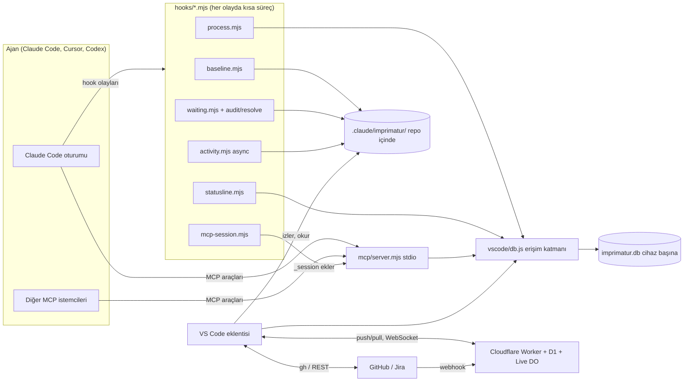
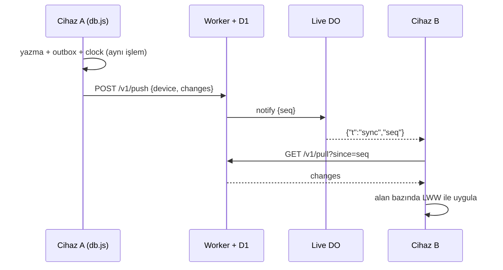

<!-- Generated by Imprimatur from its database; edit in the Imprimatur panel (Mimari/Ürün). -->

# Mimari Tasarım Dokümanı

## İçindekiler

1. [Genel bakış ve amaç](#overview)
2. [Bileşenler ve sınırları](#components)
3. [Yerel veritabanı ve veri modeli](#database)
4. [Dosya tabanlı inceleme verisi](#review-data)
5. [Hook'lar ve akışlar](#hooks)
6. [MCP sunucusu](#mcp)
7. [Panel ve görünümler](#panel)
8. [Canlı güncellemeler](#live)
9. [Cihazlar arası eşitleme](#sync)
10. [Takip aracı eşitlemesi](#tracker)
11. [Süreç kontrolleri](#process-checks)
12. [Model çağrıları ve maliyet](#model-calls)
13. [Güvenlik](#security)
14. [Kurulum ve dağıtım](#deployment)
15. [Test stratejisi](#testing)
16. [Bilinen sınırlar](#limits)

<a id="overview"></a>

## 1. Genel bakış ve amaç

Imprimatur, kodlama ajanlarının (öncelikle Claude Code; MCP üzerinden Cursor ve Codex de) bir repoda yaptığı işi kullanıcının gözü önünde tutan yerel bir araçtır. Bugün (0.45.0) üç işi birlikte yapar:

1. **İnceleme:** ajanın Markdown (varsayılan `md`, `mdx`) düzenlemeleri kullanıcı **Accept** diyene kadar editörde ve Markdown önizlemesinde "izlenen değişiklik" gibi işaretli kalır. Git'e bağlı değildir: stage ya da commit işareti kaldırmaz.
2. **Bekleyenler:** ajanın kullanıcıdan beklediği her şey (soru, izin, "test et", 👉 satırları) oturumlar arasında tek listede toplanır ve kendiliğinden güncel tutulur.
3. **Kayıtlar:** görevler ve kayıtları (todo, soru, cevap, karar, not, fixme, ADR, PDR, test) ile bu iki tasarım dokümanı Imprimatur'un kendi veritabanında yaşar; ajan onlara MCP araçlarıyla, kullanıcı VS Code panelinden erişir.

### Temel mimari kararlar

- **Yerel önce:** asıl kaynak cihaz başına tek SQLite dosyası (`node:sqlite`). Bulut yalnız isteğe bağlı eşitleme ve canlı haber kanalıdır; veri sunucuda birleşmez, cihazlarda birleşir.
- **Hook + eklenti + MCP:** Claude Code hook'ları olayları yakalar ve dosyaya ya da veritabanına yazar; VS Code eklentisi bunları gösterir; MCP sunucusu ajanın yazma yoludur. Üçü de aynı erişim katmanını (`vscode/db.js`) ve aynı yardımcı modülleri (`vscode/*.js`) kullanır.
- **Bağımlılıksız çalışma zamanı:** hook'lar, MCP sunucusu ve eklenti yalnız Node yerleşikleriyle koşar (`npm install` gerektirmez). Geliştirme bağımlılıkları yalnız paketleme ve testler içindir.
- **Markdown kayıt yok:** TODO.md, `docs/design`, `PRODUCT.md`, `docs/testing` veritabanına aktarıldı ve kaldırıldı. Tasarım dokümanları veritabanından `docs/ARCHITECTURE.md` ve `docs/PRODUCT.md` olarak üretilir ama asıl kaynak veritabanıdır.
- **Açık kaynak, tek repo:** [halilural/imprimatur](https://github.com/halilural/imprimatur), MIT. Eklenti kimliği `halilural.imprimatur`, ayar ve komut öneki `imprimatur.`.

### Bu doküman

Bu doküman sistemin bugünkü hâlini anlatır, tarihçeyi anlatmaz. Her bölüm dayandığı kayıtlara (ADR, karar) bağlıdır. Bir ADR eklenip doküman güncellenmezse süreç kontrolü (`docUpdate`) ajanı uyarır.

_Katkı veren kayıtlar: Karar · (2026-10-03) Separate public repo with its own issues and board (owner: "projesi, issue'ları da ayrı olsun"); public because the .vsix code is readable anyway, and the hook reads Claude session transcripts, so open source builds trust. MIT (#1); Karar · (2026-10-02) Kullanıcı: "farklı bir repoya taşınıp bağımsız olacak gibi, bunu open source'a açabilirim" → modül kendi başına bir proje: kendi `package.json`'ı, İngilizce README (açık kaynak okuru), LICENSE (varsayılan MIT), kendi testleri (`npm test`), groundwork'e özgü hiçbir yol/ad yok; groundwork onu yalnız kullanan ilk repo. İsim açık kaynak öncesi marketplace/npm'de kontrol edilir (#3); Karar · (2026-10-09) Kullanıcı: "architecture design recordlar, product design recordlar, ve todolar, questionlar, decisionlar artık ne varsa bunların hepsi Imprimatur db'de". Asıl kaynak veritabanı (node:sqlite, araştırma: VS Code 1.141 / Node 24.21'de bayraksız, WAL + busy_timeout ile 12 eşzamanlı yazıcı hatasız). (#53); Karar · (2026-10-09) Markdown tamamen kalkar, üretilen görünüm yok. README.md, CLAUDE.md, AGENTS.md, .claude/rules ve skill'ler araç yapılandırması olarak dosyada kalır (varsayım, kullanıcıya bildirildi). (#53); ADR · Modül (ADR); ADR · Ad (#10) — modülün ve VS Code eklentisinin adı **Imprimatur** (Latince "basılsın": onay damgası). Repo [halilural/imprimatur](https://github.com/halilural/imprimatur) (groundwork'te kopya yok), veri `.claude/imprimatur/` (eski `.claude/agent-review/` verisi taşındı), eklenti kimliği `halilural.imprimatur`; komut, ayar ve renk öneki `imprimatur.` (ör. `imprimatur.showIn`), komut kategorisi ve çıktı kanalı "Imprimatur", önizleme sınıfları `imprimatur-*`, Accept adresi `vscode://halilural.imprimatur/accept?…`. Eski `agentReview.*` ayarları okunmaz: kurulumda taşınır (tek kullanıcı, uyumluluk katmanı gereksiz). Test kimlikleri `MT-AR-nnn` kalır (bağlantılar kırılmasın). (#10) (ADR); ADR · Kayıt veritabanı (hedef hâl, #57) (ADR); ADR · Tasarım dokümanları (#72): repo başına bir mimari ve bir ürün dokümanı, bölümler + katkı veren kayıtlar + sürümler; veritabanı asıl kaynak, docs/*.md üretilir (ADR)_

<a id="components"></a>

## 2. Bileşenler ve sınırları

Sistem altı parçadan oluşur. Sınırları, kimin neye yazdığına göre çizilir.



### Parçalar

| Parça | Yer | Görev | Sınır |
|---|---|---|---|
| Hook'lar | `hooks/*.mjs` | Claude Code olaylarını yakalar: düzenleme öncesi kopya, bekleyenler, etkinlik, süreç kontrolleri, MCP oturumu, durum satırı | Aracı asla engellemez (süreç kontrolleri hariç, o da açıkça "block" ise); her hata `exit 0` |
| İnceleme verisi | `<repo>/.claude/imprimatur/` | Kopyalar, düzenleme tarihçesi, bekleyen günlükleri, etkinlik, arşiv | Repo içinde ama git'e girmez (global gitignore) |
| Veritabanı | `vscode/db.js` + `imprimatur.db` | Görevler, kayıtlar, sürümler, dokümanlar, eşitleme ve takip aracı kuyrukları | SQL yalnız `db.js`'te |
| MCP sunucusu | `mcp/server.mjs` | Ajanın kayıtlara tek yazma yolu; 10 araç | Yalnız veritabanına dokunur |
| VS Code eklentisi | `vscode/` (paketlenmiş: `vscode/dist/extension.js`) | Editör/önizleme işaretleri, Imprimatur paneli, Agent Setup, eşitleme, takip aracı, canlı bağlantı, doküman dışa aktarma | `extensionKind: workspace`; güvenilmeyen klasörde model, `gh` ve repo betiği başlatmaz |
| Eşitleme sunucusu | `cloud/` | Cihazlar arası değişiklik günlüğü (D1), canlı haber (Durable Object), GitHub webhook | Veriyi birleştirmez; yalnız sıralar ve haber verir |

Ortak modüller (`vscode/diff.js`, `waiting.js`, `audit.js`, `tasks.js`, `records.js`, `model.js`, `config.js`) hem hook'larda (`createRequire` ile) hem eklentide kullanılır; bu yüzden hook'lar eklentinin paketine değil, repodaki kaynak dosyalara bağlıdır.

_Katkı veren kayıtlar: ADR · Modül (ADR); ADR · `hooks/baseline.mjs` — PreToolUse `Edit|Write` (Claude Code'da `MultiEdit` yok). Uzantısı listede olan dosyaya (varsayılan `md`, `mdx`) dokunulmadan önce: kopya yoksa dosyanın git kökünde (git yoksa proje kökünde) `.claude/imprimatur/baseline/<yol>` altına yazar (dosya yoksa boş); kopya varsa dokunmaz. Her düzenlemede `.claude/imprimatur/history/<yol>.jsonl`'a bir satır ekler: `{t, session, tool, before}` (düzenleme öncesi metin). Git'e bakmaz. Bash da (0.9.0): PreToolUse'da komut metninde adı geçen .md/.mdx dosyalarının içeriği `.claude/imprimatur/pending/<tool_use_id>.json`'a, PostToolUse'da içerik değiştiyse Edit gibi kopya + tarihçe (`tool: "Bash"`), değişmediyse iz yok; glob ile ulaşılan dosya yakalanmaz. Her durumda exit 0. (#3, #5) (ADR); ADR · `vscode/` — VS Code eklentisi, bağımlılıksız JS. Kopyası olan her dosyayı kopyayla karşılaştırır (ortak baş/son kırpılır, satır LCS; eşleşen silme+ekleme çiftleri "değişen satır", içlerinde kelime LCS). Satırda yalnız tek kelime değiştiyse kelime işareti; birden çok kelime değiştiyse cümle düzeyi: eski cümle satırın başında (girintiden sonra) kırmızı üstü çizili, yeni cümle hemen ardından vurgulu (dekorasyon araya gerçek satır ekleyemez). Eklenen satır yeşil, silinen blok önceki satırın sonunda kırmızı işaret (tamamı hover'da). Overview ruler işaretleri, durum çubuğunda "N agent changes (M latest)". (#3, #5) (ADR); ADR · Agent setup (0.27.0, kullanıcı 2026-10-05: "projede ajanı etkileyen her şeyi takip etsin, Cursor da olabilir; burada görünüm olsun, graph'a buradan da ulaşılsın") — Etkinlik çubuğunda Imprimatur simgesi, `imprimatur.setup` ağacı (`vscode/setupView.js`): en üstte Agent Change Graph satırı (incelemedeki düzenleme ve açık istek sayısı), sonra her repo kökü ve "Global (~)". `vscode/agent-setup.js` `scanSetup`: repoda klasör yürüyüşü (node_modules, .git, dist… ve `.claude/imprimatur` hariç, derinlik ≤ 6), `classify` ile araç/tür (Claude Code, Cursor, Copilot, Codex/AGENTS.md, Gemini, Windsurf, Cline, Aider, git hooks); home'da yalnız araçların kendi klasörleri. Özet dosyanın kendisinden (model yok): settings → hook sayısı/izinler/plugin'ler ve hook listesi alt satır, skill/agent/command → front matter description, .mdc → always/globs, diğerleri → satır sayısı + ilk anlamlı satır. "Gördüğün"den beri yeni/değişen/silinen: içerik hash'i, `globalState` anlık görüntüsü (ilk bakışta hiçbiri işaretlenmez), görünüm rozeti sayısı, "Mark all as seen". Salt okunur. Dosya izleyicisi ajan yollarında yeniden tarar (500 ms), `.claude/imprimatur` hariç. (ADR); ADR · Kayıt veritabanı (hedef hâl, #57) (ADR); ADR · Erişim katmanı `vscode/db.js` (CommonJS; hook'lar `createRequire` ile) — `openDb({path})`, `repoOf`, `upsertTask`, `addRecord`, `updateRecord(id, patch, actor)`, `setPointer`, `record`, `versionsOf`, `tasksOf`, `recordsOf`, `openAsks({repoId, limit})`. 👉 yalnız açık kayda konur, kayıt kapanınca kalkar; cevabın `parent_id`'si aynı görevin başka bir kaydı. Eklenti, hook'lar ve MCP sunucusu yalnız bunu kullanır; SQL başka dosyada yok. (ADR); ADR · MCP sunucusu (#58) (ADR); ADR · `mcp/server.mjs` — stdio, bağımlılıksız: satır başına bir JSON-RPC mesajı, stdout'a yalnız MCP, günlük stderr'e; stdin kapanınca çıkar. İki dönem: 2026-07-28 (`server/discover`, her istekte `_meta` `io.modelcontextprotocol/protocolVersion` + `clientInfo`, sonuçta `resultType: "complete"`; başka sürüm `-32022`) ve eski `initialize` (istenen sürüm destekleniyorsa o, yoksa 2025-11-25). SDK yok: hook'lar gibi repodan koşar, iş makinesinde `npm install` adımı yok. (ADR); ADR · Ajanın her işi: async PostToolUse(*) hook'u her çağrıyı .claude/imprimatur/activity/<oturum>.jsonl'a kısa satır yazar; grafik türe göre süzer, alt ajan çağrılarını Agent satırının altında gruplar (#55); ADR · Claude Code plugin'i (#67): hooks.json + plugin.json kurulumla aynı listeden üretilir; setup --plugin geçişi, çift hook yok (#67); ADR · Imprimatur paneli (#69): tek webview, sekmeler (Ana sayfa, Görevler, Bende bekleyenler, Mimari, Ürün, Ajan değişiklikleri); kenar çubuğu yalnız giriş (#69)_

<a id="database"></a>

## 3. Yerel veritabanı ve veri modeli

### Motor ve yer

- Node'un yerleşik `node:sqlite` (`DatabaseSync`): native modül yok, tek evrensel `.vsix`. Eklenti VS Code'un Node'unda (Node 24), hook'lar ve MCP sunucusu sistem Node'unda (≥ 22.13) çalışır. `node:sqlite` yüklenemezse açık hata verilir; JSON yedeği ya da sessiz geri dönüş yoktur.
- Cihaz başına **tek dosya**, bütün repolar için: Linux/WSL `$XDG_DATA_HOME/imprimatur/imprimatur.db` (varsayılan `~/.local/share/imprimatur/`), macOS `~/Library/Application Support/imprimatur/`, Windows `%LOCALAPPDATA%\imprimatur\`. `IMPRIMATUR_DB` yolu ezer; `node --test` altında her zaman geçici dosya kullanılır, gerçek veritabanına dokunulmaz.
- `/mnt/<sürücü>/` üstünde açılmaz: WAL'in paylaşımlı belleği WSL/Windows sınırında bozulur.
- Repo içinde değildir: dal değiştirmek kayıtları değiştirmez, git'e girmez.

### Eşzamanlılık

Her bağlantı `journal_mode=WAL`, `synchronous=NORMAL`, `busy_timeout=5000`, `foreign_keys=ON` ile açılır. Eklenti tek uzun bağlantı, her hook süreci kısa bir bağlantı, MCP sunucusu kendi bağlantısını tutar. Her yazma kısa bir `BEGIN IMMEDIATE` işlemidir: kayıt, sürüm satırı ve eşitleme kuyruğu aynı işlemde yazılır. Yeni dosyanın WAL'e ilk geçişi 5 sn yeniden denenir. Testler 12 sürecin aynı anda yeni dosyayı açıp yazmasını kapsar.

### Şema (sürüm 4, `PRAGMA user_version`)

`MIGRATIONS` dizisi sırayla, tek `BEGIN IMMEDIATE` içinde uygulanır; kodun bildiğinden yeni bir veritabanı salt okunur açılır.

1. **Çekirdek (4 tablo):**
   - `repos(uid, root UNIQUE, origin, name)`: `root` git kökü; `origin` normalize edilmiş remote (ssh ve https aynı yazılır).
   - `tasks(uid, repo_id, key, title, status, epic_id, summary)`: `key` `#57` ya da Jira anahtarı (`PROJ-12`), özel görevler `ADR`, `PDR`, `TEST`; `status` `open|active|done|dropped`; `summary` tek satırlık "nerede kaldık".
   - `records(uid, task_id, kind, owner, status, pointer, title, body, position, parent_id, links)`: `kind` 9 tür; `owner` `C` (ajan) / `K` (kullanıcı); 👉 `pointer` görev başına en fazla bir (kısmi tekil indeks) ve yalnız açık kayıtta; `position` REAL (araya ekleme yeniden numaralamasız); `parent_id` cevabın sorusu.
   - `record_versions(record_id, at, actor_kind, actor, op, before, after)`: her değişikliğin kim (`agent|user|hook|import`, oturum ya da istemci), ne zaman ve hangi alanlarla yaptığı.
2. **Eşitleme:** `meta`, `outbox(entity, key, field, value, at)`, `clock(entity, key, field, at, device)`.
3. **Takip aracı:** `tracker_outbox` (kapat/yeniden aç kuyruğu, deneme ve geri çekilme alanları), `tracker_state` (her issue'nun son çekilen durumu). Cihaza özeldir, eşitlenmez.
4. **Tasarım dokümanları:** `documents(repo_id, kind architecture|product, title)`, `doc_sections(doc_id, key, title, body, position, status current|superseded)`, `doc_section_records` (bölüme katkı veren kayıtlar), `doc_versions`.

### Değişmezler

- Kayıt ve bölüm **silinmez**: kayıt `dropped`, bölüm `superseded` olur; sürüm geçmişi tam kalır, yabancı anahtarlar kopmaz.
- Her satırın rastgele `uid`'i vardır: yerelde `id`, cihazlar arasında `uid` kullanılır.
- Görev `done`/`dropped` olunca epic'teki o göreve ait açık satır aynı işlemde kapanır (bkz. Takip aracı eşitlemesi).
- Bölüm gövdesi en çok 40.000, başlığı 300 karakter; anahtar slug (`a-z0-9-`, ≤ 64).

### Gecikme

Panel sorguları indeksli ve `LIMIT`'li: 10.000 kayıtta < 1 ms; açılış (pragmalar + sürüm kontrolü) < 5 ms; hazır sorgular bağlantı başına önbellekte. Her yazma `PRAGMA data_version` ile birlikte okunabilen bir değişiklik damgası üretir; panel bunu canlı güncelleme için kullanır.

_Katkı veren kayıtlar: Karar · (2026-10-09) Kullanıcı: "architecture design recordlar, product design recordlar, ve todolar, questionlar, decisionlar artık ne varsa bunların hepsi Imprimatur db'de". Asıl kaynak veritabanı (node:sqlite, araştırma: VS Code 1.141 / Node 24.21'de bayraksız, WAL + busy_timeout ile 12 eşzamanlı yazıcı hatasız). (#53); Karar · (2026-10-09) Veritabanı cihaz bazlı; bulut desteği ayrı iş (#61). (#53); Karar · (2026-10-09) Kayıt silinmez, `dropped` olur: sürüm geçmişi tam kalır, yabancı anahtarlar kopmaz. (#57); Karar · (2026-10-09) Her satırda rastgele `uid`: bulut senkronu (#61) için şimdiden; yerelde `id` kullanılır. (#57); Karar · (2026-10-09) Yazmalar `BEGIN IMMEDIATE`: okuma→yazma kilit yükseltmesindeki SQLITE_BUSY'yi busy_timeout beklemez. (#57); ADR · Kayıt veritabanı (hedef hâl, #57) (ADR); ADR · Motor — Node'un yerleşik `node:sqlite` (`DatabaseSync`): native modül yok, tek evrensel vsix. Eklenti VS Code'un Node'unda (1.141 = Electron 43, Node 24: bayraksız), hook'lar ve testler sistem Node'unda (≥ 22.13: bayraksız; "experimental" uyarısı yalnız bu uyarı için susturulur). `node:sqlite` yüklenemezse `db.js` açık hata fırlatır (Node sürümüyle); sessiz geri dönüş, JSON yedeği yok. (ADR); ADR · Yer — cihaz başına tek dosya, bütün repolar içinde: Linux/WSL `$XDG_DATA_HOME/imprimatur/imprimatur.db` (varsayılan `~/.local/share/…`), macOS `~/Library/Application Support/imprimatur/`, Windows `%LOCALAPPDATA%\imprimatur\`; `IMPRIMATUR_DB` ortam değişkeni yolu ezer (testler, deneme). `/mnt/c` gibi Windows diski üstünde açılmaz: WAL'in paylaşımlı belleği WSL/Windows sınırında bozulur, `db.js` bu yolu reddeder. Repo içinde değil: git'e girmez, dal değiştirmek kayıtları değiştirmez. İki makine arası (iş makinesi) bulut senkronu ayrı iş (#61); o yüzden her satırın `uid`'i (rastgele, makineler arası tekil) var. (ADR); ADR · Eşzamanlılık — her bağlantı açılışta `journal_mode=WAL`, `synchronous=NORMAL`, `busy_timeout=5000`, `foreign_keys=ON`. Okumalar yazmayı beklemez. Her yazma `BEGIN IMMEDIATE` ile başlar (kilit en başta alınır; okuma→yazma yükseltmesindeki, busy_timeout'un beklemediği SQLITE_BUSY olmaz); yeni dosyanın WAL'e ilk geçişi de busy_timeout'u beklemez, 5 sn yeniden denenir, kısa sürer, kaydı ve sürüm satırını aynı transaction'da yazar. Aynı anda birden çok oturum, hook ve eklenti yazar: testler 12 sürecin aynı anda yeni dosyayı açmasını ve yazmasını kapsar. (ADR); ADR · Şema — zamanlar epoch ms (`INTEGER`), metinler UTF-8, yapısal ek alanlar JSON metni. (ADR); ADR · Sürüm — şema sürümü `PRAGMA user_version`; `db.js`'teki `MIGRATIONS` dizisi sırayla, tek `BEGIN IMMEDIATE` içinde uygulanır (aynı anda açan iki süreçten biri bekler, sonra işi bitmiş bulur). Veritabanı bilinen sürümden yeniyse (eski eklenti) yazma reddedilir, okuma çalışır. (ADR); ADR · Erişim katmanı `vscode/db.js` (CommonJS; hook'lar `createRequire` ile) — `openDb({path})`, `repoOf`, `upsertTask`, `addRecord`, `updateRecord(id, patch, actor)`, `setPointer`, `record`, `versionsOf`, `tasksOf`, `recordsOf`, `openAsks({repoId, limit})`. 👉 yalnız açık kayda konur, kayıt kapanınca kalkar; cevabın `parent_id`'si aynı görevin başka bir kaydı. Eklenti, hook'lar ve MCP sunucusu yalnız bunu kullanır; SQL başka dosyada yok. (ADR); ADR · Gecikme — panel sorguları indeksli ve `LIMIT`'li, 10k kayıtta < 1 ms; açılış (pragmalar + sürüm kontrolü) < 5 ms; hazır sorgular (`prepare`) bağlantı başına önbellekte. Aktarma (#59) gibi ağır işler worker thread'de. (ADR); ADR · Tasarım dokümanları (#72): repo başına bir mimari ve bir ürün dokümanı, bölümler + katkı veren kayıtlar + sürümler; veritabanı asıl kaynak, docs/*.md üretilir (ADR)_

<a id="review-data"></a>

## 4. Dosya tabanlı inceleme verisi

Ajan düzenlemesinin incelemesi veritabanında değil, repodaki `.claude/imprimatur/` klasöründe dosya olarak tutulur: hook'lar düzenlemeden önce çok hızlı yazmalı, veri repoya ve dosyaya göre bölünmüş olmalı ve eski veri kendiliğinden arşivlenebilmelidir. Klasör global gitignore'dadır.

| Yol | Yazan | İçerik |
|---|---|---|
| `baseline/<yol>` | `baseline.mjs` | Dosyanın incelemedeki ilk hâli (yeni dosyada boş). Accept satırları buraya yazar, Accept all siler. |
| `history/<yol>.jsonl` | `baseline.mjs` | Her ajan düzenlemesi için `{t, session, tool, prompt, intent, title, transcript, toolUseId, branch, before}`. Accept all'dan sonra da kalır. |
| `pending/<tool_use_id>.json` | `baseline.mjs` | Bash komutu öncesi, komutta adı geçen dosyaların içeriği ve dal; komut sonrası karşılaştırılır, 6 saatten eskisi süpürülür. |
| `waiting/<oturum>.jsonl` | `waiting.mjs`, `audit.mjs`, `resolve.mjs`, eklenti | Bekleyen maddeler ve olaylar: `question`, `command`, `verify`, `input`, kapatan `answer`/`step`/`done`, adım işareti `check`. |
| `activity/<oturum>.jsonl` | `activity.mjs` | Her araç çağrısı için kısa satır: `{t, session, id, tool, kind, what, out, ms, agent, agentId, failed}`. |
| `calls.jsonl` | eklenti (`calls.js`) | Transcript'ten okunan çağrı bilgisi (dal, Edit/Write girdisi, başarısızlık) ve eski satırların çağrı eşleşmesi; Claude Code transcript'leri 30 günde sildiği için kalıcı kopya. |
| `descriptions.jsonl` | eklenti (`describe.js`) | Model yazdığı tek cümlelik düzenleme açıklamaları `{toolUseId, file, text}`. |
| `todo-done.json`, `scanned.json`, `setup-history.json`, `process.json` | eklenti, hook'lar | Önbellek ve durum dosyaları. |
| `archive/<YYYY-MM-DD>/` | eklenti (`archive.js`) | Aynı düzende gzip'li eski satırlar; `zcat` ile okunur. |

### İlkeler

- **Kalıcılık:** işaretler yalnız Accept ile kalkar; stage, commit, yeniden açma etkilemez. Eklenti `.claude/imprimatur/**`'ı izler, git'i izlemez.
- **Kendiliğinden düzelme:** eski ya da eksik veri yeniden yazılmaz, onarım betiği yoktur. Düzeltme okuma anında yapılır, kalıcı bilgi ayrı dosyada (`calls.jsonl`) tutulur.
- **Doğruluk:** Edit/Write'ın gerçek sonucu transcript'teki çağrıdan kurulur; bir sonraki `before` ile farkı ayrı bir "Outside change" satırı olur, elle ya da git'le gelen değişiklik ajana yazılmaz. Bash'in sonucu bilinemez (transcript'te yalnız komut vardır).
- **Arşiv:** günde bir kez (açılıştan 30 sn sonra, saatte bir kontrol) `imprimatur.archive.afterDays` (varsayılan 7) günden eski düzenlemeler kabul edilmiş sayılır ve arşive taşınır; açık maddesi olmayan eski bekleyen günlükleri de. Açık istek asla kapatılmaz. Dosya yalnız okunduğu hâliyle duruyorsa yeniden yazılır; git işlemi sürerken çalışmaz; iki pencere `archive/.lock` ile ayrılır.

_Katkı veren kayıtlar: Karar · (2026-10-07) Onarım betiği yok, veri yeniden yazılmaz: düzeltme okuma anında, kalıcı bilgi ayrı dosyada (kullanıcı: "hepsi kendiliginden duzelsin") (#47); Karar · (2026-10-07) Veri yeniden yazılmaz; bağlantı ayrı dosyada (kullanıcı: "hepsi kendiliginden duzelsin") (#49); Karar · (2026-10-07) Arşivle, silme (kullanıcı) (#52); Karar · (2026-10-07) 7 gün (kullanıcı) (#52); Karar · (2026-10-07) İncelemedeki eski düzenleme de: kabul edilmiş sayılır ve arşivlenir (kullanıcı) (#52); Karar · (2026-10-07) Günde bir otomatik + elle komut (kullanıcı) (#52); Karar · (2026-10-07) Açık bekleyen istek otomatik kapatılmaz: kullanıcının yapacağı iş (#52); Karar · (2026-10-07) Geri yükleme komutu yok: `zcat` ile okunur (#52); ADR · `hooks/baseline.mjs` — PreToolUse `Edit|Write` (Claude Code'da `MultiEdit` yok). Uzantısı listede olan dosyaya (varsayılan `md`, `mdx`) dokunulmadan önce: kopya yoksa dosyanın git kökünde (git yoksa proje kökünde) `.claude/imprimatur/baseline/<yol>` altına yazar (dosya yoksa boş); kopya varsa dokunmaz. Her düzenlemede `.claude/imprimatur/history/<yol>.jsonl`'a bir satır ekler: `{t, session, tool, before}` (düzenleme öncesi metin). Git'e bakmaz. Bash da (0.9.0): PreToolUse'da komut metninde adı geçen .md/.mdx dosyalarının içeriği `.claude/imprimatur/pending/<tool_use_id>.json`'a, PostToolUse'da içerik değiştiyse Edit gibi kopya + tarihçe (`tool: "Bash"`), değişmediyse iz yok; glob ile ulaşılan dosya yakalanmaz. Her durumda exit 0. (#3, #5) (ADR); ADR · Model açıklaması (0.22.0, kullanıcı 2026-10-05: "değişikliği hâlâ anlamıyorum… hook olmalı") — `baseline.mjs` tarihçeye `toolUseId`'li satır yazınca `hooks/describe.mjs`'i ayrık arka plan süreci olarak başlatır (araç beklemez). describe düzenleme dosyaya düşene kadar bekler (izin bekleyen düzenleme için en fazla 2 dk), farkı (o satırın `before`'u ↔ sonraki satırın `before`'u ya da dosyanın şimdiki hâli, en fazla 120 satır) `claude -p --model haiku --setting-sources "" --strict-mcp-config --tools "" --no-session-persistence` ile tek cümleye çevirtir (`cwd` geçici dizin, `IMPRIMATUR_CHILD=1`: bizim hook'lar o oturumda bir şey yazmaz) ve `.claude/imprimatur/descriptions.jsonl`'a `{toolUseId, file, text}` ekler. Eski satırlar `#n` (dosyanın n. düzenlemesi) anahtarıyla elle doldurulabilir. Graph önceliği: model cümlesi → `intent` (Bash açıklaması) → ajanın sözü (`narration.js`) → `summaryOf`. Dil `IMPRIMATUR_LANG` (bu makinede Turkish, hook komutunda), `IMPRIMATUR_DESCRIBE=off` kapatır (testler). Bu dosya değişince yalnız Graph yenilenir. Açıklama hücresinin tooltip'i tam metin + istek. (ADR); ADR · Waiting on you (0.19.0, #11) — Graph panelinde ikinci sekme. İkinci hook `hooks/waiting.mjs` oturum başına `.claude/imprimatur/waiting/<oturum>.jsonl`'a satır ekler: `question` (PreToolUse AskUserQuestion, seçenekler `detail`'de; ya da Stop'ta `?` ile biten satır), `command` (PermissionRequest: araç + komut), `verify` (Stop'ta `last_assistant_message`'ın "kontrol et / test et / doğrula / please verify / shall I…" geçen satırları; kod blokları ve tablo satırları atlanır), `input` (Notification `agent_needs_input` / `elicitation_*`); kapatanlar `answer` (UserPromptSubmit ilk satırı, PostToolUse AskUserQuestion cevabı) ve `step` (soru içermeyen tur sonu). Bir oturumdaki her satır, o oturumun önceki açık maddelerini kapatır (`vscode/waiting.js` `itemsOf`): izin verilse de reddedilse de ajan devam etmiştir. Yalnız kapatan olaylar, oturumun dosyası yoksa yazılmaz. Sekme: açıklar üstte, yeniden eskiye, tür ikonu, istek, oturum rengi (Edits şeritleriyle aynı), durum ve cevap; "show answered", ortak süzgeç; sekme/süzgeç `vscode.setState` ile yenilemeden sağ çıkar. `waiting/` değişince yalnız Graph yenilenir (önizleme değil: her turda yazılır). Gürültü kabul (kullanıcı, 2026-10-05: "sonra followup öneririm"). (#11) (ADR); ADR · Kalıcılık — renkler yalnız Accept (imleçteki değişiklik kopyaya yazılır) ya da Accept all (kopya silinir) ile kalkar; stage, commit, yeniden açma renklere dokunmaz. Tarihçe Accept all'dan sonra da kalır. Eklenti `.claude/imprimatur/**`'ı izler, git'i izlemez. (#5) (ADR); ADR · Eski veri kendiliğinden düzelir (0.30.5, #47; veri yeniden yazılmaz, onarım betiği yok) — (1) `vscode/calls.js`: grafik bir çağrıyı transcript'ten ilk okuduğunda (bitmişse: `tool_result` gelmiş) `.claude/imprimatur/calls.jsonl`'a yazar `{toolUseId, branch, name?, input?, failed?}`; sonra oradan okur: Claude Code transcript'leri siler (`cleanupPeriodDays`, varsayılan 30 gün), outside ayrımı ve dal düzeltmesi kalıcı olur. `narration.js` `callInfo`: transcript'in `gitBranch`'i, bitmiş çağrılar (tool_result id'leri, büyük çıktılar parse edilmeden). (2) Grafik her satırın dalını `editBranch(transcript dalı, kayıtlı dal)` ile hesaplar: Bash'in komut sonrası kaydedilmiş dalı ve dalı hiç olmayan eski satırlar düzelir; yeni satırlarda sonuç değişmez. `editBranch` `review-state.js`'te. (3) `todo-done.json` = `{rules, files}`; başka kurallarla (eski biçim) yazılmış önbellek baştan okunur: kural değişince kaçan kapanışlar kendiliğinden olur. Grafik açılınca da `closeDoneTasks` çalışır (yalnız o repoda bir tur bitmesini beklemez). Geri gelmeyen: hata veren Bash komutlarının #45 öncesi kaydedilmemiş düzenlemeleri (yazdıkları hiçbir yerde yok). (ADR); ADR · Eski satırlar çağrılarına bağlanır (0.30.7, #49; interview ve groundwork'ün eski hook'la yazılmış satırları: toolUseId, transcript, başlık, dal, açıklama yoktu) — `calls.js` `linkIn(root, file)`: toolUseId'siz satır, oturumunun transcript'inde (`~/.claude/projects/*/<session>.jsonl`) satırdan önce başlamış (30 dk içinde; Bash satırı komut bitince yazılır) en yakın, o dosyayı adlandıran çağrıya bağlanır (Edit/Write: `file_path`; Bash: komutta yol ya da dosya adı); her çağrı bir satıra. Bağlantı `calls.jsonl`'a `{row: "<file>\t<t>", toolUseId, transcript, title}` yazılır. `historyEdits` `link` seçeneğiyle satırı tamamlar; ardından açıklama (Bash çağrısının kendi `description`'ı da, `calls.js` `said`), dal, başlık (`narration.js` `titleOf`) ve outside ayrımı eski satırlarda da çalışır, transcript silinse de kalır. Gerçek veride interview 77/79, groundwork 62/62 satır bağlandı. (ADR); ADR · Arşiv (0.32.0, #52; kullanıcı: sıkıştırılmış arşiv, 7 gün, incelemedeki eski düzenleme de, günde bir otomatik) — `vscode/archive.js` `archiveRepo(root, {days})`: her history log'unun `t`'si sınırdan eski önek satırları (log zaman sırasıyla yazılır) kabul edilmiş sayılır: kopyaya grafiğin Accept'iyle (`graph.js` `acceptEdit`) işlenir, satırlar log'dan çıkar; bütün satırları eskiyse log ve kopya tümüyle arşive; şu an repoda olmayan dosya da yalnız böyleyse (başka dalda olabilir: `git checkout` geçmişi silmesin). Açık maddesi olmayan ve son kaydı eski `waiting/` log'ları arşive; açık istek kapatılmaz. `calls.jsonl` / `descriptions.jsonl` kalan satırların kullandıklarıyla yeniden yazılır; dosyanın "#n" açıklamaları çıkan düzenleme sayısı kadar kayar. Arşiv `.claude/imprimatur/archive/<YYYY-MM-DD>/` altında aynı düzende, dosya başına gzip (aynı gün ikinci çalıştırma yeni bir gzip üyesi ekler; `zcat` hepsini okur). Önce arşive yazılır, sonra kaynak değişir (yarıda kalırsa en fazla arşivde bir kopya fazla olur). Yarış: her dosya okunduğu haliyle duruyorsa yeniden yazılır (boyut+mtime, geçici dosyayı yazdıktan sonra bir daha bakılır; rename), hook o arada yazdıysa dosya bir sonraki çalıştırmaya kalır. Git işlemi sürerken (`index.lock`, rebase, merge) çalışmaz; iki pencere aynı anda çalışmasın diye `archive/.lock` (10 dk'dan eskisi devralınır). "#n" kayması, açıklamayı yazan `describe.mjs` gibi log'un okunabilir satırlarını sayar. Eklenti açılıştan 30 sn sonra ve saatte bir `archiveDue` (son çalıştırmadan 1 gün geçti mi, `archive/state.json`) bakar; `imprimatur.archiveNow` komutu hemen çalıştırır; `imprimatur.archive.afterDays` (0: kapalı). Geri yükleme elle (`zcat`). (ADR); ADR · Sınırlar — editörde kelime/cümle düzeyi, önizlemede blok düzeyi; kopya ile şimdiki metin arasındaki her fark renklenir, kullanıcının aynı dosyadaki elle düzenlemesi de; tarihçe her düzenlemede metnin tamamını yazar (MD için küçük, büyük dosyada büyür). (#5) (ADR); ADR · Ajanın her işi: async PostToolUse(*) hook'u her çağrıyı .claude/imprimatur/activity/<oturum>.jsonl'a kısa satır yazar; grafik türe göre süzer, alt ajan çağrılarını Agent satırının altında gruplar (#55)_

<a id="hooks"></a>

## 5. Hook'lar ve akışlar

Hook'lar ya `~/.claude/settings.json`'a (`npm run setup`) ya da Claude Code plugin'inin `hooks/hooks.json`'ına kayıtlıdır; ikisi aynı listeden üretilir ve aynı anda kurulmaz. Her hook ayrı bir Node sürecidir (~65 ms, 43 ms'si Node açılışı); Claude Code eşleşen hook'ları paralel çalıştırır.

| Olay | Eşleşme | Hook | İş |
|---|---|---|---|
| PreToolUse | `Edit\|Write\|Bash` | `baseline.mjs` | Kopya (yoksa) + tarihçe satırı; Bash için `pending/` |
| PostToolUse / PostToolUseFailure | `Bash` | `baseline.mjs` | Komut sonrası karşılaştırma; başarısız komutun yaptığı değişiklik de kaydedilir |
| PreToolUse / PostToolUse | `AskUserQuestion` | `waiting.mjs` | Soru ve cevabı |
| PermissionRequest, Notification (`agent_needs_input`, `elicitation_*`) | | `waiting.mjs` | İzin ve girdi istekleri |
| UserPromptSubmit | | `waiting.mjs` → `resolve.mjs` | Kullanıcının cevabı; arka planda Haiku hangi açık adımların karara bağlandığını seçer |
| Stop | | `waiting.mjs` → `audit.mjs`, `process.mjs` | Tur sonu: Haiku denetimi; süreç kontrolleri |
| PreToolUse | `mcp__imprimatur__.*`, `mcp__plugin_imprimatur_imprimatur__.*` | `mcp-session.mjs` | Girdiye `_session` ekler, `allow` döner |
| PostToolUse / PostToolUseFailure | `*` (async) | `activity.mjs` | Ajanın her işi tek satır |
| SessionStart, PreToolUse, PostToolUse (düzenleme, Bash, MCP yazma araçları) | | `process.mjs` | Süreç kontrolleri (repo açtıysa) |

Ayrıca `statusline.mjs` Claude Code'un durum satırıdır (hook değil, `statusLine` ayarı).

### Ana akışlar

1. **Düzenleme:** ajan Edit/Write çağırır → `baseline.mjs` düzenlemeden önce kopyayı ve tarihçe satırını yazar → eklenti dosya değişikliğini görür, dosyayı kopyayla karşılaştırır ve işaretler.
2. **Tur sonu:** Stop'ta `waiting.mjs` soruları kapatan `step` satırını yazar ve `audit.mjs`'i arka planda başlatır. Haiku açık adımları ve ajanın son mesajını okur: biten, cevaplanan ya da yeniden sorulan adımları işaretler; mesajın gerçekten istediğini kısa adımlar olarak yazar (👉 satırları kelimesi kelimesine). Denetim yalnız açık madde varken ya da cevap bir şey isterken çalışır; düz rapor model çağırmaz.
3. **Kullanıcı mesajı:** UserPromptSubmit `answer` satırını yazar, `resolve.mjs` Haiku'ya "bu mesaj hangi adımları karara bağladı?" diye sorar; bir görevi anan mesaj (`LATD-13977`, ya da yalnız `13977`) diğer oturumlardaki o göreve ait adımları da değerlendirir.
4. **Görev bitti:** veritabanında `done` olan görevin, görev son değişmeden önce açılmış adımları her oturumda kapanır (`todo-done.js`, her Stop'ta ve grafik çiziminde).

### Kurallar

- Hook'lar aracı engellemez: her yol `exit 0`. Süreç kontrolleri bile kendi hatalarında hiçbir şey yapmaz.
- Model çağrıları hook'u bekletmez: ayrık arka plan süreci olarak başlar.
- `IMPRIMATUR_CHILD=1` ile başlayan model oturumlarında Imprimatur hook'ları hiçbir şey yazmaz.
- Dil ve dosya uzantıları: hook argümanı > `IMPRIMATUR_LANG` > plugin seçenekleri (`CLAUDE_PLUGIN_OPTION_*`) > veritabanı klasöründeki `config.json`.

_Katkı veren kayıtlar: Karar · (2026-10-02) Kullanıcı: "bu laptopta global olsun; dirtywork, interview felan". Repo başına ayar yerine makine geneli: tek hook satırı + global gitignore; yeni repolar da kendiliğinden alır. Bedel: hook groundwork'teki modülün yoluna bağlı; modül taşınırsa yol güncellenir (#4); Karar · (2026-10-06) TODO kapanışı Stop'ta: yeni hook kaydı yok, iş makinesinde yalnızca pull yeter (#43); ADR · `hooks/baseline.mjs` — PreToolUse `Edit|Write` (Claude Code'da `MultiEdit` yok). Uzantısı listede olan dosyaya (varsayılan `md`, `mdx`) dokunulmadan önce: kopya yoksa dosyanın git kökünde (git yoksa proje kökünde) `.claude/imprimatur/baseline/<yol>` altına yazar (dosya yoksa boş); kopya varsa dokunmaz. Her düzenlemede `.claude/imprimatur/history/<yol>.jsonl`'a bir satır ekler: `{t, session, tool, before}` (düzenleme öncesi metin). Git'e bakmaz. Bash da (0.9.0): PreToolUse'da komut metninde adı geçen .md/.mdx dosyalarının içeriği `.claude/imprimatur/pending/<tool_use_id>.json`'a, PostToolUse'da içerik değiştiyse Edit gibi kopya + tarihçe (`tool: "Bash"`), değişmediyse iz yok; glob ile ulaşılan dosya yakalanmaz. Her durumda exit 0. (#3, #5) (ADR); ADR · Haiku denetimi (0.24.0, kullanıcı 2026-10-05: "Haiku genel olarak kontrol etsin burayı") — Stop'ta `waiting.mjs` yalnız soruları kapatan `step` yazar ve arka planda `hooks/audit.mjs`'i başlatır → `vscode/audit.js` `audit(log, turn)`: açık adımlar (her birinin isteği ve sonra yazılan kullanıcı mesajları, `<open_steps>`), kullanıcı isteği ve ajanın cevabı (`<agent_reply>`) Haiku'ya verilir; model önce adım başına tek satır gerekçe, son satırda JSON yazar (`{"settled": […], "asks": […]}`; doğrudan JSON istenince Sonnet bile "Haiku genel olarak kontrol etsin"i #11'in kapatma onayı saydı, gerekçe isteyince iki model de doğru karar verdi). Kurallar: yalnız açık kanıtla kapat, kullanıcının kendi kontrolü/onayı gereken adım yalnız o adıma açık cevapla ya da aynı soru yeniden gelince kapanır, emin değilsen açık bırak. Mesajda 👉 satırı varsa istekler o satırlar (model yalnız kapatır, `<new_asks>`); yoksa model yazar (`IMPRIMATUR_LANG` dilinde). Yeni bir istek eski bir adımla kelimelerinin en az yarısını paylaşıyorsa (Jaccard ≥ 0,5) eski adım kesin kuralla kapanır. Model başarısızsa eski kural tabanlı yakalama (`asksIn`). Paneldeki Audit düğmesi aynı denetimi mesajsız, bütün oturumlarda çalıştırır. Haiku seçildi: üç denemede tutarlı ve temkinli; Sonnet daha yavaş ve bir denemede yanlış kapattı. Model çağrısı `vscode/model.js`'te (hook'lar ve eklenti ortak). (ADR); ADR · Chat senkronu (0.23.0, kullanıcı 2026-10-05: "chatte karar veriyorum, oraya senklemen lazım") — UserPromptSubmit `answer` satırını yazdıktan sonra `waiting.mjs` arka planda `hooks/resolve.mjs`'i başlatır: oturumun açık, işaretsiz adımları numaralanır, kullanıcının mesajıyla birlikte Haiku'ya "hangilerini karara bağladı (cevap, onay, ret, yapıldı)?" diye sorulur; seçilenlere `check` satırı (`by: "chat"`, `note`: mesajın ilk satırı) yazılır, panelde adımın yanında "chat" etiketi. Model başarısızsa `?` ile biten adımlar işaretlenir. Bütün adımları işaretlenen madde kapanır (mevcut kural). Anlamsal senkron (kullanıcı: "gerçekten şu an beni bekleyenleri listele… semantik olarak problemi göreceksin"): mesajda 👉 satırı varsa yalnız onlar istek sayılır (geri kalanı rapor); Stop'ta ajanın son mesajıyla da resolve çalışır (`agent` kipi, az önce açtığı madde hariç): yapıldığını söylediği ya da aynı şeyi yeniden sorduğu eski adımlar işaretlenir, notta "agent:"; model yoksa ajan tarafı hiçbir şey kapatmaz. Kullanıcı mesajındaki IDE/harness etiketleri (`<ide_opened_file>…`) ayıklanır. Durum çubuğundaki "N agent edits" düğmesi kaldırıldı (kullanıcı: "buna gerek yok"); dosya tarihçesi komut paletinden (Show Agent Edit History), Graph durum çubuğundaki "Agent Graph" düğmesinden. 👉 yalnız satırın en başındaysa sayılır (kalın yazı içindeki 👉 özelliğin adıdır). (ADR); ADR · Oturumlar arası kapanış (#43, kullanıcı 2026-10-06: başka bir repoda LATD-13977 kapandı ama üç oturuma yayılmış maddeleri açık kaldı) — (1) `vscode/todo-done.js` `closeDoneTasks(root)`: her Stop'ta `todos/<anahtar>/TODO.md` dosyalarından `## Durum` / `## Status` bölümü (ya da `Durum: …` satırı) Bitti/Done/Tamamlandı/Kapandı ile başlayanların görevine bağlı açık maddeler bütün oturum log'larında `by: "file"` ile tiklenir; yalnızca TODO.md'nin mtime'ından önce açılanlar (bitişten sonra sorulan şey açık kalır); aynı mtime'daki dosya `.claude/imprimatur/todo-done.json` sayesinde yeniden okunmaz. Yeni hook kaydı yok. (2) `resolve.mjs` `stepsFor`: kullanıcının mesajı bir görevi anıyorsa (`tasks.js` `namesTask`: anahtarın kendisi ya da Jira anahtarının ≥3 haneli numarası tek başına), diğer oturumlardaki o göreve bağlı açık adımlar da "(KEY, asked in another session)" önekiyle modele verilir, her biri kendi log'una tiklenir; modelsiz yedek yol başka oturuma dokunmaz. Oturumun kendi log'u yoksa da resolve başlar. Görev: `tasks.js` `taskOf` (kayıttaki `task`, `todo` klasörü, metindeki ya da istekteki anahtar). (3) Bütün adımları tiklenen her madde kapanır (önceden yalnızca `verify`): başka oturumdaki bir soruya o oturumda sonraki kayıt gelmez. (ADR); ADR · Açık kalan işler (0.21.0, kullanıcı 2026-10-05: "sonraki prompt'ta kayboluyor, hâlâ yapmam gereken şeyler olabilir") — Tur sonu: satırlardan biri eylem ifadesi taşıyorsa (`ACTION_PHRASES`: kontrol et, test et, dene, Reload Window, please verify…) madde `verify`, yalnız cevap isteyen (`ANSWER_PHRASES`: …ister misin, shall I, onaylar mısın; ya da yalnız `?`) `question`. `verify` sonraki olaylarla kapanmaz: kullanıcının cevapları `notes` olarak eklenir; Mark as done (`done` satırı, `item` = maddenin `t`'si) ya da bütün adımlar işaretlenince kapanır, bir işaret kaldırılırsa yeniden açılır. Diğer türler eskisi gibi sonraki olayla kapanır. (ADR); ADR · Waiting on you (0.19.0, #11) — Graph panelinde ikinci sekme. İkinci hook `hooks/waiting.mjs` oturum başına `.claude/imprimatur/waiting/<oturum>.jsonl`'a satır ekler: `question` (PreToolUse AskUserQuestion, seçenekler `detail`'de; ya da Stop'ta `?` ile biten satır), `command` (PermissionRequest: araç + komut), `verify` (Stop'ta `last_assistant_message`'ın "kontrol et / test et / doğrula / please verify / shall I…" geçen satırları; kod blokları ve tablo satırları atlanır), `input` (Notification `agent_needs_input` / `elicitation_*`); kapatanlar `answer` (UserPromptSubmit ilk satırı, PostToolUse AskUserQuestion cevabı) ve `step` (soru içermeyen tur sonu). Bir oturumdaki her satır, o oturumun önceki açık maddelerini kapatır (`vscode/waiting.js` `itemsOf`): izin verilse de reddedilse de ajan devam etmiştir. Yalnız kapatan olaylar, oturumun dosyası yoksa yazılmaz. Sekme: açıklar üstte, yeniden eskiye, tür ikonu, istek, oturum rengi (Edits şeritleriyle aynı), durum ve cevap; "show answered", ortak süzgeç; sekme/süzgeç `vscode.setState` ile yenilemeden sağ çıkar. `waiting/` değişince yalnız Graph yenilenir (önizleme değil: her turda yazılır). Gürültü kabul (kullanıcı, 2026-10-05: "sonra followup öneririm"). (#11) (ADR); ADR · Bu repoya bağlantı yalnız dışarıdan: `.gitignore`'da `.claude/imprimatur/` (tarihçe verisi). Hook makine genelinde: `~/.claude/settings.json` → `~/projects/imprimatur/hooks/baseline.mjs` (proje hook'u kaldırıldı: ikisi birlikte paralel koşuyordu) + `~/.config/git/ignore`. Kurulum: WSL'de `.vsix` → `~/.vscode-server/extensions`. (#3, #4, #2) (ADR); ADR · Kim — Claude Code MCP sunucusuna oturumu söylemez: `hooks/mcp-session.mjs` (PreToolUse `mcp__imprimatur__.*`) `updatedInput` ile girdiye `_session` ekler (girdinin tamamı kopyalanır: updatedInput birleştirmez) ve `allow` döner (araçlar yalnız Imprimatur'un veritabanına dokunur). Sürüm satırının `actor`'ı `<clientInfo.name>:<oturum>` (ör. `claude-code:adddf…`), oturum yoksa yalnız istemci adı. (ADR); ADR · Ajanın her işi: async PostToolUse(*) hook'u her çağrıyı .claude/imprimatur/activity/<oturum>.jsonl'a kısa satır yazar; grafik türe göre süzer, alt ajan çağrılarını Agent satırının altında gruplar (#55); ADR · Model çağrıları yalnız gerektiğinde (#62, #63): Haiku, `claude -p`, kural yetiyorsa çağrı yok (#62)_

<a id="mcp"></a>

## 6. MCP sunucusu

`mcp/server.mjs` ajanların görev ve kayıtlara **tek** okuma/yazma yoludur. Claude Code (kullanıcı kapsamı ya da plugin), Cursor (`~/.cursor/mcp.json`) ve Codex (`~/.codex/config.toml`) aynı sunucuyu ve araçları görür.

### Taşıma ve protokol

- stdio, bağımlılıksız: satır başına bir JSON-RPC mesajı; stdout yalnız MCP, günlük stderr'e; stdin kapanınca çıkar. SDK yoktur, `npm install` adımı gerekmez.
- İki protokol dönemi: 2026-07-28 (`server/discover`, her istekte `_meta` ile protokol sürümü ve `clientInfo`; keşif sonucu `ttlMs: 3.600.000`, `cacheScope: "public"`) ve eski `initialize` el sıkışması.
- Sunucu `instructions` alanıyla araçların birlikte nasıl kullanılacağını bir kez söyler ("oturum başında `where_we_left_off`" vb.).

### Araçlar (10)

| Araç | Tür | İş |
|---|---|---|
| `where_we_left_off` | okuma | Bitmemiş görevler, her birinin 👉'ı ve açık kayıt sayısı |
| `task_list` | okuma | Görevler, son güncellenen önce |
| `task_get` | okuma | Görev ve kayıtları; varsayılan açık kayıtlar + 👉, 50'şer, gövde 500 karakter; `status: "all"`, `kind`, `limit/offset`, `full` |
| `task_upsert` | yazma | Görev aç/güncelle (başlık, durum, özet, epic) |
| `record_add` | yazma | Kayıt ekle (görev yoksa açılır); `pointer: true` 👉'ı taşır |
| `record_update` | yazma | Verilen alanları değiştir, her değişiklik sürümlenir |
| `pointer_set` | yazma | 👉'ı açık bir kayda taşı |
| `search` | okuma | Başlık/gövdede metin; `repo: "*"` bütün repolar |
| `doc_get` | okuma | Mimari ya da ürün dokümanının içindekileri; `section` ya da `full` ile gövdeler |
| `doc_section_upsert` | yazma | Bölüm yaz/güncelle, katkı veren kayıtları bağla |

Araçlar bilerek az ve geneldir (tür başına araç yok): her tanım ajanın bağlamına girer. Sonuç kısa bir metin özeti ve tam `structuredContent` (+ `outputSchema`) olarak döner; aracın kendi hatası `isError` ile ve ne yapılacağını söyleyen bir mesajla döner (model düzeltir), bilinmeyen araç `-32602`.

### Repo ve kimlik

- Repo: `repo` argümanı, yoksa `CLAUDE_PROJECT_DIR`, yoksa sunucunun çalışma klasörü; git köküne çözülür. MCP `roots` kullanılmaz.
- Claude Code MCP sunucusuna oturumu söylemez: `mcp-session.mjs` PreToolUse'da girdiye `_session` ekler (`updatedInput` girdinin tamamını değiştirdiği için kopyalayarak) ve `allow` döner, çünkü araçlar yalnız Imprimatur veritabanına dokunur. Sürüm satırının aktörü `<clientInfo.name>:<oturum>` olur (ör. `claude-code:adddf…`).

_Katkı veren kayıtlar: Karar · (2026-10-09) Az, genel araç (~8), tür başına araç değil (kullanıcı; bağlam bütçesi #29) (#58); Karar · (2026-10-09) SDK yok, elle stdio JSON-RPC: hook'lar gibi repodan koşar, iş makinesinde `npm install` adımı yok (#58); Karar · (2026-10-09) Hook Imprimatur araçlarını izin sormadan çalıştırır (`allow`): yalnız Imprimatur'un veritabanına dokunurlar (#58); ADR · MCP sunucusu (#58) (ADR); ADR · `mcp/server.mjs` — stdio, bağımlılıksız: satır başına bir JSON-RPC mesajı, stdout'a yalnız MCP, günlük stderr'e; stdin kapanınca çıkar. İki dönem: 2026-07-28 (`server/discover`, her istekte `_meta` `io.modelcontextprotocol/protocolVersion` + `clientInfo`, sonuçta `resultType: "complete"`; başka sürüm `-32022`) ve eski `initialize` (istenen sürüm destekleniyorsa o, yoksa 2025-11-25). SDK yok: hook'lar gibi repodan koşar, iş makinesinde `npm install` adımı yok. (ADR); ADR · Araçlar az ve genel (kullanıcı, 2026-10-09; her tanım ajanın bağlamına girer, #29): `where_we_left_off`, `task_list`, `task_get`, `task_upsert`, `record_add` (`kind` ile todo|question|answer|decision|note|fixme|adr|pdr|test; görev yoksa açılır), `record_update`, `pointer_set`, `search` (`repo: "*"` bütün repolar). Sonuç hem `structuredContent` hem aynı JSON metin; aracın kendi hatası `isError` (model düzeltir), bilinmeyen araç `-32602`. SQL yok: hepsi `vscode/db.js`. (ADR); ADR · Repo — `repo` argümanı, yoksa `CLAUDE_PROJECT_DIR`, yoksa sunucunun cwd'si; git kökü. MCP `roots` 2026-07-28'de kullanımdan kalktı, kullanılmaz. (ADR); ADR · Kim — Claude Code MCP sunucusuna oturumu söylemez: `hooks/mcp-session.mjs` (PreToolUse `mcp__imprimatur__.*`) `updatedInput` ile girdiye `_session` ekler (girdinin tamamı kopyalanır: updatedInput birleştirmez) ve `allow` döner (araçlar yalnız Imprimatur'un veritabanına dokunur). Sürüm satırının `actor`'ı `<clientInfo.name>:<oturum>` (ör. `claude-code:adddf…`), oturum yoksa yalnız istemci adı. (ADR); ADR · MCP araçları spec 2026-07-28'e ve ajanlara uygun (#64, #72): discover önbelleği, instructions, sınırlı task_get, structuredContent + outputSchema, 10 araç (ADR)_

<a id="panel"></a>

## 7. Panel ve görünümler

### Editör ve Markdown önizlemesi

- Eklenti kopyası olan her dosyayı kopyayla karşılaştırır: ortak baş/son kırpılır, satır LCS, değişen satırlarda kelime LCS. Tek kelime değiştiyse kelime işareti; birden çok kelime değiştiyse eski cümle satırın üstünde CodeLens olarak (editör API'si gerçek satır ekleyemez). Eklenen satır yeşil, silinen blok önceki satırda kırmızı işaret.
- Önizlemeye markdown-it eklentisi verilir: değişiklik blok düzeyinde işaretlenir, eski metin üstte okunur kırmızı kutuda; sağ kenarda overview ruler benzeri çentikler (`preview-markers.js`).
- **Accept** Markdown birimi başınadır (blok sınırları VS Code'un markdown-it'inden): editörde CodeLens, önizlemede blok üstünde bağlantı (`vscode://halilural.imprimatur/accept?…`, `registerUriHandler`). Accept yalnız kopyaya yazar, dosya metnine dokunmaz; görünüm sıradaki değişikliğe kayar.
- `imprimatur.showIn`: `preview` (varsayılan), `both`, `editor`; `imprimatur.editorAlsoFor` glob'ları. Fark sekmelerinde (Working Tree) işaret çizilmez. Mermaid farkı `imprimatur.mermaidDiff` ile açılır (varsayılan kapalı).

### Imprimatur paneli (tek webview, `imprimatur.graph`)

Altı sekme; yalnız görünen sekmenin HTML'i çizilir:

| Sekme | Kaynak | İçerik |
|---|---|---|
| Ana sayfa | `tasksView.js` | İlerleme, her görevin nerede kaldığı, sende bekleyen ilk 5, görev tablosu |
| Görevler | `tasksView.js` | Durumlara göre görev listesi (bu repo ya da bütün repolar); görev sayfası: 👉, bekleyenler ve cevap kutusu, todo'lar, hızlı ekleme (`?` soru, `!` karar, `#` not, `@ben` kullanıcının todo'su), kararlar, ADR, PDR, testler, etkinlik |
| Bende bekleyenler | `tasksView.js` + `waiting.js` | Kullanıcıyı bekleyen her şey, göreve göre; tur sonu istekleri onay kutulu adımlar olarak |
| Mimari / Ürün | `docsView.js` | İçindekiler, işlenmiş Markdown, katkı veren kayıtlar, düzenle, eskimiş say, bölüm geçmişi |
| Ajan değişiklikleri | `graph.js` | Agent Change Graph: her düzenleme bir satır, görev başına renkli şerit, ajanın diğer işleri türe göre süzülür |

Görünüm kurucuları saftır: veritabanı bağlantısı alır, model ya da HTML döndürür; birim testleri VS Code olmadan koşar. Panel klavyeyle kullanılır (j/k, Enter, x, a, /, Esc). Kullanıcının yazmaları veritabanına aktörü `user` olarak gider.

### Agent Change Graph

- Satırlar `history/**.jsonl`'dan; şerit Claude oturumu değil **görev**: dosya `docs/todos/<anahtar>/` altında, düzenleme anındaki dal (`<tür>/<n>-ad` → `#n`), aynı turda yazılan kayıtların görevi, istekteki anahtar; yoksa "No task".
- Açıklama sırası: modelin tek cümlesi → Bash açıklaması → ajanın aynı mesajdaki sözü (`narration.js`) → en yakın başlık + ilk değişen satır.
- Hover yalnız durum hücresinden açılır; Markdown düzenlemesini önizlemenin review görünümünde gösterir. Sağ tık VS Code'un kendi menüsüdür (Accept this edit, Open diff, Go to change).
- Performans: dosya başına önbellek (boyut + mtime anahtarı), sayımlarda kelime diff'i yok; tam yenileme dirtywork'te 430 → 34 ms.

### Kenar çubuğu

Etkinlik çubuğunda Imprimatur simgesi: paneli bir sekmede açan satırlar (rozet bekleyenleri sayar) ve **Agent setup** ağacı: repoda ve home'da ajanı etkileyen her dosya (Claude Code, Cursor, Copilot, AGENTS.md, Gemini, Windsurf, Cline, Aider, git hook'ları), araç ve türe göre gruplu, son bakıştan beri yeni/değişen/silinen işaretli; ne zaman devreye girdiği, sağlık kontrolleri, repolar arası sapma, git geçmişi ve birleşik ayarlar (hook sırası, geçerli izinler). Salt okunurdur.

_Katkı veren kayıtlar: ADR · Blok blok Accept (0.7.0, #5) — editörde CodeLens "✓ Accept" Markdown birimi başına (0.15.0, `acceptGroups`): blok sınırları VS Code'un markdown-it'inden (önizleme eklentisinin örneği `extendMarkdownIt`'te alınır, açılışta `markdown.api.render` ile yüklenir; yoksa satır sezgisi); tamamı yeni olan blok tek birim (CommonMark: başlık, paragraf, kod, HTML bloğu, ayraç, blok alıntı, liste maddesi; GFM: tablo); aynı (en küçük) bloğun içinde art arda eklenen satırlar da tek birim (var olan tabloya eklenen satırlar, paragrafa ya da alıntıya eklenen satırlar; 0.15.1), liste maddeleri ayrı, değişen satır (ör. tablo hücresi) tek satır, silme önceki satırla (önceden diff parçası başınaydı, boş satırsız 10 madde tek parça olunca hepsi birden gidiyordu); önizlemede tablonun üstünde tek "✓ Accept table" (tablo içine düğme konamaz); önizlemede her değişen bloğun üstünde "✓ Accept" bağlantısı. Önizleme `command:` bağlantılarını çalıştırmaz, yalnız `http/https/mailto/vscode` geçer (markdown-language-features preview-src/index.ts): bağlantı `vscode://halilural.imprimatur/accept?file&start&end`, eklenti `window.registerUriHandler` ile yakalar. Adres işletim sisteminden geçip başka bir VS Code penceresine düşebilir: kök, çalışma alanında değilse dosyanın kendi git kökünden bulunur (klasör başına önbellek); her adres ve sonucu "Imprimatur" çıktı kanalına yazılır (0.11.0). İkisi de `acceptRange(dosya, başlangıç, bitiş)` → `acceptLines` (0.10.5): yalnız o satırlar (ve hemen bitişik boş satırlar) kopyaya yazılır; bir diff parçası birden çok bloğa yayılabildiği için (ajanın eklediği maddenin EN ve TR paragrafı) parça bütün olarak kabul edilmez, döngü yok. Eski metin okunur (0.9.1): üstü çizgisiz, normal yazı, kırmızı kutu içinde (kenar + bant); önizlemede Markdown olarak (liste/başlık işareti atılır). (#5) (ADR); ADR · Önizleme işaret şeridi (0.10.0, #5) — `markdown.previewScripts` ile önizlemeye `preview-markers.js`: sağ kenarda, kaydırma çubuğunun üstünde editör overview ruler'ı gibi ince çentikler (0.10.3; şerit tıklama almaz, yalnız çentikler), her `imprimatur-added/changed/old` bloğu için konumu ve boyu belge yüksekliğine oranlı renkli çentik (yeşil/mavi/kırmızı, önceki düzenleme soluk); tıklayınca `scrollIntoView`; aynı betik kaydırma konumunu `sessionStorage`'a yazar ve son 5 sn içinde yeniden yüklenirse (Accept ya da ajan düzenlemesi sonrası `markdown.preview.refresh`) o konuma döner, ilk açılışta önizlemenin kendi editör senkronuna dokunmaz (0.10.1); ✓ Accept'e tıklanınca bloğun yeri yazılır, yenilemeden sonra o yerin altındaki ilk işaretli bloğa kayılır (0.10.2); editörde CodeLens ile kabulden sonra imleç sıradaki değişikliğe gider; `vscode.markdown.updateContent` olayında (markdown-language-features preview-src) ve boyut değişince yeniden çizilir. Eklentiyle mesajlaşma yok. (#5) (ADR); ADR · Nerede gösterilir (0.8.0, #5) — ayar `imprimatur.showIn`: `preview` (varsayılan; Markdown'da işaret yalnız önizlemede, editörde süs ve CodeLens yok) | `both` | `editor` (önizleme işaretsiz). Durum çubuğu sayısı ve tarihçe düğmesi her durumda; Markdown olmayan dosyalar her zaman editörde. `imprimatur.editorAlsoFor` (glob listesi, `vscode.languages.match`) eşleşen Markdown dosyalarında `preview` ayarında da editör işaretlerini açar (0.13.0); bu makinede uzak makine ayarı `["**/todos/**"]`. Ayar değişince yeniden çizilir. (#5) (ADR); ADR · Editörde eski cümle üstte (0.14.0) — eklenti API'si editöre gerçek satır ekleyemez (view zone yalnız çekirdekte); cümle düzeyinde değişen satırın eski hâli o satırın üstündeki CodeLens satırında "− <eski metin>" (200 karakter, tamamı tooltip'te), yeni satır altında vurgulu; tek kelime değişikliği satır içinde kalır. (#5) (ADR); ADR · Tek görünüm (0.12.0) — önceki ve son ajan düzenlemesi aynı görünür (kullanıcı, 2026-10-03): önizleme, editör, sağ kenar çentikleri, CodeLens ve durum çubuğunda soluk/parlak ayrımı yok; düzenleme sırası tarihçe düğmesinde ve Agent Change Graph'ta. (0.3.0–0.11'deki "son düzenleme parlak, öncekiler soluk" kaldırıldı; soluk kutunun `opacity`'si Accept düğmesini örtüyordu.) (#5) (ADR); ADR · Tarihçe düğmesi (0.5.0, #7) — dosyanın tarihçesi varsa durum çubuğunda hep görünen "$(history) N agent edits" düğmesi (Accept all sonrası da); tıklayınca ajanın düzenlemeleri git log gibi yeniden eskiye listelenir (no, saat, araç, oturum, +/− satır); seçilen düzenleme yerleşik `vscode.diff` ile açılır: önce = o satırın `before`'u, sonra = bir sonraki satırın `before`'u ya da şimdiki metin; içerik `imprimatur:` şemalı salt-okunur belge sağlayıcısından. VS Code Timeline paneli kararlı API'de değil (önerilen API), kullanılmaz. (#7) (ADR); ADR · Agent Change Graph (0.6.0, #8) — Webview paneli (komut "Imprimatur: Open Agent Change Graph", tarihçe listesinin başından ve durum çubuğundan): repo kökündeki bütün `.claude/imprimatur/history/**.jsonl` dosyalarından satırlar, yeniden eskiye. Sütunlar: Graph (her görev bir renkli şerit, git dalları gibi; SVG; 0.30.0'a kadar oturum başına) · Açıklama (hook'un tarihçeye yazdığı `prompt`: oturum dökümünün son 512 KB'ındaki son `last-prompt` kaydının ilk satırı, ≤ 200 karakter) · Dosya · Tarih (yerel) · Oturum · +/−. Satıra tıklayınca o düzenlemenin `vscode.diff`'i; dosya süzgeci; `.claude/imprimatur/**` değişince yenilenir. Panel HTML'i CSP'li, veri `postMessage` ile. (#8) (ADR); ADR · Graph açıklaması (0.19.0, #8) — Açıklama sütunu artık kullanıcının isteği değil (kısa cevaplarda "olur" gibi anlamsızdı; kullanıcı, 2026-10-05): sırayla tarihçe satırının `intent`'i (Bash'te aracın `description`'ı; yoksa dökümde bu turdaki, yani kullanıcının son mesajından sonraki son ajan metninin ilk cümlesi, ≤ 120), yoksa `summaryOf`: ilk değişikliğin üstündeki en yakın Markdown başlığı + ilk değişen satır (liste işareti, vurgu, bağlantı sözdizimi atılır). İstek satırın tooltip'inde ve süzgeçte. Oturum sütunu dökümdeki son `ai-title` kaydı (`title`), yoksa kısa oturum kimliği; tam kimlik tooltip'te. Hook ikisini de (`intent`, `title`) tarihçe satırına yazar; Waiting satırları da `title` taşır. (ADR); ADR · Görev şeritleri (0.30.0, #39, kullanıcı 2026-10-06: "graphları tasklara göre ayırmak lazım; bir oturum içinde birden çok farklı şey yapabiliyoruz") — Graph şeridi Claude oturumu değil görev (GitHub `#n` ya da Jira anahtarı). Birim düzenleme ve tur (oturum + istek), oturum değil; her düzenlemenin görevi sırayla: (1) dosya `todos/<anahtar>/` altında → o anahtar; (2) düzenleme anındaki dal (`<tip>/<n>-ad` → `#n`, dalda Jira anahtarı → o; hook `branch`'i tarihçe satırına yazar, eski satırlarda yok); (3) aynı turda (aynı oturum + aynı istek) düzenlenen TODO.md'lerin görevi (birden çoksa en çok düzenleneni); (4) isteğin ya da Bash açıklamasının andığı anahtar (`taskKeyIn`); (5) yoksa tek "No task" şeridi, oturumdan tahmin yok. Bir görev birden çok oturumda yürüdüyse tek şerit. Şeritler sütun paylaşır: çakışmayan görevler aynı sütunda (git graph gibi), grafik dar kalır. Görev sütunu: anahtar rozeti (Waiting'deki gibi issue/Jira sayfasına ya da TODO.md'ye gider) + `todos/<anahtar>/TODO.md` başlığı; Oturum sütunu yine oturum başlığı. Waiting sekmesinin oturum renkleri şeritlerden ayrıldı (oturum listesi `sessions`). (ADR); ADR · Graph etkileşimi (0.20.0, kullanıcı 2026-10-05) — Durum sütunu: yeşil ✓ rozet / turuncu nokta, satır üstünde "Accept" düğmesi. Sağ tık VS Code'un kendi menüsü (`webview/context`, satırın `data-vscode-context`'i `webviewSection`: `edit-open` / `edit-ok` / `waiting-open` / `waiting-done`): Accept this edit, Open diff, Mark as done (oturumun günlüğüne `done` satırı), Copy what to do. Bir düzenlemeyi kabul etmek (`acceptEdit`): `spotsOf` ile o düzenlemenin bugün dosyada duran satırları (sonraki bir düzenlemenin yeniden yazdıkları hariç) ve silme yerleri bulunur; satırlar `acceptLines(…, "lines")`, silmeler önceki satıra bağlı `acceptLines(…, "deletions")` ile kopyaya yazılır, komşu düzenlemenin silmesi alınmaz. Waiting adımları onay kutusu: işaret oturumun günlüğüne `check` satırı (`item` = maddenin `t`'si, `i`, `on`), hiçbir maddeyi kapatmaz; satırda "k/n" ilerleme. Hover popup'ı yalnız durum hücresinden açılır (kullanıcı: "satırda hover zorlaştırıyor"), hücreden popup'a geçerken 250 ms bekler, kaydırılır, satırlar sarılır, 300 satıra kadar. Açıklama metni (`narration.js`): ajanın sözü dökümde araç çağrısından sonra yazıldığı için hook değil Graph okur: araç çağrısıyla aynı `message.id`'li metin, döküm artımlı okunur (önbellek: konum + harita). Waiting satırı açılınca "What you need to do" numaralı liste (istek satırları), tam mesaj katlı; başlık son istek satırı + "+N". Durum çubuğunda her zaman "Agent Graph" düğmesi (açık istek sayısıyla). (ADR); ADR · Agent setup (0.27.0, kullanıcı 2026-10-05: "projede ajanı etkileyen her şeyi takip etsin, Cursor da olabilir; burada görünüm olsun, graph'a buradan da ulaşılsın") — Etkinlik çubuğunda Imprimatur simgesi, `imprimatur.setup` ağacı (`vscode/setupView.js`): en üstte Agent Change Graph satırı (incelemedeki düzenleme ve açık istek sayısı), sonra her repo kökü ve "Global (~)". `vscode/agent-setup.js` `scanSetup`: repoda klasör yürüyüşü (node_modules, .git, dist… ve `.claude/imprimatur` hariç, derinlik ≤ 6), `classify` ile araç/tür (Claude Code, Cursor, Copilot, Codex/AGENTS.md, Gemini, Windsurf, Cline, Aider, git hooks); home'da yalnız araçların kendi klasörleri. Özet dosyanın kendisinden (model yok): settings → hook sayısı/izinler/plugin'ler ve hook listesi alt satır, skill/agent/command → front matter description, .mdc → always/globs, diğerleri → satır sayısı + ilk anlamlı satır. "Gördüğün"den beri yeni/değişen/silinen: içerik hash'i, `globalState` anlık görüntüsü (ilk bakışta hiçbiri işaretlenmez), görünüm rozeti sayısı, "Mark all as seen". Salt okunur. Dosya izleyicisi ajan yollarında yeniden tarar (500 ms), `.claude/imprimatur` hariç. (ADR); ADR · Düz adım listesi (0.24.0, kullanıcı 2026-10-05: "hepsi tikli olsa bile kaybolmasın, geçmişi dursun, agent change graph gibi; liste hâlinde, aynıları elemek ya da geçersiz demek lazım") — Waiting sekmesi madde değil adım satırları (`waitingSteps`): yeniden eskiye, geçmiş kalır; durum: open (onay kutusu) / done (✓, kim: sen, chat, audit) / replaced (`check` satırında `why: "again"`: aynı istek yeniden geldi, soluk) / answered / closed; "open only" süzgeci. Send to Claude (panoya kopyala + Claude girişine odaklan) denendi ve kaldırıldı (kullanıcı: "kullanışsız"; Claude Code açık sohbete dışarıdan metin göndermeye izin vermiyor, `vscode://anthropic.claude-code/open?prompt=` açık oturumda uygulanmıyor). Mark as done tek adımı işaretler. Adımlar modele harfle verilir (A, B…): kullanıcının "şu 2'yi deneyelim"i 2. adım sanılmasın. Tek oturumda Graph sütunu gizli (tek düz çizgi bir şey söylemiyor). (ADR); ADR · Grafik hover'ı review görünümünde (0.31.0, #50; kullanıcı: "md source formatı yerine review modunda") — Markdown düzenlemesinin hover'ı önce satır diff'ini gösterir, webview `{type: "preview", file, n}` ister; eklenti (`extension.js` `renderEdit`) düzenlemenin after'ını önizlemenin markdown-it'iyle işler (`preview.js` `reviewHtml`: `review(before, undefined, after)` + `annotate`, Accept düğmesi yok; eklentimizin render sarmalayıcısı `imprimaturInline` env'iyle atlanır), webview yalnız işaretli blokları ve çevresinde birer bloğu tutar (uzun listelerde aynı kesim maddelere), arada "⋯". Stil `preview.css`'in `#pop .review` altına alınmış hali (`scopeCss`). İşaret yoksa (yalnız kod bloğu değişmiş), dosya Markdown değilse ya da markdown-it henüz yüklenmemişse satır diff'i kalır. (ADR); ADR · Performans (0.31.1, #51; ölçüm: iki pencerenin extension host'u %120-140 CPU, profilin %63'ü Imprimatur: `diff.js` `lines`, `spotsOf`, `summaryOf`) — her tool çağrısında `waiting/` yazılıyor, Agent Setup'ın sayacı (`updateGraphButton` → `refreshCounts`) ve açık grafik her seferinde bütün geçmişi baştan diff'liyordu. (1) `graph.js` `fileEdits`: dosya başına önbellek, anahtar = log, inceleme kopyası, dosya (açıksa editör metni) ve `calls.jsonl`'ın boyut+mtime'ı; açıklamalar, ajanın sözü, şeritler her çizimde (ucuz). `descriptionsOf` de boyut+mtime'la. (2) `diff(a, b, {words: false})`: yalnız satır aralığı gereken yerlerde (sayım, `spotsOf`, özet, hover diff'i, `acceptedOf`'un `review`'u) kelime diff'i yok. (3) `tasks.js`: `sessionTodos` TODO.md log'ları değişmedikçe yeniden parse edilmez (satırın yalnız başı okunur); `placeOf` / `jiraBase` TODO.md'leri ve satırlarının kelimelerini mtime'a göre önbellekten alır. (4) `waiting/` ve açıklama değişiklikleri son yazmadan 1 sn sonra (sürekli yazılıyorsa en geç 3 sn'de bir) tek yenileme; tam yenileme ucuz olduğu için ajanın sözü, başlık ve dal hiç bayat kalmaz. Ölçüm (bu makine, ısınmış): grafik + bekleyenler + sayfa bir yenilemede dirtywork 430 → 34 ms, investment 260 → 21 ms; yalnız `graphRows` 150-500 → ~3 ms. (ADR); ADR · Önizleme (0.4.1, #5, #6) — eklenti VS Code Markdown önizlemesine markdown-it eklentisi verir (`markdown.markdownItPlugins`, `extendMarkdownIt`; önizlemede `html: true`). VS Code `parse`'ı belgesiz koşup token'ları önbellekler, dosya yalnız `renderer.render`'ın `env.currentDocument`'ında belli: işaretler render anında, önbellekteki token'ların kopyasına eklenir. Aynı fark blok düzeyinde: değişiklik içeren blok (paragraf, başlık, tablo satırı, kod bloğu; tablo içine div konmaz, satır yalnız sınıf alır) renkli kenar + arka plan (son düzenleme parlak, öncekiler soluk); değişen bloğun eski hâli hemen üstünde üstü çizili; silinen satırlar bulundukları yerde üstü çizili blok. Kopya ya da tarihçe değişince `markdown.preview.refresh`. Önizlemede kelime düzeyi yok. Stil `markdown.previewStyles`. (#5) (ADR); Karar · (2026-10-09) Görünümler kenar çubuğunda ağaç (kullanıcı) (#60); Karar · (2026-10-09) Kayıt metni yalnız kısa giriş kutusuyla düzenlenir; gövde salt okunur sayfada (kullanıcı) (#60); ADR · Imprimatur paneli (#69): tek webview, sekmeler (Ana sayfa, Görevler, Bende bekleyenler, Mimari, Ürün, Ajan değişiklikleri); kenar çubuğu yalnız giriş (#69)_

<a id="live"></a>

## 8. Canlı güncellemeler

Hedef: bir değişiklik yazıldığı anda panelde görünsün. Üç katman vardır.

### Aynı makine

- `watch.js` veritabanı dosyasını (ve `-wal`, `-shm`) klasör üzerinden `fs.watch` ile izler. **İlk olay hemen** işlenir, olaylar sürdükçe en çok 50 ms'de bir, sonda bir kez daha. İzleyici hata verirse (klasör silindi, izleyici sınırı) en çok 5 sn'de bir yeniden kurulur.
- Tek bir **değişiklik kapısı** (`PRAGMA data_version` + eklentinin kendi işlemleri) izleyiciye, yedek yoklamaya ve eklentinin kendi yazmalarına ortaktır: bir değişiklik bir kez çizilir.
- Panel görünürken 500 ms'de bir değişiklik damgasına bakılır (izleyici bir olayı kaçırırsa yedek). Panel gizliyken yoklama yoktur.
- `.claude/imprimatur/**` değişiklikleri: editör ve grafik hemen; `waiting/` ve açıklama değişiklikleri son yazmadan 1 sn sonra (sürekli yazılıyorsa en geç 3 sn'de bir) tek yenileme. Önizleme yalnız kopya/tarihçe değişince, 700 ms sakinlikten sonra yenilenir.
- Ölçüm: dosya izleyicisi 25–49 ms; hedef ~50 ms. Entegrasyon testi başka bir süreçten yazılan kaydın panele 500 ms içinde ulaştığını doğrular.

### Cihazlar arası

- Eşitleme kuruluysa eklenti host'u başına bir WebSocket: `GET /v1/live`, aynı Bearer token. Worker'daki `Live` Durable Object (SQLite tabanlı, WebSocket Hibernation; `ping`'e uyanmadan `pong`) bir cihaz push ettikten sonra herkese `{"t":"sync","seq","device"}` yollar; eklenti hemen çeker. Hedef 0,3–1,5 sn.
- Yeniden bağlanma 1 sn'den 30 sn'ye üstel ve rastgele; her bağlanışta çekme (en çok 10 sn'de bir). 30 sn'de bir ping ölü bağlantıyı bulur.
- Bağlıyken zamanlı eşitleme 5 dakikada bir, bağlı değilken dakikada bir; yerel değişiklikten birkaç saniye sonra da itilir.
- Eski Worker (`/v1/live` yok, 404/501): eklenti bir kez fark eder, dakikalık eşitlemeyle devam eder. Reddedilen token 5 dakikada bir yeniden denenir.

### GitHub

Her repoda `issues` webhook'u `POST /v1/github`'a gelir; imza `X-Hub-Signature-256` (HMAC-SHA256, `GITHUB_WEBHOOK_SECRET`) sabit zamanlı karşılaştırılır. Worker bağlı eklentilere `{"t":"tracker","repo"}` yollar, eklenti o repo için takip aracı eşitlemesini saniyeler içinde çalıştırır. Daha önce görülmüş teslimat (kimliği ya da gövde özeti, son 500) yok sayılır. 5 dakikalık çalışma yedek olarak kalır.

_Katkı veren kayıtlar: ADR · Kendiliğinden yenileme (0.7.2, 0.10.4) — hook kopya/tarihçeyi ajanın düzenlemesinden ÖNCE yazar; eklenti `.claude/imprimatur/**` değişince editörü, CodeLens'i, durum çubuğunu ve graph'ı hemen, 0,5 sn ve 2 sn sonra yeniden çizer. Önizleme `markdown.preview.refresh` ile sayfayı baştan yükler ve diğer önizleme betiklerini (Mermaid çizicileri) yeniden başlatır: bu yüzden yalnız kopya/tarihçe değişince ya da Accept'ten sonra, 700 ms sakinlikten sonra bir kez; belge değişince hiç (önizleme değişen belgeyi kendisi yeniden çizer). (#5) (ADR); ADR · Performans (0.31.1, #51; ölçüm: iki pencerenin extension host'u %120-140 CPU, profilin %63'ü Imprimatur: `diff.js` `lines`, `spotsOf`, `summaryOf`) — her tool çağrısında `waiting/` yazılıyor, Agent Setup'ın sayacı (`updateGraphButton` → `refreshCounts`) ve açık grafik her seferinde bütün geçmişi baştan diff'liyordu. (1) `graph.js` `fileEdits`: dosya başına önbellek, anahtar = log, inceleme kopyası, dosya (açıksa editör metni) ve `calls.jsonl`'ın boyut+mtime'ı; açıklamalar, ajanın sözü, şeritler her çizimde (ucuz). `descriptionsOf` de boyut+mtime'la. (2) `diff(a, b, {words: false})`: yalnız satır aralığı gereken yerlerde (sayım, `spotsOf`, özet, hover diff'i, `acceptedOf`'un `review`'u) kelime diff'i yok. (3) `tasks.js`: `sessionTodos` TODO.md log'ları değişmedikçe yeniden parse edilmez (satırın yalnız başı okunur); `placeOf` / `jiraBase` TODO.md'leri ve satırlarının kelimelerini mtime'a göre önbellekten alır. (4) `waiting/` ve açıklama değişiklikleri son yazmadan 1 sn sonra (sürekli yazılıyorsa en geç 3 sn'de bir) tek yenileme; tam yenileme ucuz olduğu için ajanın sözü, başlık ve dal hiç bayat kalmaz. Ölçüm (bu makine, ısınmış): grafik + bekleyenler + sayfa bir yenilemede dirtywork 430 → 34 ms, investment 260 → 21 ms; yalnız `graphRows` 150-500 → ~3 ms. (ADR); ADR · Canlı güncellemeler (#71): yerel izleyici ilk olay hemen + 50 ms, data_version yedeği 500 ms, Durable Object WebSocket, imzalı GitHub webhook (#71)_

<a id="sync"></a>

## 9. Cihazlar arası eşitleme

Kullanıcının iki makinesi (iş ve kişisel) aynı görev listesini görür. Yerel veritabanı asıl kaynak kalır; bulut yalnız değişiklik günlüğüdür.



### Yerel taraf

- Her yerel yazma aynı işlemde `outbox(entity, key, field, value, at)` ve `clock`'a düşer. Uzaktan uygulanan değişiklik outbox'a düşmez (yankı yok).
- **Eşitlenen alanlar:** repo `name`; görev `title, status, summary, epic, pointer`; kayıt `task, kind, owner, status, title, body, position, parent, links, created_at`; doküman bölümü `title, body, position, status, records`.
- **Anahtarlar** cihazdan bağımsızdır: repo = normalize origin (origin'siz repo eşitlenmez), görev = origin + anahtar, kayıt = `uid`, bölüm = origin + doküman türü + bölüm anahtarı.
- **Çakışma:** alan bazında son yazan kazanır (`clock` alan başına son yazma zamanını ve cihazı tutar). Bir makinedeki değişiklik başka makinede değişmiş farklı bir alanı geri almaz.
- **Yer tutucular:** gelen repo bu makinede henüz açılmamışsa `origin:<remote>` köklü yer tutucu repo açılır; kullanıcı repoyu açınca gerçek kökü benimser. Aynı remote'un iki klonu varsa yalnız ilk görülen eşitlenir.
- Ebeveyni henüz gelmemiş değişiklikler bekletilir (en çok 5.000 değişiklik, 3 çekme boyunca).
- Uygulanan uzak değişiklik sürüm satırı yazar (aktör `import`, `sync:<cihaz>`).

### Sunucu (`cloud/`)

- Cloudflare Worker + D1, tek tablo `changes(seq, device, entity, key, field, value, at)`. `POST /v1/push` (en çok 1.000 değişiklik, 1 MB gövde), `GET /v1/pull?since=&device=&limit=1000` (`{changes, last, more}`).
- Yetki: `Authorization: Bearer <SYNC_TOKEN>` (Worker secret), SHA-256 özetleri üzerinden sabit zamanlı karşılaştırma.
- 100.000 karakteri aşan değer kısaltılarak (sonunda "…") gönderilir; yazan makine tam hâlini tutar. Bu yüzden bölüm gövdesi 40.000 karakterle sınırlıdır.
- Sunucu birleştirme yapmaz ve `changes` tablosunu sıkıştırmaz; yeni bir makine bütün günlüğü baştan oynatır.

### İstemci

Eklenti açılışta, dakikada bir (canlı bağlıyken 5 dakikada bir), canlı haber gelince ve yerel değişiklikten birkaç saniye sonra eşitler; `Imprimatur: Sync Now` zorlar. `npm run sync` terminalden; `--setup <url>` ayarı yazar, token'ı `IMPRIMATUR_SYNC_TOKEN`'dan ya da gizli istemle alır, mevcut her şeyi kuyruğa koyar; `--off` kuyruğa almayı durdurur. Ayar veritabanı klasöründeki `config.json`'da (`0600`).

_Katkı veren kayıtlar: Karar · (2026-10-09) Veritabanı cihaz bazlı; bulut desteği ayrı iş (#61). (#53); Karar · (2026-10-09) Her satırda rastgele `uid`: bulut senkronu (#61) için şimdiden; yerelde `id` kullanılır. (#57); ADR · Senkron: yerel node:sqlite asıl kaynak kalır; değişiklikler alan alan giden kutusundan Cloudflare Worker + D1'e itilir, öteki cihazlarınki çekilir; alan bazında son yazan kazanır (#61); ADR · Canlı güncellemeler (#71): yerel izleyici ilk olay hemen + 50 ms, data_version yedeği 500 ms, Durable Object WebSocket, imzalı GitHub webhook (#71)_

<a id="tracker"></a>

## 10. Takip aracı eşitlemesi

Görev durumu GitHub Issues ya da Jira ile iki yönlü eşitlenir; epic satırları görevleriyle birlikte kapanır.

### Epic zinciri (veritabanında, eşitlemeden bağımsız)

Görev `done` ya da `dropped` olunca, aynı yazma işleminde epic'in o göreve ait açık kayıtları kapanır: `links.issue` görevin anahtarı olan ya da başlığı anahtarla başlayan (`#56 …`, `[#56 …](url)`, `PROJ-12 …`) kayıtlar `done` olur ve "#56 bitti (tarih)" notu alır; epic'in 👉'ı bu satırdaysa sıradaki açık kayda geçer. Görev yeniden açılınca satırlar kapalı kalır. `scripts/stale-epic-lines.mjs` bitmiş görevlerin açık kalmış satırlarını salt okunur listeler.

### Hangi araç

- **GitHub:** `#N` görevler, origin'i github.com olan repoda, `gh` oturumu açıksa.
- **Jira:** `PROJ-12` biçimli anahtarlar; `config.json` `{"tracker": {"jira": {"baseUrl", "email"}}}` ve token `IMPRIMATUR_JIRA_TOKEN` (ya da `0600` dosyada `tracker.jira.token`); `baseUrl` https olmalı.
- Başka bir araç (Linear vb.) yeni bir anahtar biçimi ve kendi push/pull'u olarak eklenir.

### Imprimatur → araç (push)

- `db.upsertTask` durum değişikliğini `tracker_outbox`'a koyar (cihaza özel, eşitlenmez: değişikliği yapan cihaz iter).
- `done` → issue tamamlandı olarak kapanır, `dropped` → not planned, yeniden açma → reopen; Jira'da Done / Won't Do geçişleri adla bulunur.
- Her push sabit bir yorum bırakır ("Imprimatur: tamamlandı", "bırakıldı", "yeniden açıldı"): görevin metninden hiçbir şey dışarı çıkmaz.
- Geçici hatalar (ağ, 5xx, 429, rate limit) geri çekilmeyle bekler ve deneme hakkı yemez; diğer hatalar sayılır, 5 denemeden sonra satır bırakılır. Başka pencerenin üstlendiği satır (`claimed_at`, `claimant`) ona bırakılır; arada görevin durumu değiştiyse satır düşer.

### Araç → Imprimatur (pull)

- Yalnız son çekmeden beri **durumu değişen** issue'lar işlenir (`tracker_state`); bir reponun ilk çekmesi durumları kaydeder, görev değiştirmez.
- Kapanan/yeniden açılan issue görevin durumunu aktör `tracker:<sağlayıcı>` ile değiştirir (epic satırlarını kapatır, push kuyruğuna girmez: döngü yok).
- Görevi olmayan açık GitHub issue'su görev olur (`imprimatur.tracker.createTasks`, çalışma başına en çok 50).

### Zamanlama

Açılışta, 5 dakikada bir, durum değişikliğinden birkaç saniye sonra ve GitHub webhook haberiyle hemen; `Imprimatur: Sync with Issue Tracker` zorlar; güvenilmeyen klasörde çalışmaz. `npm run tracker` (`--all`, `--dry-run`, `--no-create`) terminalden.

_Katkı veren kayıtlar: Karar · (2026-10-05) Jira adresi ayar değil, TODO.md'deki anahtarı içeren ilk bağlantıdan; `#n` için origin'in GitHub issue'su. (#34); Karar · (2026-10-06) PR yok: iş bitince dal doğrudan main'e birleşir ve main'e dönülür (kullanıcı) (#43); ADR · Takip aracı eşitlemesi (#70): epic satırları görevle aynı yazmada kapanır; GitHub (gh) / Jira (REST) ile iki yönlü durum, cihaza özel giden kutusu (ADR)_

<a id="process-checks"></a>

## 11. Süreç kontrolleri

Geliştirme sürecinin kuralları (eskiden her repoya kopyalanan `.claude/hooks/*.sh`) Imprimatur'un global hook'unda (`hooks/process.mjs` → `vscode/process.js`) tek yerde çalışır.

### Açma ve ayar

- Repo, commit'lenen `.claude/imprimatur.json` ile açar (**Imprimatur: Turn On Process Checks for This Repo** yazar). Dosya yoksa hiçbir kontrol çalışmaz.
- Her kontrol `"block"` (aracı ya da turu durdur), `"warn"` (ajana söyle, devam et) ya da `false`; dosyada olmayan anahtar varsayılanı alır.
- Bir kontrolün kendi hatası ajanı durdurmaz (`exit 0`); Stop'ta `stop_hook_active` döngüyü önler.

### Kontroller

| Olay | Kontrol | Varsayılan | Ne yapar |
|---|---|---|---|
| SessionStart | `whereWeLeftOff` | açık | Bitmemiş görevler ve 👉'ları veritabanından (en çok 4.000 karakter) |
| PreToolUse Bash | `hookBypass` | block | `git --no-verify`, `commit -n`, `HUSKY=0` |
| PreToolUse düzenleme | `mainGuard` | block | `main`'de yalnız izin verilen yollar (varsayılan `^docs/`) |
| PreToolUse düzenleme | `designFirst` | warn | `<tür>/<n>-…` dalında görevin ADR/PDR'si yokken kod |
| PostToolUse düzenleme | `docsToc` | warn | `docs/**/*.md` değişince reponun içindekiler betiği (yalnız güvenilen repoda) |
| PostToolUse düzenleme | `unopenedSources` | warn | Pazar araştırmasında "açılmadı" işaretli kaynak |
| PostToolUse Bash | `issueCreate`, `issueFields` | warn | `gh issue create` sonrası epic, pano, milestone, Imprimatur görevi |
| PostToolUse MCP | `sweep` | warn | Görev bitti ama issue açık (takip aracı eşitlemesi çalışırken susar) |
| Stop | `status` | block | Cevapta "Neredeyiz" bölümü yok |
| SessionStart, Bash | `branchFinish` | warn | Birleşmiş ama bırakılmış dallar |
| PostToolUse MCP, Stop | `docUpdate` | warn | Eklenen/değişen ADR ya da PDR'ye hiçbir doküman bölümü bağlı değil |

Repoya özel kurallar (em dash yasağı, deploy, migration vb.) kapsam dışıdır, repoda kalır.

_Katkı veren kayıtlar: Karar · (2026-10-09) Repoya özel kurallar (em dash, i-have-adhd, interview code-guard, investment onay kapıları, migration, deploy) #56 kapsamı dışında, repoda kalır. (#53); Karar · (2026-10-09) Ayar dosyası (.claude/imprimatur.json) yoksa süreç kontrolleri kapalı; dev-workflow'la işimiz kalmadı, dosyayı Imprimatur'un komutu kurar (kullanıcı) (#56); Karar · (2026-10-09) Yeni kontroller (issue alanları, tasarım önce, dal bitişi, süpürme) uyarı; her kontrol ayar dosyasında "warn" | "block" | false. --no-verify, main koruması ve Neredeyiz bugünkü gibi engeller (#56); ADR · Tasarım dokümanları (#72): repo başına bir mimari ve bir ürün dokümanı, bölümler + katkı veren kayıtlar + sürümler; veritabanı asıl kaynak, docs/*.md üretilir (ADR)_

<a id="model-calls"></a>

## 12. Model çağrıları ve maliyet

Imprimatur küçük bir modele (Haiku) yalnız sözel yargı gereken yerde başvurur; kural yetiyorsa model çağrılmaz.

### Nasıl çağrılır

`vscode/model.js` tek yoldur: `claude -p --model haiku`, araçsız, MCP'siz, ayar dosyasız (`--setting-sources ""`, `--strict-mcp-config`, `--tools ""`), oturum kaydetmeden, geçici bir klasörde ve `IMPRIMATUR_CHILD=1` ile (Imprimatur hook'ları o oturumda yazmaz). Kullanıcının Claude aboneliğiyle çalışır; API anahtarı istemez. Dil `IMPRIMATUR_LANG` / `imprimatur.language`.

### Nerede

| Yer | Ne zaman | Model yoksa |
|---|---|---|
| Tur sonu denetimi (`audit.js`) | Stop'ta, yalnız açık madde varken ya da cevap bir şey isterken (👉, `?`, "test et") | Kural tabanlı okuma (👉, `?`, istek ifadeleri) |
| Sohbet senkronu (`resolve.mjs`) | Her kullanıcı mesajından sonra, açık adım varsa | `?` ile biten adımlar cevaplanmış sayılır |
| Düzenleme açıklaması (`describe.js`) | Yalnız ajanın sözü 4 kelimeden kısaysa ve satır grafikte gösterilirken (en yeni 40 satır, aynı anda en çok 2) | En yakın başlık + ilk değişen satır |
| Geçmiş taraması (`history.js`) | Kullanıcı istediğinde ya da projede ilk açılışta; aynı anda 4 çağrı | Yalnız 👉 satırları |
| Agent Setup "Explain last change" | İstendiğinde, commit + yola göre önbellekli | Yok |

### Maliyet ilkeleri

- Ölçüm (2026-10-09): her hook ~65 ms; MCP araç tanımları ~1,4k token ve Claude Code bunları ertelemeli yükler; asıl maliyet arka plan Haiku çağrılarıydı (investment'ta günde ~100 açıklama + her tur sonu denetimi). Açıklamaların 40'tan 38'i ajanın sözüyle karşılanabildiği için model yalnız kalan durumlarda çağrılır.
- SessionStart bağlamı 4.000 karakterle sınırlıdır (Claude Code 10.000'de keser).
- Görev şeridi gibi deterministik bilgiler modele sorulmaz (metindeki `#n` anahtarı kullanılır).
- Güvenilmeyen klasörde eklenti hiçbir model çağrısı başlatmaz.
- `--bare` ya da doğrudan API değerlendirildi, kullanılmıyor: API anahtarı ister, abonelikle çalışmaz.

_Katkı veren kayıtlar: Karar · (2026-10-06) (4) model yerine metindeki anahtar: Haiku yalnız farkı görüyor, görevi bilemez; isteğin/açıklamanın andığı `#n` deterministik (#39); Karar · (2026-10-07) Açıklama için model çağrısı yok: ajanın sözü ya da Bash açıklaması yeter (#49); ADR · Haiku denetimi (0.24.0, kullanıcı 2026-10-05: "Haiku genel olarak kontrol etsin burayı") — Stop'ta `waiting.mjs` yalnız soruları kapatan `step` yazar ve arka planda `hooks/audit.mjs`'i başlatır → `vscode/audit.js` `audit(log, turn)`: açık adımlar (her birinin isteği ve sonra yazılan kullanıcı mesajları, `<open_steps>`), kullanıcı isteği ve ajanın cevabı (`<agent_reply>`) Haiku'ya verilir; model önce adım başına tek satır gerekçe, son satırda JSON yazar (`{"settled": […], "asks": […]}`; doğrudan JSON istenince Sonnet bile "Haiku genel olarak kontrol etsin"i #11'in kapatma onayı saydı, gerekçe isteyince iki model de doğru karar verdi). Kurallar: yalnız açık kanıtla kapat, kullanıcının kendi kontrolü/onayı gereken adım yalnız o adıma açık cevapla ya da aynı soru yeniden gelince kapanır, emin değilsen açık bırak. Mesajda 👉 satırı varsa istekler o satırlar (model yalnız kapatır, `<new_asks>`); yoksa model yazar (`IMPRIMATUR_LANG` dilinde). Yeni bir istek eski bir adımla kelimelerinin en az yarısını paylaşıyorsa (Jaccard ≥ 0,5) eski adım kesin kuralla kapanır. Model başarısızsa eski kural tabanlı yakalama (`asksIn`). Paneldeki Audit düğmesi aynı denetimi mesajsız, bütün oturumlarda çalıştırır. Haiku seçildi: üç denemede tutarlı ve temkinli; Sonnet daha yavaş ve bir denemede yanlış kapattı. Model çağrısı `vscode/model.js`'te (hook'lar ve eklenti ortak). (ADR); ADR · Chat senkronu (0.23.0, kullanıcı 2026-10-05: "chatte karar veriyorum, oraya senklemen lazım") — UserPromptSubmit `answer` satırını yazdıktan sonra `waiting.mjs` arka planda `hooks/resolve.mjs`'i başlatır: oturumun açık, işaretsiz adımları numaralanır, kullanıcının mesajıyla birlikte Haiku'ya "hangilerini karara bağladı (cevap, onay, ret, yapıldı)?" diye sorulur; seçilenlere `check` satırı (`by: "chat"`, `note`: mesajın ilk satırı) yazılır, panelde adımın yanında "chat" etiketi. Model başarısızsa `?` ile biten adımlar işaretlenir. Bütün adımları işaretlenen madde kapanır (mevcut kural). Anlamsal senkron (kullanıcı: "gerçekten şu an beni bekleyenleri listele… semantik olarak problemi göreceksin"): mesajda 👉 satırı varsa yalnız onlar istek sayılır (geri kalanı rapor); Stop'ta ajanın son mesajıyla da resolve çalışır (`agent` kipi, az önce açtığı madde hariç): yapıldığını söylediği ya da aynı şeyi yeniden sorduğu eski adımlar işaretlenir, notta "agent:"; model yoksa ajan tarafı hiçbir şey kapatmaz. Kullanıcı mesajındaki IDE/harness etiketleri (`<ide_opened_file>…`) ayıklanır. Durum çubuğundaki "N agent edits" düğmesi kaldırıldı (kullanıcı: "buna gerek yok"); dosya tarihçesi komut paletinden (Show Agent Edit History), Graph durum çubuğundaki "Agent Graph" düğmesinden. 👉 yalnız satırın en başındaysa sayılır (kalın yazı içindeki 👉 özelliğin adıdır). (ADR); ADR · Model açıklaması (0.22.0, kullanıcı 2026-10-05: "değişikliği hâlâ anlamıyorum… hook olmalı") — `baseline.mjs` tarihçeye `toolUseId`'li satır yazınca `hooks/describe.mjs`'i ayrık arka plan süreci olarak başlatır (araç beklemez). describe düzenleme dosyaya düşene kadar bekler (izin bekleyen düzenleme için en fazla 2 dk), farkı (o satırın `before`'u ↔ sonraki satırın `before`'u ya da dosyanın şimdiki hâli, en fazla 120 satır) `claude -p --model haiku --setting-sources "" --strict-mcp-config --tools "" --no-session-persistence` ile tek cümleye çevirtir (`cwd` geçici dizin, `IMPRIMATUR_CHILD=1`: bizim hook'lar o oturumda bir şey yazmaz) ve `.claude/imprimatur/descriptions.jsonl`'a `{toolUseId, file, text}` ekler. Eski satırlar `#n` (dosyanın n. düzenlemesi) anahtarıyla elle doldurulabilir. Graph önceliği: model cümlesi → `intent` (Bash açıklaması) → ajanın sözü (`narration.js`) → `summaryOf`. Dil `IMPRIMATUR_LANG` (bu makinede Turkish, hook komutunda), `IMPRIMATUR_DESCRIBE=off` kapatır (testler). Bu dosya değişince yalnız Graph yenilenir. Açıklama hücresinin tooltip'i tam metin + istek. (ADR); ADR · Model çağrıları yalnız gerektiğinde (#62, #63): Haiku, `claude -p`, kural yetiyorsa çağrı yok (#62)_

<a id="security"></a>

## 13. Güvenlik

### VS Code eklentisi

- **Workspace Trust:** `capabilities.untrustedWorkspaces.supported = "limited"`. Güvenilmeyen klasörde değişiklikleri ve kayıtları gösterir ama model çağrısı (`claude`), `gh` ya da repo betiği başlatmaz (`trust.js` her iş türü için bir kez günlüğe yazar). Hook'lar VS Code dışında çalışır ve kendi kararlarını verir.
- **extensionKind `workspace`:** uzak/WSL bağlantısında eklenti dosyaların ve veritabanının olduğu makinede çalışır. Sanal çalışma alanları desteklenmez.
- **Webview:** `localResourceRoots: []` (yerel dosya yüklenmez, her şey satır içi); CSP `default-src 'none'; style-src 'unsafe-inline'; script-src 'nonce-…'; form-action 'none'; base-uri 'none'`. Doküman gövdeleri `html: false` ile işlenir, bağlantılar yalnız http(s), mailto ve sayfa içi çapalar. Veri `postMessage` ile taşınır.
- Önizlemedeki Accept bağlantıları `vscode://halilural.imprimatur/accept?…` URI işleyicisinden geçer. Bekleyen adımların 📄 bağlantısı repo dışındaki dosyayı açmaz.

### Sırlar

- Eşitleme token'ı ve Jira token'ı veritabanı klasöründeki `config.json`'da, dosya modu `0600`. Token komut satırında verilmez (kabuk geçmişi), ortam değişkeninden ya da gizli istemle alınır.
- Worker: `SYNC_TOKEN` ve `GITHUB_WEBHOOK_SECRET` Worker secret'ı; Bearer ve HMAC imzası SHA-256 özetleri üzerinden sabit zamanlı karşılaştırılır. Webhook yeniden oynatması teslimat kimliği ve gövde özetiyle (son 500) engellenir.
- Takip aracına giden yorumlar sabittir: görev ya da kayıt metni dışarı sızmaz.
- Agent Setup sağlık kontrolü gizli bilgi bulursa yalnız satırını söyler, değeri asla yazmaz.

### Hook'lar ve süreç kontrolleri

- MCP araçları izinsiz çalışır (`allow`), çünkü yalnız Imprimatur'un veritabanına dokunur.
- Reponun kendi betikleri (ör. `docsToc` için `scripts/docs-toc.mjs`) yalnız kullanıcının VS Code komutuyla güvendiği repolarda çalışır: liste repo dışında, veritabanı klasöründe (`trusted-repos.json`). Betik yolu repo içinde gerçek bir dosya olmalı (bağlantılar çözülür, `-` ile başlayan yol reddedilir).
- Doküman dışa aktarımı repo dışına (`docs/` ya da dosya repo dışına giden bir bağlantıysa) ve elle yazılmış dosyanın üstüne yazmaz.

_Katkı veren kayıtlar: Karar · (2026-10-09) Hook Imprimatur araçlarını izin sormadan çalıştırır (`allow`): yalnız Imprimatur'un veritabanına dokunurlar (#58); ADR · Senkron: yerel node:sqlite asıl kaynak kalır; değişiklikler alan alan giden kutusundan Cloudflare Worker + D1'e itilir, öteki cihazlarınki çekilir; alan bazında son yazan kazanır (#61); ADR · Eklenti güvenliği ve paketleme (#65): extensionKind workspace, Workspace Trust limited, webview CSP + boş localResourceRoots, esbuild tek dosya (ADR); ADR · Takip aracı eşitlemesi (#70): epic satırları görevle aynı yazmada kapanır; GitHub (gh) / Jira (REST) ile iki yönlü durum, cihaza özel giden kutusu (ADR)_

<a id="deployment"></a>

## 14. Kurulum ve dağıtım

### Makinede kurulum: `npm run setup`

Repo klonunda (Node 22+, git, VS Code 1.100+, `claude` CLI) tek komut:

- `~/.claude/settings.json`'a hook'ları ekler (önce yedek; bizimkiler betik adıyla bulunur, yol ya da dil değiştiyse güncellenir, başkalarınınkine dokunulmaz).
- Durum satırı yoksa `hooks/statusline.mjs`'i durum satırı yapar.
- MCP sunucusunu Claude Code'a (kullanıcı kapsamı, `claude mcp add`), kuruluysa Cursor ve Codex'e kaydeder (dosyanın geri kalanı bayt bayt korunur). Node < 22.13 ise kaydetmez, nedenini yazar.
- Eklentiyi paketler ve kurar; `--lang`, `--show-in` VS Code makine ayarlarına; `--lang`/`--exts` veritabanı klasöründeki `config.json`'a yazılır.
- `--dry-run`, `--no-extension` seçenekleri vardır.

Hook'lar ve MCP sunucusu **repo klonundan** çalışır: bu makinede `~/projects/imprimatur`'un main checkout'u canlı koddur; main'e birleşen değişiklik bir sonraki hook çağrısında devrededir. Eklenti ise paketlenip kurulana kadar eski sürümde kalır.

### Claude Code plugin

- `.claude-plugin/plugin.json` (sürümü eklentininkiyle aynı, MCP sunucusu satır içi, `${CLAUDE_PLUGIN_ROOT}`) ve `hooks/hooks.json`, `scripts/plugin.mjs` ile kurulumla aynı hook listesinden üretilir; test, commit'lenen dosyalar farklıysa kırılır.
- `claude plugin marketplace add halilural/imprimatur` + `claude plugin install imprimatur@imprimatur`. Plugin VS Code eklentisini ve durum satırını getirmez.
- `npm run setup -- --plugin` klonu marketplace olarak ekler, plugin'i kurar, ayar dosyasındaki hook'ları ve kullanıcı kapsamı MCP sunucusunu çıkarır (önce yedek). Plugin açıkken düz `setup` hook yazmaz: aynı hook iki kez çalışmaz.

### VS Code eklentisi

`npm run package`: `scripts/build.mjs` esbuild ile tek `vscode/dist/extension.js` üretir (`vscode` ve Node yerleşikleri dışarıda), sonra `vsce` ile `dist/imprimatur-<sürüm>.vsix`. Paket dosya listesi elle tutulur; eksik dosyayı test yakalar. Marketplace ve Open VSX yayını henüz yok (#1).

### Eşitleme sunucusu

Kullanıcının kendi Cloudflare hesabında bir kez: `wrangler d1 create`, `d1 migrations apply`, `secret put SYNC_TOKEN` (ve webhook için `GITHUB_WEBHOOK_SECRET`), `wrangler deploy` (Durable Object göçü deploy ile uygulanır). Sonra her makinede `npm run sync -- --setup <url>`. Webhook komutlarını `node scripts/github-webhooks.mjs` yazdırır, kendisi çalıştırmaz.

### Sürümleme

Tek sürüm numarası (`vscode/package.json`, bugün 0.45.0) eklentiye ve plugin'e ortaktır. İş kısa ömürlü dalda yapılır, kalite yeşilse doğrudan main'e birleşir (PR açılmaz), ardından `chore: <sürüm>` commit'i.

_Katkı veren kayıtlar: Karar · (2026-10-02) Kullanıcı: "farklı bir repoya taşınıp bağımsız olacak gibi, bunu open source'a açabilirim" → modül kendi başına bir proje: kendi `package.json`'ı, İngilizce README (açık kaynak okuru), LICENSE (varsayılan MIT), kendi testleri (`npm test`), groundwork'e özgü hiçbir yol/ad yok; groundwork onu yalnız kullanan ilk repo. İsim açık kaynak öncesi marketplace/npm'de kontrol edilir (#3); Karar · (2026-10-02) Kullanıcı: "bu laptopta global olsun; dirtywork, interview felan". Repo başına ayar yerine makine geneli: tek hook satırı + global gitignore; yeni repolar da kendiliğinden alır. Bedel: hook groundwork'teki modülün yoluna bağlı; modül taşınırsa yol güncellenir (#4); Karar · (2026-10-07) Paket listesi elle kalır; testi bozulursa yeni dosya eklenmemiş demektir (#48); ADR · Bu repoya bağlantı yalnız dışarıdan: `.gitignore`'da `.claude/imprimatur/` (tarihçe verisi). Hook makine genelinde: `~/.claude/settings.json` → `~/projects/imprimatur/hooks/baseline.mjs` (proje hook'u kaldırıldı: ikisi birlikte paralel koşuyordu) + `~/.config/git/ignore`. Kurulum: WSL'de `.vsix` → `~/.vscode-server/extensions`. (#3, #4, #2) (ADR); ADR · Kurulum — `npm run setup`: Claude Code `claude mcp add -s user imprimatur` (aynı ad varsa önce `remove`; yol aynıysa dokunmaz), Cursor `~/.cursor/mcp.json` `mcpServers.imprimatur` (`type: "stdio"`), Codex `~/.codex/config.toml` `[mcp_servers.imprimatur]` (tablo ve alt tabloları değiştirilir, dosyanın gerisi bayt bayt kalır); Cursor/Codex klasörü yoksa atlanır. Node < 22.13 ise sunucu kaydedilmez, nedeni yazılır. (ADR); ADR · Claude Code plugin'i (#67): hooks.json + plugin.json kurulumla aynı listeden üretilir; setup --plugin geçişi, çift hook yok (#67)_

<a id="testing"></a>

## 15. Test stratejisi

### Birim testleri (`npm test`)

- `node:test`, bağımlılıksız (`markdown-it` yalnız önizleme testleri için). `test/` altında 44 test dosyası; her modülün kendi testi var: diff, önizleme, grafik, bekleyenler, denetim, hook'lar (gerçek JSON girdisiyle), veritabanı, MCP, eşitleme, canlı bağlantı, takip aracı, süreç kontrolleri, dokümanlar, Agent Setup, plugin dosyaları, paket listesi.
- Saf tasarım test edilebilirliği sağlar: görünüm kurucuları (`tasksView`, `docsView`) veritabanı alır, HTML döndürür; `sync.js`, `live.js`, `tracker.js`, `watch.js` VS Code'a bağlı değildir, sahte WebSocket, saat ve `gh` ile sürülür. Worker (`cloud/src/server.js`) Node'da `node:sqlite` üstünde D1 yerine test edilir.
- Testler gerçek veritabanına asla dokunmaz: `node --test` altında `dbPath()` geçici dosya verir ve test sürecinin başlattığı hook'lara da geçer.
- Eşzamanlılık: 12 sürecin aynı anda yeni veritabanını açıp yazması.
- Veri denetimi ve "grafik doğruluğu" testleri gerçek veriden çıkan hataların gerilemesini önler.

### Entegrasyon testleri (`npm run test:integration`)

`@vscode/test-cli` + `@vscode/test-electron` ile gerçek VS Code'da: etkinleşme ve komutlar, kayıt komutları, doküman sekmeleri, ve başka bir süreçten yazılan kaydın panele 500 ms içinde ulaşması.

### Elle testler

Editör işaretleri ve önizleme gibi görsel davranışların elle testleri `TEST` görevinde test kaydı olarak durur (MT-AR-001…012, #6). Ölçümler (gecikme, CPU) gerçek repolarda (dirtywork, investment, interview, groundwork) yapılır ve ilgili kayda yazılır.

_Katkı veren kayıtlar: Karar · (2026-10-02) Kullanıcı: "manuel test adımları için de bir issue aç". Testlerin koşulması #5'den ayrıldı; #5 kod tarafı, #6 doğrulama. Pano: In Review (kullanıcıya bekliyor) (#6); Karar · (2026-10-07) Paket listesi elle kalır; testi bozulursa yeni dosya eklenmemiş demektir (#48); ADR · Eşzamanlılık — her bağlantı açılışta `journal_mode=WAL`, `synchronous=NORMAL`, `busy_timeout=5000`, `foreign_keys=ON`. Okumalar yazmayı beklemez. Her yazma `BEGIN IMMEDIATE` ile başlar (kilit en başta alınır; okuma→yazma yükseltmesindeki, busy_timeout'un beklemediği SQLITE_BUSY olmaz); yeni dosyanın WAL'e ilk geçişi de busy_timeout'u beklemez, 5 sn yeniden denenir, kısa sürer, kaydı ve sürüm satırını aynı transaction'da yazar. Aynı anda birden çok oturum, hook ve eklenti yazar: testler 12 sürecin aynı anda yeni dosyayı açmasını ve yazmasını kapsar. (ADR); ADR · Gecikme — panel sorguları indeksli ve `LIMIT`'li, 10k kayıtta < 1 ms; açılış (pragmalar + sürüm kontrolü) < 5 ms; hazır sorgular (`prepare`) bağlantı başına önbellekte. Aktarma (#59) gibi ağır işler worker thread'de. (ADR); Karar · (2026-10-09) docs/testing test kaydı olarak aktarılır, Markdown kalkar (kullanıcı) (#59)_

<a id="limits"></a>

## 16. Bilinen sınırlar

### İnceleme

- Fark sekmelerinde (Working Tree) işaret yok: git zaten renklendirir.
- Bash düzenlemeleri yalnız komutta adı geçen dosyalar için görülür; glob (`sed -i *.md`) ve değişkenli yol (`$R/x.md`) kaçar. Bash düzenlemesinin gerçek sonucu bilinemez.
- Numaralı liste numaraları karşılaştırılmaz; çitli kod bloklarının içindeki değişiklikler işaretlenmez (tarihçe yine sayar).
- Önizleme blok düzeyindedir (kelime işareti yok); silinen tablo satırı önizlemede görünmez.
- Kopya ile dosya arasındaki her fark işaretlenir, kullanıcının aynı dosyadaki kendi düzenlemesi de; paralel bir oturumun aynı dosyayı düzenlemesi "Outside change" görünebilir.
- Tarihçe her düzenlemede metnin tamamını yazar: belgeler için küçük, büyük dosyada büyür. LCS O(n·m): binlerce satırı değişen dosyada yavaş (üst sınırda orta kısım tek blok gösterilir).
- Mermaid farkı yalnız `flowchart`/`graph`; iki Mermaid önizleme eklentisi aynı pencerede çakışabildiği için varsayılan kapalı.

### Veri ve eşitleme

- #45 öncesi hata veren Bash komutlarının düzenlemeleri kayıtlı değildir, geri gelmez.
- Origin'i olmayan repo eşitlenmez; aynı remote'un iki klonundan yalnız ilki eşitlenir.
- 100.000 karakteri aşan değer diğer makinelere kısaltılmış gider.
- Worker'ın `changes` tablosu sıkıştırılmaz; yeni makine bütün günlüğü oynatır. Tek kişilik kullanım için tasarlandı.
- Eşitleme ve takip aracı eşitlemesi eklenti açıkken çalışır (ya da `npm run sync` / `npm run tracker` ile).

### Kapsam

- Hook'lar yalnız Claude Code içindir; Cursor ve Codex yalnız MCP araçlarını kullanır (inceleme, bekleyenler ve etkinlik onlarda yok).
- Takip aracı yalnız GitHub Issues ve Jira; pano Status alanı ve Linear yok.
- Bağlam bütçesi (kalem kalem token) henüz yok (#29).

_Katkı veren kayıtlar: Karar · (2026-10-07) Bash düzenlemesinin gerçek after'ı bilinemez (transcript'te yalnız komut var): yalnız Edit/Write düzeltilir (#46); Karar · (2026-10-07) İnceleme: yalnız satır sonu / boşluk farkı outside sayılmaz; iki görev dalı arasında geçişte sonraki dal; transcript önbelleği girdiyi değil satırın yerini tutar (bellek); paralel oturumun aynı dosyayı düzenlemesi outside görünebilir (bilinen sınır) (#46); Karar · (2026-10-07) #45 öncesi hata veren Bash komutlarının düzenlemeleri geri gelmez (yazdıkları kaydedilmemiş) (#47); ADR · Fark sekmeleri (0.7.3) — bir grubun etkin sekmesi `TabInputTextDiff` ise (Working Tree, git karşılaştırması) o sekmenin iki URI'si "diff'te" sayılır: o belgede süs çizilmez, durum çubuğu gizlenir, CodeLens boş döner (CodeLens belgeye bağlı). Diff tarafındaki editörün `viewColumn`'u boş gelebildiği için grup değil URI eşlenir; aynı dosya başka grupta düz sekmede açıksa orada süs kalır. Sekme değişince (`tabGroups.onDidChangeTabs`) yeniden çizilir. (#5) (ADR); ADR · Mermaid farkı (0.11.0; 0.17.0'dan beri varsayılan KAPALI, ayar `imprimatur.mermaidDiff`, #9) — iki Mermaid önizleme eklentisi (Mermaid Chart + Markdown Mermaid Zoom) aynı webview'da çakışıyor (Mermaid Zoom readme), kullanıcı Mermaid Chart'ı tutuyor; kapalıyken önizleme Mermaid bloklarına hiç dokunmaz. Açıkken: önizlemede ajanın değiştirdiği bir Mermaid flowchart'ı kopyadaki eşi (ortak satırı en çok olan Mermaid bloğu) ile karşılaştırılır; render'da (dosyaya dokunmadan) diyagram kaynağının sonuna renk satırları eklenir: yeni düğüm yeşil kalın kenar, etiketi değişen turuncu, silinen düğüm kırmızı kesikli olarak geri eklenir; yeni ok yeşil, etiketi değişen turuncu (`linkStyle`), silinen ok kırmızı kesikli geri eklenir. Diyagramın üstünde açıklama satırı ve ✓ Accept (çit aralığı). Kaynak: Flow Lens `classDef added/modified/deleted`. İlk sürüm `flowchart`/`graph`; `&` ile çoklu bağlantı ve diğer diyagram türleri kapsam dışı. (#9) (ADR); ADR · Liste numaraları (0.17.1) — satır karşılaştırmasında numaralı liste numarası yok sayılır (`listKey`: `N.` → `1.`): bir madde silinince alttakilerin yeniden numaralanması değişiklik sayılmaz, yalnız silinen madde işaretlenir. (#5) (ADR); ADR · Kod blokları — çitli kod bloklarının (``` ya da ~~~, çit satırları dahil; kapanış çiti en az açılış kadar uzun) içindeki değişiklikler işaretlenmez: editör, önizleme, durum çubuğu sayısı (`review()` tek yerde süzer). Tarihçe ve Agent Change Graph yine sayar. (#5) (ADR); ADR · Sınırlar — editörde kelime/cümle düzeyi, önizlemede blok düzeyi; kopya ile şimdiki metin arasındaki her fark renklenir, kullanıcının aynı dosyadaki elle düzenlemesi de; tarihçe her düzenlemede metnin tamamını yazar (MD için küçük, büyük dosyada büyür). (#5) (ADR); ADR · Senkron: yerel node:sqlite asıl kaynak kalır; değişiklikler alan alan giden kutusundan Cloudflare Worker + D1'e itilir, öteki cihazlarınki çekilir; alan bazında son yazan kazanır (#61)_
