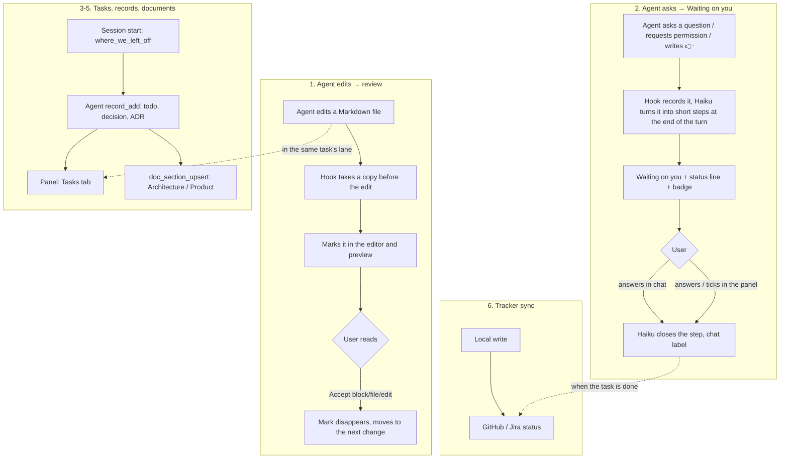

<!-- Generated by Imprimatur from its database; edit in the Imprimatur panel (Architecture/Product). -->

# Product Design Document

## Contents

1. [Product summary](#summary)
2. [Who it is for](#users)
3. [Problems it solves](#problems)
4. [Principles](#principles)
5. [Main flows](#flows)
6. [Surfaces and features](#surfaces)
7. [Success metrics](#metrics)
8. [Roadmap](#roadmap)
9. [Out of scope](#non-goals)
10. [Agent setup audit (planned)](#agent-setup-audit)
11. [Project glossary](#glossary)
12. [A task's analysis](#task-analysis)
13. [Unread: comprehension debt (#91, #92)](#unread)
14. [/study: studying a topic (#95)](#study)

## 1. Product summary

**Imprimatur: the agent writes, you approve.** (*Imprimatur* is Latin for "let it be printed": a stamp of approval.)

An open source (MIT) tool made of a VS Code extension, Claude Code hooks and an MCP server. It answers three questions of a developer who works with a coding agent, in one place:

1. **What did the agent change?** The agent's document edits stay marked in the editor and in the Markdown preview, like Word's tracked changes, until they are accepted. A block, a file or a whole edit is **Accepted** with one click. It does not depend on Git.
2. **What is the agent waiting on me for?** Its questions, permission requests and "test this" steps are collected across sessions in the **Waiting on you** list; the list updates itself after every turn.
3. **Where did we leave off, and what did we decide?** Tasks, to-dos, questions, decisions, ADRs and PDRs live in Imprimatur's database; the agent (Claude Code, Cursor, Codex) reads and writes them through MCP tools, and the user sees and edits them in the panel. The architecture and product documents are living documents fed by these records.

It is used daily by a developer who works with an AI agent across several repositories, possibly on more than one machine. Imprimatur also accepts optional plugins.

## 2. Who it is for

### Primary user

An **individual developer** who spends most of the day with a coding agent (first of all Claude Code), works in several repos and sessions at once, and has to actually read and approve the documents and plans the agent writes. Traits:

- Has the agent write Markdown files such as specs, designs, TODOs and READMEs, and wants to see each change line by line.
- Runs several sessions in parallel and misses which session is waiting on them.
- Makes decisions in chat and wants them to persist somewhere.
- May work on more than one machine (for example work and personal).
- Does not want to be tied to one tool: next to Claude Code, may also use Cursor or Codex.

### Secondary (future) user

**Teams:** teams that manage agent configuration (CLAUDE.md, rules, hooks, MCP) across several repos and people, and want to measure drift and "did this rule work". Considered as a paid team plan (#42); there is no product today.

### Distribution assumption

The open source extension is the distribution and trust vehicle: because the hook reads the agent's session transcripts, open code builds trust. Today it installs from a repo clone (`npm run setup`) or as a Claude Code plugin; Marketplace / Open VSX publishing is on the roadmap.

## 3. Problems it solves

| Problem | What happens today | With Imprimatur |
|---|---|---|
| The agent's document changes are hard to review | A git diff or a summary in chat; after stage/commit the change is lost, and several turns pile on top of each other | Every change stays marked in the editor and preview until Accepted; independent of git; a one-sentence explanation and history for every edit |
| The agent is waiting for the human and it goes unnoticed | The question is left in the middle of the chat and is lost at the next prompt; with parallel sessions nobody knows who is waiting | Requests from all sessions in one list, tied to a task, closing themselves; a count in the status bar and on the sidebar badge |
| "Where did we leave off" is rebuilt every session | TODO.md files, chat history, memory | A 👉 pointer and a one-line summary per task; handed to the agent at the start of a session |
| Decisions and design are scattered | In chat, in commit messages, in Markdown | Decision, ADR and PDR records are versioned; the architecture and product documents link to them |
| What the agent did is invisible | Only edits are seen | Reads, searches, web, MCP, sub-agent and skill calls as rows tied to a task |
| The configuration that shapes the agent is scattered | CLAUDE.md, rules, skills, Cursor rules and hooks are in separate places; drift goes unnoticed | Agent Setup: one tool-independent view, change tracking, health, drift, merged settings |
| Process rules are copied into every repo | Separate `.claude/hooks/*.sh` in every repo, and the variants diverge | One global hook, plus a small settings file committed per repo |
| The tracker and the tasks drift apart | The status of a GitHub issue and the status of the task are separate | Two-way status with GitHub/Jira |

The market research (2026-10-05) concluded that the bottleneck is not tokens but human attention: reviewing, noticing a wait, and knowing whether a rule worked.

## 4. Principles

### 1. Nothing slips through

- Every change the agent makes stays marked until the user explicitly accepts it; committing does not count as approval.
- An open request is never closed on its own: archive, audit and import close it only with evidence. A request closed by mistake is worse than one left open.
- Records are not deleted (`dropped`), document sections are not deleted (`superseded`); who changed what and when stays in the version history.
- Old data heals itself: there is no repair script, the fix is made at read time.

### 2. Cheap and fast

- A model is used only where verbal judgment is needed and only the small model (Haiku); where a rule is enough, there is no call. It runs on the user's existing Claude subscription.
- Hooks do not hold the tool back (~65 ms, heavy work in the background); the panel shows a change in ~50 ms; queries take < 1 ms at 10,000 records.
- No dependencies: no `npm install` step at install.

### 3. Independent of agent and tool

- The only way to write records is MCP: Claude Code, Cursor and Codex see the same tools. The tools are few and general (12 tools), because every definition enters the agent's context.
- Agent Setup shows each tool's configuration (Claude Code, Cursor, Copilot, AGENTS.md, Gemini, Windsurf, Cline, Aider) in one place.
- Hook-based features (review, waiting items, activity) are specific to Claude Code today.

### 4. The user's decisions are recorded

- A decision made in chat is kept as a `decision` record, with its date and the user's own words; the agent does not ask the same question again.
- Design documents are tied to decisions: which ADR/PDR/decision a section rests on is visible.
- The source of truth is the database; the Markdown views (`docs/ARCHITECTURE.md`, `docs/PRODUCT.md`) are generated.

### 5. Safe defaults

- In an untrusted folder no model, `gh` or repo script runs; secrets live in a `0600` file; comments sent to the tracker are fixed text.
- Process checks do not run unless the repo explicitly turns them on.

## 5. Main flows

### 1. Agent edits → review / Accept

The agent changes a document; the user opens the file or the preview: an added line is green, a changed word sits in a red box next to the old word, a deleted block is marked. The user Accepts block by block; the view moves to the next one like a review queue. The **Agent changes** tab shows all edits in the repo in task lanes, each with a one-sentence explanation; a diff opens from the row, or an edit is accepted as a whole.

### 2. Agent asks → Waiting on you → answer

The agent asks something, requests permission, or at the end of a turn says "test this". The request lands in the list with its task, worded so it is understandable a week later without the chat ("#64: …"). If the user answers in chat, Haiku finds which step was decided and marks it; from the panel the user can write an answer, tick the step, or say "Done it". When the task is done, the requests that belong to it close in every session.

### 3. Where we left off

At the start of a session the agent gets the unfinished tasks and each one's 👉 with `where_we_left_off` (automatically at SessionStart if process checks are on). The user sees the same information on **Home** and in the status line (`Imprimatur · 3 waiting on you · #64 👉 …`).

### 4. Tasks and records

While working, the agent adds and closes todo, decision, note, ADR, PDR and test records through MCP; the 👉 moves to where the work stopped. In the **Tasks** tab the user opens the task's page: adds records with the quick-add box (`?` question, `!` decision, `#` note, `@me` their own todo), ticks todos, answers questions. Every change is versioned with who made it.

### 5. Architecture and product documents

When the agent makes an architecture or product decision, it adds an ADR/PDR record, updates the relevant document section with `doc_section_upsert` and links it to the record (if it does not, a process check warns). In the **Architecture** and **Product** tabs the user reads the contents, the rendered text and the contributing records, edits a section or marks it superseded; each section's history is visible. The documents are also written to the repo as `docs/ARCHITECTURE.md` and `docs/PRODUCT.md`.

### 6. Sync with GitHub and Jira

When a task is done, its GitHub issue closes (or moves to Done in Jira); an issue closed on GitHub finishes the task, a new issue becomes a task; the line in the epic closes with the task. Imprimatur also accepts optional plugins.

## 6. Surfaces and features

### VS Code panel (the Imprimatur panel)

| Tab | What it is for |
|---|---|
| **Home** | Progress, where each task left off, the first 5 items waiting on you, end-of-turn requests that could not be tied to a task, Audit and Scan history, all tasks; the badge on its button counts what is waiting on you |
| **Tasks** | The task list (this repo or all repos) and the task page: 👉, and under it tabs: Waiting on you (records and that task's end-of-turn requests, with an answer box), To-dos with quick add, Decisions, Notes, Tests, Activity |
| **Analysis** | Architecture, Product, Glossary and Task analyses: live design documents (contents, contributing records, edit, mark superseded, history) and the tasks' analysis files |
| **Agent changes** | The Agent Change Graph: edits and the agent's other work, task lanes, explanation, the rendered diff on hover, Accept |

Keyboard: j/k, Enter, x, a, /, Esc. In the sidebar, rows that open the tabs and a badge that counts what is waiting.

### Editor marks and preview

- Marks at word or sentence level, the old text readable in a red box, a mark for a deleted block, the overview ruler, the number of changes in the status bar.
- In the Markdown preview, marks at block level, clickable ticks on the right edge, ✓ Accept above the block (instant, without reloading the page).
- `imprimatur.showIn`: Markdown marks are in the preview only by default; `both` turns the editor on too.
- The file's agent edit history (Show Agent Edit History), each edit's diff. An optional Mermaid diagram diff.

### Agent Setup

Every file that affects the agent, for the repo and for home, grouped by tool and kind: a new/changed/deleted mark, when it takes effect ("always", "for these files", "on request") and which rules apply to the open file, health checks (broken reference, invalid JSON, secret, contradiction), drift across repos, git history and a "what did the last change do" summary, merged settings (hook order, effective permissions). Read-only.

### Status line

In Claude Code's status line, for the repo and session: `Imprimatur · 3 waiting on you · #64 👉 discover cache`. It does not overwrite the user's existing status line.

### MCP tools

`where_we_left_off`, `task_list`, `task_get`, `task_upsert`, `record_add`, `record_update`, `pointer_set`, `search`, `doc_get`, `doc_section_upsert`. In Claude Code (settings file or plugin), Cursor and Codex.

### Process checks

Optional per repo (`.claude/imprimatur.json`): where we left off at session start, a `--no-verify` block, main protection, design first, docs contents, issue fields, sweep, a "Where are we" section, branch finish, document update. Each is `block`, `warn` or off.

### Command line

`npm run setup` (install), `npm run import` (import old Markdown records), `npm run tracker`, `node scripts/github-webhooks.mjs`, `node scripts/stale-epic-lines.mjs`.

## 7. Success metrics

The metrics are values measured in real repositories of different sizes.

### Latency

| Metric | Target | Measured |
|---|---|---|
| Local record → shown in the panel | ~50 ms | File watcher 25–49 ms; an integration test guarantees < 500 ms (the earlier design had a 300 ms wait) |
| GitHub issue change → task | seconds | Webhook (the earlier design polled every 5 min) |
| Time the hook adds to the tool | low | ~65 ms (43 ms of it Node startup), hooks run in parallel |
| Panel query | < 1 ms | < 1 ms at 10,000 records; opening < 5 ms |
| Full refresh of graph + waiting items | < 50 ms | 430 → 34 ms in a large repo, 260 → 21 ms in a smaller one; `graphRows` 150–500 → ~3 ms |
| Idle CPU | ~0% | The earlier 120–140% (two windows) is fixed |
| Tick → redraw in Waiting on you | instant | ~150 ms → 57–80 ms |

### Cost

| Metric | Before | Now |
|---|---|---|
| Haiku call for an edit's explanation | Every Markdown edit (~100 a day in one repo) | Only for an edit where the agent's own words are not enough and which is shown in the graph; in a measurement, 38 of 40 edits are explained by the agent's own words |
| End-of-turn check | Every turn | Only when an item is open or the answer asks for something |
| SessionStart context | Up to Claude Code's 10,000-character cut | ≤ 4,000 characters |
| MCP tool definitions | | ~1.4k tokens, loaded deferred |

### Correctness and coverage

- Lines written by the old hook are matched to their calls: 77/79 and 62/62 in two real repositories.
- Database: 12 concurrent writers without an error.
- Markdown import: the number of prefixed lines per file = the number of records.

### To watch (not measured yet)

- How long the agent waits for the user and how soon changes are reviewed (#42).
- The per-item token cost of the context loaded in every session (#29).

## 8. Roadmap

Open work, by priority:

| Work | What | Status |
|---|---|---|
| [#67](https://github.com/halilural/imprimatur/issues/67) Claude Code plugin switch | Hooks and the MCP server as a plugin; moving from the settings file to the plugin with `npm run setup -- --plugin` | Code is ready (0.38.0, `validate --strict` passes); the switch waits for the user's decision |
| [#29](https://github.com/halilural/imprimatur/issues/29) Context budget | In Agent Setup, the approximate tokens of each file, the total loaded in every session (CLAUDE.md + imports, rules, skill/agent descriptions, MCP definitions), a warning for big ones, a suggestion to remove with the tokens it would save | Next; the first piece of #41 |
| [#41](https://github.com/halilural/imprimatur/issues/41) Epic: Cost and context (open source) | Show what eats context and which turns are wasted; the promise is not a "cost dashboard" | Open; starts with #29 |
| [#1](https://github.com/halilural/imprimatur/issues/1) Marketplace + Open VSX publishing | Anyone can install the extension from the store, the Claude Code side comes with one command; CI (GitHub Actions) | A revised plan (R1–R7) waits for the user's approval |
| [#6](https://github.com/halilural/imprimatur/issues/6) Manual tests | Manual tests of the editor and preview behavior (MT-AR-001…012) | Open; the tests are in the `TEST` task |
| [#42](https://github.com/halilural/imprimatur/issues/42) Epic: Team (paid) | Configuration governance, drift across repos and machines, change history, "did this rule work", review and wait metrics | No sub-work; willingness to pay will be tested with a waitlist and a trial, not with interviews |

### Known next steps

- Linear in the tracker, and the board's Status field (postponed in #70).

## 9. Out of scope

- **A cost dashboard or enterprise FinOps:** providers (Claude Code `/usage`, Cursor, Copilot) and free tools already report cost. Imprimatur shows what eats context and what does not help.
- **Being a code review tool:** review is for documents (`md`, `mdx` by default); for code, git diff and existing tools are enough. The extension list can be widened but that is not the goal.
- **Changing the Git workflow:** Imprimatur does not commit, stage or manage branches; it does not open PRs.
- **Sending text to the chat:** Claude Code does not allow sending text to an open chat from outside; "Send to Claude" was tried and removed.
- **Process rules specific to a repo:** rules such as an em dash ban, deploy, migration and approval gates stay in the repo; Imprimatur carries only the general process checks.
- **Managing tool configuration:** Agent Setup is read-only; turning rules on and off or moving them across repos is out of scope for now.
- **Making Markdown the source of truth:** README, CLAUDE.md, AGENTS.md, rules and skills stay in files as tool configuration; the source of truth for records and design documents is the database.
- **Command-line task management** (like `imprimatur done --task`) and a restore-from-archive command: not seen as needed.

## 10. Agent setup audit (planned)

The agent setup (CLAUDE.md, AGENTS.md, `.claude/` settings, hooks, skills, subagents, MCP, plugins, Cursor/Codex/Copilot/Gemini/Kiro files) is audited with rules based on the official documentation. The rule engine is agnix and it is used with its full coverage: no rule or file is cut.

- Findings are not hidden; they are grouped as project / user / plugin / worktree and shown with category and level counts. Every finding has a link to the rule's documentation and the date it was verified.
- Every finding is an Imprimatur record: open / applied / rejected (with a reason). A finding that disappears becomes "applied", a rejected one is not reopened; the difference between two scans is visible. Competitors have no per-suggestion status history; that is Imprimatur's difference.
- Later: an LLM layer (quality, contradiction, stale instruction), consistency across agents, context cost × usage (#29).

Epic [#76](https://github.com/halilural/imprimatur/issues/76), first piece of work [#77](https://github.com/halilural/imprimatur/issues/77).

## 11. Project glossary

Next to Architecture and Product, every repo keeps a third living document: the **Glossary**. The project's terms stand in one place, with one meaning each.

- Every term is a section: the title is the term, the text is its definition (what it means, where it appears, what not to confuse it with). Terms are listed alphabetically and without numbers.
- In the panel there is a **Glossary** tab and a button in the launcher: a term is added with "New term", updated with "Edit"; its history is versioned like a section's. A term that is no longer used is not deleted, it ends with "Mark superseded".
- The agent reads and writes the glossary through MCP (`doc_get` / `doc_section_upsert`, `kind: "glossary"`). Its instruction: a new term or a term whose meaning changed is written to the glossary.
- It is written to the repo as `docs/GLOSSARY.md`; edits in the file are reverted as in Architecture/Product.

## 12. A task's analysis

STORY: I read a task's analyses, plans, spike results and research notes (wherever the agent wrote the file, including the plan it came out of plan mode with) in one place, the **Analysis** tab; the task page stays focused on to-dos.

- A single **Analysis** tab in the top menu: under it **Architecture**, **Product**, **Glossary** and **Task analyses**; the tab returns to the sub-page opened last.
- **Task analyses:** on the left the tasks that have analyses (newest on top), on the right the selected task's files; one card per file, the sections are the file's `##` headings. A file that was read on this machine opens in the editor with "open", "Go to task" takes you to the task page.
- **Analyses without a task:** below the list; a task picker next to every file, it moves to the selected task.
- **Task page:** an "Analysis · N files →" link in the title; at the top Where we left off and Waiting on you, below it tabs: To-dos, Decisions, Notes, Tests, Activity (the selected tab is remembered, while searching all are shown).
- What was written in past sessions comes in once per repo in the background; by hand: **Imprimatur: Take Task Analyses from Past Sessions** or `npm run analysis` (`--dry-run`, `--no-model`).
- To turn it off: `"analysis": false` in `.claude/imprimatur.json`; to exclude a path: `{"exclude": ["drafts/"]}`.

## 13. Unread: comprehension debt (#91, #92)

The agent writes code and documents faster than a person can read them; Imprimatur shows how much you have not yet seen.

- **Task list:** "N unread" per task.
- **Task page and Home:** an "Unread" card: edits that are not accepted (clicking filters Agent changes by that task) and document sections the agent changed since your last read; each one opens, with "Read" or "Mark all read".
- **Architecture / Product / Glossary:** an "Unread" mark and a left edge line on the changed section, a dot in the contents, "N unread · Mark all read" in the title.
- **Status line:** `Imprimatur · 3 waiting on you · 12 unread · …`.

A section you wrote counts as read. Read marks are specific to the device. On first install everything that exists counts as read.

Next: a "since your last read" diff (#93), an end-of-turn briefing (#94).

## 14. /study: studying a topic (#95)

To learn a design decision, a feature or a document the agent made well enough to explain it, defend it and point to it in the code: `/study #92` (or "I want to study the section_reads design").

1. A **study note** is written to the task's Analysis page: what and why, how it works, where in the code (a tour in order with `file:line`), the alternatives and why they were not chosen, limits and risks, terms, sources. Nothing without a reason in the records is invented; it says "no reason in the records".
2. **Quiz yourself**: questions come one at a time (comprehension, why, alternative, where in the code, debug, what if it were this way, objection). You answer first; the agent says full / partial / missing and shows what is missing with its source; an "I don't know" gets a hint first.
3. **Mastery**: the score and weak points stay on the task as a note. The next `/study` asks the weak questions first and says what changed since then. A reason found missing in the document becomes a to-do for the agent.

Why it is this way: in Anthropic's 2026 study, people who asked for explanations and asked questions kept 65–86% of the topic, those who only delegated kept 39%.
