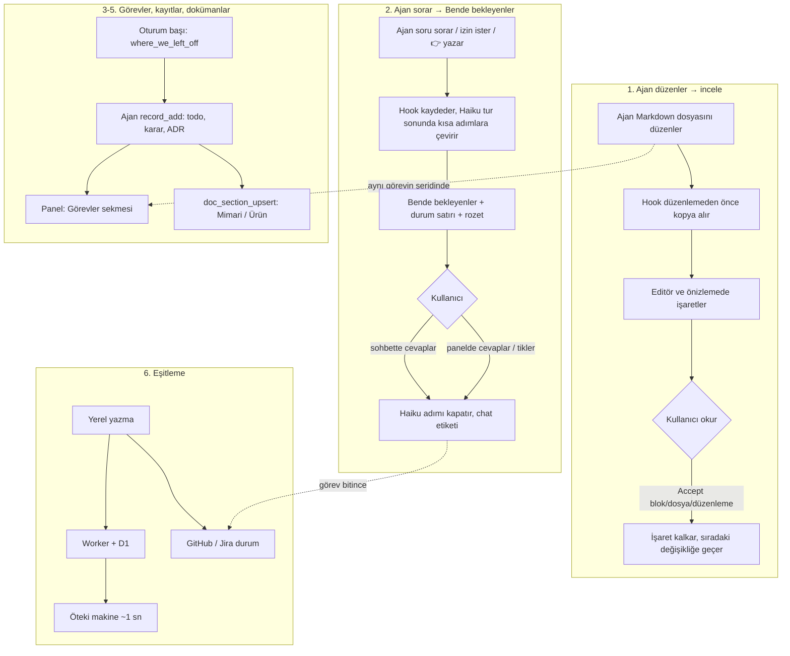

<!-- Generated by Imprimatur from its database; edit in the Imprimatur panel (Mimari/Ürün). -->

# Ürün Tasarım Dokümanı

## İçindekiler

1. [Ürün özeti](#summary)
2. [Kimin için](#users)
3. [Çözdüğü sorunlar](#problems)
4. [İlkeler](#principles)
5. [Ana akışlar](#flows)
6. [Yüzeyler ve özellikler](#surfaces)
7. [Başarı ölçütleri](#metrics)
8. [Yol haritası](#roadmap)
9. [Kapsam dışı](#non-goals)

## 1. Ürün özeti

**Imprimatur: ajan yazar, sen onaylarsın.** (*Imprimatur*, Latince "basılsın": onay damgası.)

Kodlama ajanıyla çalışan bir geliştiricinin üç sorusuna tek yerden cevap veren, VS Code eklentisi + Claude Code hook'ları + MCP sunucusundan oluşan açık kaynak (MIT) bir araç:

1. **Ajan neyi değiştirdi?** Ajanın doküman düzenlemeleri, kabul edilene kadar editörde ve Markdown önizlemesinde Word'ün izlenen değişiklikleri gibi işaretli kalır. Blok, dosya ya da bütün bir düzenleme tek tıkla **Accept** edilir. Git'e bağlı değildir.
2. **Ajan benden ne bekliyor?** Soruları, izin istekleri ve "şunu test et" adımları oturumlar arasında **Bende bekleyenler** listesinde toplanır; liste her turdan sonra kendini günceller.
3. **Nerede kaldık, neye karar verdik?** Görevler, todo'lar, sorular, kararlar, ADR ve PDR'ler Imprimatur'un veritabanında tutulur; ajan (Claude Code, Cursor, Codex) MCP araçlarıyla okur ve yazar, kullanıcı panelden görür ve düzenler. Mimari ve ürün dokümanları bu kayıtlardan beslenen canlı belgelerdir.

Sürüm 0.45.0. Bugün tek kullanıcı (geliştirici) iki makinede ve birden çok repoda (dirtywork, groundwork, interview, investment, imprimatur) günlük olarak kullanıyor.

## 2. Kimin için

### Birincil kullanıcı

Günün büyük kısmını bir kodlama ajanıyla (öncelikle Claude Code) geçiren, aynı anda birden çok repo ve oturumda çalışan, ajanın yazdığı doküman ve planları gerçekten okuyup onaylaması gereken **bireysel geliştirici**. Özellikleri:

- Ajana spec, tasarım, TODO, README gibi Markdown dosyaları yazdırır ve değişikliği satır satır görmek ister.
- Birden çok oturumu paralel yürütür; hangi oturumun kendisini beklediğini kaçırır.
- Kararlarını sohbette verir ve bunların bir yerde kalıcı olmasını ister.
- İki makinede (iş ve kişisel) çalışır.
- Tek araca bağlı kalmak istemez: Claude Code yanında Cursor ya da Codex de kullanabilir.

### İkincil (gelecek) kullanıcı

**Ekipler:** ajan yapılandırmasını (CLAUDE.md, kurallar, hook'lar, MCP) birden çok repo ve kişi arasında yöneten, sapmayı ve "bu kural işe yaradı mı"yı ölçmek isteyen ekipler. Ücretli ekip planı olarak düşünülüyor (#42); bugün ürün yok.

### Dağıtım varsayımı

Açık kaynak eklenti dağıtım ve güven aracıdır: hook ajan oturum dökümlerini okuduğu için kodun açık olması güven verir. Kurulum bugün repo klonundan (`npm run setup`) ya da Claude Code plugin'i olarak; Marketplace / Open VSX yayını yol haritasında.

## 3. Çözdüğü sorunlar

| Sorun | Bugün olan | Imprimatur ile |
|---|---|---|
| Ajanın doküman değişikliğini incelemek zor | Git diff ya da sohbetteki özet; stage/commit sonrası değişiklik kaybolur, birden çok tur üst üste biner | Her değişiklik Accept edilene kadar editörde ve önizlemede işaretli; git'ten bağımsız; her düzenlemenin tek cümlelik açıklaması ve geçmişi |
| Ajan insanı bekliyor ve fark edilmiyor | Soru sohbetin ortasında kalır, bir sonraki prompt'ta kaybolur; paralel oturumlarda kim bekliyor bilinmez | Bütün oturumların istekleri tek listede, göreve bağlı, kendini kapatan; durum satırında ve kenar çubuğu rozetinde sayı |
| "Nerede kaldık" her oturumda yeniden kurulur | TODO.md dosyaları, sohbet geçmişi, hafıza | Görev başına 👉 ve tek satırlık özet; oturum başında ajana verilir |
| Kararlar ve tasarım dağınık | Sohbette, commit mesajında, Markdown'da | Karar, ADR, PDR kayıtları sürümlü; mimari ve ürün dokümanları bunlara bağlı |
| Ajanın ne yaptığı görünmez | Yalnız düzenlemeler görülür | Okuma, arama, web, MCP, alt ajan, skill çağrıları göreve bağlı satırlar |
| Ajanı etkileyen yapılandırma dağınık | CLAUDE.md, kurallar, skill'ler, Cursor kuralları, hook'lar ayrı yerlerde; sapma fark edilmez | Agent Setup: araçtan bağımsız tek görünüm, değişiklik takibi, sağlık, sapma, birleşik ayarlar |
| Süreç kuralları her repoya kopyalanır | Her repoda ayrı `.claude/hooks/*.sh`, varyantlar ayrışır | Tek global hook, repo başına commit'lenen küçük ayar dosyası |
| Makineler ve takip aracı ayrışır | İş makinesindeki kayıt kişisel makinede yok; GitHub issue'su ile görev durumu ayrı | Cihazlar arası eşitleme; GitHub/Jira ile iki yönlü durum |

Pazar araştırmasının (2026-10-05) vardığı sonuç: darboğaz token değil, insanın dikkatidir: incelemek, beklemeyi fark etmek, kuralın işe yarayıp yaramadığını bilmek.

## 4. İlkeler

### 1. Hiçbir şey gözden kaçmasın

- Ajanın her değişikliği kullanıcı açıkça kabul edene kadar işaretli kalır; commit etmek onay sayılmaz.
- Açık bir istek asla kendiliğinden kapatılmaz: arşiv, denetim ve eşitleme yalnız kanıt varsa kapatır. Yanlışlıkla kapanan istek, açık kalandan kötüdür.
- Kayıtlar silinmez (`dropped`), doküman bölümleri silinmez (`superseded`); her değişikliğin kim ve ne zaman yaptığı sürüm geçmişinde kalır.
- Eski veri kendiliğinden düzelir: onarım betiği yok, düzeltme okuma anında yapılır.

### 2. Ucuz ve hızlı

- Model yalnız sözel yargı gereken yerde ve yalnız küçük model (Haiku) ile; kural yetiyorsa çağrı yok. Kullanıcının mevcut Claude aboneliğiyle çalışır.
- Hook'lar aracı bekletmez (~65 ms, ağır iş arka planda); panel değişikliği ~50 ms'de gösterir; sorgular 10.000 kayıtta < 1 ms.
- Bağımlılık yok: kurulumda `npm install` adımı yok; bulut isteğe bağlı ve kullanıcının kendi hesabında.

### 3. Ajan ve araçtan bağımsız

- Kayıtların tek yazma yolu MCP: Claude Code, Cursor ve Codex aynı araçları görür. Araçlar az ve geneldir (10 araç), çünkü her tanım ajanın bağlamına girer.
- Agent Setup her aracın yapılandırmasını (Claude Code, Cursor, Copilot, AGENTS.md, Gemini, Windsurf, Cline, Aider) tek yerde gösterir.
- Hook tabanlı özellikler (inceleme, bekleyenler, etkinlik) bugün Claude Code'a özeldir.

### 4. Kullanıcının kararları kayıtlı

- Sohbette verilen karar `decision` kaydı olarak, tarihiyle ve kullanıcının sözüyle tutulur; ajan aynı soruyu yeniden sormaz.
- Tasarım dokümanları kararlara bağlıdır: bir bölümün hangi ADR/PDR/karara dayandığı görünür.
- Asıl kaynak veritabanıdır; Markdown görünümler (`docs/ARCHITECTURE.md`, `docs/PRODUCT.md`) üretilir.

### 5. Güvenli varsayılanlar

- Güvenilmeyen klasörde model, `gh` ya da repo betiği çalışmaz; sırlar `0600` dosyada; takip aracına giden yorumlar sabit metindir.
- Süreç kontrolleri repo açıkça açmadıkça çalışmaz.

## 5. Ana akışlar

### 1. Ajan düzenler → incele / Accept

Ajan bir dokümanı değiştirir; kullanıcı dosyayı ya da önizlemeyi açar: eklenen satır yeşil, değişen kelime eski kelimenin yanında kırmızı kutuda, silinen blok işaretli. Kullanıcı blok blok Accept eder; görünüm bir inceleme kuyruğu gibi sıradakine kayar. **Ajan değişiklikleri** sekmesi repodaki bütün düzenlemeleri görev şeritlerinde, tek cümlelik açıklamalarıyla gösterir; satırdan diff açılır ya da düzenleme bütünüyle kabul edilir.

### 2. Ajan sorar → Bende bekleyenler → cevap

Ajan bir şey sorar, izin ister ya da tur sonunda "şunu test et" der. İstek, bir hafta sonra sohbetsiz anlaşılacak biçimde ("#64: …") göreviyle birlikte listeye düşer. Kullanıcı sohbette cevap verirse Haiku hangi adımın karara bağlandığını bulup işaretler; panelden cevap yazabilir, adımı tikleyebilir ya da "Yaptım" diyebilir. Görev bitince o göreve ait istekler her oturumda kapanır.

### 3. Nerede kaldık

Oturum başında ajan `where_we_left_off` ile bitmemiş görevleri ve her birinin 👉'ını alır (süreç kontrolleri açıksa SessionStart'ta kendiliğinden). Kullanıcı aynı bilgiyi **Ana sayfa**'da ve durum satırında (`Imprimatur · 3 waiting on you · #64 👉 …`) görür.

### 4. Görev ve kayıtlar

Ajan çalışırken todo, karar, not, ADR, PDR, test kayıtlarını MCP ile ekler ve kapatır; 👉 iş durduğu yere taşınır. Kullanıcı **Görevler** sekmesinde görevin sayfasını açar: hızlı ekleme kutusuyla (`?` soru, `!` karar, `#` not, `@ben` kendi todo'su) kayıt ekler, todo'ları tikler, soruları cevaplar. Her değişiklik kimin yaptığıyla sürümlenir.

### 5. Mimari ve ürün dokümanları

Ajan mimari ya da ürün kararı verdiğinde ADR/PDR kaydı ekler ve ilgili doküman bölümünü `doc_section_upsert` ile güncelleyip kayda bağlar (bağlamazsa süreç kontrolü uyarır). Kullanıcı **Mimari** ve **Ürün** sekmelerinde içindekiler, işlenmiş metin ve katkı veren kayıtlarla okur, bölümü düzenler ya da eskimiş sayar; her bölümün geçmişi görünür. Dokümanlar repoya `docs/ARCHITECTURE.md` ve `docs/PRODUCT.md` olarak da yazılır.

### 6. Cihazlar ve GitHub ile eşitleme

Bir makinede yazılan kayıt öteki makinede yaklaşık bir saniyede görünür (alan bazında son yazan kazanır). Görev bitince GitHub issue'su kapanır (ya da Jira'da Done'a geçer); GitHub'da kapanan issue görevi bitirir, yeni issue görev olur; epic'teki satır görevle birlikte kapanır.

## 6. Yüzeyler ve özellikler

### VS Code paneli (Imprimatur paneli)

| Sekme | Ne için |
|---|---|
| **Ana sayfa** | İlerleme, her görevin nerede kaldığı, sende bekleyen ilk 5, bütün görevler |
| **Görevler** | Görev listesi (bu repo ya da her repo) ve görev sayfası: 👉, bekleyenler ve cevap kutusu, todo'lar, hızlı ekleme, kararlar, ADR, PDR, testler, etkinlik |
| **Bende bekleyenler** | Kullanıcıyı bekleyen her şey, göreve göre; tur sonu istekleri onay kutulu adımlar; Audit ve Scan history |
| **Mimari** / **Ürün** | Canlı tasarım dokümanları: içindekiler, katkı veren kayıtlar, düzenle, eskimiş say, geçmiş |
| **Ajan değişiklikleri** | Agent Change Graph: düzenlemeler ve ajanın diğer işleri, görev şeritleri, açıklama, hover'da işlenmiş fark, Accept |

Klavye: j/k, Enter, x, a, /, Esc. Kenar çubuğunda sekmeleri açan satırlar ve bekleyenleri sayan rozet.

### Editör işaretleri ve önizleme

- Kelime ya da cümle düzeyinde işaret, eski metin okunur kırmızı kutuda, silinen blok işareti, overview ruler, durum çubuğunda değişiklik sayısı.
- Markdown önizlemesinde blok düzeyinde işaret, sağ kenarda tıklanabilir çentikler, blok üstünde ✓ Accept (anında, sayfa yeniden yüklenmeden).
- `imprimatur.showIn`: Markdown işaretleri varsayılan olarak yalnız önizlemede; `both` editörü de açar.
- Dosyanın ajan düzenleme geçmişi (Show Agent Edit History), her düzenlemenin diff'i. İsteğe bağlı Mermaid diyagram farkı.

### Agent Setup

Ajanı etkileyen her dosya, repo ve home için, araca ve türe göre gruplu: yeni/değişen/silinen işareti, ne zaman devreye girdiği ("her zaman", "şu dosyalar için", "istenince") ve açık dosya için hangi kuralların geçerli olduğu, sağlık kontrolleri (bozuk referans, geçersiz JSON, gizli bilgi, çelişki), repolar arası sapma, git geçmişi ve "son değişiklik ne yaptı" özeti, birleşik ayarlar (hook sırası, geçerli izinler). Salt okunur.

### Durum satırı

Claude Code'un durum satırında repo ve oturum için: `Imprimatur · 3 waiting on you · #64 👉 discover cache`. Kullanıcının mevcut durum satırının üzerine yazılmaz.

### MCP araçları

`where_we_left_off`, `task_list`, `task_get`, `task_upsert`, `record_add`, `record_update`, `pointer_set`, `search`, `doc_get`, `doc_section_upsert`. Claude Code (ayar dosyası ya da plugin), Cursor ve Codex'te.

### Süreç kontrolleri

Repo başına isteğe bağlı (`.claude/imprimatur.json`): oturum başında nerede kaldık, `--no-verify` engeli, main koruması, tasarım önce, docs içindekiler, issue alanları, süpürme, "Neredeyiz" bölümü, dal bitişi, doküman güncelleme. Her biri `block`, `warn` ya da kapalı.

### Komut satırı

`npm run setup` (kurulum), `npm run import` (eski Markdown kayıtlarını aktarma), `npm run sync`, `npm run tracker`, `node scripts/github-webhooks.mjs`, `node scripts/stale-epic-lines.mjs`.

## 7. Başarı ölçütleri

Ölçütler gerçek repolarda (dirtywork, investment, interview, groundwork) ölçülmüş değerlerdir.

### Gecikme

| Ölçüt | Hedef | Ölçülen |
|---|---|---|
| Yerel kayıt → panelde görünme | ~50 ms | Dosya izleyicisi 25–49 ms; entegrasyon testi < 500 ms garanti eder (önceki tasarımda 300 ms bekleme) |
| Cihazlar arası kayıt → öteki makine | 0,3–1,5 sn | WebSocket haberi + çekme (önceki tasarımda 60 sn yoklama) |
| GitHub issue değişikliği → görev | saniyeler | Webhook (önceki tasarımda 5 dk yoklama) |
| Hook'un araca eklediği süre | düşük | ~65 ms (43 ms Node açılışı), hook'lar paralel |
| Panel sorgusu | < 1 ms | 10.000 kayıtta < 1 ms; açılış < 5 ms |
| Grafik + bekleyenler tam yenileme | < 50 ms | dirtywork 430 → 34 ms, investment 260 → 21 ms; `graphRows` 150–500 → ~3 ms |
| Boşta CPU | ~%0 | Önceki %120–140 (iki pencere) giderildi |
| Bende bekleyenler'de tik → çizim | anında | ~150 ms → 57–80 ms |

### Maliyet

| Ölçüt | Önce | Şimdi |
|---|---|---|
| Düzenleme açıklaması için Haiku çağrısı | Her Markdown düzenlemesi (investment'ta günde ~100) | Yalnız ajanın sözü yetmeyen ve grafikte gösterilen düzenleme; ölçümde 40 düzenlemenin 38'i ajanın sözüyle açıklanıyor |
| Tur sonu denetimi | Her tur | Yalnız açık madde varken ya da cevap bir şey isterken |
| SessionStart bağlamı | Claude Code'un 10.000 karakterlik kesimine kadar | ≤ 4.000 karakter |
| MCP araç tanımları | | ~1,4k token, ertelemeli yüklenir |

### Doğruluk ve kapsam

- Eski hook'la yazılmış satırların çağrılarına bağlanması: interview 77/79, groundwork 62/62.
- Veritabanı: 12 eşzamanlı yazıcı hatasız.
- Markdown aktarımı: dosya başına önekli satır sayısı = kayıt sayısı.

### İzlenecek (henüz ölçülmüyor)

- Ajanın kullanıcıyı ne kadar beklediği ve değişikliklerin ne kadar sürede incelendiği (#42).
- Her oturumda yüklenen bağlamın kalem kalem token'ı (#29).

## 8. Yol haritası

Açık işler, önceliğe göre:

| İş | Ne | Durum |
|---|---|---|
| [#67](https://github.com/halilural/imprimatur/issues/67) Claude Code plugin geçişi | Hook'lar ve MCP sunucusu plugin olarak; bu makinede `npm run setup -- --plugin` ile ayar dosyasından plugin'e geçiş | Kod hazır (0.38.0, `validate --strict` geçer); geçiş kullanıcının kararını bekliyor |
| [#29](https://github.com/halilural/imprimatur/issues/29) Bağlam bütçesi | Agent Setup'ta her dosyanın yaklaşık token'ı, her oturumda yüklenen toplam (CLAUDE.md + içe aktarmalar, kurallar, skill/agent açıklamaları, MCP tanımları), büyükler için uyarı, kazanılacak token'la kaldırma önerisi | Sıradaki; #41'in ilk işi |
| [#41](https://github.com/halilural/imprimatur/issues/41) Epic: Maliyet ve bağlam (açık kaynak) | Neyin bağlam yediğini ve hangi turların boşa gittiğini göstermek; vaat "maliyet panosu" değil | Açık; #29 ile başlar |
| [#1](https://github.com/halilural/imprimatur/issues/1) Marketplace + Open VSX yayını | Herkesin eklentiyi mağazadan kurabilmesi, Claude Code tarafının tek komutla gelmesi; CI (GitHub Actions) | Gözden geçirilmiş plan (R1–R7) kullanıcı onayını bekliyor |
| [#6](https://github.com/halilural/imprimatur/issues/6) Elle testler | Editör ve önizleme davranışlarının elle testleri (MT-AR-001…012) | Açık; testler `TEST` görevinde |
| [#42](https://github.com/halilural/imprimatur/issues/42) Epic: Ekip (ücretli) | Yapılandırma yönetişimi, repolar ve makineler arası sapma, değişiklik geçmişi, "bu kural işe yaradı mı", inceleme ve bekleme metrikleri | Alt işi yok; ödeme isteği görüşmeyle değil bekleme listesi ve denemeyle test edilecek |

### Bilinen sonraki adımlar

- Takip aracında Linear ve pano Status alanı (#70'te sonraya bırakıldı).
- Worker'ın `changes` günlüğünü sıkıştırma (şimdilik gerek yok).

## 9. Kapsam dışı

- **Maliyet panosu ya da kurumsal FinOps:** sağlayıcılar (Claude Code `/usage`, Cursor, Copilot) ve ücretsiz araçlar maliyeti zaten raporluyor. Imprimatur neyin bağlam yediğini ve neyin işe yaramadığını gösterir.
- **Kod incelemesi aracı olmak:** inceleme dokümanlar içindir (varsayılan `md`, `mdx`); kod için git diff ve mevcut araçlar yeterli. Uzantı listesi genişletilebilir ama hedef değil.
- **Git akışını değiştirmek:** Imprimatur commit, stage ya da dal yönetmez; PR açmaz.
- **Sohbete metin göndermek:** Claude Code açık bir sohbete dışarıdan metin göndermeye izin vermiyor; "Send to Claude" denendi ve kaldırıldı.
- **Repoya özel süreç kuralları:** em dash yasağı, deploy, migration, onay kapıları gibi kurallar repoda kalır; Imprimatur yalnız genel süreç kontrollerini taşır.
- **Araç yapılandırmasını yönetmek:** Agent Setup salt okunurdur; kural açıp kapatmak ya da repolar arası taşımak şimdilik kapsam dışı.
- **Merkezi sunucu / çok kullanıcı:** eşitleme Worker'ı kullanıcının kendi hesabında, tek token'lı, tek kişilik kullanım içindir; birleştirme cihazlarda yapılır.
- **Markdown'ı asıl kaynak yapmak:** README, CLAUDE.md, AGENTS.md, kurallar ve skill'ler araç yapılandırması olarak dosyada kalır; kayıtlar ve tasarım dokümanlarının asıl kaynağı veritabanıdır.
- **Komut satırı görev yönetimi** (`imprimatur done --task` gibi), arşivden geri yükleme komutu: gerek görülmedi.
