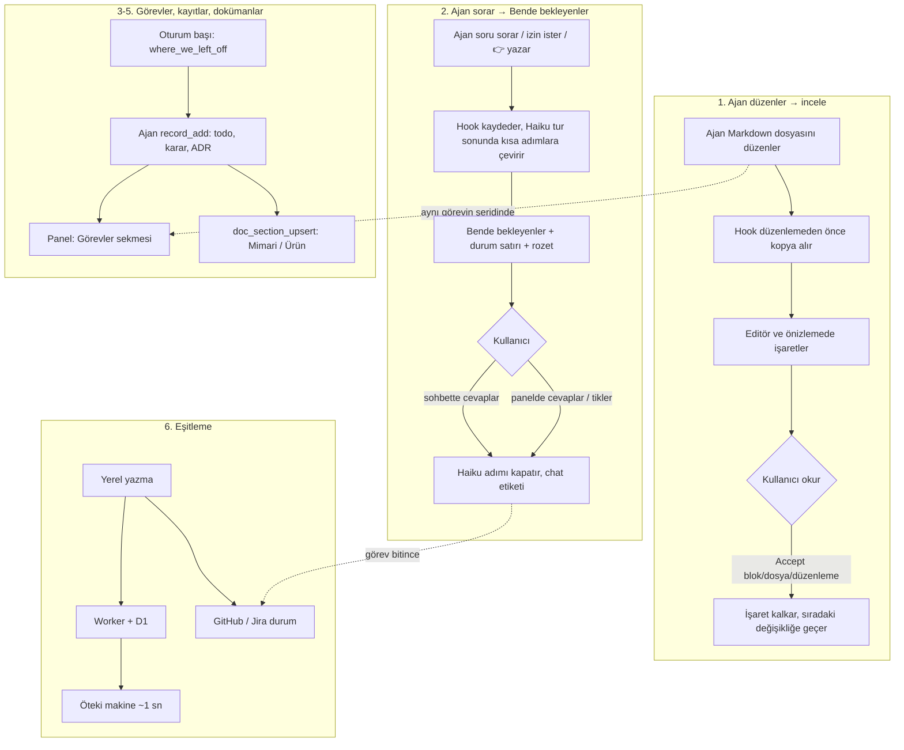

<!-- Generated by Imprimatur from its database; edit in the Imprimatur panel (Mimari/Ürün). -->

# Ürün Tasarım Dokümanı

## İçindekiler

1. [Ürün özeti](#summary)
2. [Kimin için](#users)
3. [Çözdüğü sorunlar](#problems)
4. [İlkeler](#principles)
5. [Ana akışlar](#flows)
6. [Yüzeyler ve özellikler](#surfaces)
7. [Kullanıcı kararları](#user-decisions)
8. [Başarı ölçütleri](#metrics)
9. [Yol haritası](#roadmap)
10. [Kapsam dışı](#non-goals)

## 1. Ürün özeti

**Imprimatur: ajan yazar, sen onaylarsın.** (*Imprimatur*, Latince "basılsın": onay damgası.)

Kodlama ajanıyla çalışan bir geliştiricinin üç sorusuna tek yerden cevap veren, VS Code eklentisi + Claude Code hook'ları + MCP sunucusundan oluşan açık kaynak (MIT) bir araç:

1. **Ajan neyi değiştirdi?** Ajanın doküman düzenlemeleri, kabul edilene kadar editörde ve Markdown önizlemesinde Word'ün izlenen değişiklikleri gibi işaretli kalır. Blok, dosya ya da bütün bir düzenleme tek tıkla **Accept** edilir. Git'e bağlı değildir.
2. **Ajan benden ne bekliyor?** Soruları, izin istekleri ve "şunu test et" adımları oturumlar arasında **Bende bekleyenler** listesinde toplanır; liste her turdan sonra kendini günceller.
3. **Nerede kaldık, neye karar verdik?** Görevler, todo'lar, sorular, kararlar, ADR ve PDR'ler Imprimatur'un veritabanında tutulur; ajan (Claude Code, Cursor, Codex) MCP araçlarıyla okur ve yazar, kullanıcı panelden görür ve düzenler. Mimari ve ürün dokümanları bu kayıtlardan beslenen canlı belgelerdir.

Sürüm 0.45.0. Bugün tek kullanıcı (geliştirici) iki makinede ve birden çok repoda (dirtywork, groundwork, interview, investment, imprimatur) günlük olarak kullanıyor.

_Katkı veren kayıtlar: Karar · (2026-10-03) Separate public repo with its own issues and board (owner: "projesi, issue'ları da ayrı olsun"); public because the .vsix code is readable anyway, and the hook reads Claude session transcripts, so open source builds trust. MIT (#1); Karar · (2026-10-09) Kullanıcı: "architecture design recordlar, product design recordlar, ve todolar, questionlar, decisionlar artık ne varsa bunların hepsi Imprimatur db'de". Asıl kaynak veritabanı (node:sqlite, araştırma: VS Code 1.141 / Node 24.21'de bayraksız, WAL + busy_timeout ile 12 eşzamanlı yazıcı hatasız). (#53); ADR · Modül (ADR); ADR · Ad (#10) — modülün ve VS Code eklentisinin adı **Imprimatur** (Latince "basılsın": onay damgası). Repo [halilural/imprimatur](https://github.com/halilural/imprimatur) (groundwork'te kopya yok), veri `.claude/imprimatur/` (eski `.claude/agent-review/` verisi taşındı), eklenti kimliği `halilural.imprimatur`; komut, ayar ve renk öneki `imprimatur.` (ör. `imprimatur.showIn`), komut kategorisi ve çıktı kanalı "Imprimatur", önizleme sınıfları `imprimatur-*`, Accept adresi `vscode://halilural.imprimatur/accept?…`. Eski `agentReview.*` ayarları okunmaz: kurulumda taşınır (tek kullanıcı, uyumluluk katmanı gereksiz). Test kimlikleri `MT-AR-nnn` kalır (bağlantılar kırılmasın). (#10) (ADR); ADR · Kayıt veritabanı (hedef hâl, #57) (ADR); ADR · Tasarım dokümanları (#72): repo başına bir mimari ve bir ürün dokümanı, bölümler + katkı veren kayıtlar + sürümler; veritabanı asıl kaynak, docs/*.md üretilir (ADR)_

## 2. Kimin için

### Birincil kullanıcı

Günün büyük kısmını bir kodlama ajanıyla (öncelikle Claude Code) geçiren, aynı anda birden çok repo ve oturumda çalışan, ajanın yazdığı doküman ve planları gerçekten okuyup onaylaması gereken **bireysel geliştirici**. Özellikleri:

- Ajana spec, tasarım, TODO, README gibi Markdown dosyaları yazdırır ve değişikliği satır satır görmek ister.
- Birden çok oturumu paralel yürütür; hangi oturumun kendisini beklediğini kaçırır.
- Kararlarını sohbette verir ve bunların bir yerde kalıcı olmasını ister.
- İki makinede (iş ve kişisel) çalışır.
- Tek araca bağlı kalmak istemez: Claude Code yanında Cursor ya da Codex de kullanabilir.

### İkincil (gelecek) kullanıcı

**Ekipler:** ajan yapılandırmasını (CLAUDE.md, kurallar, hook'lar, MCP) birden çok repo ve kişi arasında yöneten, sapmayı ve "bu kural işe yaradı mı"yı ölçmek isteyen ekipler. Ücretli ekip planı olarak düşünülüyor (#42); bugün ürün yok.

### Dağıtım varsayımı

Açık kaynak eklenti dağıtım ve güven aracıdır: hook ajan oturum dökümlerini okuduğu için kodun açık olması güven verir. Kurulum bugün repo klonundan (`npm run setup`) ya da Claude Code plugin'i olarak; Marketplace / Open VSX yayını yol haritasında.

_Katkı veren kayıtlar: Karar · (2026-10-03) Separate public repo with its own issues and board (owner: "projesi, issue'ları da ayrı olsun"); public because the .vsix code is readable anyway, and the hook reads Claude session transcripts, so open source builds trust. MIT (#1); Karar · (2026-10-02) Kullanıcı: "bu laptopta global olsun; dirtywork, interview felan". Repo başına ayar yerine makine geneli: tek hook satırı + global gitignore; yeni repolar da kendiliğinden alır. Bedel: hook groundwork'teki modülün yoluna bağlı; modül taşınırsa yol güncellenir (#4); Karar · (2026-10-05) Kullanıcı: "projede ajanı etkileyen her şeyi takip etsin; Claude, Cursor felan ne varsa, sonradan eklenenler dahil". İlk adım takip ve görüntüleme, yönetme sonra. Sıra 1 → 2 → 4 → 5 (#27 → #28 → #30 → #31), sonra #29, #32, #33. (#25); Karar · (2026-10-06) Kullanıcı: görüşme yapılmadan gidilecek. İki epic açıldı: [#41](https://github.com/halilural/imprimatur/issues/41) Maliyet ve bağlam (açık kaynak; #29 F1 buradan #41'e taşındı), [#42](https://github.com/halilural/imprimatur/issues/42) Ekip: yapılandırma yönetişimi ve iş birliği metrikleri (ücretli). #25'te kalan sıra: #27 → #28 → #30 → #31, sonra #32, #33. (#25); ADR · Claude Code plugin'i (#67): hooks.json + plugin.json kurulumla aynı listeden üretilir; setup --plugin geçişi, çift hook yok (#67)_

## 3. Çözdüğü sorunlar

| Sorun | Bugün olan | Imprimatur ile |
|---|---|---|
| Ajanın doküman değişikliğini incelemek zor | Git diff ya da sohbetteki özet; stage/commit sonrası değişiklik kaybolur, birden çok tur üst üste biner | Her değişiklik Accept edilene kadar editörde ve önizlemede işaretli; git'ten bağımsız; her düzenlemenin tek cümlelik açıklaması ve geçmişi |
| Ajan insanı bekliyor ve fark edilmiyor | Soru sohbetin ortasında kalır, bir sonraki prompt'ta kaybolur; paralel oturumlarda kim bekliyor bilinmez | Bütün oturumların istekleri tek listede, göreve bağlı, kendini kapatan; durum satırında ve kenar çubuğu rozetinde sayı |
| "Nerede kaldık" her oturumda yeniden kurulur | TODO.md dosyaları, sohbet geçmişi, hafıza | Görev başına 👉 ve tek satırlık özet; oturum başında ajana verilir |
| Kararlar ve tasarım dağınık | Sohbette, commit mesajında, Markdown'da | Karar, ADR, PDR kayıtları sürümlü; mimari ve ürün dokümanları bunlara bağlı |
| Ajanın ne yaptığı görünmez | Yalnız düzenlemeler görülür | Okuma, arama, web, MCP, alt ajan, skill çağrıları göreve bağlı satırlar |
| Ajanı etkileyen yapılandırma dağınık | CLAUDE.md, kurallar, skill'ler, Cursor kuralları, hook'lar ayrı yerlerde; sapma fark edilmez | Agent Setup: araçtan bağımsız tek görünüm, değişiklik takibi, sağlık, sapma, birleşik ayarlar |
| Süreç kuralları her repoya kopyalanır | Her repoda ayrı `.claude/hooks/*.sh`, varyantlar ayrışır | Tek global hook, repo başına commit'lenen küçük ayar dosyası |
| Makineler ve takip aracı ayrışır | İş makinesindeki kayıt kişisel makinede yok; GitHub issue'su ile görev durumu ayrı | Cihazlar arası eşitleme; GitHub/Jira ile iki yönlü durum |

Pazar araştırmasının (2026-10-05) vardığı sonuç: darboğaz token değil, insanın dikkatidir: incelemek, beklemeyi fark etmek, kuralın işe yarayıp yaramadığını bilmek.

_Katkı veren kayıtlar: Karar · (2026-10-02) Kullanıcı (ekran görüntüsü 8, interview): "git stage'e bağlı olmasın; ajanın MD değişikliklerini history olarak tut; commit olsa bile change management'ı tut." Varsayılanlar: renkler yalnız Accept / Accept all ile kalkar; parlak/soluk ayrımı stage yerine "son ajan düzenlemesi / öncekiler"; tarihçe yerel (`.claude/agent-review/`, git dışı), göz atma arayüzü sonra (#5); Karar · (2026-10-05) Kullanıcı: "kullanıcıdan input beklediği her şey diyelim şimdilik; gürültü olursa ben followup öneririm". Görünüm: ayrı sekme. Hook ile, Graph içinde, filtreyle tek yerden. (#11); Karar · (2026-10-05) Kullanıcı: "projede ajanı etkileyen her şeyi takip etsin; Claude, Cursor felan ne varsa, sonradan eklenenler dahil". İlk adım takip ve görüntüleme, yönetme sonra. Sıra 1 → 2 → 4 → 5 (#27 → #28 → #30 → #31), sonra #29, #32, #33. (#25); Karar · (2026-10-06) Kullanıcı: görüşme yapılmadan gidilecek. İki epic açıldı: [#41](https://github.com/halilural/imprimatur/issues/41) Maliyet ve bağlam (açık kaynak; #29 F1 buradan #41'e taşındı), [#42](https://github.com/halilural/imprimatur/issues/42) Ekip: yapılandırma yönetişimi ve iş birliği metrikleri (ücretli). #25'te kalan sıra: #27 → #28 → #30 → #31, sonra #32, #33. (#25); Karar · (2026-10-09) Kullanıcı: "architecture design recordlar, product design recordlar, ve todolar, questionlar, decisionlar artık ne varsa bunların hepsi Imprimatur db'de". Asıl kaynak veritabanı (node:sqlite, araştırma: VS Code 1.141 / Node 24.21'de bayraksız, WAL + busy_timeout ile 12 eşzamanlı yazıcı hatasız). (#53)_

## 4. İlkeler

### 1. Hiçbir şey gözden kaçmasın

- Ajanın her değişikliği kullanıcı açıkça kabul edene kadar işaretli kalır; commit etmek onay sayılmaz.
- Açık bir istek asla kendiliğinden kapatılmaz: arşiv, denetim ve eşitleme yalnız kanıt varsa kapatır. Yanlışlıkla kapanan istek, açık kalandan kötüdür.
- Kayıtlar silinmez (`dropped`), doküman bölümleri silinmez (`superseded`); her değişikliğin kim ve ne zaman yaptığı sürüm geçmişinde kalır.
- Eski veri kendiliğinden düzelir: onarım betiği yok, düzeltme okuma anında yapılır.

### 2. Ucuz ve hızlı

- Model yalnız sözel yargı gereken yerde ve yalnız küçük model (Haiku) ile; kural yetiyorsa çağrı yok. Kullanıcının mevcut Claude aboneliğiyle çalışır.
- Hook'lar aracı bekletmez (~65 ms, ağır iş arka planda); panel değişikliği ~50 ms'de gösterir; sorgular 10.000 kayıtta < 1 ms.
- Bağımlılık yok: kurulumda `npm install` adımı yok; bulut isteğe bağlı ve kullanıcının kendi hesabında.

### 3. Ajan ve araçtan bağımsız

- Kayıtların tek yazma yolu MCP: Claude Code, Cursor ve Codex aynı araçları görür. Araçlar az ve geneldir (10 araç), çünkü her tanım ajanın bağlamına girer.
- Agent Setup her aracın yapılandırmasını (Claude Code, Cursor, Copilot, AGENTS.md, Gemini, Windsurf, Cline, Aider) tek yerde gösterir.
- Hook tabanlı özellikler (inceleme, bekleyenler, etkinlik) bugün Claude Code'a özeldir.

### 4. Kullanıcının kararları kayıtlı

- Sohbette verilen karar `decision` kaydı olarak, tarihiyle ve kullanıcının sözüyle tutulur; ajan aynı soruyu yeniden sormaz.
- Tasarım dokümanları kararlara bağlıdır: bir bölümün hangi ADR/PDR/karara dayandığı görünür.
- Asıl kaynak veritabanıdır; Markdown görünümler (`docs/ARCHITECTURE.md`, `docs/PRODUCT.md`) üretilir.

### 5. Güvenli varsayılanlar

- Güvenilmeyen klasörde model, `gh` ya da repo betiği çalışmaz; sırlar `0600` dosyada; takip aracına giden yorumlar sabit metindir.
- Süreç kontrolleri repo açıkça açmadıkça çalışmaz.

_Katkı veren kayıtlar: Karar · (2026-10-05) Kullanıcı: "projede ajanı etkileyen her şeyi takip etsin; Claude, Cursor felan ne varsa, sonradan eklenenler dahil". İlk adım takip ve görüntüleme, yönetme sonra. Sıra 1 → 2 → 4 → 5 (#27 → #28 → #30 → #31), sonra #29, #32, #33. (#25); Karar · (2026-10-07) "verify" türündeki soru maddeleri değişmiyor: yanlışlıkla kapanan istek, açık kalandan kötü (audit ilkesi); tekrar eden sorular 10-05 verisinden, "again" mantığı o zamandan beri var (#45); Karar · (2026-10-07) Onarım betiği yok, veri yeniden yazılmaz: düzeltme okuma anında, kalıcı bilgi ayrı dosyada (kullanıcı: "hepsi kendiliginden duzelsin") (#47); Karar · (2026-10-07) Veri yeniden yazılmaz; bağlantı ayrı dosyada (kullanıcı: "hepsi kendiliginden duzelsin") (#49); Karar · (2026-10-07) Açık bekleyen istek otomatik kapatılmaz: kullanıcının yapacağı iş (#52); Karar · (2026-10-09) Kullanıcı: "architecture design recordlar, product design recordlar, ve todolar, questionlar, decisionlar artık ne varsa bunların hepsi Imprimatur db'de". Asıl kaynak veritabanı (node:sqlite, araştırma: VS Code 1.141 / Node 24.21'de bayraksız, WAL + busy_timeout ile 12 eşzamanlı yazıcı hatasız). (#53); Karar · (2026-10-09) Kayıt silinmez, `dropped` olur: sürüm geçmişi tam kalır, yabancı anahtarlar kopmaz. (#57); Karar · (2026-10-09) Az, genel araç (~8), tür başına araç değil (kullanıcı; bağlam bütçesi #29) (#58); Karar · (2026-10-09) SDK yok, elle stdio JSON-RPC: hook'lar gibi repodan koşar, iş makinesinde `npm install` adımı yok (#58); ADR · Model çağrıları yalnız gerektiğinde (#62, #63): Haiku, `claude -p`, kural yetiyorsa çağrı yok (#62); ADR · Eklenti güvenliği ve paketleme (#65): extensionKind workspace, Workspace Trust limited, webview CSP + boş localResourceRoots, esbuild tek dosya (ADR)_

## 5. Ana akışlar

### 1. Ajan düzenler → incele / Accept

Ajan bir dokümanı değiştirir; kullanıcı dosyayı ya da önizlemeyi açar: eklenen satır yeşil, değişen kelime eski kelimenin yanında kırmızı kutuda, silinen blok işaretli. Kullanıcı blok blok Accept eder; görünüm bir inceleme kuyruğu gibi sıradakine kayar. **Ajan değişiklikleri** sekmesi repodaki bütün düzenlemeleri görev şeritlerinde, tek cümlelik açıklamalarıyla gösterir; satırdan diff açılır ya da düzenleme bütünüyle kabul edilir.

### 2. Ajan sorar → Bende bekleyenler → cevap

Ajan bir şey sorar, izin ister ya da tur sonunda "şunu test et" der. İstek, bir hafta sonra sohbetsiz anlaşılacak biçimde ("#64: …") göreviyle birlikte listeye düşer. Kullanıcı sohbette cevap verirse Haiku hangi adımın karara bağlandığını bulup işaretler; panelden cevap yazabilir, adımı tikleyebilir ya da "Yaptım" diyebilir. Görev bitince o göreve ait istekler her oturumda kapanır.

### 3. Nerede kaldık

Oturum başında ajan `where_we_left_off` ile bitmemiş görevleri ve her birinin 👉'ını alır (süreç kontrolleri açıksa SessionStart'ta kendiliğinden). Kullanıcı aynı bilgiyi **Ana sayfa**'da ve durum satırında (`Imprimatur · 3 waiting on you · #64 👉 …`) görür.

### 4. Görev ve kayıtlar

Ajan çalışırken todo, karar, not, ADR, PDR, test kayıtlarını MCP ile ekler ve kapatır; 👉 iş durduğu yere taşınır. Kullanıcı **Görevler** sekmesinde görevin sayfasını açar: hızlı ekleme kutusuyla (`?` soru, `!` karar, `#` not, `@ben` kendi todo'su) kayıt ekler, todo'ları tikler, soruları cevaplar. Her değişiklik kimin yaptığıyla sürümlenir.

### 5. Mimari ve ürün dokümanları

Ajan mimari ya da ürün kararı verdiğinde ADR/PDR kaydı ekler ve ilgili doküman bölümünü `doc_section_upsert` ile güncelleyip kayda bağlar (bağlamazsa süreç kontrolü uyarır). Kullanıcı **Mimari** ve **Ürün** sekmelerinde içindekiler, işlenmiş metin ve katkı veren kayıtlarla okur, bölümü düzenler ya da eskimiş sayar; her bölümün geçmişi görünür. Dokümanlar repoya `docs/ARCHITECTURE.md` ve `docs/PRODUCT.md` olarak da yazılır.

### 6. Cihazlar ve GitHub ile eşitleme

Bir makinede yazılan kayıt öteki makinede yaklaşık bir saniyede görünür (alan bazında son yazan kazanır). Görev bitince GitHub issue'su kapanır (ya da Jira'da Done'a geçer); GitHub'da kapanan issue görevi bitirir, yeni issue görev olur; epic'teki satır görevle birlikte kapanır.

_Katkı veren kayıtlar: Karar · (2026-10-02) Kullanıcı (ekran görüntüsü 8, interview): "git stage'e bağlı olmasın; ajanın MD değişikliklerini history olarak tut; commit olsa bile change management'ı tut." Varsayılanlar: renkler yalnız Accept / Accept all ile kalkar; parlak/soluk ayrımı stage yerine "son ajan düzenlemesi / öncekiler"; tarihçe yerel (`.claude/agent-review/`, git dışı), göz atma arayüzü sonra (#5); Karar · (2026-10-09) Kullanıcı: "architecture design recordlar, product design recordlar, ve todolar, questionlar, decisionlar artık ne varsa bunların hepsi Imprimatur db'de". Asıl kaynak veritabanı (node:sqlite, araştırma: VS Code 1.141 / Node 24.21'de bayraksız, WAL + busy_timeout ile 12 eşzamanlı yazıcı hatasız). (#53); Karar · (2026-10-09) Ajan yazma yolu: Imprimatur MCP sunucusu (#58). (#53); ADR · Blok blok Accept (0.7.0, #5) — editörde CodeLens "✓ Accept" Markdown birimi başına (0.15.0, `acceptGroups`): blok sınırları VS Code'un markdown-it'inden (önizleme eklentisinin örneği `extendMarkdownIt`'te alınır, açılışta `markdown.api.render` ile yüklenir; yoksa satır sezgisi); tamamı yeni olan blok tek birim (CommonMark: başlık, paragraf, kod, HTML bloğu, ayraç, blok alıntı, liste maddesi; GFM: tablo); aynı (en küçük) bloğun içinde art arda eklenen satırlar da tek birim (var olan tabloya eklenen satırlar, paragrafa ya da alıntıya eklenen satırlar; 0.15.1), liste maddeleri ayrı, değişen satır (ör. tablo hücresi) tek satır, silme önceki satırla (önceden diff parçası başınaydı, boş satırsız 10 madde tek parça olunca hepsi birden gidiyordu); önizlemede tablonun üstünde tek "✓ Accept table" (tablo içine düğme konamaz); önizlemede her değişen bloğun üstünde "✓ Accept" bağlantısı. Önizleme `command:` bağlantılarını çalıştırmaz, yalnız `http/https/mailto/vscode` geçer (markdown-language-features preview-src/index.ts): bağlantı `vscode://halilural.imprimatur/accept?file&start&end`, eklenti `window.registerUriHandler` ile yakalar. Adres işletim sisteminden geçip başka bir VS Code penceresine düşebilir: kök, çalışma alanında değilse dosyanın kendi git kökünden bulunur (klasör başına önbellek); her adres ve sonucu "Imprimatur" çıktı kanalına yazılır (0.11.0). İkisi de `acceptRange(dosya, başlangıç, bitiş)` → `acceptLines` (0.10.5): yalnız o satırlar (ve hemen bitişik boş satırlar) kopyaya yazılır; bir diff parçası birden çok bloğa yayılabildiği için (ajanın eklediği maddenin EN ve TR paragrafı) parça bütün olarak kabul edilmez, döngü yok. Eski metin okunur (0.9.1): üstü çizgisiz, normal yazı, kırmızı kutu içinde (kenar + bant); önizlemede Markdown olarak (liste/başlık işareti atılır). (#5) (ADR); ADR · Görev şeritleri (0.30.0, #39, kullanıcı 2026-10-06: "graphları tasklara göre ayırmak lazım; bir oturum içinde birden çok farklı şey yapabiliyoruz") — Graph şeridi Claude oturumu değil görev (GitHub `#n` ya da Jira anahtarı). Birim düzenleme ve tur (oturum + istek), oturum değil; her düzenlemenin görevi sırayla: (1) dosya `todos/<anahtar>/` altında → o anahtar; (2) düzenleme anındaki dal (`<tip>/<n>-ad` → `#n`, dalda Jira anahtarı → o; hook `branch`'i tarihçe satırına yazar, eski satırlarda yok); (3) aynı turda (aynı oturum + aynı istek) düzenlenen TODO.md'lerin görevi (birden çoksa en çok düzenleneni); (4) isteğin ya da Bash açıklamasının andığı anahtar (`taskKeyIn`); (5) yoksa tek "No task" şeridi, oturumdan tahmin yok. Bir görev birden çok oturumda yürüdüyse tek şerit. Şeritler sütun paylaşır: çakışmayan görevler aynı sütunda (git graph gibi), grafik dar kalır. Görev sütunu: anahtar rozeti (Waiting'deki gibi issue/Jira sayfasına ya da TODO.md'ye gider) + `todos/<anahtar>/TODO.md` başlığı; Oturum sütunu yine oturum başlığı. Waiting sekmesinin oturum renkleri şeritlerden ayrıldı (oturum listesi `sessions`). (ADR); ADR · Düz adım listesi (0.24.0, kullanıcı 2026-10-05: "hepsi tikli olsa bile kaybolmasın, geçmişi dursun, agent change graph gibi; liste hâlinde, aynıları elemek ya da geçersiz demek lazım") — Waiting sekmesi madde değil adım satırları (`waitingSteps`): yeniden eskiye, geçmiş kalır; durum: open (onay kutusu) / done (✓, kim: sen, chat, audit) / replaced (`check` satırında `why: "again"`: aynı istek yeniden geldi, soluk) / answered / closed; "open only" süzgeci. Send to Claude (panoya kopyala + Claude girişine odaklan) denendi ve kaldırıldı (kullanıcı: "kullanışsız"; Claude Code açık sohbete dışarıdan metin göndermeye izin vermiyor, `vscode://anthropic.claude-code/open?prompt=` açık oturumda uygulanmıyor). Mark as done tek adımı işaretler. Adımlar modele harfle verilir (A, B…): kullanıcının "şu 2'yi deneyelim"i 2. adım sanılmasın. Tek oturumda Graph sütunu gizli (tek düz çizgi bir şey söylemiyor). (ADR); ADR · Haiku denetimi (0.24.0, kullanıcı 2026-10-05: "Haiku genel olarak kontrol etsin burayı") — Stop'ta `waiting.mjs` yalnız soruları kapatan `step` yazar ve arka planda `hooks/audit.mjs`'i başlatır → `vscode/audit.js` `audit(log, turn)`: açık adımlar (her birinin isteği ve sonra yazılan kullanıcı mesajları, `<open_steps>`), kullanıcı isteği ve ajanın cevabı (`<agent_reply>`) Haiku'ya verilir; model önce adım başına tek satır gerekçe, son satırda JSON yazar (`{"settled": […], "asks": […]}`; doğrudan JSON istenince Sonnet bile "Haiku genel olarak kontrol etsin"i #11'in kapatma onayı saydı, gerekçe isteyince iki model de doğru karar verdi). Kurallar: yalnız açık kanıtla kapat, kullanıcının kendi kontrolü/onayı gereken adım yalnız o adıma açık cevapla ya da aynı soru yeniden gelince kapanır, emin değilsen açık bırak. Mesajda 👉 satırı varsa istekler o satırlar (model yalnız kapatır, `<new_asks>`); yoksa model yazar (`IMPRIMATUR_LANG` dilinde). Yeni bir istek eski bir adımla kelimelerinin en az yarısını paylaşıyorsa (Jaccard ≥ 0,5) eski adım kesin kuralla kapanır. Model başarısızsa eski kural tabanlı yakalama (`asksIn`). Paneldeki Audit düğmesi aynı denetimi mesajsız, bütün oturumlarda çalıştırır. Haiku seçildi: üç denemede tutarlı ve temkinli; Sonnet daha yavaş ve bir denemede yanlış kapattı. Model çağrısı `vscode/model.js`'te (hook'lar ve eklenti ortak). (ADR); ADR · Chat senkronu (0.23.0, kullanıcı 2026-10-05: "chatte karar veriyorum, oraya senklemen lazım") — UserPromptSubmit `answer` satırını yazdıktan sonra `waiting.mjs` arka planda `hooks/resolve.mjs`'i başlatır: oturumun açık, işaretsiz adımları numaralanır, kullanıcının mesajıyla birlikte Haiku'ya "hangilerini karara bağladı (cevap, onay, ret, yapıldı)?" diye sorulur; seçilenlere `check` satırı (`by: "chat"`, `note`: mesajın ilk satırı) yazılır, panelde adımın yanında "chat" etiketi. Model başarısızsa `?` ile biten adımlar işaretlenir. Bütün adımları işaretlenen madde kapanır (mevcut kural). Anlamsal senkron (kullanıcı: "gerçekten şu an beni bekleyenleri listele… semantik olarak problemi göreceksin"): mesajda 👉 satırı varsa yalnız onlar istek sayılır (geri kalanı rapor); Stop'ta ajanın son mesajıyla da resolve çalışır (`agent` kipi, az önce açtığı madde hariç): yapıldığını söylediği ya da aynı şeyi yeniden sorduğu eski adımlar işaretlenir, notta "agent:"; model yoksa ajan tarafı hiçbir şey kapatmaz. Kullanıcı mesajındaki IDE/harness etiketleri (`<ide_opened_file>…`) ayıklanır. Durum çubuğundaki "N agent edits" düğmesi kaldırıldı (kullanıcı: "buna gerek yok"); dosya tarihçesi komut paletinden (Show Agent Edit History), Graph durum çubuğundaki "Agent Graph" düğmesinden. 👉 yalnız satırın en başındaysa sayılır (kalın yazı içindeki 👉 özelliğin adıdır). (ADR); ADR · Waiting on you (0.19.0, #11) — Graph panelinde ikinci sekme. İkinci hook `hooks/waiting.mjs` oturum başına `.claude/imprimatur/waiting/<oturum>.jsonl`'a satır ekler: `question` (PreToolUse AskUserQuestion, seçenekler `detail`'de; ya da Stop'ta `?` ile biten satır), `command` (PermissionRequest: araç + komut), `verify` (Stop'ta `last_assistant_message`'ın "kontrol et / test et / doğrula / please verify / shall I…" geçen satırları; kod blokları ve tablo satırları atlanır), `input` (Notification `agent_needs_input` / `elicitation_*`); kapatanlar `answer` (UserPromptSubmit ilk satırı, PostToolUse AskUserQuestion cevabı) ve `step` (soru içermeyen tur sonu). Bir oturumdaki her satır, o oturumun önceki açık maddelerini kapatır (`vscode/waiting.js` `itemsOf`): izin verilse de reddedilse de ajan devam etmiştir. Yalnız kapatan olaylar, oturumun dosyası yoksa yazılmaz. Sekme: açıklar üstte, yeniden eskiye, tür ikonu, istek, oturum rengi (Edits şeritleriyle aynı), durum ve cevap; "show answered", ortak süzgeç; sekme/süzgeç `vscode.setState` ile yenilemeden sağ çıkar. `waiting/` değişince yalnız Graph yenilenir (önizleme değil: her turda yazılır). Gürültü kabul (kullanıcı, 2026-10-05: "sonra followup öneririm"). (#11) (ADR); ADR · Ajanın her işi: async PostToolUse(*) hook'u her çağrıyı .claude/imprimatur/activity/<oturum>.jsonl'a kısa satır yazar; grafik türe göre süzer, alt ajan çağrılarını Agent satırının altında gruplar (#55); ADR · Canlı güncellemeler (#71): yerel izleyici ilk olay hemen + 50 ms, data_version yedeği 500 ms, Durable Object WebSocket, imzalı GitHub webhook (#71); ADR · Takip aracı eşitlemesi (#70): epic satırları görevle aynı yazmada kapanır; GitHub (gh) / Jira (REST) ile iki yönlü durum, cihaza özel giden kutusu (ADR); ADR · Imprimatur paneli (#69): tek webview, sekmeler (Ana sayfa, Görevler, Bende bekleyenler, Mimari, Ürün, Ajan değişiklikleri); kenar çubuğu yalnız giriş (#69); ADR · Tasarım dokümanları (#72): repo başına bir mimari ve bir ürün dokümanı, bölümler + katkı veren kayıtlar + sürümler; veritabanı asıl kaynak, docs/*.md üretilir (ADR)_

## 6. Yüzeyler ve özellikler

### VS Code paneli (Imprimatur paneli)

| Sekme | Ne için |
|---|---|
| **Ana sayfa** | İlerleme, her görevin nerede kaldığı, sende bekleyen ilk 5, bütün görevler |
| **Görevler** | Görev listesi (bu repo ya da her repo) ve görev sayfası: 👉, bekleyenler ve cevap kutusu, todo'lar, hızlı ekleme, kararlar, ADR, PDR, testler, etkinlik |
| **Bende bekleyenler** | Kullanıcıyı bekleyen her şey, göreve göre; tur sonu istekleri onay kutulu adımlar; Audit ve Scan history |
| **Mimari** / **Ürün** | Canlı tasarım dokümanları: içindekiler, katkı veren kayıtlar, düzenle, eskimiş say, geçmiş |
| **Ajan değişiklikleri** | Agent Change Graph: düzenlemeler ve ajanın diğer işleri, görev şeritleri, açıklama, hover'da işlenmiş fark, Accept |

Klavye: j/k, Enter, x, a, /, Esc. Kenar çubuğunda sekmeleri açan satırlar ve bekleyenleri sayan rozet.

### Editör işaretleri ve önizleme

- Kelime ya da cümle düzeyinde işaret, eski metin okunur kırmızı kutuda, silinen blok işareti, overview ruler, durum çubuğunda değişiklik sayısı.
- Markdown önizlemesinde blok düzeyinde işaret, sağ kenarda tıklanabilir çentikler, blok üstünde ✓ Accept (anında, sayfa yeniden yüklenmeden).
- `imprimatur.showIn`: Markdown işaretleri varsayılan olarak yalnız önizlemede; `both` editörü de açar.
- Dosyanın ajan düzenleme geçmişi (Show Agent Edit History), her düzenlemenin diff'i. İsteğe bağlı Mermaid diyagram farkı.

### Agent Setup

Ajanı etkileyen her dosya, repo ve home için, araca ve türe göre gruplu: yeni/değişen/silinen işareti, ne zaman devreye girdiği ("her zaman", "şu dosyalar için", "istenince") ve açık dosya için hangi kuralların geçerli olduğu, sağlık kontrolleri (bozuk referans, geçersiz JSON, gizli bilgi, çelişki), repolar arası sapma, git geçmişi ve "son değişiklik ne yaptı" özeti, birleşik ayarlar (hook sırası, geçerli izinler). Salt okunur.

### Durum satırı

Claude Code'un durum satırında repo ve oturum için: `Imprimatur · 3 waiting on you · #64 👉 discover cache`. Kullanıcının mevcut durum satırının üzerine yazılmaz.

### MCP araçları

`where_we_left_off`, `task_list`, `task_get`, `task_upsert`, `record_add`, `record_update`, `pointer_set`, `search`, `doc_get`, `doc_section_upsert`. Claude Code (ayar dosyası ya da plugin), Cursor ve Codex'te.

### Süreç kontrolleri

Repo başına isteğe bağlı (`.claude/imprimatur.json`): oturum başında nerede kaldık, `--no-verify` engeli, main koruması, tasarım önce, docs içindekiler, issue alanları, süpürme, "Neredeyiz" bölümü, dal bitişi, doküman güncelleme. Her biri `block`, `warn` ya da kapalı.

### Komut satırı

`npm run setup` (kurulum), `npm run import` (eski Markdown kayıtlarını aktarma), `npm run sync`, `npm run tracker`, `node scripts/github-webhooks.mjs`, `node scripts/stale-epic-lines.mjs`.

_Katkı veren kayıtlar: ADR · Nerede gösterilir (0.8.0, #5) — ayar `imprimatur.showIn`: `preview` (varsayılan; Markdown'da işaret yalnız önizlemede, editörde süs ve CodeLens yok) | `both` | `editor` (önizleme işaretsiz). Durum çubuğu sayısı ve tarihçe düğmesi her durumda; Markdown olmayan dosyalar her zaman editörde. `imprimatur.editorAlsoFor` (glob listesi, `vscode.languages.match`) eşleşen Markdown dosyalarında `preview` ayarında da editör işaretlerini açar (0.13.0); bu makinede uzak makine ayarı `["**/todos/**"]`. Ayar değişince yeniden çizilir. (#5) (ADR); ADR · Tarihçe düğmesi (0.5.0, #7) — dosyanın tarihçesi varsa durum çubuğunda hep görünen "$(history) N agent edits" düğmesi (Accept all sonrası da); tıklayınca ajanın düzenlemeleri git log gibi yeniden eskiye listelenir (no, saat, araç, oturum, +/− satır); seçilen düzenleme yerleşik `vscode.diff` ile açılır: önce = o satırın `before`'u, sonra = bir sonraki satırın `before`'u ya da şimdiki metin; içerik `imprimatur:` şemalı salt-okunur belge sağlayıcısından. VS Code Timeline paneli kararlı API'de değil (önerilen API), kullanılmaz. (#7) (ADR); ADR · Agent Change Graph (0.6.0, #8) — Webview paneli (komut "Imprimatur: Open Agent Change Graph", tarihçe listesinin başından ve durum çubuğundan): repo kökündeki bütün `.claude/imprimatur/history/**.jsonl` dosyalarından satırlar, yeniden eskiye. Sütunlar: Graph (her görev bir renkli şerit, git dalları gibi; SVG; 0.30.0'a kadar oturum başına) · Açıklama (hook'un tarihçeye yazdığı `prompt`: oturum dökümünün son 512 KB'ındaki son `last-prompt` kaydının ilk satırı, ≤ 200 karakter) · Dosya · Tarih (yerel) · Oturum · +/−. Satıra tıklayınca o düzenlemenin `vscode.diff`'i; dosya süzgeci; `.claude/imprimatur/**` değişince yenilenir. Panel HTML'i CSP'li, veri `postMessage` ile. (#8) (ADR); ADR · Agent setup (0.27.0, kullanıcı 2026-10-05: "projede ajanı etkileyen her şeyi takip etsin, Cursor da olabilir; burada görünüm olsun, graph'a buradan da ulaşılsın") — Etkinlik çubuğunda Imprimatur simgesi, `imprimatur.setup` ağacı (`vscode/setupView.js`): en üstte Agent Change Graph satırı (incelemedeki düzenleme ve açık istek sayısı), sonra her repo kökü ve "Global (~)". `vscode/agent-setup.js` `scanSetup`: repoda klasör yürüyüşü (node_modules, .git, dist… ve `.claude/imprimatur` hariç, derinlik ≤ 6), `classify` ile araç/tür (Claude Code, Cursor, Copilot, Codex/AGENTS.md, Gemini, Windsurf, Cline, Aider, git hooks); home'da yalnız araçların kendi klasörleri. Özet dosyanın kendisinden (model yok): settings → hook sayısı/izinler/plugin'ler ve hook listesi alt satır, skill/agent/command → front matter description, .mdc → always/globs, diğerleri → satır sayısı + ilk anlamlı satır. "Gördüğün"den beri yeni/değişen/silinen: içerik hash'i, `globalState` anlık görüntüsü (ilk bakışta hiçbiri işaretlenmez), görünüm rozeti sayısı, "Mark all as seen". Salt okunur. Dosya izleyicisi ajan yollarında yeniden tarar (500 ms), `.claude/imprimatur` hariç. (ADR); ADR · Düz adım listesi (0.24.0, kullanıcı 2026-10-05: "hepsi tikli olsa bile kaybolmasın, geçmişi dursun, agent change graph gibi; liste hâlinde, aynıları elemek ya da geçersiz demek lazım") — Waiting sekmesi madde değil adım satırları (`waitingSteps`): yeniden eskiye, geçmiş kalır; durum: open (onay kutusu) / done (✓, kim: sen, chat, audit) / replaced (`check` satırında `why: "again"`: aynı istek yeniden geldi, soluk) / answered / closed; "open only" süzgeci. Send to Claude (panoya kopyala + Claude girişine odaklan) denendi ve kaldırıldı (kullanıcı: "kullanışsız"; Claude Code açık sohbete dışarıdan metin göndermeye izin vermiyor, `vscode://anthropic.claude-code/open?prompt=` açık oturumda uygulanmıyor). Mark as done tek adımı işaretler. Adımlar modele harfle verilir (A, B…): kullanıcının "şu 2'yi deneyelim"i 2. adım sanılmasın. Tek oturumda Graph sütunu gizli (tek düz çizgi bir şey söylemiyor). (ADR); ADR · Waiting on you (0.19.0, #11) — Graph panelinde ikinci sekme. İkinci hook `hooks/waiting.mjs` oturum başına `.claude/imprimatur/waiting/<oturum>.jsonl`'a satır ekler: `question` (PreToolUse AskUserQuestion, seçenekler `detail`'de; ya da Stop'ta `?` ile biten satır), `command` (PermissionRequest: araç + komut), `verify` (Stop'ta `last_assistant_message`'ın "kontrol et / test et / doğrula / please verify / shall I…" geçen satırları; kod blokları ve tablo satırları atlanır), `input` (Notification `agent_needs_input` / `elicitation_*`); kapatanlar `answer` (UserPromptSubmit ilk satırı, PostToolUse AskUserQuestion cevabı) ve `step` (soru içermeyen tur sonu). Bir oturumdaki her satır, o oturumun önceki açık maddelerini kapatır (`vscode/waiting.js` `itemsOf`): izin verilse de reddedilse de ajan devam etmiştir. Yalnız kapatan olaylar, oturumun dosyası yoksa yazılmaz. Sekme: açıklar üstte, yeniden eskiye, tür ikonu, istek, oturum rengi (Edits şeritleriyle aynı), durum ve cevap; "show answered", ortak süzgeç; sekme/süzgeç `vscode.setState` ile yenilemeden sağ çıkar. `waiting/` değişince yalnız Graph yenilenir (önizleme değil: her turda yazılır). Gürültü kabul (kullanıcı, 2026-10-05: "sonra followup öneririm"). (#11) (ADR); ADR · Araçlar az ve genel (kullanıcı, 2026-10-09; her tanım ajanın bağlamına girer, #29): `where_we_left_off`, `task_list`, `task_get`, `task_upsert`, `record_add` (`kind` ile todo|question|answer|decision|note|fixme|adr|pdr|test; görev yoksa açılır), `record_update`, `pointer_set`, `search` (`repo: "*"` bütün repolar). Sonuç hem `structuredContent` hem aynı JSON metin; aracın kendi hatası `isError` (model düzeltir), bilinmeyen araç `-32602`. SQL yok: hepsi `vscode/db.js`. (ADR); Karar · (2026-10-09) Ayar dosyası (.claude/imprimatur.json) yoksa süreç kontrolleri kapalı; dev-workflow'la işimiz kalmadı, dosyayı Imprimatur'un komutu kurar (kullanıcı) (#56); ADR · MCP araçları spec 2026-07-28'e ve ajanlara uygun (#64, #72): discover önbelleği, instructions, sınırlı task_get, structuredContent + outputSchema, 10 araç (ADR); ADR · Eklenti güvenliği ve paketleme (#65): extensionKind workspace, Workspace Trust limited, webview CSP + boş localResourceRoots, esbuild tek dosya (ADR); ADR · Claude Code plugin'i (#67): hooks.json + plugin.json kurulumla aynı listeden üretilir; setup --plugin geçişi, çift hook yok (#67); ADR · Imprimatur paneli (#69): tek webview, sekmeler (Ana sayfa, Görevler, Bende bekleyenler, Mimari, Ürün, Ajan değişiklikleri); kenar çubuğu yalnız giriş (#69); ADR · Tasarım dokümanları (#72): repo başına bir mimari ve bir ürün dokümanı, bölümler + katkı veren kayıtlar + sürümler; veritabanı asıl kaynak, docs/*.md üretilir (ADR)_

## 7. Kullanıcı kararları

Kullanıcının ürünü biçimlendiren kararları, tarih sırasıyla. Ayrıntı ve gerekçe her birinin karar kaydındadır.

### 2026-10-02: inceleme çekirdeği

- Kendi tasarımımız: kopya (baseline) + editörde satır içi renk; dosyaya işaretleme yazılmaz (#3).
- Modül kendi başına bir proje: kendi `package.json`'ı, İngilizce README, MIT lisans; herhangi bir repoya özel yol yok (#3).
- Değişen satırda tek kelime değiştiyse kelime, birden çok kelime değiştiyse cümle düzeyi; eski metin üstte (#5).
- **Git'e bağlı olmasın:** işaretler stage ya da commit'le değil, yalnız Accept ile kalkar; tarihçe yerel tutulur (#5).
- Makine geneli kurulum: tek hook satırı + global gitignore, yeni repolar kendiliğinden alır (#4).
- Düzenlemeler "commit commit" görülsün: durum çubuğu ve komut paletinden tarihçe (VS Code Timeline kararlı API'de değil) (#7).
- Git Graph benzeri **Agent Change Graph** (#8).
- Elle testler ayrı iş (#6).

### 2026-10-03: ad ve repo

- Ad **Imprimatur**; iç sınıflar dahil tek ad (#10).
- Ayrı, public repo; kendi issue'ları ve panosu; repo İngilizce (#1).
- Mermaid diyagram farkı varsayılan kapalı (#9).

### 2026-10-05: bekleyenler ve Agent Setup

- **Waiting on you:** "kullanıcıdan input beklediği her şey"; gürültü olursa sonra daraltılır. Bir oturumdaki yeni olay önceki açık soruları kapatır (#11).
- Jira adresi ayar değil, kayıttaki bağlantıdan; görev numarası yalnız adım o dosyada geçiyorsa (#34).
- Agent Setup: "ajanı etkileyen her şeyi takip et, araç fark etmez"; önce takip ve görüntüleme, yönetme sonra; etkinlik çubuğunda kendi simgesi (#25).
- Bağlam bütçesi (pazar araştırmasının F1'i) sıranın başına (#25 → #29).

### 2026-10-06: görev şeritleri, ekip epic'i, akış

- Grafikte şerit oturum değil **görev**; görev metindeki anahtardan, modelden değil (#39).
- Görüşme yapılmadan ilerlenir; iki epic: Maliyet ve bağlam (açık kaynak, #41), Ekip (ücretli, #42).
- Görev bitince istekleri her oturumda kapanır, bitişten sonra sorulan açık kalır (#43).
- **PR yok:** iş bitince dal doğrudan main'e birleşir (#43).

### 2026-10-07: doğruluk, performans, arşiv

- Bütün denetim bulguları tek işte; yanlışlıkla kapanan istek açık kalandan kötü (#45, #46).
- **"Hepsi kendiliğinden düzelsin":** onarım betiği yok, veri yeniden yazılmaz (#47, #49).
- Açıklama için gereksiz model çağrısı yok: ajanın sözü yeter (#49).
- Hover'da Markdown review görünümünde, yalnız değişen bloklar (#50).
- Önbellek boyut + mtime ile (#51).
- **Arşiv:** silme yok, 7 gün, incelemedeki eski düzenleme de kabul sayılır, günde bir otomatik + komut, açık istek kapatılmaz, geri yükleme `zcat` ile (#52).

### 2026-10-09: her şey veritabanında

- **"Ne varsa hepsi Imprimatur db'de":** ADR, PDR, todo, soru, karar; Markdown kayıtlar kalkar, üretilen görünüm yok (o gün için) (#53, #57).
- Ajanın yazma yolu MCP; az ve genel araç; SDK yok; araçlar izinsiz çalışır (#58).
- Veritabanı cihaz bazlı, kayıt silinmez, her satırda `uid` (#57).
- Hepsi tek sprintte; bulut sonra (#53).
- Görevler `docs/todos/` altında, kökte yalnız README, CLAUDE.md, AGENTS.md, LICENSE (#54).
- Açık oturumlar olsa da aktarma yapılır (#60); kayıt metni kısa kutuda düzenlenir (#60).
- Süreç kontrolleri ayar dosyası yoksa kapalı; yeni kontroller uyarı, eskiler engel (#56).
- **Bulut:** Cloudflare D1 + Worker, alan bazında son yazan kazanır (#61).
- Plugin geçişi bu makinede sonraya (kod hazır) (#67).

### 2026-10-10: panel, eşitleme, canlılık, dokümanlar

- Kenar çubuğundaki dar ağaçlar yerine panelde web sayfası gibi sekmeler (onaylı taslak) (#69); bu, #60'taki "kenar çubuğunda ağaç" kararının yerine geçti.
- Epic satırları görevle kapansın; görevler GitHub/Jira ile iki yönlü eşitlensin (#70).
- "Değişikliği anında göremiyorum": yerel ~50 ms, cihazlar arası WebSocket, GitHub webhook (#71).
- Mimari ve ürün ayrı, canlı dokümanlar; kayıtlar katkı verir; ajan yazar, kullanıcı panelde düzenler; veritabanı asıl kaynak, `docs/*.md` üretilir (#72).

_Katkı veren kayıtlar: Karar · (2026-10-03) Separate public repo with its own issues and board (owner: "projesi, issue'ları da ayrı olsun"); public because the .vsix code is readable anyway, and the hook reads Claude session transcripts, so open source builds trust. MIT (#1); Karar · (2026-10-03) This repo is written in English (open source) (#1); Karar · (2026-10-02) Kullanıcı: "epic oluştur ve başla". #3 groundwork#2'den bu epic'e taşındı; Sprint 2'ye eklendi (Sprint 1 işleri bitti, kapasite boş) (#2); Karar · (2026-10-02) B: kopya ajandan önceki hâlde commit'e kadar sabit; stage'li değişiklikler soluk, stage'lenmemiş (yeni) değişiklikler parlak; stage gizlemez. Gerekçe: C1–C3 turlarında önceki turlar kayboluyordu (kullanıcının denemesi), ajan stage'lese de kayıp olmasın (#3); Karar · (2026-10-02) Kullanıcı: "bunu hep groundwork'te ayrı bir modül gibi düşünelim, her an çıkartılıp farklı bir repoya taşınacak gibi" → her şey tek klasörde `modules/imprimatur/` (hook, VS Code eklentisi, diff, testler, README, kurulum); repo yalnız dışarıdan bağlar (`.claude/settings.json` hook satırı, `.gitignore`, `scripts/test-hooks.sh` modülün testini çağırır). Modül repo yardımcılarını (`_json.sh` vb.) kullanmaz, kendi başına çalışır; klasörü kopyalamak taşımaya yeter (#3); Karar · (2026-10-02) Kullanıcı: "farklı bir repoya taşınıp bağımsız olacak gibi, bunu open source'a açabilirim" → modül kendi başına bir proje: kendi `package.json`'ı, İngilizce README (açık kaynak okuru), LICENSE (varsayılan MIT), kendi testleri (`npm test`), groundwork'e özgü hiçbir yol/ad yok; groundwork onu yalnız kullanan ilk repo. İsim açık kaynak öncesi marketplace/npm'de kontrol edilir (#3); Karar · (2026-10-02) Kelime düzeyi fark: eklenen/silinen satır satır düzeyinde; değişen satırda yalnız değişen kelimeler renkli, eski kelime yanında kırmızı üstü çizili (kullanıcı). Spec'teki "eski hal satır sonunda" bunun yerine geçer (#3); Karar · (2026-10-02) Kendi tasarımımız (baseline kopya + editörde satır içi renk + stage = kabul); ChangeDown denenmez. Gerekçe: dosyaya markup yazmıyor, git akışıyla uyumlu (#3); Karar · (2026-10-02) Epic #2, Sprint 2 (kullanıcı "başla"); ilk karar (epic groundwork#2, Sprint 3) geçersiz (#3); Karar · (2026-10-02) Kullanıcı: "bu laptopta global olsun; dirtywork, interview felan". Repo başına ayar yerine makine geneli: tek hook satırı + global gitignore; yeni repolar da kendiliğinden alır. Bedel: hook groundwork'teki modülün yoluna bağlı; modül taşınırsa yol güncellenir (#4); Karar · (2026-10-02) Kullanıcı (ekran 9): "Kelime başına değişiklik böyle olacaksa olmasın; tam cümle değişiyorsa (tek kelime değilse) cümle olarak, tek kelimeyse kelime olarak." Eşik: değişen kelime sayısı > 1 → satır düzeyi (#5); Karar · (2026-10-02) Kullanıcı: "ya da sadece cümle olarak olsun, eskisinin üstünü çiz, yenisini üstüne koy" → satır düzeyinde eski cümle önce (üstü çizili, kırmızı), yeni cümle hemen ardından (vurgulu); VS Code dekorasyonu araya gerçek satır ekleyemez, eski metin aynı satırın başında durur. Tek kelime kuralı korunur (ilk istek); hep satır düzeyi istenirse tek satırlık değişiklik (#5); Karar · (2026-10-02) Kullanıcı (ekran görüntüsü 8, interview): "git stage'e bağlı olmasın; ajanın MD değişikliklerini history olarak tut; commit olsa bile change management'ı tut." Varsayılanlar: renkler yalnız Accept / Accept all ile kalkar; parlak/soluk ayrımı stage yerine "son ajan düzenlemesi / öncekiler"; tarihçe yerel (`.claude/agent-review/`, git dışı), göz atma arayüzü sonra (#5); Karar · (2026-10-02) Kullanıcı: "manuel test adımları için de bir issue aç". Testlerin koşulması #5'den ayrıldı; #5 kod tarafı, #6 doğrulama. Pano: In Review (kullanıcıya bekliyor) (#6); Karar · (2026-10-02) Kullanıcı: "önceki değişimleri aşağıda butona basınca görmek ve erişebilmek istiyorum; yani commit commit gibi". VS Code Timeline paneli (git commit'leri gibi) kullanılamaz: `registerTimelineProvider` kararlı API'de yok (vscode.d.ts'te 0 sonuç), yalnız önerilen API, yayınlanan eklenti kullanamaz. Yerine: durum çubuğu düğmesi → QuickPick listesi (git log gibi) → yerleşik `vscode.diff` komutu (#7); Karar · (2026-10-02) Kullanıcı: "Git Graph yerine Agent Change Graph gibi" + "tamam yap bakalım". Webview kararlı API. Git dallarının karşılığı Claude oturumları (her oturum bir şerit). Açıklama: oturum dökümündeki `last-prompt` kaydı (döküm biçimi gerçek dosyada okundu: `{type: "last-prompt", lastPrompt, sessionId}`); döküm yoksa boş (#8); Karar · (2026-10-03) Mermaid diyagram farkı varsayılan KAPALI: ayar `agentReview.mermaidDiff` (false); kapalıyken önizleme Mermaid bloklarına hiçbir satır, açıklama ya da düğme eklemez. Kod kalır (tek Mermaid eklentisiyle açılabilir) (#9); Karar · (2026-10-03) Ad Imprimatur (kullanıcı seçti; isim taraması [todos/26](../2/TODO.md)). İç CSS sınıfları da (5a) `imprimatur-*` olur: açık kaynakta tek ad (#10); Karar · (2026-10-05) Kullanıcı: "kullanıcıdan input beklediği her şey diyelim şimdilik; gürültü olursa ben followup öneririm". Görünüm: ayrı sekme. Hook ile, Graph içinde, filtreyle tek yerden. (#11); Karar · (2026-10-05) Bir oturumdaki her yeni olay, o oturumda daha önce açık kalan maddeleri kapatır (izin verildiyse ya da reddedildiyse ajan devam etmiştir); UserPromptSubmit ve AskUserQuestion cevabı metni maddeye yazılır. Notification `permission_prompt` ve `idle_prompt` alınmaz: PermissionRequest ve Stop ile aynı şeyi söylerler. (#11); Karar · (2026-10-05) Kullanıcı: "projede ajanı etkileyen her şeyi takip etsin; Claude, Cursor felan ne varsa, sonradan eklenenler dahil". İlk adım takip ve görüntüleme, yönetme sonra. Sıra 1 → 2 → 4 → 5 (#27 → #28 → #30 → #31), sonra #29, #32, #33. (#25); Karar · (2026-10-05) Görünüm etkinlik çubuğunda kendi simgesiyle; Agent Change Graph'a oradan da gidilir. Dosyalar araç, sonra tür altında gruplu. (#25); Karar · (2026-10-05) Kullanıcı onayı: #29 pazar araştırmasının F1'i (bağlam bütçesi + kaldırma önerisi) ile genişletildi ve sıranın başına alındı: #29 → #27 → #28 → #30 → #31, sonra #32, #33. Ücretli "Ekip: yönetişim ve iş birliği metrikleri" epic'i kullanıcı görüşmeleri yapılana kadar açılmıyor. (#25); Karar · (2026-10-06) Kullanıcı: görüşme yapılmadan gidilecek. İki epic açıldı: [#41](https://github.com/halilural/imprimatur/issues/41) Maliyet ve bağlam (açık kaynak; #29 F1 buradan #41'e taşındı), [#42](https://github.com/halilural/imprimatur/issues/42) Ekip: yapılandırma yönetişimi ve iş birliği metrikleri (ücretli). #25'te kalan sıra: #27 → #28 → #30 → #31, sonra #32, #33. (#25); Karar · (2026-10-05) Jira adresi ayar değil, TODO.md'deki anahtarı içeren ilk bağlantıdan; `#n` için origin'in GitHub issue'su. (#34); Karar · (2026-10-05) TODO.md'den gelen iş numarası yalnız adım o dosyada geçiyorsa (çok konulu oturumlar yanlış etiketlenmesin). (#34); Karar · (2026-10-06) Birim düzenleme + tur, oturum değil: bir oturumda birden çok iş yapılıyor (kullanıcı) (#39); Karar · (2026-10-06) (4) model yerine metindeki anahtar: Haiku yalnız farkı görüyor, görevi bilemez; isteğin/açıklamanın andığı `#n` deterministik (#39); Karar · (2026-10-06) TODO kapanışı Stop'ta: yeni hook kaydı yok, iş makinesinde yalnızca pull yeter (#43); Karar · (2026-10-06) Yalnızca TODO.md'nin son değişikliğinden önce açılan maddeler kapanır: bitişten sonra sorulan şey açık kalır (#43); Karar · (2026-10-06) `imprimatur done --task` CLI kapsam dışı (#43); Karar · (2026-10-06) PR yok: iş bitince dal doğrudan main'e birleşir ve main'e dönülür (kullanıcı) (#43); Karar · (2026-10-07) Tek iş: denetimin bütün bulguları burada (kullanıcı) (#45); Karar · (2026-10-07) "verify" türündeki soru maddeleri değişmiyor: yanlışlıkla kapanan istek, açık kalandan kötü (audit ilkesi); tekrar eden sorular 10-05 verisinden, "again" mantığı o zamandan beri var (#45); Karar · (2026-10-07) `leadKey`: `#N` her zaman, Jira biçimi yalnızca ardından `:` gelirse ("UTF-8 …" görev değil; inceleme bulgusu) (#45); Karar · (2026-10-07) İnceleme birikimi (kabul edilmemiş dosyalar) kod sorunu değil; kapsam dışı (#45); Karar · (2026-10-07) Tek iş: grafik denetiminin üç bulgusu (kullanıcı: "bunlarin hepsini de yap") (#46); Karar · (2026-10-07) Bash düzenlemesinin gerçek after'ı bilinemez (transcript'te yalnız komut var): yalnız Edit/Write düzeltilir (#46); Karar · (2026-10-07) "No task" şeridindeki main düzenlemeleri doğru: görev anahtarı yok (#46); Karar · (2026-10-07) İnceleme: yalnız satır sonu / boşluk farkı outside sayılmaz; iki görev dalı arasında geçişte sonraki dal; transcript önbelleği girdiyi değil satırın yerini tutar (bellek); paralel oturumun aynı dosyayı düzenlemesi outside görünebilir (bilinen sınır) (#46); Karar · (2026-10-07) Onarım betiği yok, veri yeniden yazılmaz: düzeltme okuma anında, kalıcı bilgi ayrı dosyada (kullanıcı: "hepsi kendiliginden duzelsin") (#47); Karar · (2026-10-07) `cleanupPeriodDays`'e dokunulmaz: gereken bilgi calls.jsonl'da (#47); Karar · (2026-10-07) #45 öncesi hata veren Bash komutlarının düzenlemeleri geri gelmez (yazdıkları kaydedilmemiş) (#47); Karar · (2026-10-07) Paket listesi elle kalır; testi bozulursa yeni dosya eklenmemiş demektir (#48); Karar · (2026-10-07) Veri yeniden yazılmaz; bağlantı ayrı dosyada (kullanıcı: "hepsi kendiliginden duzelsin") (#49); Karar · (2026-10-07) Açıklama için model çağrısı yok: ajanın sözü ya da Bash açıklaması yeter (#49); Karar · (2026-10-07) Başlık kaydı olmayan oturum (dirtywork fff30086) başlıksız kalır (#49); Karar · (2026-10-07) Satır diff'i önce görünür, işlenmiş hali gelince yerini alır (hover gecikmez) (#50); Karar · (2026-10-07) Yalnız değişen bloklar ve çevresinde birer blok: bütün belge hover'a sığmaz (#50); Karar · (2026-10-07) Kod bloğu içindeki değişiklik önizlemede de işaretlenmez (#28): o düzenlemede satır diff'i kalır (#50); Karar · (2026-10-07) Önbellek anahtarı boyut + mtime (içerik hash'i değil): değişmeyen dosya hiç okunmaz (#51); Karar · (2026-10-07) Todo Tree'nin maliyeti (markdown liste satırlarını aday yapan regex) bu reponun dışında: dev-workflow ayarı (#51); Karar · (2026-10-07) Arşivle, silme (kullanıcı) (#52); Karar · (2026-10-07) 7 gün (kullanıcı) (#52); Karar · (2026-10-07) İncelemedeki eski düzenleme de: kabul edilmiş sayılır ve arşivlenir (kullanıcı) (#52); Karar · (2026-10-07) Günde bir otomatik + elle komut (kullanıcı) (#52); Karar · (2026-10-07) Açık bekleyen istek otomatik kapatılmaz: kullanıcının yapacağı iş (#52); Karar · (2026-10-07) Geri yükleme komutu yok: `zcat` ile okunur (#52); Karar · (2026-10-09) Kullanıcı onayı: tek epic, altında yerleşim (#54), süreç hook'ları (#56) ve ajanın her işi (#55). #55 #2'yi genişletmek yerine burada; #2'nin eski maddeleri (#4–#10) #55'te gözden geçirilecek. (#53); Karar · (2026-10-09) Hedef yol `docs/todos/`; README.md, CLAUDE.md, AGENTS.md, LICENSE kökte kalır. (#53); Karar · (2026-10-09) Repoya özel kurallar (em dash, i-have-adhd, interview code-guard, investment onay kapıları, migration, deploy) #56 kapsamı dışında, repoda kalır. (#53); Karar · (2026-10-09) Kullanıcı: "architecture design recordlar, product design recordlar, ve todolar, questionlar, decisionlar artık ne varsa bunların hepsi Imprimatur db'de". Asıl kaynak veritabanı (node:sqlite, araştırma: VS Code 1.141 / Node 24.21'de bayraksız, WAL + busy_timeout ile 12 eşzamanlı yazıcı hatasız). (#53); Karar · (2026-10-09) Ajan yazma yolu: Imprimatur MCP sunucusu (#58). (#53); Karar · (2026-10-09) Veritabanı cihaz bazlı; bulut desteği ayrı iş (#61). (#53); Karar · (2026-10-09) Agent Change Graph'te kayıt değişiklikleri Accept edilmez (#55). (#53); Karar · (2026-10-09) Markdown tamamen kalkar, üretilen görünüm yok. README.md, CLAUDE.md, AGENTS.md, .claude/rules ve skill'ler araç yapılandırması olarak dosyada kalır (varsayım, kullanıcıya bildirildi). (#53); Karar · (2026-10-09) Kullanıcı: "hepsi bir sprintte olacak": #55–#60 Sprint 2'de; #61 (bulut) Backlog'da kaldı ("sonrasında"). (#53); Karar · (2026-10-09) Yol tek yerde (`TODO_DIRS`), yeni yerleşim önce; görev iki yerde birden varsa (taşıma ortasında) `docs/todos/` kazanır. (#54); Karar · (2026-10-09) Kökte kalanlar: README.md, CLAUDE.md, AGENTS.md, LICENSE (ajanlar bunları kökte arar). (#54); Karar · (2026-10-09) Kayıt silinmez, `dropped` olur: sürüm geçmişi tam kalır, yabancı anahtarlar kopmaz. (#57); Karar · (2026-10-09) Her satırda rastgele `uid`: bulut senkronu (#61) için şimdiden; yerelde `id` kullanılır. (#57); Karar · (2026-10-09) Yazmalar `BEGIN IMMEDIATE`: okuma→yazma kilit yükseltmesindeki SQLITE_BUSY'yi busy_timeout beklemez. (#57); Karar · (2026-10-09) Az, genel araç (~8), tür başına araç değil (kullanıcı; bağlam bütçesi #29) (#58); Karar · (2026-10-09) "Waiting on you ve panel anında görüyor" #60'a taşındı (kullanıcı) (#58); Karar · (2026-10-09) dev-workflow v3 #59'dan sonra: aktarma bitmeden kurala geçilirse kayıtlar iki yere bölünür (kullanıcı) (#58); Karar · (2026-10-09) SDK yok, elle stdio JSON-RPC: hook'lar gibi repodan koşar, iş makinesinde `npm install` adımı yok (#58); Karar · (2026-10-09) Hook Imprimatur araçlarını izin sormadan çalıştırır (`allow`): yalnız Imprimatur'un veritabanına dokunurlar (#58); Karar · (2026-10-09) Aktarma, Markdown kaldırma ve dev-workflow v3 hepsi #59'da; #60'a kadar şeritler, (K) istekleri ve otomatik kapanış çalışmaz (kullanıcı) (#59); Karar · (2026-10-09) docs/testing test kaydı olarak aktarılır, Markdown kalkar (kullanıcı) (#59); Karar · (2026-10-09) Görünümler kenar çubuğunda ağaç (kullanıcı) (#60); Karar · (2026-10-09) Kayıt metni yalnız kısa giriş kutusuyla düzenlenir; gövde salt okunur sayfada (kullanıcı) (#60); Karar · (2026-10-09) investment ve dirtywork açık oturumlarına rağmen aktarılır; TODO.md okuyan kod kalkar (kullanıcı: "Açık olsa bile yap gitsin") (#60); Karar · (2026-10-09) Ayar dosyası (.claude/imprimatur.json) yoksa süreç kontrolleri kapalı; dev-workflow'la işimiz kalmadı, dosyayı Imprimatur'un komutu kurar (kullanıcı) (#56); Karar · (2026-10-09) Yeni kontroller (issue alanları, tasarım önce, dal bitişi, süpürme) uyarı; her kontrol ayar dosyasında "warn" | "block" | false. --no-verify, main koruması ve Neredeyiz bugünkü gibi engeller (#56); ADR · Senkron: yerel node:sqlite asıl kaynak kalır; değişiklikler alan alan giden kutusundan Cloudflare Worker + D1'e itilir, öteki cihazlarınki çekilir; alan bazında son yazan kazanır (#61)_

## 8. Başarı ölçütleri

Ölçütler gerçek repolarda (dirtywork, investment, interview, groundwork) ölçülmüş değerlerdir.

### Gecikme

| Ölçüt | Hedef | Ölçülen |
|---|---|---|
| Yerel kayıt → panelde görünme | ~50 ms | Dosya izleyicisi 25–49 ms; entegrasyon testi < 500 ms garanti eder (önceki tasarımda 300 ms bekleme) |
| Cihazlar arası kayıt → öteki makine | 0,3–1,5 sn | WebSocket haberi + çekme (önceki tasarımda 60 sn yoklama) |
| GitHub issue değişikliği → görev | saniyeler | Webhook (önceki tasarımda 5 dk yoklama) |
| Hook'un araca eklediği süre | düşük | ~65 ms (43 ms Node açılışı), hook'lar paralel |
| Panel sorgusu | < 1 ms | 10.000 kayıtta < 1 ms; açılış < 5 ms |
| Grafik + bekleyenler tam yenileme | < 50 ms | dirtywork 430 → 34 ms, investment 260 → 21 ms; `graphRows` 150–500 → ~3 ms |
| Boşta CPU | ~%0 | Önceki %120–140 (iki pencere) giderildi |
| Bende bekleyenler'de tik → çizim | anında | ~150 ms → 57–80 ms |

### Maliyet

| Ölçüt | Önce | Şimdi |
|---|---|---|
| Düzenleme açıklaması için Haiku çağrısı | Her Markdown düzenlemesi (investment'ta günde ~100) | Yalnız ajanın sözü yetmeyen ve grafikte gösterilen düzenleme; ölçümde 40 düzenlemenin 38'i ajanın sözüyle açıklanıyor |
| Tur sonu denetimi | Her tur | Yalnız açık madde varken ya da cevap bir şey isterken |
| SessionStart bağlamı | Claude Code'un 10.000 karakterlik kesimine kadar | ≤ 4.000 karakter |
| MCP araç tanımları | | ~1,4k token, ertelemeli yüklenir |

### Doğruluk ve kapsam

- Eski hook'la yazılmış satırların çağrılarına bağlanması: interview 77/79, groundwork 62/62.
- Veritabanı: 12 eşzamanlı yazıcı hatasız.
- Markdown aktarımı: dosya başına önekli satır sayısı = kayıt sayısı.

### İzlenecek (henüz ölçülmüyor)

- Ajanın kullanıcıyı ne kadar beklediği ve değişikliklerin ne kadar sürede incelendiği (#42).
- Her oturumda yüklenen bağlamın kalem kalem token'ı (#29).

_Katkı veren kayıtlar: Karar · (2026-10-09) Kullanıcı: "architecture design recordlar, product design recordlar, ve todolar, questionlar, decisionlar artık ne varsa bunların hepsi Imprimatur db'de". Asıl kaynak veritabanı (node:sqlite, araştırma: VS Code 1.141 / Node 24.21'de bayraksız, WAL + busy_timeout ile 12 eşzamanlı yazıcı hatasız). (#53); ADR · Eski satırlar çağrılarına bağlanır (0.30.7, #49; interview ve groundwork'ün eski hook'la yazılmış satırları: toolUseId, transcript, başlık, dal, açıklama yoktu) — `calls.js` `linkIn(root, file)`: toolUseId'siz satır, oturumunun transcript'inde (`~/.claude/projects/*/<session>.jsonl`) satırdan önce başlamış (30 dk içinde; Bash satırı komut bitince yazılır) en yakın, o dosyayı adlandıran çağrıya bağlanır (Edit/Write: `file_path`; Bash: komutta yol ya da dosya adı); her çağrı bir satıra. Bağlantı `calls.jsonl`'a `{row: "<file>\t<t>", toolUseId, transcript, title}` yazılır. `historyEdits` `link` seçeneğiyle satırı tamamlar; ardından açıklama (Bash çağrısının kendi `description`'ı da, `calls.js` `said`), dal, başlık (`narration.js` `titleOf`) ve outside ayrımı eski satırlarda da çalışır, transcript silinse de kalır. Gerçek veride interview 77/79, groundwork 62/62 satır bağlandı. (ADR); ADR · Performans (0.31.1, #51; ölçüm: iki pencerenin extension host'u %120-140 CPU, profilin %63'ü Imprimatur: `diff.js` `lines`, `spotsOf`, `summaryOf`) — her tool çağrısında `waiting/` yazılıyor, Agent Setup'ın sayacı (`updateGraphButton` → `refreshCounts`) ve açık grafik her seferinde bütün geçmişi baştan diff'liyordu. (1) `graph.js` `fileEdits`: dosya başına önbellek, anahtar = log, inceleme kopyası, dosya (açıksa editör metni) ve `calls.jsonl`'ın boyut+mtime'ı; açıklamalar, ajanın sözü, şeritler her çizimde (ucuz). `descriptionsOf` de boyut+mtime'la. (2) `diff(a, b, {words: false})`: yalnız satır aralığı gereken yerlerde (sayım, `spotsOf`, özet, hover diff'i, `acceptedOf`'un `review`'u) kelime diff'i yok. (3) `tasks.js`: `sessionTodos` TODO.md log'ları değişmedikçe yeniden parse edilmez (satırın yalnız başı okunur); `placeOf` / `jiraBase` TODO.md'leri ve satırlarının kelimelerini mtime'a göre önbellekten alır. (4) `waiting/` ve açıklama değişiklikleri son yazmadan 1 sn sonra (sürekli yazılıyorsa en geç 3 sn'de bir) tek yenileme; tam yenileme ucuz olduğu için ajanın sözü, başlık ve dal hiç bayat kalmaz. Ölçüm (bu makine, ısınmış): grafik + bekleyenler + sayfa bir yenilemede dirtywork 430 → 34 ms, investment 260 → 21 ms; yalnız `graphRows` 150-500 → ~3 ms. (ADR); ADR · Gecikme — panel sorguları indeksli ve `LIMIT`'li, 10k kayıtta < 1 ms; açılış (pragmalar + sürüm kontrolü) < 5 ms; hazır sorgular (`prepare`) bağlantı başına önbellekte. Aktarma (#59) gibi ağır işler worker thread'de. (ADR); ADR · Model çağrıları yalnız gerektiğinde (#62, #63): Haiku, `claude -p`, kural yetiyorsa çağrı yok (#62); ADR · Canlı güncellemeler (#71): yerel izleyici ilk olay hemen + 50 ms, data_version yedeği 500 ms, Durable Object WebSocket, imzalı GitHub webhook (#71)_

## 9. Yol haritası

Açık işler, önceliğe göre:

| İş | Ne | Durum |
|---|---|---|
| [#67](https://github.com/halilural/imprimatur/issues/67) Claude Code plugin geçişi | Hook'lar ve MCP sunucusu plugin olarak; bu makinede `npm run setup -- --plugin` ile ayar dosyasından plugin'e geçiş | Kod hazır (0.38.0, `validate --strict` geçer); geçiş kullanıcının kararını bekliyor |
| [#29](https://github.com/halilural/imprimatur/issues/29) Bağlam bütçesi | Agent Setup'ta her dosyanın yaklaşık token'ı, her oturumda yüklenen toplam (CLAUDE.md + içe aktarmalar, kurallar, skill/agent açıklamaları, MCP tanımları), büyükler için uyarı, kazanılacak token'la kaldırma önerisi | Sıradaki; #41'in ilk işi |
| [#41](https://github.com/halilural/imprimatur/issues/41) Epic: Maliyet ve bağlam (açık kaynak) | Neyin bağlam yediğini ve hangi turların boşa gittiğini göstermek; vaat "maliyet panosu" değil | Açık; #29 ile başlar |
| [#1](https://github.com/halilural/imprimatur/issues/1) Marketplace + Open VSX yayını | Herkesin eklentiyi mağazadan kurabilmesi, Claude Code tarafının tek komutla gelmesi; CI (GitHub Actions) | Gözden geçirilmiş plan (R1–R7) kullanıcı onayını bekliyor |
| [#6](https://github.com/halilural/imprimatur/issues/6) Elle testler | Editör ve önizleme davranışlarının elle testleri (MT-AR-001…012) | Açık; testler `TEST` görevinde |
| [#42](https://github.com/halilural/imprimatur/issues/42) Epic: Ekip (ücretli) | Yapılandırma yönetişimi, repolar ve makineler arası sapma, değişiklik geçmişi, "bu kural işe yaradı mı", inceleme ve bekleme metrikleri | Alt işi yok; ödeme isteği görüşmeyle değil bekleme listesi ve denemeyle test edilecek |

### Bilinen sonraki adımlar

- Takip aracında Linear ve pano Status alanı (#70'te sonraya bırakıldı).
- Worker'ın `changes` günlüğünü sıkıştırma (şimdilik gerek yok).

_Katkı veren kayıtlar: Karar · (2026-10-03) Separate public repo with its own issues and board (owner: "projesi, issue'ları da ayrı olsun"); public because the .vsix code is readable anyway, and the hook reads Claude session transcripts, so open source builds trust. MIT (#1); Karar · (2026-10-03) This repo is written in English (open source) (#1); Karar · (2026-10-02) Kullanıcı: "manuel test adımları için de bir issue aç". Testlerin koşulması #5'den ayrıldı; #5 kod tarafı, #6 doğrulama. Pano: In Review (kullanıcıya bekliyor) (#6); Karar · (2026-10-05) Kullanıcı onayı: #29 pazar araştırmasının F1'i (bağlam bütçesi + kaldırma önerisi) ile genişletildi ve sıranın başına alındı: #29 → #27 → #28 → #30 → #31, sonra #32, #33. Ücretli "Ekip: yönetişim ve iş birliği metrikleri" epic'i kullanıcı görüşmeleri yapılana kadar açılmıyor. (#25); Karar · (2026-10-06) Kullanıcı: görüşme yapılmadan gidilecek. İki epic açıldı: [#41](https://github.com/halilural/imprimatur/issues/41) Maliyet ve bağlam (açık kaynak; #29 F1 buradan #41'e taşındı), [#42](https://github.com/halilural/imprimatur/issues/42) Ekip: yapılandırma yönetişimi ve iş birliği metrikleri (ücretli). #25'te kalan sıra: #27 → #28 → #30 → #31, sonra #32, #33. (#25); ADR · Claude Code plugin'i (#67): hooks.json + plugin.json kurulumla aynı listeden üretilir; setup --plugin geçişi, çift hook yok (#67)_

## 10. Kapsam dışı

- **Maliyet panosu ya da kurumsal FinOps:** sağlayıcılar (Claude Code `/usage`, Cursor, Copilot) ve ücretsiz araçlar maliyeti zaten raporluyor. Imprimatur neyin bağlam yediğini ve neyin işe yaramadığını gösterir.
- **Kod incelemesi aracı olmak:** inceleme dokümanlar içindir (varsayılan `md`, `mdx`); kod için git diff ve mevcut araçlar yeterli. Uzantı listesi genişletilebilir ama hedef değil.
- **Git akışını değiştirmek:** Imprimatur commit, stage ya da dal yönetmez; PR açmaz.
- **Sohbete metin göndermek:** Claude Code açık bir sohbete dışarıdan metin göndermeye izin vermiyor; "Send to Claude" denendi ve kaldırıldı.
- **Repoya özel süreç kuralları:** em dash yasağı, deploy, migration, onay kapıları gibi kurallar repoda kalır; Imprimatur yalnız genel süreç kontrollerini taşır.
- **Araç yapılandırmasını yönetmek:** Agent Setup salt okunurdur; kural açıp kapatmak ya da repolar arası taşımak şimdilik kapsam dışı.
- **Merkezi sunucu / çok kullanıcı:** eşitleme Worker'ı kullanıcının kendi hesabında, tek token'lı, tek kişilik kullanım içindir; birleştirme cihazlarda yapılır.
- **Markdown'ı asıl kaynak yapmak:** README, CLAUDE.md, AGENTS.md, kurallar ve skill'ler araç yapılandırması olarak dosyada kalır; kayıtlar ve tasarım dokümanlarının asıl kaynağı veritabanıdır.
- **Komut satırı görev yönetimi** (`imprimatur done --task` gibi), arşivden geri yükleme komutu: gerek görülmedi.

_Katkı veren kayıtlar: Karar · (2026-10-06) `imprimatur done --task` CLI kapsam dışı (#43); Karar · (2026-10-07) İnceleme birikimi (kabul edilmemiş dosyalar) kod sorunu değil; kapsam dışı (#45); Karar · (2026-10-07) Todo Tree'nin maliyeti (markdown liste satırlarını aday yapan regex) bu reponun dışında: dev-workflow ayarı (#51); Karar · (2026-10-07) Geri yükleme komutu yok: `zcat` ile okunur (#52); Karar · (2026-10-09) Repoya özel kurallar (em dash, i-have-adhd, interview code-guard, investment onay kapıları, migration, deploy) #56 kapsamı dışında, repoda kalır. (#53); Karar · (2026-10-09) Markdown tamamen kalkar, üretilen görünüm yok. README.md, CLAUDE.md, AGENTS.md, .claude/rules ve skill'ler araç yapılandırması olarak dosyada kalır (varsayım, kullanıcıya bildirildi). (#53); ADR · Takip aracı eşitlemesi (#70): epic satırları görevle aynı yazmada kapanır; GitHub (gh) / Jira (REST) ile iki yönlü durum, cihaza özel giden kutusu (ADR)_
