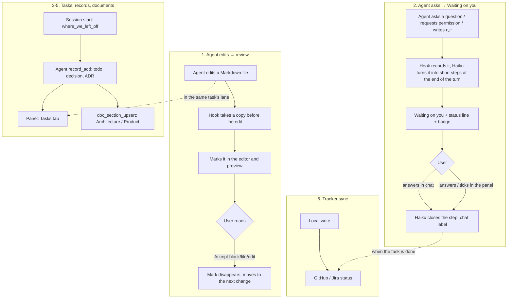

<!-- Generated by Imprimatur from its database; edit in the Imprimatur panel (Architecture/Product). -->

# Product Design Document

## Contents

- [Problem](#chapter-problem)
  - [1. Problems it solves](#problems)
- [Users](#chapter-users)
  - [2. Who it is for](#users)
- [Goals](#chapter-goals)
  - [3. Product summary](#summary)
  - [4. Principles](#principles)
- [Non-goals](#chapter-non-goals)
  - [5. Out of scope](#non-goals)
- [Features](#chapter-features)
  - [6. Main flows](#flows)
  - [7. Surfaces and features](#surfaces)
  - [8. A task's analysis](#task-analysis)
  - [9. Unread: comprehension debt (#91, #92)](#unread)
  - [10. /study: studying a topic (#95)](#study)
  - [11. /exercise: practise any topic in small steps (#108)](#exercise)
  - [12. Social media: /social-post and the Social document (#109)](#social)
  - [13. Project glossary: a third living document (#91)](#glossary-feature)
  - [14. Skills Imprimatur carries](#bundled-skills)
- [Metrics](#chapter-metrics)
  - [15. Success metrics](#metrics)
- [Unsorted](#chapter-unsorted)
  - [16. Agent setup audit (planned)](#agent-setup-audit)
  - [17. The agent's toolset: seen, versioned, installed, found (#138)](#agent-toolset)
  - [18. The panel as a board, with analytics (#147)](#board)
  - [19. The baseline every repo gets](#baseline)

## Problem

### 1. Problems it solves

| Problem | What happens today | With Imprimatur |
|---|---|---|
| The agent's document changes are hard to review | A git diff or a summary in chat; after stage/commit the change is lost, and several turns pile on top of each other | Every change stays marked in the editor and preview until Accepted; independent of git; a one-sentence explanation and history for every edit |
| The agent is waiting for the human and it goes unnoticed | The question is left in the middle of the chat and is lost at the next prompt; with parallel sessions nobody knows who is waiting | Requests from all sessions in one list, tied to a task, closing themselves; a count in the status bar and on the sidebar badge |
| "Where did we leave off" is rebuilt every session | TODO.md files, chat history, memory | A 👉 pointer and a one-line summary per task; handed to the agent at the start of a session |
| Decisions and design are scattered | In chat, in commit messages, in Markdown | Decision, ADR and PDR records are versioned; the architecture and product documents link to them |
| What the agent did is invisible | Only edits are seen | Reads, searches, web, MCP, sub-agent and skill calls as rows tied to a task |
| The configuration that shapes the agent is scattered | CLAUDE.md, rules, skills, Cursor rules and hooks are in separate places; drift goes unnoticed | Agent Setup: one tool-independent view, change tracking, health, drift, merged settings |
| Process rules are copied into every repo | Separate `.claude/hooks/*.sh` in every repo, and the variants diverge | One global hook, plus a small settings file committed per repo |
| The tracker and the tasks drift apart | The status of a GitHub issue and the status of the task are separate | Two-way status with GitHub/Jira |

The market research (2026-10-05) concluded that the bottleneck is not tokens but human attention: reviewing, noticing a wait, and knowing whether a rule worked.

## Users

### 2. Who it is for

#### Primary user

An **individual developer** who spends most of the day with a coding agent (first of all Claude Code), works in several repos and sessions at once, and has to actually read and approve the documents and plans the agent writes. Traits:

- Has the agent write Markdown files such as specs, designs, TODOs and READMEs, and wants to see each change line by line.
- Runs several sessions in parallel and misses which session is waiting on them.
- Makes decisions in chat and wants them to persist somewhere.
- May work on more than one machine (for example work and personal).
- Does not want to be tied to one tool: next to Claude Code, may also use Cursor or Codex.

#### Secondary (future) user

**Teams:** teams that manage agent configuration (CLAUDE.md, rules, hooks, MCP) across several repos and people, and want to measure drift and "did this rule work". Considered as a paid team plan (#42); there is no product today.

#### Distribution assumption

The open source extension is the distribution and trust vehicle: because the hook reads the agent's session transcripts, open code builds trust. Today it installs from a repo clone (`npm run setup`) or as a Claude Code plugin; Marketplace / Open VSX publishing is on the roadmap.

## Goals

### 3. Product summary

**Imprimatur: the agent writes, you approve.** (*Imprimatur* is Latin for "let it be printed": a stamp of approval.)

An open source (MIT) tool made of a VS Code extension, Claude Code hooks and an MCP server. It answers three questions of a developer who works with a coding agent, in one place:

1. **What did the agent change?** The agent's document edits stay marked in the editor and in the Markdown preview, like Word's tracked changes, until they are accepted. A block, a file or a whole edit is **Accepted** with one click. It does not depend on Git.
2. **What is the agent waiting on me for?** Its questions, permission requests and "test this" steps are collected across sessions in the **Waiting on you** list; the list updates itself after every turn.
3. **Where did we leave off, and what did we decide?** Tasks, to-dos, questions, decisions, ADRs and PDRs live in Imprimatur's database; the agent (Claude Code, Cursor, Codex) reads and writes them through MCP tools, and the user sees and edits them in the panel. The architecture and product documents are living documents fed by these records.

It is used daily by a developer who works with an AI agent across several repositories, possibly on more than one machine. Imprimatur also accepts optional plugins.

### 4. Principles

#### 1. Nothing slips through

- Every change the agent makes stays marked until the user explicitly accepts it; committing does not count as approval.
- An open request is never closed on its own: archive, audit and import close it only with evidence. A request closed by mistake is worse than one left open.
- Records are not deleted (`dropped`), document sections are not deleted (`superseded`); who changed what and when stays in the version history.
- Old data heals itself: there is no repair script, the fix is made at read time.

#### 2. Cheap and fast

- A model is used only where verbal judgment is needed and only the small model (Haiku); where a rule is enough, there is no call. It runs on the user's existing Claude subscription.
- Hooks do not hold the tool back (~65 ms, heavy work in the background); the panel shows a change in ~50 ms; queries take < 1 ms at 10,000 records.
- No dependencies: no `npm install` step at install.

#### 3. Independent of agent and tool

- The only way to write records is MCP: Claude Code, Cursor and Codex see the same tools. The tools are few and general (12 tools), because every definition enters the agent's context.
- Agent Setup shows each tool's configuration (Claude Code, Cursor, Copilot, AGENTS.md, Gemini, Windsurf, Cline, Aider) in one place.
- Hook-based features (review, waiting items, activity) are specific to Claude Code today.

#### 4. The user's decisions are recorded

- A decision made in chat is kept as a `decision` record, with its date and the user's own words; the agent does not ask the same question again.
- Design documents are tied to decisions: which ADR/PDR/decision a section rests on is visible.
- The source of truth is the database; the Markdown views (`docs/ARCHITECTURE.md`, `docs/PRODUCT.md`) are generated.

#### 5. Safe defaults

- In an untrusted folder no model, `gh` or repo script runs; secrets live in a `0600` file; comments sent to the tracker are fixed text.
- Process checks do not run unless the repo explicitly turns them on.

## Non-goals

### 5. Out of scope

- **A cost dashboard or enterprise FinOps:** providers (Claude Code `/usage`, Cursor, Copilot) and free tools already report cost. Imprimatur shows what eats context and what does not help.
- **Being a code review tool:** review is for documents (`md`, `mdx` by default); for code, git diff and existing tools are enough. The extension list can be widened but that is not the goal.
- **Changing the Git workflow:** Imprimatur does not commit, stage or manage branches; it does not open PRs.
- **Sending text to the chat:** Claude Code does not allow sending text to an open chat from outside; "Send to Claude" was tried and removed.
- **Process rules specific to a repo:** rules such as an em dash ban, deploy, migration and approval gates stay in the repo; Imprimatur carries only the general process checks.
- **Managing tool configuration:** Agent Setup is read-only; turning rules on and off or moving them across repos is out of scope for now.
- **Making Markdown the source of truth:** README, CLAUDE.md, AGENTS.md, rules and skills stay in files as tool configuration; the source of truth for records and design documents is the database.
- **Command-line task management** (like `imprimatur done --task`) and a restore-from-archive command: not seen as needed.

## Features

### 6. Main flows

#### 1. Agent edits → review / Accept

The agent changes a document; the user opens the file or the preview: an added line is green, a changed word sits in a red box next to the old word, a deleted block is marked. The user Accepts block by block; the view moves to the next one like a review queue. The **Agent changes** tab shows all edits in the repo in task lanes, each with a one-sentence explanation; a diff opens from the row, or an edit is accepted as a whole.

#### 2. Agent asks → Waiting on you → answer

The agent asks something, requests permission, or at the end of a turn says "test this". The request lands in the list with its task, worded so it is understandable a week later without the chat ("#64: …"). If the user answers in chat, Haiku finds which step was decided and marks it; from the panel the user can write an answer, tick the step, or say "Done it". When the task is done, the requests that belong to it close in every session.

#### 3. Where we left off

At the start of a session the agent gets the unfinished tasks and each one's 👉 with `where_we_left_off` (automatically at SessionStart if process checks are on). The user sees the same information on **Home** and in the status line (`Imprimatur · 3 waiting on you · #64 👉 …`).

#### 4. Tasks and records

While working, the agent adds and closes todo, decision, note, ADR, PDR and test records through MCP; the 👉 moves to where the work stopped. In the **Tasks** tab the user opens the task's page: adds records with the quick-add box (`?` question, `!` decision, `#` note, `@me` their own todo), ticks todos, answers questions. Every change is versioned with who made it.

#### 5. Architecture and product documents

When the agent makes an architecture or product decision, it adds an ADR/PDR record, updates the relevant document section with `doc_section_upsert` and links it to the record (if it does not, a process check warns). In the **Architecture** and **Product** tabs the user reads the contents, the rendered text and the contributing records, edits a section or marks it superseded; each section's history is visible. The documents are also written to the repo as `docs/ARCHITECTURE.md` and `docs/PRODUCT.md`.

#### 6. Sync with GitHub and Jira

When a task is done, its GitHub issue closes (or moves to Done in Jira); an issue closed on GitHub finishes the task, a new issue becomes a task; the line in the epic closes with the task. Imprimatur also accepts optional plugins.

### 7. Surfaces and features

#### VS Code panel (the Imprimatur panel)

| Tab | What it is for |
|---|---|
| **Home** | Progress, where each task left off, the first 5 items waiting on you, end-of-turn requests that could not be tied to a task, Audit and Scan history, all tasks; the badge on its button counts what is waiting on you |
| **Tasks** | The task list (this repo or all repos) and the task page: 👉, and under it tabs: Waiting on you (records and that task's end-of-turn requests, with an answer box), To-dos with quick add, Decisions, Notes, Tests, Activity |
| **Analysis** | Architecture, Product, Glossary and Task analyses: live design documents (contents, contributing records, edit, mark superseded, history) and the tasks' analysis files |
| **Agent changes** | The Agent Change Graph: edits and the agent's other work, task lanes, explanation, the rendered diff on hover, Accept |

Keyboard: j/k, Enter, x, a, /, Esc. In the sidebar, rows that open the tabs and a badge that counts what is waiting.

#### Editor marks and preview

- Marks at word or sentence level, the old text readable in a red box, a mark for a deleted block, the overview ruler, the number of changes in the status bar.
- In the Markdown preview, marks at block level, clickable ticks on the right edge, ✓ Accept above the block (instant, without reloading the page).
- `imprimatur.showIn`: Markdown marks are in the preview only by default; `both` turns the editor on too.
- The file's agent edit history (Show Agent Edit History), each edit's diff. An optional Mermaid diagram diff.

#### Agent Setup

Every file that affects the agent, for the repo and for home, grouped by tool and kind: a new/changed/deleted mark, when it takes effect ("always", "for these files", "on request") and which rules apply to the open file, health checks (broken reference, invalid JSON, secret, contradiction), drift across repos, git history and a "what did the last change do" summary, merged settings (hook order, effective permissions). Read-only.

#### Status line

In Claude Code's status line, for the repo and session: `Imprimatur · 3 waiting on you · #64 👉 discover cache`. It does not overwrite the user's existing status line.

#### MCP tools

`where_we_left_off`, `task_list`, `task_get`, `task_upsert`, `record_add`, `record_update`, `pointer_set`, `search`, `doc_get`, `doc_section_upsert`. In Claude Code (settings file or plugin), Cursor and Codex.

#### Process checks

Optional per repo (`.claude/imprimatur.json`): where we left off at session start, a `--no-verify` block, main protection, design first, docs contents, issue fields, sweep, a "Where are we" section, branch finish, document update. Each is `block`, `warn` or off.

#### Command line

`npm run setup` (install), `npm run import` (import old Markdown records), `npm run tracker`, `node scripts/github-webhooks.mjs`, `node scripts/stale-epic-lines.mjs`.

### 8. A task's analysis

STORY: I read a task's analyses, plans, spike results and research notes (wherever the agent wrote the file, including the plan it came out of plan mode with) in one place, the **Analysis** tab; the task page stays focused on to-dos.

- A single **Analysis** tab in the top menu: under it **Architecture**, **Product**, **Glossary** and **Task analyses**; the tab returns to the sub-page opened last.
- **Task analyses:** on the left the tasks that have analyses (newest on top), on the right the selected task's files; one card per file, the sections are the file's `##` headings. A file that was read on this machine opens in the editor with "open", "Go to task" takes you to the task page.
- **Analyses without a task:** below the list; a task picker next to every file, it moves to the selected task.
- **Task page:** an "Analysis · N files →" link in the title; at the top Where we left off and Waiting on you, below it tabs: To-dos, Decisions, Notes, Tests, Activity (the selected tab is remembered, while searching all are shown).
- What was written in past sessions comes in once per repo in the background; by hand: **Imprimatur: Take Task Analyses from Past Sessions** or `npm run analysis` (`--dry-run`, `--no-model`).
- To turn it off: `"analysis": false` in `.claude/imprimatur.json`; to exclude a path: `{"exclude": ["drafts/"]}`.

#### Decisions settled

- 7078: the panel's Analysis tab shows a task's analysis/plan/spike files as one card per file, with the task page kept focused on to-dos; a file that cannot be placed in a task is listed with a one-click "link to this task" action rather than being dropped.

<!-- imprimatur:decisions --> Decisions: [PDR 0079](decisions/0079-gorev-sayfasinda-analiz-gorev-icin-yazilan-analiz-plan-spike.md)

### 9. Unread: comprehension debt (#91, #92)

The agent writes code and documents faster than a person can read them; Imprimatur shows how much you have not yet seen.

- **Task list:** "N unread" per task.
- **Task page and Home:** an "Unread" card: edits that are not accepted (clicking filters Agent changes by that task) and document sections the agent changed since your last read; each one opens, with "Read" or "Mark all read".
- **Architecture / Product / Glossary:** an "Unread" mark and a left edge line on the changed section, a dot in the contents, "N unread · Mark all read" in the title.
- **Status line:** `Imprimatur · 3 waiting on you · 12 unread · …`.

A section you wrote counts as read. Read marks are specific to the device. On first install everything that exists counts as read.

Next: a "since your last read" diff (#93), an end-of-turn briefing (#94).

<!-- imprimatur:decisions --> Decisions: [PDR 0080](decisions/0080-anlama-borcu-satiri-degil-niyeti-karari-davranis-degisikligi.md), [PDR 0082](decisions/0082-okumadiklarin-gorev-listesinde-n-okunmadi-gorev-sayfasi-ve-a.md)

### 10. /study: studying a topic (#95)

To learn a design decision, a feature or a document the agent made well enough to explain it, defend it and point to it in the code: `/study #92` (or "I want to study the section_reads design").

1. A **study note** is written to the task's Analysis page: what and why, how it works, where in the code (a tour in order with `file:line`), the alternatives and why they were not chosen, limits and risks, terms, sources. Nothing without a reason in the records is invented; it says "no reason in the records".
2. **Quiz yourself**: questions come one at a time (comprehension, why, alternative, where in the code, debug, what if it were this way, objection). You answer first; the agent says full / partial / missing and shows what is missing with its source; an "I don't know" gets a hint first.
3. **Mastery**: the score and weak points stay on the task as a note. The next `/study` asks the weak questions first and says what changed since then. A reason found missing in the document becomes a to-do for the agent.

Why it is this way: in Anthropic's 2026 study, people who asked for explanations and asked questions kept 65–86% of the topic, those who only delegated kept 39%.

<!-- imprimatur:decisions --> Decisions: [PDR 0080](decisions/0080-anlama-borcu-satiri-degil-niyeti-karari-davranis-degisikligi.md), [PDR 0084](decisions/0084-study-bir-konuyu-dokumantasyon-calisir-gibi-ogren.md)

### 11. /exercise: practise any topic in small steps (#108)

The user picks any topic (a language feature, a concept for an interview, a spoken language, a book chapter, a sport) and wants to practise it, not only read about it. `/exercise <topic>` in Claude Code turns it into an exercise they tick in the panel's **Exercises** tab.

#### What the user gets

- **A few questions first:** why (understand, do, an exam or interview), their level, time and place; then two or three quick diagnostic questions, so what they know is skipped.
- **A "can do" goal** with how it is checked at the end.
- **5 to 9 steps of 10 to 25 minutes**, each with a kind (learn, example, predict, do, vary, explain, recall), what it is for, and when it counts as done: something they can show.
- **Coaching without answers:** the agent reviews what they bring, gives a hint, then a narrower one; the solution only when they ask after trying.
- **A closing recall** without notes; the weak points are kept for the next session.

#### The Exercises tab

Progress, the step to do now, a box per step, **skip** (why goes in its note), a note per step, **split** (copies `/exercise split step … of exercise …` for Claude Code), drop and resume, finished exercises below.

#### Rules

- Exercises are the user's, not a repo's or a task's: the same list in every project. They stay on this machine.
- A split step is ticked when its smaller steps are; an exercise is done when its steps are.
- Reading is at most a third of the steps; every exercise has a do step and a closing recall.

Later: spaced recall of weak points (1, 3, 7 days, then FSRS-like) on Home; a quick create from the panel.

<!-- imprimatur:decisions --> Decisions: [PDR 0086](decisions/0086-exercise-mode-exercise-turns-any-topic-into-5-9-ticked-steps.md)

### 12. Social media: /social-post and the Social document (#109)

Announcing a project means a different post for each channel, and each channel has its own rules: a subreddit's sidebar, X's character counting, Show HN's guidelines, Product Hunt's launch page. Rules change, and a post that breaks one is removed or ignored.

#### /social-post

- Reads the target platform's own rules and docs **when it writes**, not from memory. When a page cannot be fetched (Reddit blocks most fetches; Discord rules live in the server), the user pastes it, or the post is marked "rules not checked".
- Keeps a dated **rules card** per channel: length, title format, self-promotion, where links go, flair, required parts, timing, what is forbidden.
- Writes the post to fit the card and that community's way of reading, counts characters with a script, and checks every fact against its source.
- Where a platform asks for text written by hand (Show HN), it gives the facts and an outline instead of a draft.
- Never posts, schedules or logs in for the user.

#### The Social document (off by default)

- **Imprimatur: Turn on social media tracking** for a repo adds a **Social** page under Analysis, next to Architecture, Product and Glossary, kept in `docs/SOCIAL.md`.
- One section per channel: the rules read, the post, its status (planned, posted, link), results over time, what was learned. /social-post writes it and updates a channel when the user says a post went out or brings its numbers.
- **Turn off** hides the page and stops the file; the document is kept for when it is turned on again.

<!-- imprimatur:decisions --> Decisions: [PDR 0087](decisions/0087-social-media-is-a-fifth-living-document-social-off-by-defaul.md)

### 13. Project glossary: a third living document (#91)

#### Decisions settled

- 6903: the project glossary became a third living document alongside Architecture and Product (`documents.kind = 'glossary'`), one section per term, sorted alphabetically; it is read and written through the same `doc_get`/`doc_section_upsert` MCP tools and generated to `docs/GLOSSARY.md`, and the agent is instructed to write a new or changed term there as it works.

<!-- imprimatur:decisions --> Decisions: [PDR 0075](decisions/0075-proje-sozlugu-ucuncu-yasayan-dokuman-terim-basina-bir-bolum.md)

### 14. Skills Imprimatur carries

Imprimatur brings its skills to every repo with no manual step: setup links each folder of `skills/` into `~/.claude/skills` (or the plugin carries them), and an Imprimatur update brings their new versions.

| Skill | What it is for | From |
|---|---|---|
| issues, study, exercise, social-post, imprimatur-stats | Imprimatur's own workflows | this repo |
| documentation-writer | Writing a tutorial, how-to, reference or explanation (Diátaxis), outline first | github/awesome-copilot, MIT |
| docs-sync-audit | A read-only check of where the docs no longer match the code, P0–P3 findings with path:line | github/awesome-copilot, MIT |
| writing-clearly-and-concisely | Strunk's rules and the AI patterns to avoid, for any prose people read | softaworks/agent-toolkit, MIT |
| i-have-adhd | Output shaped for a reader with ADHD: next action first, numbered steps, state restated each turn, no tangents; `/i-have-adhd` turns it on until "stop adhd mode" | ayghri/i-have-adhd, MIT |

A skill taken from elsewhere is read in full before it ships, keeps its LICENSE, and records its source commit and every change in `SOURCE.txt`. The documentation skills above are changed so they never write Imprimatur's generated documents by hand, and run no bundled code; i-have-adhd ships unchanged (output rules only). A skill that would keep a second task, decision or memory store next to Imprimatur's is not carried; its useful ideas go into Imprimatur's own features instead.

<!-- imprimatur:decisions --> Decisions: [PDR 0099](decisions/0099-imprimatur-carries-the-adopted-skills-itself-and-installs-th.md)

## Metrics

### 15. Success metrics

The metrics are values measured in real repositories of different sizes.

#### Latency

| Metric | Target | Measured |
|---|---|---|
| Local record → shown in the panel | ~50 ms | File watcher 25–49 ms; an integration test guarantees < 500 ms (the earlier design had a 300 ms wait) |
| GitHub issue change → task | seconds | Webhook (the earlier design polled every 5 min) |
| Time the hook adds to the tool | low | ~65 ms (43 ms of it Node startup), hooks run in parallel |
| Panel query | < 1 ms | < 1 ms at 10,000 records; opening < 5 ms |
| Full refresh of graph + waiting items | < 50 ms | 430 → 34 ms in a large repo, 260 → 21 ms in a smaller one; `graphRows` 150–500 → ~3 ms |
| Idle CPU | ~0% | The earlier 120–140% (two windows) is fixed |
| Tick → redraw in Waiting on you | instant | ~150 ms → 57–80 ms |

#### Cost

| Metric | Before | Now |
|---|---|---|
| Haiku call for an edit's explanation | Every Markdown edit (~100 a day in one repo) | Only for an edit where the agent's own words are not enough and which is shown in the graph; in a measurement, 38 of 40 edits are explained by the agent's own words |
| End-of-turn check | Every turn | Only when an item is open or the answer asks for something |
| SessionStart context | Up to Claude Code's 10,000-character cut | ≤ 4,000 characters |
| MCP tool definitions | | ~1.4k tokens, loaded deferred |

#### Correctness and coverage

- Lines written by the old hook are matched to their calls: 77/79 and 62/62 in two real repositories.
- Database: 12 concurrent writers without an error.
- Markdown import: the number of prefixed lines per file = the number of records.

#### To watch (not measured yet)

- How long the agent waits for the user and how soon changes are reviewed (#42).
- The per-item token cost of the context loaded in every session (#29).

## Unsorted

### 16. Agent setup audit (planned)

The agent setup (CLAUDE.md, AGENTS.md, `.claude/` settings, hooks, skills, subagents, MCP, plugins, Cursor/Codex/Copilot/Gemini/Kiro files) is audited with rules based on the official documentation. The rule engine is agnix and it is used with its full coverage: no rule or file is cut.

- Findings are not hidden; they are grouped as project / user / plugin / worktree and shown with category and level counts. Every finding has a link to the rule's documentation and the date it was verified.
- Every finding is an Imprimatur record: open / applied / rejected (with a reason). A finding that disappears becomes "applied", a rejected one is not reopened; the difference between two scans is visible. Competitors have no per-suggestion status history; that is Imprimatur's difference.
- Later: an LLM layer (quality, contradiction, stale instruction), consistency across agents, context cost × usage (#29).

Epic [#76](https://github.com/halilural/imprimatur/issues/76), first piece of work [#77](https://github.com/halilural/imprimatur/issues/77).

#### Decisions settled

- 5734: the agent setup audit takes agnix's full rule coverage with nothing cut, hides no finding, and keeps a per-suggestion accept/reject status history across scans — the feature's stated point of difference from competitors.

<!-- imprimatur:decisions --> Decisions: [PDR 0071](decisions/0071-agent-setup-denetimi-agnix-in-tam-kapsamini-alir-bulgular-gi.md)

### 17. The agent's toolset: seen, versioned, installed, found (#138)

Epic #138, opened 2026-11-04 and the top priority. Imprimatur becomes the place where everything the agent uses is seen and managed. It builds on the Agent setup view, which already shows every agent file per repo and globally, the drift between copies, the effective settings, and the audit findings.

- **Seen (#139):**
  - *Shipped in 0.92.0:* Agent setup lists installed Claude Code plugins with their version, scope (every repo, or this project) and source marketplace. A plugin installed both for every repo and for this one is flagged. Skills synced from claude.ai are listed with their source and last update.
  - *Next:* hand-copied skills and MCP servers with their source and version.
- **Versioned (#140):** "update available" with what changed, a one-click update, and a lock so an update can be undone.
- **Installed (#141):** a must-have set ships with Imprimatur and goes into every repo, and a repo can turn an item off. Imprimatur changes only what it installed. Repo-specific agent files stay in the repo.
- **Checklist (#142):** the panel lists what this repo is missing or has out of date. Each item has an action, and Home shows the count.
- **Recommended (#143):** maintained, well-adopted OSS skills, plugins and MCP servers that match the repo's stack.
- **Found on demand (#144):** when work touches a technology with no skill installed, Imprimatur finds candidates, vets them, and installs one once the user agrees.
- **Cost (#145):** what each hook costs per run and per session.

Anything brought in is vetted first: its license allows redistribution, its hooks and network calls have been read, and it adds no second task store, memory store or context injector.

<!-- imprimatur:decisions --> Decisions: [PDR 0100](decisions/0100-imprimatur-is-where-the-agent-s-toolset-is-seen-and-managed.md), [ADR 0102](decisions/0102-agent-setup-lists-installed-claude-code-plugins-from-claude.md), [PDR 0103](decisions/0103-139-covers-everything-that-shapes-the-agent-s-decisions-not.md), [ADR 0104](decisions/0104-agent-setup-shows-what-the-repo-s-last-claude-code-session-w.md)

### 18. The panel as a board, with analytics (#147)

Epic #147, opened 2026-11-04. The Imprimatur panel looks and works like the ponytail board. The VS Code side bar stays as it is.

- **Board look on every tab (#148).** *Shipped in 0.95.0:* a near-black board palette, with a light variant on light themes. Cards have a soft gradient and an inner highlight, corners are rounder, and the app bar is translucent. High-contrast themes keep VS Code's colours, and text stays legible.
- **Session numbers (#149):** each Claude Code session's cost, time, lines and tokens.
- **One stats module (#150):** daily series, shared by the panel and `/imprimatur-stats`.
- **Board landing (#151):**
  - cards with sparklines;
  - a large chart with a metric switch and a 7d/30d/90d/All range;
  - a sessions table;
  - a 12-week activity heatmap with active days and streak.
- **Analytics on each tab (#152):** tasks over time, agent edits per day and the most edited files, document chapters filled, and hook cost.

<!-- imprimatur:decisions --> Decisions: [PDR 0106](decisions/0106-the-whole-imprimatur-panel-becomes-a-board-in-the-ponytail-b.md), [ADR 0107](decisions/0107-the-board-look-comes-from-theme-js-on-dark-and-light-themes.md)

### 19. The baseline every repo gets

Imprimatur's own plugin brings its hooks, its MCP server and its skills: issues, study, exercise, imprimatur-stats and social-post. It installs at user scope. Beyond that, every repo should have five third-party items. Imprimatur does not ship them: each is installed from its own marketplace or repo, at user scope, after the user confirms.

| Item | Why | Source |
|---|---|---|
| The repo's language server | exact go-to-definition, references and type errors | an LSP plugin chosen by the repo's files (typescript-lsp, pyright-lsp, gopls-lsp…) |
| security-guidance | warns about security problems while Claude edits | claude-plugins-official |
| ponytail | the smallest change that fully solves a task | DietrichGebert/ponytail |
| context-mode | keeps large tool output out of the context window | mksglu/context-mode. ⚠ It keeps its own session store next to Imprimatur's records |
| humanizer | clears AI tells from prose | blader/humanizer, downloaded into ~/.claude/skills with a SOURCE.txt for the upstream check |

**In Agent Setup → Checklist:**

- A missing item is a **Baseline: install …** row; one the user turned off is a **Baseline: turn on …** row. The button shows a confirmation, then runs `claude plugin install|enable <id> --scope user` in a terminal, or downloads the skill.
- **Not in This Repo**, on a row's menu, opts the repo out of that item. The choice is kept in the repo's Imprimatur data. Setting a plugin's `enabledPlugins` entry to `false` in the repo's `.claude` settings counts as opting out too.
- A **Baseline: N off in this repo** row brings an item back.

Imprimatur only adds what it installs. It never edits or removes a hook, a plugin or a skill it did not install.

#### Decisions settled

- 9332: Imprimatur carries the community skills it adopts itself — its own plugin and marketplace bundle them, with license and source commit, and Imprimatur's setup installs them in every repo automatically; where a tool cannot be carried this way (a different app, a second store, an incompatible license), Imprimatur takes its ideas into its own features instead of adopting it directly.

<!-- imprimatur:decisions --> Decisions: [PDR 0099](decisions/0099-imprimatur-carries-the-adopted-skills-itself-and-installs-th.md), [PDR 0108](decisions/0108-the-baseline-for-every-repo-imprimatur-s-own-skills-plus-fiv.md)
