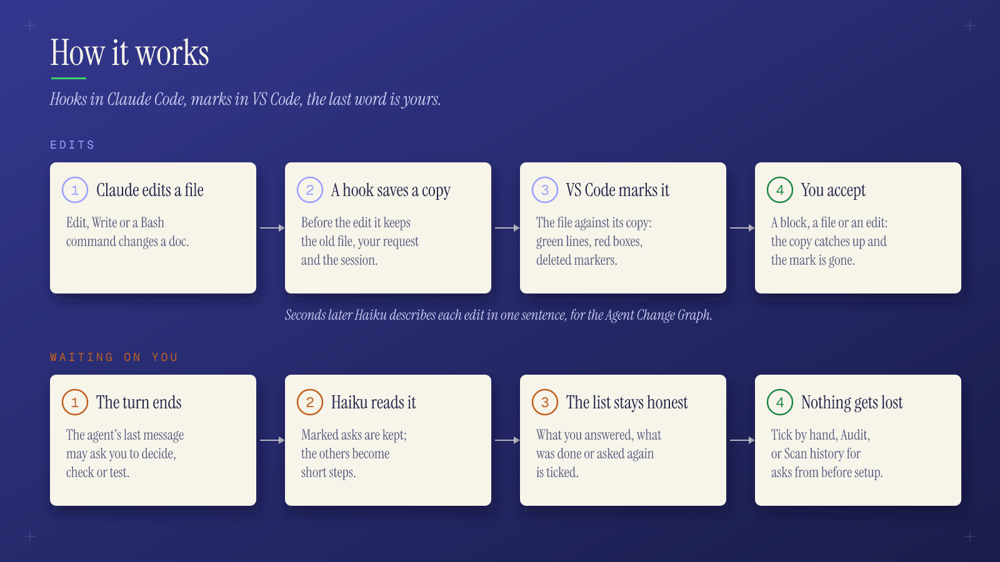

# Imprimatur reference

The full reference. For an overview and install steps, see the [README](../README.md).

## Contents

- [Tracked changes](#tracked-changes)
- [Agent Change Graph](#agent-change-graph)
- [Waiting on you](#waiting-on-you)
- [The Imprimatur panel and side bar](#the-imprimatur-panel-and-side-bar)
- [Tasks and records](#tasks-and-records)
- [Design documents](#design-documents)
- [Task analyses](#task-analyses)
- [Unread](#unread)
- [/study](#study)
- [Agent setup and recommendations](#agent-setup-and-recommendations)
- [Archive](#archive)
- [How it works](#how-it-works)
- [Setup options](#setup-options)
- [Install by hand](#install-by-hand)
- [Hooks](#hooks)
- [MCP tools](#mcp-tools)
- [Settings](#settings)
- [Process checks](#process-checks)
- [Epics and the issue tracker](#epics-and-the-issue-tracker)
- [Plugins](#plugins)
- [Commands](#commands)
- [Limits](#limits)
- [Develop](#develop)

## Tracked changes

- Added lines get a green background.
- A changed line where only one word changed marks that word: the new word highlighted,
  the old one in a red box next to it. When more than one word changed, the old sentence
  is shown above the line (a CodeLens: the editor API cannot insert a real line) and the
  new line is highlighted.
- A deleted block shows a red marker on the line before it. Hover to read it.
- Old text is shown as plain text in a red box, with no strike line, so it stays
  readable. In the preview it is rendered as Markdown.
- Marks in the overview ruler, and a change count in the status bar.
- **✓ Accept** in the editor (CodeLens) works per Markdown unit. A block that is all new
  (table, quote, list item, paragraph, heading, code, HTML, rule) is one unit. A changed
  line, such as a table cell, is its own unit. **✓ Accept** on a changed block in the
  Markdown preview accepts that block. **Imprimatur: Accept Agent Change at Cursor** and
  **Accept All Agent Changes in File** do the same from the command palette. After an
  accept the view moves to the next change, like a review queue.
- Git is not involved: staging or committing does not clear the marks.
- **Imprimatur: Show Agent Edit History** lists the agent's edits to the file newest
  first, like a commit log. Pick one to open its diff (before and after), or pick **All
  changes under review**.

### Where marks show

- `imprimatur.showIn`: Markdown files are marked only in the preview by default
  (`preview`). `both` adds the editor marks and their ✓ Accept lenses. `editor` uses the
  editor only. Other file types are always marked in the editor.
- `imprimatur.editorAlsoFor` (globs, for example `["**/todos/**"]`) adds the editor marks
  for matching Markdown files while `showIn` stays `preview`.

### The Markdown preview

- Changed blocks are colored, their old text struck through right above them, and
  deleted lines struck through where they were.
- Thin marks over the preview's scrollbar, like the editor's overview ruler: one colored
  tick per change (green added, blue changed, red old or deleted). Click a tick to jump
  there.
- With `imprimatur.mermaidDiff` on, changed Mermaid flowcharts are colored like a visual
  diff: new nodes and arrows green, changed labels orange, removed ones red and dashed
  (kept visible), with a legend and an Accept button above the diagram. It is off by
  default because two Mermaid preview extensions in one window can then fail to render.

## Agent Change Graph

Open it with **Agent Graph** in the status bar, or **Imprimatur: Open Agent Change
Graph**. The status bar button also shows how many asks wait on you.

- Every agent edit in the repo as a table like Git Graph: one colored lane per Claude
  session. Click a row for its diff.
- The description is one plain sentence on what the edit changed, written a few seconds
  later by a small model from the edit's diff ([hooks/describe.mjs](../hooks/describe.mjs),
  `claude -p --model haiku`, run in the background). The language comes from
  `IMPRIMATUR_LANG` (default English). `IMPRIMATUR_DESCRIBE=off` turns it off. Until
  then, or without it, the row shows what the agent said it was doing, else the nearest
  heading and the first changed line.
- Hover the description for all of it. Your request is in the row's tooltip. The session
  column shows Claude's title for the conversation.
- A green ✓ marks edits with nothing left under review, an amber dot the rest. Hover the
  dot for an Accept button, or right-click the row: Accept this edit, Go to change, Open
  diff.
- Hover the status cell to see the change. The popup stays while you move into it, and
  scrolls. A Markdown edit is shown rendered, as in the preview: added and changed blocks
  marked, old text in red boxes, one block of context around each.

## Waiting on you

Everything the agent asked of you: questions, commands waiting for permission, and
"verify / test this" at the end of a turn. Open ones come first.

- Each step is written to make sense on its own, with a line on why (for example
  "#64: test the export on a large repo").
- A step shows its task. Click the key to open its GitHub issue or Jira page (the link in
  the task's `TODO.md`, or the repo's GitHub issue), or the 📄 to open the `TODO.md` at
  the line that says it.
- Questions close once you reply. Things to go and do ("test this", "Reload Window") stay
  open until you mark them done or tick every step. Your later replies are kept on them
  as notes.
- The list is flat, like the edits: one row per step, newest first, history kept. A row's
  status is a checkbox while open, then ✓ done (by you, a chat reply or the audit),
  "replaced" (asked again later), or Answered. "Open only" hides the rest.
- Click a row for the full message. Right-click: Mark as done, Copy. The Graph column
  shows only with more than one session. The filter works on both tabs.
- After each turn Haiku keeps the list honest: what you answered, what was done or asked
  again is ticked. **Audit** runs the same review on demand.
- **Scan history** reads your past Claude sessions and `TODO.md` files for asks you may
  have missed. See [How it works](#how-it-works), step 5.

## The Imprimatur panel and side bar

The panel has these tabs:

- **Home**: progress, where each task was left, the top asks, the turn-end asks with no
  task, Audit and Scan history. Its badge counts what waits on you.
- **Tasks**: the task list by status, for this repo or every repo. A task's page shows
  where you left off, then tabs: what waits on you (with the turn-end asks for it and an
  answer box), to-dos to tick with a quick-add box (`?` question, `!` decision, `#` note,
  `@me` your own to-do), decisions, notes, manual tests and activity.
- **Analysis**: Architecture, Product, Glossary and each task's analyses.
- **Agent changes**: the [Agent Change Graph](#agent-change-graph).

Keyboard: j/k, Enter, x, a, /, Esc. Writes go to Imprimatur's database as you.

The **side bar** (its own icon in the activity bar) has rows that open the panel on a tab
(the badge counts what waits on you), then [Agent setup](#agent-setup-and-recommendations).

The Claude Code **status line** shows the session's repo and task:
`Imprimatur · 3 waiting on you · 12 unread · #64 👉 …`. Setup adds it only if you have
none.

## Tasks and records

Tasks are keyed `#58` (a GitHub issue) or a Jira key such as `PROJ-12`. Each task holds
records: to-dos, questions, answers, decisions, notes, fix-mes, ADRs (architecture), PDRs
(product) and tests. The 👉 pointer marks where work stopped, and each task keeps a
one-line summary of where it stands.

Agents read and write them through the [MCP tools](#mcp-tools). The records live in one
database per machine: `~/.local/share/imprimatur/imprimatur.db` on Linux,
`~/Library/Application Support/imprimatur/imprimatur.db` on macOS. Set `IMPRIMATUR_DB`
to move it. Records are not deleted (dropped instead), and every change is versioned
with who made it.

Records a repo still keeps in Markdown (`docs/todos/*/TODO.md`, `docs/design`,
`PRODUCT.md` or `docs/product`, `docs/testing`) move in with
`npm run import -- <repo> [--dry-run]` or **Imprimatur: Import Markdown Records**. It can
run again (nothing is added twice) and checks each file's count.

## Design documents

Every repo has three living documents in sections: **Architecture**, **Product** and
**Glossary** (one section per term). They show in the panel's **Analysis** tab with their
contents, the records each section rests on, an edit button, Mark superseded and each
section's history.

- They stay in step with `ARCHITECTURE.md`, `PRODUCT.md` and `GLOSSARY.md` in `docs/`, or
  the folder `.claude/imprimatur.json` names: `{"docs": {"dir": "docs/design"}}`.
- Whenever Imprimatur comes to a repo, the sync gets both sides to the same text. With no
  files it writes them. A hand-written file is adopted (each `##` heading a section, its
  imported records linked) and rewritten in Imprimatur's form. An edit saved in the file
  is taken in; a change in Imprimatur is written out.
- A section changed on both sides is a conflict, and neither is written:
  `npm run docs -- sync [repo] [--dry-run] [--take file|db]`. Files that went away after
  an import come back from git: `npm run docs -- sync --rev <commit>`.
- The sync runs at session start, after `doc_section_upsert`, after an edit of the file,
  and in VS Code. `{"docs": {"sync": false}}` turns it off.
- Once per repo, when the repo has at least 10 records and was never backfilled, a
  background `claude -p` (Sonnet, capped at $3) reads the records and the code and writes
  the documents through the MCP server.

## Task analyses

- Every analysis, plan, spike result or research note the agent writes for a task,
  wherever it puts it, is kept in the task's **Analysis** section: one part per `##`
  heading, every change a version. The plan it leaves plan mode with is kept too.
- The task comes from the file's folder (`docs/todos/<key>/`), a key in its path
  (`spikes/81-x/`) or branch, or the task the session was working on. Haiku decides only
  when the path and headings cannot tell.
- Past sessions are read once per repo in the background, or on demand with **Imprimatur:
  Take Task Analyses from Past Sessions** or `npm run analysis` (`--dry-run`,
  `--no-model`).
- In `.claude/imprimatur.json`: `"analysis": false` turns it off,
  `{"analysis": {"sync": false}}` keeps it on this machine only, and
  `{"analysis": {"exclude": ["drafts/"]}}` leaves paths out.

## Unread

What the agent wrote that you have not seen yet (comprehension debt).

- Each task in the list shows "N unread".
- Its page and Home list the edits not accepted and the design-document sections the
  agent changed since you last read them, each with **Read it**.
- A changed section is marked in Architecture, Product and Glossary.
- Sections you write count as read. Read marks stay on this machine. On first install,
  everything that exists counts as read.

## /study

Study one topic end to end, as if studying its documentation. The topic can be a
decision, a feature, a document or an epic: `/study #92`.

1. The agent writes a study note into the task's analysis: what and why, how it works, a
   code tour with `file:line`, the alternatives, the limits and the terms.
2. It quizzes you one question at a time. You answer first. It grades the answer against
   the records and the code and points to what was missing.
3. A mastery note keeps the score, and the next study asks the weak questions first.

The skill reads everything with the `study_material` MCP tool. Setup links it into
`~/.claude/skills`; the plugin brings it by itself.

## Agent setup and recommendations

**Agent setup** (in the side bar) lists every file in the repo, and in your home folder,
that shapes a coding agent, whatever the tool: Claude Code (CLAUDE.md, settings hooks and
permissions, hook scripts, skills, commands, agents, MCP), Cursor rules, Copilot
instructions, AGENTS.md, GEMINI.md, Windsurf, Cline, Aider, and the git hooks commits run
through.

- Files are grouped by tool, each with a one-line summary (a settings file lists its
  hooks).
- Files new, changed or removed since you last looked are marked until you **Mark all as
  seen**.
- Per file: **Compare with Another Repo's Copy** (drift across repos, see
  `imprimatur.setup.driftRoots`) and **Explain Last Change**.
- It is read only.

**Recommendations** (the lightbulb) is one place for what to improve, from two producers.
Each finding is a record that stays: open, applied (gone in a later run), or dismissed
with a reason. A dismissed one does not come back.

- **Agent setup**: lints every agent file with [agnix](https://github.com/agent-sh/agnix),
  whose rules cite the tools' docs: the repo, and your home's agent folders with their
  plugins. Findings are grouped by project, your setup, plugin and worktree, then by
  category. Findings in files Claude Code does not load are kept apart ("not loaded").
  agnix is fetched with `npx` (once, cached by npm), so the folder must be trusted. Also
  `npm run audit -- [repo] [--global] [--dry-run]` and the `setup_audit` MCP tool.
- **Project** (**Imprimatur: Review Project Best Practices**): best practices for how the
  repo is built, by ISO/IEC 25010:2023 and NIST SSDF (security, reliability,
  maintainability, compatibility, performance, the development process; the rest on
  request). Code fetches the stack's current documentation (Context7, vendors' docs MCP
  servers, changelogs). Claude judges one category per call against your architecture
  document and decisions. A recommendation is kept only if it cites a page fetched in the
  run and has evidence in the repo. It takes about 2 to 3 minutes, uses your Claude plan,
  and asks first. Also
  `npm run best -- [repo] [--categories …|all] [--refresh-sources] [--budget 1.5]`.

## Archive

Once a day per repo, what is older than `imprimatur.archive.afterDays` (7 by default,
`0` = never) leaves the graph and the waiting list. An older agent edit counts as
accepted, and its history row moves to `.claude/imprimatur/archive/<date>/` (gzipped,
same layout, read with `zcat`). Waiting logs with nothing open move too. Open asks stay
until you do them. **Imprimatur: Archive Old Agent Edits and Asks Now** runs it at once.

## How it works



1. A Claude Code hook ([hooks/baseline.mjs](../hooks/baseline.mjs)) runs before each agent
   edit of a listed file type: Edit, Write, or a Bash command that names the file (for
   example a python or sed edit). Bash is compared before and after, so read-only
   commands leave no trace. The hook:
   - copies the file to `.claude/imprimatur/baseline/<path>` if there is no copy yet (an
     empty copy for a new file);
   - appends `{t, session, tool, prompt, before}` to
     `.claude/imprimatur/history/<path>.jsonl`, a history of the agent's edits.
2. The VS Code extension ([vscode/](../vscode/)) diffs each open file against its copy
   (line LCS, then word LCS inside changed lines). Every change looks the same, whichever
   agent edit made it; the edit history keeps the order.
3. Accept writes the change at the cursor into the copy. Accept all deletes the copy. The
   history stays.
4. A second hook ([hooks/waiting.mjs](../hooks/waiting.mjs)) appends what the agent waits
   on you for to `.claude/imprimatur/waiting/<session>.jsonl`: AskUserQuestion,
   PermissionRequest, input notifications, and the lines of the final message that ask
   something (a `?`, phrases like "please test", "please verify", "shall I", or any line
   starting with 👉).
   - A later event in the session closes earlier questions, with your next prompt kept as
     the answer. Things to go and do stay open until you mark them done.
   - After each of your messages, [hooks/resolve.mjs](../hooks/resolve.mjs) asks a small
     model which open steps the message settled ("ok, merge it" settles "shall I
     merge?") and ticks them, tagged "chat". The agent's next message does the same for
     steps it reports done or asks again.
   - A message that names a task (`PROJ-12`, or a number alone) also settles that task's
     steps asked in other sessions. An item closes when all its steps are ticked.
   - When a task's `docs/todos/<task>/TODO.md` (or the older `todos/<task>/TODO.md`) says
     done (its `## Status` starts with Done), the next turn end ticks the task's steps in
     every session, except ones asked after the `TODO.md` last changed.
   - After each agent turn, Haiku audits the list with the agent's final message
     ([vscode/audit.js](../vscode/audit.js)). It closes steps that are done, answered or
     only reports, and writes what the message really asks as short steps (the agent's 👉
     lines verbatim, when it marks its asks; an ask in nearly the same words replaces the
     old step). The **Audit** button runs the same review on demand. Without the model,
     the rules above apply.
5. **Scan history** ([vscode/history.js](../vscode/history.js)) finds what was already
   waiting on you when Imprimatur was set up after work began. It runs once when the
   panel first opens in a project, and again from the button.
   - It reads Claude Code's own transcripts of the project
     (`~/.claude/projects/<project>/*.jsonl`, last 30 days). Earlier turns' 👉 lines
     become steps, your later messages are kept on them, and Haiku audits each session
     with its final message, as the hook would have.
   - Sessions that already have a log or were scanned before are skipped
     (`.claude/imprimatur/scanned.json`).
   - It also adds the `TODO: (K)` lines (your own to-dos) of `TODO.md` and
     `docs/todos/*/TODO.md` (or `todos/*/TODO.md`). On the next scan the ones marked DONE
     or removed are ticked.

In an untrusted VS Code folder, Imprimatur shows changes and records but starts no model
calls, `gh` or repo scripts (Workspace Trust).

## Setup options

### The plugin

```sh
claude plugin marketplace add halilural/imprimatur
claude plugin install imprimatur@imprimatur
```

The plugin brings the hooks, the MCP server and the `/study` skill, and Claude Code keeps
them up to date. It does not bring the VS Code extension or the status line. Plugin hooks
take no arguments: they read the language and file extensions from `IMPRIMATUR_LANG`, the
plugin's options (`/config`), or the `config.json` next to Imprimatur's database.

### From a clone

You need Node 22.13+, git, VS Code 1.100+ and the `claude` CLI. In a clone of this repo:

- `npm run setup` adds the Claude Code hooks for every repo to `~/.claude/settings.json`
  (a backup first; ours are updated in place, other hooks are left alone), the status
  line (only if you have none), and the MCP server, then packages and installs the
  extension and checks for the `claude` CLI.
- `npm run setup -- --plugin` installs the plugin from the clone instead, takes the
  settings-file hooks and the user-scope MCP server out (a backup first), and adds the
  status line and the extension. While the plugin is enabled, a plain `npm run setup`
  writes no hooks, so they do not run twice.

Options:

- `--lang German`: the language of the model's descriptions and steps (default English).
  It also sets `imprimatur.language` and writes `config.json` for the plugin's hooks. A
  repo can set its own in `.claude/imprimatur.json` (`{"lang": "English"}`), which also
  tells the agent at session start to write that repo's records, documents, comments and
  commits in it.
- `--exts md,mdx`: the file types whose edits are tracked (default `md,mdx`).
- `--show-in both`: also mark Markdown in the editor (`imprimatur.showIn` in VS Code's
  machine settings; on a remote or WSL machine,
  `~/.vscode-server/data/Machine/settings.json`).
- `--no-extension`: skip the extension.
- `--dry-run`: show the changes only.

The MCP server (`mcp/server.mjs`, Node 22.13+) is registered for Claude Code at user scope,
and for Cursor (`~/.cursor/mcp.json`) and Codex (`~/.codex/config.toml`) when they are
installed.

## Install by hand

1. Hooks, in your project's `.claude/settings.json` (file extensions after the script
   name; default `md mdx`):

   ```json
   {
     "hooks": {
       "PreToolUse": [
         {
           "matcher": "Edit|Write|Bash",
           "hooks": [{ "type": "command", "command": "node \"$CLAUDE_PROJECT_DIR\"/path/to/imprimatur/hooks/baseline.mjs md mdx" }]
         }
       ],
       "PostToolUse": [
         {
           "matcher": "Bash",
           "hooks": [{ "type": "command", "command": "node \"$CLAUDE_PROJECT_DIR\"/path/to/imprimatur/hooks/baseline.mjs md mdx" }]
         }
       ],
       "PostToolUseFailure": [
         {
           "matcher": "Bash",
           "hooks": [{ "type": "command", "command": "node \"$CLAUDE_PROJECT_DIR\"/path/to/imprimatur/hooks/baseline.mjs md mdx" }]
         }
       ]
     }
   }
   ```

   `PostToolUseFailure` records a Bash command that edited a file and then failed.
   Without it, that edit is lost.

   For **Waiting on you**, also run `hooks/waiting.mjs` (no arguments) on `PreToolUse`
   and `PostToolUse` with matcher `AskUserQuestion`, on `PermissionRequest`, `Stop` and
   `UserPromptSubmit`, and on `Notification` with matcher
   `agent_needs_input|elicitation_dialog|elicitation_url_dialog`.

   MCP server: `claude mcp add -s user imprimatur -- node /path/to/imprimatur/mcp/server.mjs`,
   and `hooks/mcp-session.mjs` on `PreToolUse` with matcher `mcp__imprimatur__.*` (it
   tells the server which session calls).

2. Ignore the copies: add `.claude/imprimatur/` to `.gitignore` (or to your global git
   ignore file).
3. Extension: `npm run package`, then install `dist/imprimatur-<version>.vsix`
   (`code --install-extension …`, or Extensions view → Install from VSIX).

## Hooks

The plugin's hooks ([hooks/hooks.json](../hooks/hooks.json)):

| Script | Events | What it does |
|---|---|---|
| `baseline.mjs` | PreToolUse (Edit, Write, Bash), PostToolUse and PostToolUseFailure (Bash) | Copies a file before the agent's edit and logs the edit |
| `waiting.mjs` | AskUserQuestion, PermissionRequest, Notification, Stop, UserPromptSubmit | Records what the agent waits on you for |
| `process.mjs` | SessionStart, PreToolUse, PostToolUse, Stop | Where you left off at session start, the [process checks](#process-checks), the one-time backfills |
| `activity.mjs` | PostToolUse, PostToolUseFailure (every tool) | The agent's other work (reads, searches, web, MCP, sub-agents, skills) as activity rows |
| `mcp-session.mjs` | PreToolUse (Imprimatur's MCP tools) | Tells the MCP server which session calls |

`describe.mjs` and `resolve.mjs` run in the background for edit descriptions and for
closing answered asks. `statusline.mjs` is the status line.

## MCP tools

The MCP server ([mcp/server.mjs](../mcp/server.mjs)) gives every agent the same tools:

| Tool | What it does |
|---|---|
| `where_we_left_off` | The unfinished tasks and each one's 👉 |
| `task_list`, `task_get`, `task_upsert` | List, read, and create or update a task |
| `record_add`, `record_update` | Add a record to a task, or change one |
| `pointer_set` | Move a task's 👉 |
| `search` | Search records, in this repo or every repo |
| `doc_get`, `doc_section_upsert` | Read the design documents and glossary, write a section |
| `study_material` | Everything `/study` reads on a topic |
| `setup_audit` | Run the agent setup audit |

## Settings

| Setting | Default | What it does |
|---|---|---|
| `imprimatur.showIn` | `preview` | Where Markdown changes are marked: `preview`, `editor` or `both` |
| `imprimatur.editorAlsoFor` | `[]` | Globs of Markdown files that also get editor marks |
| `imprimatur.language` | empty | Language of the steps Scan history and Audit write; empty: the agent's |
| `imprimatur.mermaidDiff` | `false` | Color changed Mermaid flowcharts in the preview |
| `imprimatur.archive.afterDays` | `7` | Days before an edit counts as accepted and leaves review; `0` = never |
| `imprimatur.docs.export` | `true` | Keep the design documents and their files in step |
| `imprimatur.tracker.createTasks` | `true` | An open GitHub issue with no task gets one (at most 50 a run) |
| `imprimatur.setup.driftRoots` | `["~/projects"]` | Folders whose repos are compared for agent setup drift |
| `imprimatur.setup.driftExclude` | `["CLAUDE.md", "CLAUDE.local.md", ".claude/settings.local.json"]` | Agent files meant to differ per repo |
| `imprimatur.diagramZoomStep` | `40` | Diagram zoom per mouse-wheel notch, in percent |

Environment variables: `IMPRIMATUR_LANG` (language of model-written text),
`IMPRIMATUR_DESCRIBE=off` (no edit descriptions), `IMPRIMATUR_DB` (database path),
`IMPRIMATUR_JIRA_TOKEN` (Jira API token).

## Process checks

Opt-in per repo. **Imprimatur: Turn On Process Checks for This Repo** writes
`.claude/imprimatur.json`; commit it. Without the file nothing runs. Then Imprimatur's
hooks:

- show where work stopped at session start, and design documents that need attention
  (ADRs or PDRs no section links, conflicts with their files);
- block `git --no-verify` and `HUSKY=0`;
- keep code off `main` (allowed paths are set in the file);
- refresh the docs table of contents;
- check that each answer ends with a status section (a "Where we are" section by default; `status.word` sets the word);
- warn when a new issue lacks its milestone or board item, a task is done but its issue
  is open, code starts before its ADR or PDR, an ADR or PDR (or a decision a section
  links) changes but its document section does not follow, or a merged branch is left
  behind.

Each check is `"block"`, `"warn"` or `false`.

## Epics and the issue tracker

A task set done or dropped closes its line in its epic in the same write. The epic's open
records whose `links.issue` is the task, or whose title starts with its key (`#56 …`,
`[#56 …](url)`, `PROJ-12 …`), become done with a note ("#56 done (date)"). The epic's 👉
on such a line moves to its next open record. Reopening a task leaves those lines closed.

VS Code keeps task status in step with the issue tracker: on start, every 5 minutes, and
a few seconds after a status change. **Imprimatur: Sync with Issue Tracker** forces it. It
does not run in an untrusted folder.

- **GitHub** (`#N` tasks in a repo whose origin is github.com, with `gh` logged in): a
  task done closes its issue as completed, dropped closes it as not planned, and reopened
  reopens it. Each comes with a fixed comment ("Imprimatur: completed" and so on), with
  none of the task's text. An issue closed or reopened on GitHub sets the task's status
  (the first sync of a repo only notes where issues stand). An open issue without a task
  gets one (`imprimatur.tracker.createTasks`, at most 50 a run). Network errors and rate
  limits are retried later; a push that keeps failing otherwise is given up after 5
  tries.
- **Jira** (tasks keyed `PROJ-12`): `config.json` next to the database gets
  `{"tracker": {"jira": {"baseUrl": "https://you.atlassian.net", "email": "you@…"}}}`,
  and the API token goes in `IMPRIMATUR_JIRA_TOKEN` (or `tracker.jira.token`, with the
  file at mode 0600; `baseUrl` must be https). Status moves through the issue's
  transitions (Done or Won't Do by name), its comment posted first.

`npm run tracker` runs it from a terminal (`--all` for every repo, `--dry-run` to see what
would change). `node scripts/stale-epic-lines.mjs` lists open epic lines of tasks already
finished, changing nothing.

## Plugins

Imprimatur loads optional plugins. `config.json` next to the database
(`~/.local/share/imprimatur/` on Linux) names them in
`"plugins": ["/absolute/path/to/plugin.js"]`. A plugin is told about every change to a
repo, task, record or document section, and can add actions to **Imprimatur: Plugin
Actions…**. The contract is in [vscode/db.js](../vscode/db.js) (`loadPlugins`). Without
plugins nothing changes.

## Commands

The command palette has, under **Imprimatur:**

- Review: Accept Agent Change at Cursor, Accept All Agent Changes in File, Accept Agent
  Changes in Range, Show Agent Edit History, Open Agent Change Graph.
- Panel: Open Home, Open Tasks, Open Waiting on You, Open Architecture Document, Open
  Product Document, Open Project Glossary, Show a Design Document Section.
- Records: Search Records, Add Record…, Show Every Repo, Show This Window's Repos Only,
  Refresh Records.
- Agent setup: Recommendations…, Audit Agent Setup (agnix), Review Project Best
  Practices (Claude).
- Upkeep: Import Markdown Records, Take Task Analyses from Past Sessions, Archive Old
  Agent Edits and Asks Now, Sync with Issue Tracker, Turn On Process Checks for This
  Repo, Plugin Actions….

## Limits

- No marks in diff tabs (for example Working Tree): git already colors those.
- Bash edits are seen only for files named in the command; a glob (`sed -i *.md`) is
  missed.
- Ordered list numbers are not compared: deleting an item does not mark the renumbered
  items after it.
- Changes inside fenced code blocks (``` or ~~~) are not marked; the edit history still
  lists them.
- The preview works per block (no word marks there); a deleted table row is not shown in
  the preview.
- Every difference between the copy and the file is marked, including your own edits to
  the same file.
- The history stores the full text before each edit: small for documents.
- Plain O(n·m) LCS on the part between the common head and tail: fine for documents, slow
  for files with thousands of changed lines.
- The hook-based features (review, Waiting on you, activity) work with Claude Code only.
  Cursor and Codex get the MCP tools.
- On WSL the database cannot live under `/mnt/<drive>`: SQLite's WAL breaks across the
  WSL and Windows boundary.

## Develop

```sh
npm ci
npm test                    # unit tests (Node 22.13 or later)
npm run test:integration    # VS Code integration tests (xvfb on Linux)
npm run package             # builds dist/imprimatur-<version>.vsix
```

See [CONTRIBUTING.md](../CONTRIBUTING.md) for the conventions and the release steps.
