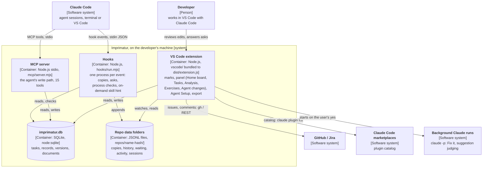
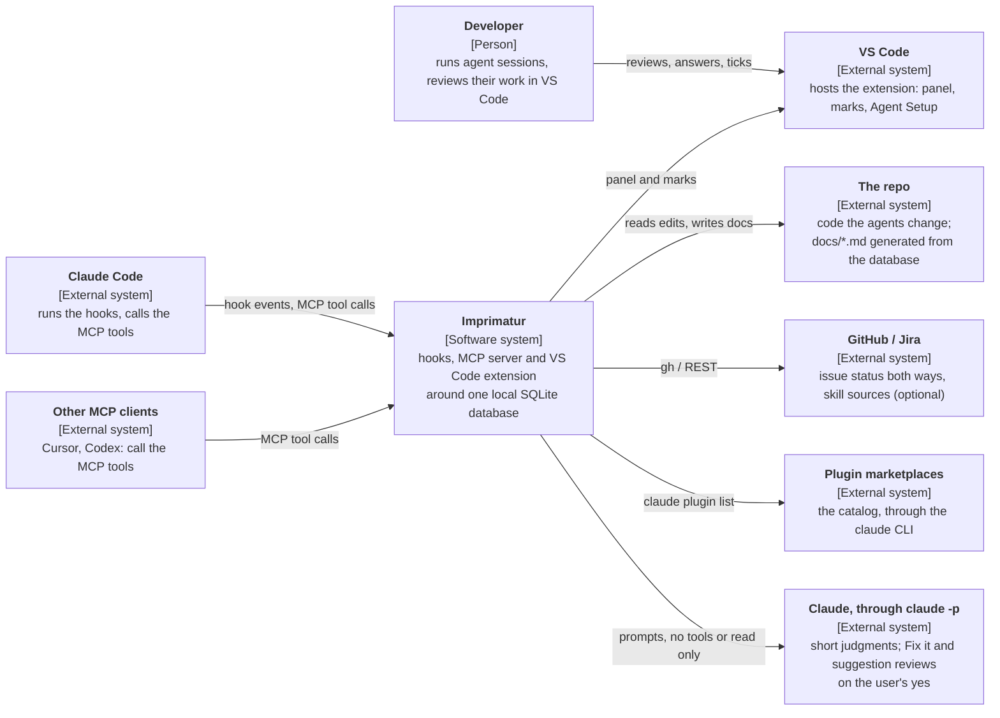

<!-- Generated by Imprimatur from its database; edit in the Imprimatur panel (Architecture/Product). -->

# Capability · agent-setup-audit

## Contents

1. [Hooks and flows](#hooks)
2. [Audit: is the finding in effect (#78)](#audit-effect)
3. [Process checks](#process-checks)
4. [Test strategy](#testing)
5. [Components and their boundaries](#components)
6. [Security](#security)
7. [Installation and distribution](#deployment)
8. [System context](#context)
9. [Model calls and cost](#model-calls)
10. [Agent setup audit (agnix)](#agent-setup-audit)
11. [Agent setup inventory: plugins, synced skills and the session's context (#139)](#agent-inventory)
12. [Context budget: what a session loads, in estimated tokens](#context-budget)
13. [Agent files: AGENTS.md, CLAUDE.md and the docs rule (#133)](#agent-files)
14. [Languages: the chat, the records, the hooks (#80, #176)](#languages)
15. [The agent's toolset: seen, versioned, installed, found (#138)](#agent-toolset)
16. [The baseline every repo gets](#baseline)
17. [#139 covers everything that shapes the agent's decisions, not only plugins and skills: instruction files, settings and permissions, hook-injected context, tools with their instructions, the environment, and data sources](#139-covers-everything-that-shapes-the-agent-s-de)
18. [Imprimatur is where the agent's toolset is seen and managed: everything the agent uses is visible, third-party items are versioned and updatable, the must-have set is installed by Imprimatur, the panel lists what is missing, and new skills are recommended or found on demand](#imprimatur-is-where-the-agent-s-toolset-is-seen-)

## 1. Hooks and flows

Hooks are registered either in `~/.claude/settings.json` (`npm run setup`) or in the Claude Code plugin's `hooks/hooks.json`. Both are generated from the same list (`vscode/hook-plan.js`) and are not installed at the same time.

Since #118 there is **one dispatcher process per event**: `hooks/run.mjs` reads the input once and runs, in-process, every step the plan gives for the event and the tool. Each step is caught on its own. The steps' answers are merged:

- a block (exit 2) wins, with its stderr;
- `additionalContext` and `systemMessage` texts are joined;
- `permissionDecision` is the strongest (deny > ask > allow);
- `updatedInput` is kept.

A Bash or Edit call costs two node processes (Pre, Post) instead of five. Measured medians for a Bash call: 140 ms of CPU instead of 294 ms. The agent's wait is about the same, because Claude Code ran the old hooks in parallel.

| Event | Tools (anchored) | Steps in `run.mjs` |
|---|---|---|
| PreToolUse | `Edit`, `Write`, `Bash` · `AskUserQuestion` · Imprimatur MCP · `Bash`, `Edit`, `Write`, `MultiEdit`, `NotebookEdit` | baseline (copy + history line; `pending/` for Bash) · waiting · mcp (adds `_session`, returns `allow`) · process |
| PostToolUse | `Bash` · `AskUserQuestion` · `Edit`, `Write`, `MultiEdit`, `ExitPlanMode`, `Bash`, MCP write tools | baseline (comparison after the command) · waiting · process · activity |
| PostToolUseFailure | `Bash` | baseline (a failed command's change is recorded too) · activity |
| PermissionRequest, Notification (`agent_needs_input`, `elicitation_*`), UserPromptSubmit | | waiting (UserPromptSubmit → `resolve.mjs` in the background) |
| SessionStart | | process |
| Stop | | waiting (→ `audit.mjs` in the background) · process |

`hooks/activity.mjs` (PostToolUse and PostToolUseFailure, matcher `*`, async) writes the activity row only for tools the dispatcher does not run for (`activityHookWrites`). That gives one row per call. The older per-step scripts (`baseline.mjs`, `waiting.mjs`, `mcp-session.mjs`, `process.mjs`) still work on their own, for sessions started before an update. `npm run setup` takes their settings entries out as stale.

`statusline.mjs` is also Claude Code's status line (not a hook, the `statusLine` setting).

### Main flows

1. **Edit:** the agent calls Edit/Write → the baseline step writes the copy and the history line before the edit → the extension sees the file change, compares the file with the copy and marks it.
2. **End of turn:** on Stop, the waiting step writes the `step` line that closes the questions and starts `audit.mjs` in the background. Haiku reads the open steps and the agent's last message: it marks steps that are done, answered or asked again, and writes what the message really asks for as short steps (👉 lines word for word). The audit runs only when there is an open item or the reply asks for something; a plain report makes no model call.
3. **User message:** UserPromptSubmit writes the `answer` line, and `resolve.mjs` asks Haiku "which steps did this message settle?"; a message that names a task (`LATD-13977`, or just `13977`) also evaluates the steps of that task in other sessions.
4. **Task done:** for a task that is `done` in the database, the steps opened before the task last changed are closed in every session (`todo-done.js`, on every Stop and when the graph is drawn).

### Rules

- Hooks do not block the tool: every path is `exit 0`, except a process check that blocks on purpose. Even the process checks do nothing on their own errors.
- Model calls do not make a hook wait: they start as a detached background process.
- In model sessions started with `IMPRIMATUR_CHILD=1`, Imprimatur hooks write nothing.
- Language and file extensions: hook argument > `IMPRIMATUR_LANG` > plugin options (`CLAUDE_PLUGIN_OPTION_*`) > `config.json` in the database folder.
- `db.js` has an optional plugin hook (config.json "plugins"; a plugin hears every write through `onChange` in a savepoint, can answer `adoptRepo`, hears `onOrigin`, and its `activate` gets the extension's API; `vscode/loop.js` `runLoop` runs timed jobs).

## 2. Audit: is the finding in effect (#78)

Each finding is marked in the audit by whether Claude Code loads that file (`links.audit.effect`: `active` / `inactive`, `why`). No finding is hidden; "Open" counts only those that are loaded, and the rest stay under **Not loaded**, by reason.

- Source: `~/.claude/plugins/installed_plugins.json` (each install's `installPath` and `scope`) and `~/.claude/settings.json` `enabledPlugins`. A user-scope install is on unless `enabledPlugins` turns it off; a project-scope install is on in its own project.
- `inactive` reasons: `catalog` (`plugins/marketplaces/…`, the store catalog), `temp` (a `cache/temp_git_*` leftover), `not-installed` (a version other than the installed one, or a plugin that is not installed), `disabled` (a disabled plugin), `other-tool` (a file in the installed plugin folder that is not a Claude component: `.cursor-plugin`, `.github`, `configs/`, the Gemini manifest …), `worktree` (an agent worktree copy).
- Claude components (the first part of the plugin folder path): `.claude-plugin`, `hooks`, `skills`, `agents`, `commands`, `output-styles`, `monitors`, `.mcp.json`, `.lsp.json`.
- Repo, user and synced skill files are always `active`.
- An open record whose effect changed is updated in the next audit. The task's summary is `N open (levels) · N not loaded · N applied · N dismissed`.

## 3. Process checks

The development process rules (formerly `.claude/hooks/*.sh` copied into every repo) run in one place, Imprimatur's global hook (`hooks/process.mjs` → `vscode/process.js`).

### Turning on and configuration

- A repo opts in with a committed `.claude/imprimatur.json` (written by **Imprimatur: Turn On Process Checks for This Repo**). If the file is missing, no check runs.
- Each check is `"block"` (stop the tool or the turn), `"warn"` (tell the agent, carry on) or `false`; a key missing from the file takes its default.
- A check's own error does not stop the agent (`exit 0`); on Stop, `stop_hook_active` prevents a loop.

### Checks

| Event | Check | Default | What it does |
|---|---|---|---|
| SessionStart | `whereWeLeftOff` | on | Unfinished tasks and their 👉 from the database (at most 4,000 characters) |
| PreToolUse Bash | `hookBypass` | block | `git --no-verify`, `commit -n`, `HUSKY=0` |
| PreToolUse edit | `mainGuard` | block | On `main`, only allowed paths (default `^docs/`) |
| PreToolUse edit | `designFirst` | warn | Code on a `<type>/<n>-…` branch while the task has no ADR/PDR |
| PostToolUse edit | `docsToc` | warn | When `docs/**/*.md` changes, the repo's table-of-contents script (only in a trusted repo) |
| PostToolUse edit | `unopenedSources` | warn | A source marked "not opened" in market research |
| PostToolUse Bash | `issueCreate`, `issueFields` | warn | After `gh issue create`: epic, board, milestone, Imprimatur task |
| PostToolUse MCP | `sweep` | warn | The task is done but the issue is open (silent while issue tracker sync is running) |
| Stop | `status` | block | The answer has no "Where are we" section |
| SessionStart, Bash | `branchFinish` | warn | Branches that were merged but left behind |
| PostToolUse MCP, Stop | `docUpdate` | warn | No document section is linked to an added/changed ADR or PDR |

Repo-specific rules (an em dash ban, deploy, migrations, etc.) are out of scope and stay in the repo.

## 4. Test strategy

### Unit tests (`npm test`)

- `node:test`, dependency-free (`markdown-it` only for the preview tests). 44 test files under `test/`; each module has its own test: diff, preview, graph, waiting items, audit, hooks (with real JSON input), database, MCP, issue tracker, process checks, documents, Agent Setup, plugin files, the package list.
- A pure design makes testing possible: the view builders (`tasksView`, `docsView`) take a database and return HTML; `tracker.js` and `watch.js` do not depend on VS Code and are driven with a fake clock and a fake `gh`.
- Tests never touch the real database: under `node --test`, `dbPath()` gives a temporary file and passes it on to the hooks the test process starts.
- Concurrency: 12 processes opening and writing a new database at the same time.
- The data audit and "graph accuracy" tests prevent regressions of bugs that came from real data.

### Integration tests (`npm run test:integration`)

In a real VS Code with `@vscode/test-cli` + `@vscode/test-electron`: activation and commands, the record commands, the document tabs, and a record written from another process reaching the panel within 500 ms.

### Manual tests

Manual tests of visual behavior such as the editor marks and the preview are kept as test records in the `TEST` task (MT-AR-001…012, #6). Measurements (latency, CPU) are taken on real repositories of different sizes and written to the relevant record.

## 5. Components and their boundaries

C4 level 2 (containers), drawn as a flowchart with C4 labels: Mermaid's C4Container layout stacks the external systems on top and its labels overlap. Everything inside the boundary runs on the developer's machine. The boundaries follow who writes what.

### Parts

| Part | Location | Job | Boundary |
|---|---|---|---|
| Hooks | `hooks/run.mjs` (the dispatcher, steps from `vscode/hook-plan.js`), `activity.mjs`, `statusline.mjs` | Capture Claude Code events: the pre-edit copy, waiting items, activity, process checks, the MCP session, the on-demand skill hint (#144), the status line | Never block the tool, except a process check that says "block"; every error is `exit 0` |
| Review data | `<database folder>/repos/<name>-<hash>/` (#126, `vscode/data-dir.js`) | Copies, edit history, waiting logs, activity, archive, `sessions.jsonl`, `on-demand.json` | Outside the repo; links inside it are never followed |
| Database | `vscode/db.js` + `imprimatur.db` | Tasks (with `done_at`), records, versions, documents, exercises, issue-tracker queues | SQL only in `db.js`; a database newer than the code is read only |
| MCP server | `mcp/server.mjs` | The agent's only write path to the records; 15 tools | Touches only the database |
| VS Code extension | `vscode/`, bundled to `vscode/dist/extension.js` | Editor and preview marks, the panel, Agent Setup, issue tracker, document export, background `claude -p` runs | `extensionKind: workspace`; in an untrusted folder it starts no model, no `gh` and no repo script |

`db.js` also has an optional plugin hook (config.json "plugins"). A plugin hears every write through `onChange` in a savepoint, can answer `adoptRepo`, hears `onOrigin`, and its `activate` gets the extension's API. `vscode/loop.js` `runLoop` runs timed jobs. Device sync works through that hook and lives outside this repo. Nothing that leaves the device is part of this repo.

The shared modules (`vscode/diff.js`, `waiting.js`, `audit.js`, `tasks.js`, `records.js`, `model.js`, `config.js`, `stats.js`, `sessions.js`) are used both by the hooks (through `createRequire`) and by the extension. That is why the hooks depend on the source files in the repo, not on the extension's bundle.

#### Decisions settled

- 5524 (reversed; see #106 in *Installation and distribution*): device sync was first designed as `outbox`/`clock` tables pushing field-level last-write-wins changes straight to a Cloudflare Worker + D1 from this repo. That design is superseded: sync now runs only through the generic plugin hook described above, so the Worker, its D1 id and the sync logic itself live in a private plugin, not in this repo.

## 6. Security

### VS Code extension

- **Workspace Trust:** `capabilities.untrustedWorkspaces.supported = "limited"`. In an untrusted folder it shows changes and records but starts no model call (`claude`), no `gh` and no repo script (`trust.js` logs once for each kind of work). Hooks run outside VS Code and make their own decisions.
- **extensionKind `workspace`:** on a remote/WSL connection the extension runs on the machine where the files and the database are. Virtual workspaces are not supported.
- **Webview:** `localResourceRoots: []` (no local file is loaded, everything is inline); CSP `default-src 'none'; style-src 'unsafe-inline'; script-src 'nonce-…'; form-action 'none'; base-uri 'none'`. Document bodies are rendered with `html: false`, links are only http(s), mailto and in-page anchors. Data is carried by `postMessage`.
- The Accept links in the preview go through the `vscode://halilural.imprimatur/accept?…` URI handler. The 📄 link of a waiting step does not open a file outside the repo.

### Secrets (#124)

- Keys and tokens live in `secrets.json` (mode `0600`) next to `config.json` in the database folder. `config.json` keeps only what is not secret. A section reads as the two merged, with `secrets.json` winning (`vscode/secrets.js` `sectionWithSecrets`; `imprimatur-private` `lib/settings.js`). A `secrets.json` that others can read, or that is a symlink, is ignored.
- `migrateSecrets` moves a field out of `config.json` only once its reader reads `secrets.json`: Imprimatur's own (`tracker.jira.token`), or a loaded plugin that names the key in `module.exports.secrets`. It runs when the extension starts and in `npm run setup`. It reports names only, never values. `secrets.json` is written first, so a crash never loses a key.
- `npm run setup` adds `permissions.deny` `Read(…/secrets.json)` and `Edit(…/secrets.json)` to `~/.claude/settings.json`, so an agent's file tools do not pull a key into its context. A Bash command that reads the file still goes through the permission check; any process running as the user can read it; an OS keychain is the next step where one exists.
- A token is not given on the command line (shell history); it is taken from an environment variable or a hidden prompt.
- Comments sent to the issue tracker are fixed: no task or record text leaks out.
- If the Agent Setup health check finds a secret, it names only the line and never writes the value.
- Plugins listed in `config.json` ("plugins") are code the user chose to install; a plugin reaches only what the plugin hook gives it (writes through `onChange`, `adoptRepo`, `onOrigin`, and the extension's API in `activate`).

### Hooks and process checks

- MCP tools run without a permission prompt (`allow`), because they touch only Imprimatur's database.
- The repo's own scripts (e.g. `scripts/docs-toc.mjs` for `docsToc`) run only in repos the user trusted with a VS Code command: the list is outside the repo, in the database folder (`trusted-repos.json`). The script path must be a real file inside the repo (links are resolved, a path starting with `-` is rejected).
- Document export does not write outside the repo (if `docs/` or the file is a link that leads outside the repo) and does not overwrite a hand-written file.

#### Decisions settled

- 5573: the extension runs with `extensionKind: ["workspace"]` (so it runs where the files and database are, even remote/WSL), `untrustedWorkspaces: limited` (no model/`gh`/repo script in an untrusted folder), and a webview with no local resource roots and a nonce-based CSP allowing no network or inline resources.

## 7. Installation and distribution

### Installing on a machine: `npm run setup`

In a repo clone (Node 22+, git, VS Code 1.100+, the `claude` CLI), one command:

- Adds the hooks to `~/.claude/settings.json` (backup first; ours are found by script name, older releases' per-script entries included, updated if the path or language changed, other people's are not touched): one `run.mjs` dispatcher entry per event (#118).
- If there is no status line, makes `hooks/statusline.mjs` the status line.
- Adds the MCP allow rule (#113) and the deny rules for `secrets.json` (#124) to `permissions`, and moves keys from `config.json` to `secrets.json`.
- Registers the MCP server with Claude Code (user scope, `claude mcp add`) and, if installed, with Cursor and Codex (the rest of the file is preserved byte for byte). If Node < 22.13 it does not register and says why.
- Packages and installs the extension; `--lang`, `--show-in` go to the VS Code machine settings; `--lang`/`--exts` go to `config.json` in the database folder.
- Options `--dry-run`, `--no-extension`, `--no-allow` exist.

Hooks and the MCP server run **from the repo clone**: on this machine the main checkout of `~/projects/imprimatur` is live code; a change merged to main is in effect at the next hook call (a session reads its hook list when it starts). The extension stays on the old version until it is packaged and installed.

### Claude Code plugin

- `.claude-plugin/plugin.json` (the same version as the extension, the MCP server inline, `${CLAUDE_PLUGIN_ROOT}`) and `hooks/hooks.json` are generated by `scripts/plugin.mjs` from the same hook list as the setup; the test breaks if the committed files differ.
- `claude plugin marketplace add halilural/imprimatur` + `claude plugin install imprimatur@imprimatur`. The plugin does not bring the VS Code extension or the status line.
- `npm run setup -- --plugin` adds the clone as a marketplace, installs the plugin, and removes the hooks in the settings file and the user-scope MCP server (backup first). While the plugin is on, a plain `setup` writes no hooks: the same hook never runs twice.

### One version per machine (#123)

Claude Code does not update a plugin's cache by itself, so the plugin can lag behind the extension; a migration shipped in one then makes the other read-only. `vscode/versions.js` reads what runs, from files only:

- `imprimaturPlugin()`: the user-scope, enabled entry in `~/.claude/plugins/installed_plugins.json`;
- `extensionVersion()`: VS Code's `extensions.json`;
- `codeVersion(root)`: the version of the code in a folder.

With the plugin installed, the status line imports the plugin's own `hooks/statusline.mjs`, so it runs the code the hooks and the MCP server run, whatever path `statusLine` names. It adds `⚠ <own> ≠ extension <ext>` when its version differs from the extension's. At start, the extension warns when the plugin's version differs from its own; its "Update the plugin" button runs `claude plugin marketplace update imprimatur && claude plugin update imprimatur@imprimatur` in a terminal.

### VS Code extension

`npm run package`: `scripts/build.mjs` produces a single `vscode/dist/extension.js` with esbuild (`vscode` and Node built-ins left out), then `dist/imprimatur-<version>.vsix` with `vsce`. The package file list is kept by hand; a test catches a missing file.

### Plugins

`db.js` has an optional plugin hook (config.json "plugins"; a plugin hears every write through `onChange` in a savepoint, can answer `adoptRepo`, hears `onOrigin`, its `activate` gets the extension's API, and its `secrets` export names the keys it reads from `secrets.json`; `vscode/loop.js` `runLoop` runs timed jobs). Plugins are installed and deployed on their own, outside this repo.

Device sync is one such plugin: the public repo (`halilural/imprimatur`) carries only this generic plugin hook, never the sync code itself. The user's own Cloudflare Worker, its D1 database id, and the outbox/LWW sync logic live in a private repo (`halilural/imprimatur-private`) loaded through `config.json`'s `plugins` list. Going to the Marketplace made this split necessary: the public code and its history disclose nothing about the private backend.

### Versioning

One version number (`vscode/package.json`) is shared by the extension and the plugin. Work is done on a short-lived branch and, when quality is green, merged straight into main (no PR).

#### Decisions settled

- 578: the review module is independent and lives in its own public repo, separate from git's staging/commit mechanics.
- 619: the product and extension are named "Imprimatur", with the `imprimatur.` prefix used everywhere (settings, commands, colors, URI handler).
- 620: this repo is reached only from outside; review data lives outside the repo, and the hook is installed machine-wide (not per-project).
- 634: `npm run setup` registers the MCP server with Claude Code/Cursor/Codex and needs Node ≥ 22.13.
- 5574: the Claude Code plugin's `hooks.json`/`plugin.json` are generated from the same hook list `npm run setup` uses, so the settings-file path and the plugin path never both write the same hook.
- 8625: device sync stays a private plugin; the public repo keeps only the generic plugin hook, so the Cloudflare Worker, its D1 id and the sync logic never appear in public code.

## 8. System context

Imprimatur runs on the user's machine, next to the coding agents. It reaches outside it only for what the user turns on or asks for: an issue tracker, GitHub for skill sources, the plugin marketplaces' catalog, and Claude runs the user confirms. C4 level 1, drawn as a flowchart with C4 labels (Mermaid's C4Context layout draws its text too small to read):

### Outside the boundary

- **Agents** reach Imprimatur through hooks (events in) and MCP (tools out). Imprimatur starts a Claude run of its own only for the work the user confirms: Fix it, which reads and proposes the diffs Imprimatur shows before applying them, and judging the plugin suggestions, with no tools.
- **The model** is the user's own Claude subscription, called as `claude -p`: Haiku for the short judgments (turn-end audit, edit descriptions), Sonnet for judging suggestions. These runs load no hooks and no MCP servers (see *Model calls and cost*).
- **Trackers** get a status and a fixed comment, never a task's text (see *Issue tracker sync*). GitHub is also read, with GET requests only, to check and download hand-installed skills.
- **The marketplaces** are read through Claude Code's own `claude plugin list`. Installing a plugin is Claude Code's `claude plugin install`, run in a terminal after the user's yes.
- **The repo** holds the code and the generated documents. Per-repo review data lives outside it (see *File-based review data*).

## 9. Model calls and cost

Imprimatur turns to a small model (Haiku) only where verbal judgment is needed; where a rule is enough, no model is called.

### How it is called

`vscode/model.js` is the only path: `claude -p --model haiku`, with no tools, no MCP, no settings files (`--setting-sources ""`, `--strict-mcp-config`, `--tools ""`), without saving a session, in a temporary folder and with `IMPRIMATUR_CHILD=1` (Imprimatur hooks write nothing in that session). It runs on the user's Claude subscription; it needs no API key. The language is `IMPRIMATUR_LANG` / `imprimatur.language`.

### Where

| Place | When | Without a model |
|---|---|---|
| End-of-turn audit (`audit.js`) | On Stop, only when there is an open item or the reply asks for something (👉, `?`, "test this") | Rule-based reading (👉, `?`, request phrases) |
| Chat sync (`resolve.mjs`) | After every user message, if a step is open | Steps that end with `?` count as answered |
| Edit description (`describe.js`) | Only when the agent's words are shorter than 4 words and the row is shown in the graph (the newest 40 rows, at most 2 at a time) | The nearest heading + the first changed line |
| History scan (`history.js`) | When the user asks, or on first open in a project; 4 calls at a time | Only 👉 lines |
| Agent Setup "Explain last change" | When asked, cached by commit + path | None |

### Cost principles

- Measured (2026-10-09): each hook ~65 ms; the MCP tool definitions ~1.4k tokens and Claude Code loads them deferred; the real cost was the background Haiku calls (in a busy real repository about 100 descriptions a day + the audit at every turn end). Since 38 of 40 descriptions could be covered by the agent's own words, the model is called only for the rest.
- The SessionStart context is limited to 4,000 characters (Claude Code truncates at 10,000).
- Deterministic information such as the task strip is not asked of the model (the `#n` key in the text is used).
- In an untrusted folder the extension starts no model call.
- `--bare` or the API directly was evaluated and is not used: it needs an API key and does not work with a subscription.

#### Decisions settled

- 598: the end-of-turn audit calls Haiku only when there is an open step or the reply asks for something, after the model reasons one line per step before writing its JSON; Haiku was kept over Sonnet because it closed steps more consistently and cautiously in testing.
- 601: the chat-sync pass (`resolve.mjs`) asks Haiku which open steps a user message settled, after every user message, including steps opened by other sessions on the same task.
- 604: an edit's one-sentence description is requested from Haiku only when the agent's own words are too short to describe the change.
- 5571: model calls happen only where a rule cannot decide (Haiku, via `claude -p`); this is the cost principle the rows above follow.

## 10. Agent setup audit (agnix)

`vscode/setup-audit.js` audits the agent setup with [agnix](https://github.com/agent-sh/agnix) and keeps the findings as records; no rule or file is cut off. `setup-audit-tree.js` groups the records (`auditGroups`); the **Recommendations** tree in Agent Setup and the AUDIT page in the Tasks tab use the same grouping.

### Running

- The agnix version is pinned (`agnix@0.57.0`, the JSON format is tied to it). `npx -y -p agnix@0.57.0` runs once (with a script in a temporary folder only its owner can read; on Windows `node -e` would be split by the shell) and gives the path of the Rust binary; later calls go straight to the binary (`explain` ~7 ms; the npx call ~1.4 s). `AGNIX_BIN` overrides the path (tests use a fake agnix).
- For a repo, the repo root; for global, only the agent folders in home (`~/.claude` with its plugins, `~/.cursor`, `~/.codex`, `~/.gemini`, `~/.kiro`, …). The whole home is not scanned: it would read every project; if home itself is open as a repo, it is not scanned either. A `.agnix.toml` at the root (in the repo and in home) pins the Claude Code version.
- Exit code 1 means "there are findings", not an error; unreadable JSON is an error.
- Surfaces: `npm run audit -- [repo …] [--global] [--dry-run]`, MCP `setup_audit` (`global`, `dry_run`), the light bulb in the Agent Setup header. The extension runs agnix and the rule explanations asynchronously (the host does not freeze) and does not run them in an untrusted folder.

### Records

- Each root has an `AUDIT` task; global findings go on home's repo row ("~"). `AUDIT` is a record container (like ADR, PDR, TEST): it does not count as work in `where_we_left_off`. Because the global AUDIT applies to every repo, it is listed in the Tasks tab under "This repo" and also in a separate **Global (~)** group. It is opened `active` on the first audit; after that only its summary (`N open (levels) · N applied · N dismissed`) is written, and only if it changed.
- Each finding is a `fixme`. The title is `RULE: message`; the body has file:line, level, suggestion, assumption, the rule's name, its normative level, source type, verification date and documentation links (`agnix explain`, cached per run). `links.audit`: `fp`, rule, rule name, level, agnix category, source (`project` / `user` / `synced` / `plugin` / `worktree`), owner (plugin or worktree name), file, line; and `reason` if dismissed.
- Source: `~/.claude/plugins/…` → plugin; `~/.claude/skills/synced/…` (skills synced from claude.ai) → synced; `.claude/worktrees/<name>/` → worktree; agent folders in home → user; the rest is project. An open record whose source changed is updated in the next audit.
- Dismissal reason (`reason`): `plugin` (third-party plugin), `synced` (synced skill), `false` (false alarm), `local` (specific to this machine), `other`. If absent it is derived from the source (plugin → plugin, synced → synced), and if that is absent, other.
- Fingerprint is sha1(rule, path, message, which repetition). There is no line number: a line added at the top does not make a finding new. The path of a file in the plugin cache is taken without the version folder (or the `temp_git_*` copy): when a plugin is updated its findings are not counted as "applied" and reopened, and a dismissed one stays dismissed.
- Reading, reconciling (`reconcile`, pure) and writing happen in one transaction: an audit made at the same time from another process (MCP, CLI) cannot duplicate a record or reopen one just dismissed. New → `open`; a vanished `open` → `done` (an "Applied" note in the body); a `done` that appears again → `open`; `dropped` never changes.

### View

One grouping: **status** (Open / Applied / Dismissed) → [for dismissed, **reason**] → **source** (Project, Your setup, Synced skills, Plugins → plugin, Worktrees → worktree) → **agnix category** (claude-hooks, agent-skills, cross-platform, …) → **rule** (id + name) → finding (errors first). Each group shows its count and levels.

- Agent Setup: Recommendations → the audited root → groups; Open and Project / Your setup start expanded. A finding opens the file at its line, the tooltip is the record's body. On an open finding **Dismiss…** lets the user pick the reason from a list (the one suggested by source first) and take an optional note; on a closed one **Reopen** deletes the reason. If there has been no audit, the row starts one.
- Tasks tab: on the AUDIT page, instead of a flat "To-dos" list, "Audit findings" as nested collapsible sections (`
`), with labels in the UI language.

#### Decisions settled

- 5735: agnix's Rust binary is located with a one-time `npx` call and then cached; every finding becomes a `fixme` record in the per-root `AUDIT` task, fingerprinted by rule+path+message (no line number) so an unrelated line added above a finding does not make it look new.

## 11. Agent setup inventory: plugins, synced skills and the session's context (#139)

Agent setup (`agent-setup.js` `scanSetup`) lists the agent's files, and three more sources besides them. All of it is read only; nothing is written.

- **Installed plugins (`pluginItems`, 0.92.0):**
  - Read from `~/.claude/plugins/installed_plugins.json`: the user scope goes in the global list, a project or local install in the repo it was made for.
  - The source comes from `known_marketplaces.json`.
  - The version is the row's hash, so an update shows as "changed".
  - A repo install of a plugin that is also installed for every repo is flagged.
- **Synced skills (`syncedSkills`):** each claude.ai account's `~/.claude/skills/synced/<account>/manifest.json`. The row's hash is the skill's `updatedAt`.
- **This session (`session-context.js`, 0.93.0):**
  - Source: the attachments of the repo's newest transcript in `~/.claude/projects/<slug>/`: instructions, hook_success, mcp_instructions_delta, deferred_tools_delta, skill and agent listings, model, auto mode and session context.
  - Rows: the loaded files; each hook with its runs, ms each and the size and first line of the text it added; MCP server instructions; tools per server, with failed and needs-sign-in servers; listings; model and mode.
  - Reading: a transcript is read from the offset of the last read, so a growing file costs only its new lines. At most 8 transcripts are kept.
  - The row's hash is its summary.

Rows with no file (MCP, tools, listings) have an empty `abs` and open nothing.

## 12. Context budget: what a session loads, in estimated tokens

Agent Setup's **Context budget** group (#29) lists what the repo's last Claude Code session loaded into the model's context. Items are sorted biggest first.

**Source.** The session transcript, not the files on disk. Claude Code writes what it gave the model as attachments, and `session-context.js` reads them incrementally. The attachments read are:

- instruction files with their loaded text (`instructions`)
- each hook run's added text (`hook_success`: `additionalContext`, `systemMessage`, or plain stdout for SessionStart and UserPromptSubmit)
- MCP server instructions (`mcp_instructions_delta`)
- the skill listing (`skill_listing`)
- Claude Code's own session context

The tools the agent called are counted per server from `tool_use` blocks.

**Estimate.** Tokens are characters ÷ 4, rounded. This is Anthropic's rule of thumb for English prose and code with Claude's tokenizer. Every number is shown with "~", and Claude Code's `/context` gives the exact count. A hook's tokens are the sum of the text it added on each run, not its last output times its runs.

**Not counted.** Tool definitions (their schemas are not in the transcript) and agent descriptions are shown as "Not counted", with how many there are. They are never guessed.

**Warnings and suggestions.** An item of 5,000 tokens or more is marked as large. Each suggestion names the item it shrinks and what it saves:

- An instruction file of 2,000 tokens or more: move the sections the agent needs only now and then into a skill or an on-demand file; halving it saves half its tokens.
- A hook that adds 100 tokens or more on several runs: make its output shorter, or add text only when something changed.
- An MCP server that was not called in the session: turn it off where it is not needed, which saves its instructions and its tool definitions.
- A skill listing of 2,000 tokens or more: turn off plugins whose skills the repo never uses.

## 13. Agent files: AGENTS.md, CLAUDE.md and the docs rule (#133)

AGENTS.md holds the rules every coding agent follows in a repo, at most 200 lines. CLAUDE.md starts with `@AGENTS.md` and keeps only what is Claude Code's own. `.claude/rules/docs.md`, scoped to `docs/**` by its `paths:` front matter, holds the documentation standard (decision 9331). `vscode/agent-files.js` reads how a repo stands and puts rows in Agent Setup's checklist:

| Repo has | Row | Action |
|---|---|---|
| neither file | Agent files: write AGENTS.md and CLAUDE.md | templates, written with `wx` (never over a file) |
| AGENTS.md only | Agent files: write CLAUDE.md | the one-line `@AGENTS.md` |
| no `.claude/rules/docs.md` | (the same row) | the docs-rule template |
| a CLAUDE.md that does not import AGENTS.md | Agent files: CLAUDE.md does not import AGENTS.md | Fix it |

**Fix it** for this row gives Claude the three file names, never their text (Claude reads the files and is told their text is data). Claude hands each file back whole: AGENTS.md with the shared rules, CLAUDE.md with `@AGENTS.md` and the Claude-only items, and the docs rule only if CLAUDE.md had any. `fix-edits.js` `planEdits` takes these as `whole` files: an empty old text creates the file or rewrites it as a whole. For every other fix, an edit still needs an old text found exactly once. The diffs open first, a new file against an empty one.

**Writes are kept inside the repo.** `safeTarget(root, file)` walks the path from the repo root and refuses any symbolic link on the way, the file itself included, so a planted link (`.claude/rules` pointing elsewhere, a dangling `AGENTS.md`) cannot carry a write out of the repo. A new file is opened with `wx` (O_EXCL), so an existing file or a dangling link is never written through. Apply checks its whole-file targets the same way, and writes an existing file only if it did not change since Claude read it.

A second run writes nothing: the templates are skipped once their files exist, and the Fix it row goes once CLAUDE.md imports AGENTS.md.

## 14. Languages: the chat, the records, the hooks (#80, #176)

Three languages, each set in one place:

- **Reply language** (#176): the language of everything addressed to the user. That means the agent's chat replies, with their headings (for Turkish the turn-end status section is "Neredeyiz"), and the **Waiting on you** list (turn-end audit, Settle, Scan history). It is the same in every repo on the machine and comes from `IMPRIMATUR_REPLY_LANG`, the plugin's **Reply language** option, or config.json `replyLang` (`npm run setup -- --reply-lang Turkish`). Without any of these it is English. Imprimatur says it at every session start.
- **Repo language** (#80): a repo's `.claude/imprimatur.json` `"lang"` sets the language of its records, design documents, code comments, commits and edit descriptions. A public repo can keep English records while the chat stays in the user's language.
- **Hook language**: config.json `lang` (or `imprimatur.language`) sets the language of edit descriptions in repos without their own `lang`.

## 15. The agent's toolset: seen, versioned, installed, found (#138)

Epic #138, opened 2026-11-04 and the top priority. Imprimatur becomes the place where everything the agent uses is seen and managed. It builds on the Agent setup view, which already shows every agent file per repo and globally, the drift between copies, the effective settings, and the audit findings.

- **Seen (#139):**
  - *Shipped in 0.92.0:* Agent setup lists installed Claude Code plugins with their version, scope (every repo, or this project) and source marketplace. A plugin installed both for every repo and for this one is flagged. Skills synced from claude.ai are listed with their source and last update.
  - *Next:* hand-copied skills and MCP servers with their source and version.
- **Versioned (#140):** "update available" with what changed, a one-click update, and a lock so an update can be undone.
- **Installed (#141):** a must-have set ships with Imprimatur and goes into every repo, and a repo can turn an item off. Imprimatur changes only what it installed. Repo-specific agent files stay in the repo.
- **Checklist (#142):** the panel lists what this repo is missing or has out of date. Each item has an action, and Home shows the count.
- **Recommended (#143):** maintained, well-adopted OSS skills, plugins and MCP servers that match the repo's stack.
- **Found on demand (#144):** when work touches a technology with no skill installed, Imprimatur finds candidates, vets them, and installs one once the user agrees.
- **Cost (#145):** what each hook costs per run and per session.

Anything brought in is vetted first: its license allows redistribution, its hooks and network calls have been read, and it adds no second task store, memory store or context injector.

## 16. The baseline every repo gets

Imprimatur's own plugin brings its hooks, its MCP server and its skills: issues, study, exercise, imprimatur-stats and social-post. It installs at user scope. Beyond that, every repo should have five third-party items. Imprimatur does not ship them: each is installed from its own marketplace or repo, at user scope, after the user confirms.

| Item | Why | Source |
|---|---|---|
| The repo's language server | exact go-to-definition, references and type errors | an LSP plugin chosen by the repo's files (typescript-lsp, pyright-lsp, gopls-lsp…) |
| security-guidance | warns about security problems while Claude edits | claude-plugins-official |
| ponytail | the smallest change that fully solves a task | DietrichGebert/ponytail |
| context-mode | keeps large tool output out of the context window | mksglu/context-mode. ⚠ It keeps its own session store next to Imprimatur's records |
| humanizer | clears AI tells from prose | blader/humanizer, downloaded into ~/.claude/skills with a SOURCE.txt for the upstream check |

**In Agent Setup → Checklist:**

- A missing item is a **Baseline: install …** row; one the user turned off is a **Baseline: turn on …** row. The button shows a confirmation, then runs `claude plugin install|enable <id> --scope user` in a terminal, or downloads the skill.
- **Not in This Repo**, on a row's menu, opts the repo out of that item. The choice is kept in the repo's Imprimatur data. Setting a plugin's `enabledPlugins` entry to `false` in the repo's `.claude` settings counts as opting out too.
- A **Baseline: N off in this repo** row brings an item back.

Imprimatur only adds what it installs. It never edits or removes a hook, a plugin or a skill it did not install.

### Decisions settled

- 9332: Imprimatur carries the community skills it adopts itself — its own plugin and marketplace bundle them, with license and source commit, and Imprimatur's setup installs them in every repo automatically; where a tool cannot be carried this way (a different app, a second store, an incompatible license), Imprimatur takes its ideas into its own features instead of adopting it directly.

## 17. #139 covers everything that shapes the agent's decisions, not only plugins and skills: instruction files, settings and permissions, hook-injected context, tools with their instructions, the environment, and data sources

The user, on 2026-11-04. They asked whether plugins and skills are all I think of as "agent". Shown the six groups below, they answered: "these are all of what I mean."

What Agent setup must show, each item with where it comes from and, where it applies, its version and its size in context:

1. **Instruction files:** CLAUDE.md at every scope and folder, @imports, AGENTS.md, `.claude/rules`, auto memory, other tools' rules. Already shown.
2. **Settings and permissions:** allow, deny and ask rules; permission mode; model and effort; `env`; output style; sandbox; additional directories; managed policy. Each with the scope that sets it. Partly shown.
3. **Hook-injected context:** what each SessionStart and UserPromptSubmit hook writes into the session (Imprimatur's where-we-left-off, ponytail, adhd-always-on, context-mode …) and how long it is. Not shown.
4. **Tools and their instructions:** MCP servers with their tools and server instructions; claude.ai connectors; subagents; slash commands; and what each plugin brings (hooks, agents, MCP servers, skills, commands). Partly shown.
5. **Environment:** Claude Code version, IDE context, git state, ignore files, git hooks and CI gates. Partly shown.
6. **Data sources:** other memory systems in use (Nook, Notion memory, claude-mem …), and the repo content and tool results that reach the agent. They are listed as sources, not inventoried, because they carry prompt-injection risk.

Already shipped toward this: installed plugins and synced skills (0.92.0, ADR 9343).

## 18. Imprimatur is where the agent's toolset is seen and managed: everything the agent uses is visible, third-party items are versioned and updatable, the must-have set is installed by Imprimatur, the panel lists what is missing, and new skills are recommended or found on demand

The user, on 2026-11-04: "My aim is for everything the agent touches and uses to come to the surface. I want to see whether third-party skills are up to date, have them versioned, and update them when needed. Repo-specific agent files stay in the repo, but what every repo needs is brought, installed and managed by Imprimatur. When Imprimatur is set up in a project, there is something like a checklist of what is missing that tells me to do it, in Imprimatur's own panel. Also: suggest well-adopted, high-star OSS agent repos that best match the repo (these skills, those plugins). And when work needs, say, Cloudflare and we have no skill for it, look on GitHub right away, because some technologies have skills, download it and use it."

What the user gets:

1. **Visible:** Agent setup shows every third-party skill, plugin, MCP server and hook script with its source, the installed version or commit, and its scope. An item installed twice is flagged. (#139)
2. **Versioned and updatable:** "update available" with the changelog or diff, a one-click update, and a lock so updates are deliberate and reversible. (#140)
3. **Must-haves brought by Imprimatur:** a baseline set ships with Imprimatur and is installed in every repo, with a per-repo opt-out. Imprimatur touches only what it installed. Repo-specific files stay in the repo. (#141, absorbs the install half of #134)
4. **Checklist in the panel:** what this repo is missing or has outdated, each item with an action, and a count on Home. (#142)
5. **Recommendations:** maintained, high-star OSS skills, plugins and MCP servers that match the repo's stack, with the vetting result. (#143, extends #86)
6. **On demand:** when work touches a technology with no installed skill, find official or well-adopted candidates, vet them, and install after the user agrees. (#144)
7. **Cost:** what each hook costs per run and per session. (#145)

Already in place and built on: the Agent setup inventory (per repo and global, by tool, new/changed), drift (#31), effective settings (#33), scope (#28), history (#32), and the agnix audit with Recommendations.

Vetting rules for anything brought in (from #128): the license allows redistribution, hooks and network calls have been read, and it adds no second task or memory store or context injector beside Imprimatur's.
