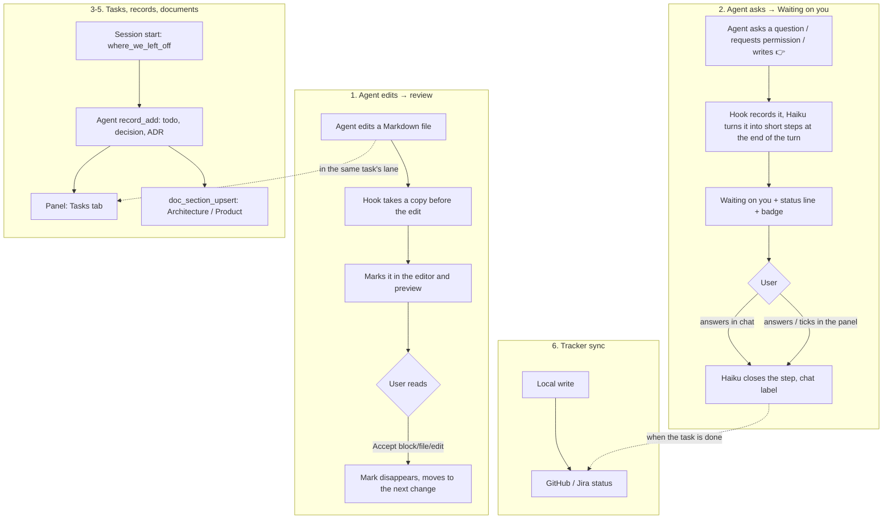

<!-- Generated by Imprimatur from its database; edit in the Imprimatur panel (Architecture/Product). -->

# Capability · docs-sync

## Contents

1. [Documentation linters (#132)](#doc-linting)
2. [Design documents ↔ Markdown files (docs sync)](#docs-sync)
3. [Recommendations: project best-practice review (#86, #87)](#best-practice-review)
4. [Decision records: ADR and PDR as MADR 4 files](#decision-records)
5. [Documentation rules in the audit (IMP-DOC, #131)](#doc-rules)
6. [Main flows](#flows)
7. [Surfaces and features](#surfaces)
8. [Social media: /social-post and the Social document (#109)](#social)

## 1. Documentation linters (#132)

Every repo can carry four documentation linters: markdownlint-cli2 (structure), cspell (spelling, warnings only), lychee `--offline` (links between the repo's files) and Vale with Google's style (warnings). Agent Setup's checklist shows "Doc lint: write …" while a repo lacks one of their configs (`.markdownlint-cli2.jsonc`, `cspell.json`, `lychee.toml`, `.vale.ini`) or the npm scripts that run them. `vscode/doc-lint.js` writes only what is missing, with O_EXCL, so a repo's own edits stay; the scripts go into package.json under names that are free.

| Script | Runs | Fails the run |
|---|---|---|
| `lint:docs` | markdownlint-cli2@0.18.1, then cspell@9.2.1 (English prose only) | markdownlint errors |
| `lint:links` | lychee --offline docs | broken local links |
| `lint:prose` | vale sync && vale docs | no (warnings) |

### Generated documents pass by construction

The exported documents are tidied where their text is made (`vscode/md-tidy.js`, from `docMarkdown` and `madrText`): blank lines around headings, fences and the start of a list, `text` on a bare fence, bare URLs in `<>`, a line starting `#139` escaped. `nest` shifts a section body's headings so its highest sits one level under the section heading, so the same subheading in two sections is no longer a duplicate. docs-sync hashes a section after the same nest and tidy, so the tidied file and its stored body compare equal and the tidy-up is never read back as a hand edit. No stored text changes.

## 2. Design documents ↔ Markdown files (docs sync)

`vscode/docs-sync.js` (#73) brings the architecture/product document in the database to the same text as `<docs dir>/ARCHITECTURE.md` and `PRODUCT.md`; whenever Imprimatur comes to a repo (no file, a hand-written file, a file deleted after a move) the result is the same.

- **Folder:** `.claude/imprimatur.json` `{"docs": {"dir": "docs/design"}}`, otherwise `docs`. `{"docs": {"sync": false}}` turns it off.
- **State:** a summary of the last sync per document is in the `meta` table (`docsync:<repoId>:<kind>`: file path, a title+body hash per section, conflicts if any); machine-specific.
- **Rule (per section key):** same → nothing; only the file changed → the database takes it (actor `import:file`); only the database changed → the file is written; both changed, or no base and different → conflict, neither side is written, `--take file|db` resolves it. A section deleted from the file and unchanged in the database becomes superseded; a section superseded in the database but edited in the file is a conflict.
- **Adoption:** a file without HEADER becomes sections from its `##` headings (the first `#` heading, the part before it as `overview`, `<!-- toc -->` is dropped); records imported from that file are linked to the section with `links.source` + `links.area`, and the original is written to `.claude/imprimatur/docs-backup/`. Only if the repo joined with the `docs` key, or by hand (CLI, `npm run import`). `--rev <commit>` reads the files from git and first imports that version's design/product records.
- **Read safety:** a managed file is split by `` followed by `## n. Title` (no fence tracking); if the database's own text is not read back into its sections (`roundTrips`), that document is not synced and `unreadable` is reported.
- **Trigger:** the process check `docSync` at SessionStart and after a file edit; after the MCP `doc_section_upsert` (the reply has `file`); in the extension when the database changes, when a file is saved, and at startup; `npm run docs -- sync [repo] [--dry-run] [--take file|db] [--rev R]`.
- **Importer (#59) fixes:** `docs/design/PRODUCT.md` → PDR, `README.md` is not a record, a generated file is not a source; a record earlier saved under another kind/task is moved to the right task by `<uid>@<task>` (the old one is dropped with `moved_to`).
- **Health (#74):** `db.docHealth` + conflicts → `where_we_left_off` `docs`/`docs_problem` and the SessionStart line; `docUpdate` names an ADR/PDR with no link, and an ADR/PDR/decision whose linked section did not change after the record.

### Chapters (#129, 0.91.0)

Architecture and product sections each sit in a fixed chapter (`doc_sections.chapter`, ids in `CHAPTERS` in `db.js`), the same in every repo. The file shows every chapter as `<a id="chapter-<id>"></a>` + `## Title` (an empty one says "_Not written yet._") and the sections under it as `### n. Title`, numbered through the document; sections with no chapter come last under "Unsorted". `parseManaged` reads `##` or `###` after a section anchor and skips chapter blocks, so old flat files still parse. A section moved to another chapter by editing the file is not read back: change `chapter` in the panel or with `doc_section_upsert`.

### Decisions settled

- 677: the Markdown importer (`vscode/import.js`) maps TODO.md's prefixed lines, `docs/design/*.md`, `PRODUCT.md`/`docs/product/*.md` and `docs/testing/*.md` to tasks and record kinds (todo/done/fixme/canceled/question+answer/decision/note, adr/pdr/test).
- 5696: docs sync is two-way between the database and `docs/*.md`; a hand-written file is adopted only on opt-in or by hand, the original goes to a local backup, a conflict (no common base, both sides changed) is never silently overwritten, and `--rev` lets a past commit be re-imported for repair.
- 5698: `docUpdate` warns on a section that is linked but did not actually change after the linked record, decisions are in scope alongside ADR/PDR, and `where_we_left_off` reports empty documents, unlinked records and sync conflicts.
- 5578: architecture/product documents live in the database as chaptered, versioned sections with contributing records, generated into `docs/*.md`; a section body is capped near 40,000 characters, set by the sync Worker's 100,000-character value limit after JSON escaping roughly doubles it.
- 9326: the plan to keep managed documents only inside Imprimatur, with no generated or hand-written docs in the repo at all, was reversed (decision 9328): documents stay in the repo too, generated from the database and kept in sync two-way as described above.

## 3. Recommendations: project best-practice review (#86, #87)

**Recommendations** is a single place: one `RECS` task per repo (a record container) holds the records of two producers. The agent setup audit (`setup-audit.js`, `links.audit`) and the project best-practice review (`best-practice.js`, `links.best`). The old `AUDIT` (#77) and `BEST` (#86) records are moved to RECS with `db.moveRecord` the first time `recs.recsTask` is called (a version row is written); the old tasks become `dropped`, with the summary "Moved to RECS (#87)".

### Taxonomy

The ISO/IEC 25010:2023 product quality characteristics and, for process, NIST SSDF (SP 800-218). Each category's subcategories are given to the model with their definitions and are an enum in the schema. The default 6 core categories: Security, Reliability, Maintainability, Compatibility, Performance efficiency, SSDF. Flexibility, Interaction capability, Functional suitability and Safety when asked ("All categories" / `--categories all`).

### Flow (a pipeline, not an agent loop)

Spike measurement (spike/best-fast): in an agent loop every look at a document was a turn (6 to 8 s), about 600 s in all. Now:

1. **Source map** (once, in a `links.bestSources` note; refreshed with "remap"): Haiku, effort low, only repo tools; stack components, version, evidence, vendor, changelog address. In code: the Context7 id by a REST search (the full title; for names of 3+ words, all the words; no loose match for a short name), the changelog only as public https.
2. **Document gathering** (code, 8 in parallel): for each component × category, Context7 `/api/v2/context` (the category query; the `Source:` of the chunks is the real address used as the citation), the vendor's public documentation MCP (Cloudflare, Microsoft Learn, AWS Knowledge) directly by JSON-RPC (`initialize` → `tools/list` → `tools/call`; relative links are resolved against the site's address), the changelog page (for Compatibility and SSDF).
3. **Decision**: one `claude -p` per category (Sonnet, effort medium, `--max-turns 12`, only Read/Glob/Grep, no web, no MCP). The shared pack (decisions, architecture document sections, stack, `git ls-files`, numbered key files: the manifest/build/CI files of every ecosystem) goes through `--append-system-prompt-file`; the first call writes the cache, the others start 4 s later and read it. The category-specific documents are in the prompt.
4. **Gate** (code): type/size are normalized; the subcategory belongs to the category; the source is one of the gathered pages and public https; evidence files are inside the repo and the line is in the file; decision ids belong to the repo. The same component and first evidence → a single recommendation (the heaviest one; the other categories go in `tags`).
5. **Records** (one transaction): id `category:key`; new → `todo`, found → refreshed (`seen`), not found → untouched (the page shows "not seen in the last round"), dismissed → untouched. `lastRun` per category is in the map. The summary counts the two producers separately: `Agent setup: … | Project: N open (high/medium/low) · …`.

### Safety

The child process: `--permission-mode dontAsk`, only Read/Glob/Grep, `.env*`/key/`~/.ssh`/`~/.aws`/gh/npm credential files are forbidden, `--setting-sources ""`, a minimal environment (the host's tokens are not there), the prompt comes from stdin, the shared pack is in a `0600` temporary file and is deleted when the job ends. Since the model has no network access it cannot send out what it read. Every model text on the page goes through `esc()`; a source link is only http(s).

### Cost

By `claude auth status`: subscription (claude.ai) → the plan's usage limits; API key → billing; Bedrock/Vertex → the cloud account. The confirmation dialog is written accordingly. In this repo with 6 categories: 181 s (map 63, gathering 7, decision 112), 16 recommendations, 2.70 USD API equivalent.

### View

The Agent Setup light bulb opens a menu: audit the agent setup (agnix), review the project (Claude), both. In the Recommendations tree: root → "Agent setup" / "Project" → status → (reason for dismissed) → category → subcategory → recommendation. In the Tasks tab, a single RECS page: "Agent setup" and "Project" sections, the source map; Applied / Dismiss… / Reopen work for both producers (`recs-ui.js`): the reason is chosen from one list (those that fit the producer, the likely one first), including the "Decided not to do it" decision.

#### Decisions settled

- 6809: the project best-practice review has a model build a source map, code gather and gate the evidence (public https sources, in-repo evidence lines), and a per-category `claude -p` call decide, each call budget-capped.
- 6812: Recommendations (`RECS`) is a single per-repo task combining agnix findings (`links.audit`) and project-review findings (`links.best`), classified with ISO/IEC 25010 and NIST SSDF categories, replacing the separate `AUDIT`/`BEST` tasks.

## 4. Decision records: ADR and PDR as MADR 4 files

The decisions are the repo's adr and pdr records. Each one is also written as a MADR 4 file, `docs/decisions/NNNN-slug.md`, listed in `docs/decisions/README.md`. That index is the list this chapter would otherwise repeat.

- **Source:** the record. The files are generated on every document export (`vscode/decisions.js`, from `exportDocs`) and never read back (decision 9331).
- **Numbers:** a record gets its number the first time it is exported, kept in `links.madr`, so every device names it the same after sync. A dropped record keeps its number and its file reads `status: rejected`, so a number is never reused. Two devices numbering new decisions before either syncs can give one number twice.
- **Shape:**
  - Front matter: `type: adr|pdr`, `status`, `date`, and `record`, the record's uid.
  - Headings: Context and Problem Statement (from the task), Considered Options and Consequences (the body's lines that name them, else a note that they are not listed apart), Decision Outcome (the body), Sections.
  - A long imported title is cut to its first sentence; the whole title starts the outcome.
- **Links:** under each architecture and product section, the generated file adds `<!-- imprimatur:decisions --> Decisions: [ADR 0012](decisions/…)` for the adr and pdr records linked to it, and docs-sync skips that line. Each decision file lists those sections back.
- **Safety:** a hand-written file of the same name is left alone. A generated file whose decision was renamed is removed, and the number goes with the new name.

## 5. Documentation rules in the audit (IMP-DOC, #131)

`setup_audit` checks the documentation standard next to agnix's agent-setup rules. `vscode/doc-rules.js` reads the repo's documents (the database) and its agent files and returns findings in agnix's diagnostic shape. `auditRoot` adds them for a repo, not for the global scope, so they become Recommendations records with Fix it and dismiss like agnix's.

| Rule | Checks | Level |
|---|---|---|
| IMP-DOC-001 | each MADR number used once, every current decision numbered; a "superseded by NNNN" names a file that exists | warning |
| IMP-DOC-002 | a decision names an alternative to the option chosen (a body line with alternative, rejected, instead of, not chosen or considered) | info |
| IMP-DOC-003 | a decision is linked to a section | info |
| IMP-DOC-004 | every architecture chapter has a section; a C4 context view (`[Person]`, `[Software system]`) and a container view (`[Container: …]`) exist | warning |
| IMP-DOC-005 | every sequenceDiagram (architecture, product, task analyses) has `autonumber` and a numbered list under it with an item per arrow | warning |
| IMP-DOC-006 | AGENTS.md and CLAUDE.md stay under 200 lines | warning |

The decision rules (001–003) report one finding per rule. Each names up to 12 decisions, then "and N more": one finding per decision would bury the panel. 002 and 003 are info, because they describe what the records lack, not a broken setup.

### Fix it on a documentation finding

IMP-DOC-001..005 live in the database, and `docs/*.md` is generated from it, so the usual Fix it (a file diff) would be lost at the next export. On these findings Fix it (`fixDocs` in `vscode/setupView.js`) runs a background `claude -p` with docs-backfill's settings (sonnet, $3 cap, Read/Glob/Grep and Imprimatur's MCP server only) plus `record_update`. The prompt (`fixPrompt` in `vscode/docs-backfill.js`) lists the decisions 002 and 003 name (`decisionGaps` in `doc-rules.js`). The agent links decisions to sections with `doc_section_upsert`. It adds an "Alternative: …" line only when the decision's task records show the option was weighed, and never invents one. The audit then runs again, so what the agent left stays open. The bulk Fix it takes this path when every open finding is a docs one; in a mixed list it fixes the file findings, and each docs finding has its own Fix it. IMP-DOC-006 stays a file finding.

The run reads record bodies written by people and other agents, so its write access is narrowed. The MCP server gets `IMPRIMATUR_RECORD_UPDATE` (the ids `fixRecordIds` returns, the decisions the prompt lists). With it set, `record_update` refuses any other record and changes only `body` and `links`, never status, title or kind. `task_upsert` is not granted. A sequenceDiagram in a task analysis is left for the user. `doc_section_upsert` stays open to every section, as in the one-time backfill.

## 6. Main flows

### 1. Agent edits → review / Accept

The agent changes a document; the user opens the file or the preview: an added line is green, a changed word sits in a red box next to the old word, a deleted block is marked. The user Accepts block by block; the view moves to the next one like a review queue. The **Agent changes** tab shows all edits in the repo in task lanes, each with a one-sentence explanation; a diff opens from the row, or an edit is accepted as a whole.

### 2. Agent asks → Waiting on you → answer

The agent asks something, requests permission, or at the end of a turn says "test this". The request lands in the list with its task, worded so it is understandable a week later without the chat ("#64: …"). If the user answers in chat, Haiku finds which step was decided and marks it; from the panel the user can write an answer, tick the step, or say "Done it". When the task is done, the requests that belong to it close in every session.

### 3. Where we left off

At the start of a session the agent gets the unfinished tasks and each one's 👉 with `where_we_left_off` (automatically at SessionStart if process checks are on). The user sees the same information on **Home** and in the status line (`Imprimatur · 3 waiting on you · #64 👉 …`).

### 4. Tasks and records

While working, the agent adds and closes todo, decision, note, ADR, PDR and test records through MCP; the 👉 moves to where the work stopped. In the **Tasks** tab the user opens the task's page: adds records with the quick-add box (`?` question, `!` decision, `#` note, `@me` their own todo), ticks todos, answers questions. Every change is versioned with who made it.

### 5. Architecture and product documents

When the agent makes an architecture or product decision, it adds an ADR/PDR record, updates the relevant document section with `doc_section_upsert` and links it to the record (if it does not, a process check warns). In the **Architecture** and **Product** tabs the user reads the contents, the rendered text and the contributing records, edits a section or marks it superseded; each section's history is visible. The documents are also written to the repo as `docs/ARCHITECTURE.md` and `docs/PRODUCT.md`.

### 6. Sync with GitHub and Jira

When a task is done, its GitHub issue closes (or moves to Done in Jira); an issue closed on GitHub finishes the task, a new issue becomes a task; the line in the epic closes with the task. Imprimatur also accepts optional plugins.

## 7. Surfaces and features

### VS Code panel (the Imprimatur panel)

| Tab | What it is for |
|---|---|
| **Home** | Progress, where each task left off, the first 5 items waiting on you, end-of-turn requests that could not be tied to a task, Audit and Scan history, all tasks; the badge on its button counts what is waiting on you |
| **Tasks** | The task list (this repo or all repos) and the task page: 👉, and under it tabs: Waiting on you (records and that task's end-of-turn requests, with an answer box), To-dos with quick add, Decisions, Notes, Tests, Activity |
| **Analysis** | Architecture, Product, Glossary and Task analyses: live design documents (contents, contributing records, edit, mark superseded, history) and the tasks' analysis files |
| **Agent changes** | The Agent Change Graph: edits and the agent's other work, task lanes, explanation, the rendered diff on hover, Accept |

Keyboard: j/k, Enter, x, a, /, Esc. In the sidebar, rows that open the tabs and a badge that counts what is waiting.

### Editor marks and preview

- Marks at word or sentence level, the old text readable in a red box, a mark for a deleted block, the overview ruler, the number of changes in the status bar.
- In the Markdown preview, marks at block level, clickable ticks on the right edge, ✓ Accept above the block (instant, without reloading the page).
- `imprimatur.showIn`: Markdown marks are in the preview only by default; `both` turns the editor on too.
- The file's agent edit history (Show Agent Edit History), each edit's diff. An optional Mermaid diagram diff.

### Agent Setup

Every file that affects the agent, for the repo and for home, grouped by tool and kind: a new/changed/deleted mark, when it takes effect ("always", "for these files", "on request") and which rules apply to the open file, health checks (broken reference, invalid JSON, secret, contradiction), drift across repos, git history and a "what did the last change do" summary, merged settings (hook order, effective permissions). Read-only.

### Status line

In Claude Code's status line, for the repo and session: `Imprimatur · 3 waiting on you · #64 👉 discover cache`. It does not overwrite the user's existing status line.

### MCP tools

`where_we_left_off`, `task_list`, `task_get`, `task_upsert`, `record_add`, `record_update`, `pointer_set`, `search`, `doc_get`, `doc_section_upsert`. In Claude Code (settings file or plugin), Cursor and Codex.

### Process checks

Optional per repo (`.claude/imprimatur.json`): where we left off at session start, a `--no-verify` block, main protection, design first, docs contents, issue fields, sweep, a "Where are we" section, branch finish, document update. Each is `block`, `warn` or off.

### Command line

`npm run setup` (install), `npm run import` (import old Markdown records), `npm run tracker`, `node scripts/github-webhooks.mjs`, `node scripts/stale-epic-lines.mjs`.

## 8. Social media: /social-post and the Social document (#109)

Announcing a project means a different post for each channel, and each channel has its own rules: a subreddit's sidebar, X's character counting, Show HN's guidelines, Product Hunt's launch page. Rules change, and a post that breaks one is removed or ignored.

### /social-post

- Reads the target platform's own rules and docs **when it writes**, not from memory. When a page cannot be fetched (Reddit blocks most fetches; Discord rules live in the server), the user pastes it, or the post is marked "rules not checked".
- Keeps a dated **rules card** per channel: length, title format, self-promotion, where links go, flair, required parts, timing, what is forbidden.
- Writes the post to fit the card and that community's way of reading, counts characters with a script, and checks every fact against its source.
- Where a platform asks for text written by hand (Show HN), it gives the facts and an outline instead of a draft.
- Never posts, schedules or logs in for the user.

### The Social document (off by default)

- **Imprimatur: Turn on social media tracking** for a repo adds a **Social** page under Analysis, next to Architecture, Product and Glossary, kept in `docs/SOCIAL.md`.
- One section per channel: the rules read, the post, its status (planned, posted, link), results over time, what was learned. /social-post writes it and updates a channel when the user says a post went out or brings its numbers.
- **Turn off** hides the page and stops the file; the document is kept for when it is turned on again.
