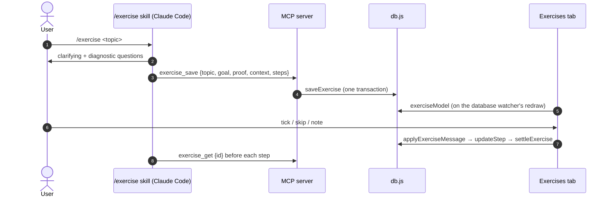

<!-- Generated by Imprimatur from its database; edit in the Imprimatur panel (Architecture/Product). -->

# Capability · exercise-mode

## Contents

1. [/exercise: exercise mode (#108)](#exercise)
2. [/exercise: practise any topic in small steps (#108)](#exercise-2)

## 1. /exercise: exercise mode (#108)

Exercises are the user's own data, of no repo or task, in the same device database as everything else (`vscode/db.js`, schema 9).

### Data

- `exercises`: topic, goal, proof (how the goal is checked), context (what the clarifying questions found), weak (JSON list of short lines from the closing recall), status active | done | dropped.
- `exercise_steps`: exercise_id, parent_id (a split step's smaller steps; one level), position, kind (learn, example, predict, do, vary, explain, recall), title, why, done_when, minutes, status open | done | skipped, note, done_at.
- Steps are never deleted (skipped instead). `settleExercise` keeps progress true after every status change: a split step is done when its smaller steps are all done or skipped, open when one opens; an exercise is done when all its top-level steps are closed, active when one opens, and a dropped one stays dropped.
- Device-local and not reported to plugins: not synced between machines (like `section_reads`).

### Flow

1. The user names the topic in Claude Code.
2. The skill asks why, level and time, then two or three diagnostic questions.
3. It saves the goal and 5 to 9 checked steps with `exercise_save`.
4. The MCP server writes the exercise and its steps in one transaction; a bad step rolls back the whole save.
5. The panel's Exercises tab reads the active exercises when the database changes.
6. The user ticks, skips or notes a step in the tab.
7. The page posts `exStep`/`exNote`/`exDrop`/`exResume`; `tasksView.applyMessage` hands them to `exerciseView.applyExerciseMessage`, which writes through `updateStep` and settles the progress.
8. Before coaching each step the skill reads the exercise again, so it sees the user's ticks and notes.

### Code

- `vscode/db.js`: `saveExercise`, `saveStep`, `updateStep`, `settleExercise`, `exercise`, `exercises`.
- `mcp/server.mjs`: `exercise_save` (not idempotent: steps without id are added), `exercise_get` (read-only; always the list, plus one exercise with id); `exerciseDigest` is the text the agent reads.
- `vscode/exerciseView.js`: the tab's model, HTML, CSS and writes; `split` copies a command through the host (`exCopy` → clipboard).
- `skills/exercise/SKILL.md`: the pipeline (clarify → diagnose → goal → steps → check → coach → recall); setup links it into `~/.claude/skills`.

### Why generation lives in the skill

Not a model call from the panel: the Claude Code session can research the topic's sources, ask questions, and coach in the same conversation. The panel only tracks.

## 2. /exercise: practise any topic in small steps (#108)

The user picks any topic (a language feature, a concept for an interview, a spoken language, a book chapter, a sport) and wants to practise it, not only read about it. `/exercise <topic>` in Claude Code turns it into an exercise they tick in the panel's **Exercises** tab.

### What the user gets

- **A few questions first:** why (understand, do, an exam or interview), their level, time and place; then two or three quick diagnostic questions, so what they know is skipped.
- **A "can do" goal** with how it is checked at the end.
- **5 to 9 steps of 10 to 25 minutes**, each with a kind (learn, example, predict, do, vary, explain, recall), what it is for, and when it counts as done: something they can show.
- **Coaching without answers:** the agent reviews what they bring, gives a hint, then a narrower one; the solution only when they ask after trying.
- **A closing recall** without notes; the weak points are kept for the next session.

### The Exercises tab

Progress, the step to do now, a box per step, **skip** (why goes in its note), a note per step, **split** (copies `/exercise split step … of exercise …` for Claude Code), drop and resume, finished exercises below.

### Rules

- Exercises are the user's, not a repo's or a task's: the same list in every project. They stay on this machine.
- A split step is ticked when its smaller steps are; an exercise is done when its steps are.
- Reading is at most a third of the steps; every exercise has a do step and a closing recall.

Later: spaced recall of weak points (1, 3, 7 days, then FSRS-like) on Home; a quick create from the panel.
