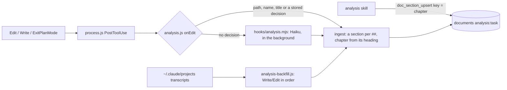

<!-- Generated by Imprimatur from its database; edit in the Imprimatur panel (Architecture/Product). -->

# Capability · task-tracking

## Contents

1. [Understanding debt: read marks and the unread count (#92)](#unread)
2. [Issue tracker sync](#tracker)
3. [History scan and TODO.md task tracking](#history-scan-todo)
4. [Task analyses](#task-analysis)
5. [A task's analysis](#task-analysis-2)
6. [Unread: comprehension debt (#91, #92)](#unread-2)
7. [Görev sayfasında "Analiz": görev için yazılan analiz/plan/spike dosyaları, dosya başına kart; görevsiz analizler "Bu göreve bağla" ile](#g-rev-sayfas-nda-analiz-g-rev-i-in-yaz-lan-anali)
8. [Okumadıkların: görev listesinde "N okunmadı", görev sayfası ve Ana sayfada kart (kabul edilmemiş düzenlemeler + değişen bölümler, Okudum / Hepsini okudum), dokümanda "Okunmadı" işareti, durum satırında "N unread"](#okumad-klar-n-g-rev-listesinde-n-okunmad-g-rev-s)

## 1. Understanding debt: read marks and the unread count (#92)

### Data

- Migration 7 (and 8): `section_reads(section_id PK → doc_sections, version_id, at)`. Device-specific. The migration counts every section that exists at that moment as read at its latest version. Migration 8 rebuilds the table: a draft of 7 without `version_id` had reached the live database (the branch was running in the live checkout).
- A section is **unread** if it is `current` and an `agent` or `hook` wrote a version after its `version_id`, and that version changed the title or the text (a change of link or position alone does not count). The comparison is by version id, not by time: when an analysis is re-read, versions can be written with a past time.
- When `user` writes, `upsertSection` marks the section read. `import` does not count (writes from a plugin or a file): reading belongs to this device, so that a first import does not show everything as unread.
- `db.unreadSections(repoId)`: unread sections and their tasks: in a task analysis, the `scope`; in repo documents, the tasks of the records the unread versions newly linked. `db.markSectionsRead(ids)`.
- When a placeholder repo is merged, the read row of a deleted section is deleted too (foreign key).

### Edits

Edits not yet accepted are not in the database: they are counted per task strip from the graph rows (`!accepted && !gone`, activity and record rows excluded) (`graphView.openEditsOf`) and passed to `paneHtml` as `openEdits`. The status line does not draw the graph: the extension writes the count to `.claude/imprimatur/unread.json` while it computes the sidebar badge (when it changes, or every 5 minutes); the status line ignores a file older than 15 minutes.

### Surfaces

`tasksView.unreadOf` gives `{edits, sections}` per task; the task list, the top of the task page and Home use `unreadHtml`; `docsView` has the section mark and Done reading. Page messages: `read` (ids, `writeFromPanel` → `applyMessage`), `showSection` (document tab + section).

## 2. Issue tracker sync

A task's status is synced both ways with GitHub Issues or Jira; epic rows close together with their tasks.

### Epic chain (in the database, independent of any sync)

When a task becomes `done` or `dropped`, in the same write the epic's open records for that task are closed: records whose `links.issue` is the task's key, or whose title starts with the key (`#56 …`, `[#56 …](url)`, `PROJ-12 …`), become `done` and get a note "#56 done (date)"; if the epic's 👉 is on that row it moves to the next open record. When the task is reopened the rows stay closed. `scripts/stale-epic-lines.mjs` lists, read-only, the open rows of finished tasks.

### Which tracker

- **GitHub:** `#N` tasks, in a repo whose origin is github.com, when a `gh` session is open.
- **Jira:** keys shaped like `PROJ-12`; `config.json` `{"tracker": {"jira": {"baseUrl", "email"}}}` and the token in `IMPRIMATUR_JIRA_TOKEN` (or `tracker.jira.token` in a `0600` file); `baseUrl` must be https.
- Another tracker (Linear etc.) is added as a new key shape with its own push/pull.

### Imprimatur → tracker (push)

- `db.upsertTask` puts a status change into `tracker_outbox` (device-specific: the device that made the change pushes).
- `done` → the issue closes as completed, `dropped` → not planned, reopening → reopen; in Jira the Done / Won't Do transitions are found by name.
- Every push leaves a fixed comment ("Imprimatur: completed", "Imprimatur: dropped", "Imprimatur: reopened"): nothing from the task's text leaves the machine.
- Transient errors (network, 5xx, 429, rate limit) wait with backoff and do not use up an attempt; other errors are counted, and after 5 attempts the row is given up. A row claimed by another window (`claimed_at`, `claimant`) is left to it; if the task's status changed in the meantime, the row is dropped.

### Tracker → Imprimatur (pull)

- Only issues whose **status changed** since the last pull are processed (`tracker_state`); a repo's first pull records the states and changes no task.
- A closed/reopened issue changes the task's status with the actor `tracker:<provider>` (closes the epic rows, does not enter the push queue: no loop).
- An open GitHub issue with no task becomes a task (`imprimatur.tracker.createTasks`, at most 50 per run).

### Timing

At startup, every 5 minutes, a few seconds after a status change; the Sync with Issue Tracker command (`Imprimatur: Sync with Issue Tracker`) forces it; it does not run in an untrusted folder. `npm run tracker` (`--all`, `--dry-run`, `--no-create`) runs it from a terminal. A plugin that listens for tracker events can also trigger a run through `vscode/loop.js` `runLoop`.

#### Decisions settled

- 5576: epic rows close in the same database write as their task, and GitHub/Jira sync is two-way through a per-device outbox queue with a fixed, content-free comment, so a task's own text never leaves the machine.

## 3. History scan and TODO.md task tracking

The panel's "Scan history" button (and, once, automatically the first time the panel is opened in a project) runs `scanHistory(root)` from `vscode/history.js`.

### Sources

- Claude Code transcripts: `~/.claude/projects/<slug>/*.jsonl` (slug = the non-letter/digit characters of the path as `-`); if `cwd` is inside the root, sessions opened in subfolders are scanned too; the last 30 days.
- The `TODO: (K)` lines in TODO.md and in the task folders become one step each in the `todo-files` session.

### Behavior

- The 👉 lines of earlier turns become steps, later user messages are noted with an `answer` record, and the last turn is checked with `audit()`; the records carry the turn's own time (`turn.at`).
- A session that has a log (the hook ran) or is in `.claude/imprimatur/scanned.json` is skipped; at most 4 model calls run at a time.
- On every scan, an open TODO step that is DONE or was deleted from the file is ticked with `by: "file"`.

### Step text and task binding (audit)

- `audit()` asks Haiku for `asks: [{text, why}]` and `task`: a step must be understandable a week later without the chat (the work key, a person, a file, a concrete thing; ≤ ~25 words), `why` is a one-sentence context.
- The 👉 lines are introduced as "exactly N records, same order, same meaning"; if the count does not match they stay word for word. Routine steps (e.g. Reload Window) are left empty and dropped. The language is required on a separate line (otherwise the model could write English even when Turkish was asked for).
- `task_hint`: the key in the request/message, otherwise the folder of the TODO.md the session last edited; used only for steps about that work.
- `stepTask`/`normKey` (`vscode/tasks.js`): if the step's text starts with a key it belongs to that work ("#88: …"), otherwise to the item's task; if the model writes `"80"` it is normalized to `#80`. If all `asks` start with the same key, that task is written on the item.

### Mapping to a task in the panel (placeOf)

- The key is taken from the record or the text (Jira `ABC-123`; the inside of long codes like `MT-AR-011` does not count; GitHub `#n`).
- The target file: the record's own TODO.md, or a file the session edited whose folder name has the key / whose text matches the step (≥ 40% of the words); a multi-topic session does not stamp the last TODO.md on each of its steps.
- Badge: opens the first link in TODO.md that contains the key (not opened if the Jira address is not set); for `#n` without one, the origin's GitHub issue; 📄 opens the file at that line (a path outside the repo is not opened).
- Even if the session did not edit it, the TODO.md in the work's own task folder is used (old scanned sessions); for a Jira key with no TODO.md, the address is learned from the `…/browse/<PROJECT>-n` links in other TODO.md files. A key with no target is not clickable, it is a plain label.
- The model's JSON can come multi-line and fenced (`lastJson`).

### Where the task folders are

- A task folder is `docs/todos/<key>/TODO.md`; for old repos `todos/<key>/TODO.md` is read too (`TODO_DIRS`, the new one first).
- `todoFiles(root)` returns the root TODO.md and the folders in both layouts; `todoOfKey(root, key)` picks the new one if both exist; `taskOfFile(file)` extracts the task strip (`(docs/)todos/<key>/…`).
- Task strips, the title, the Jira address, the `TODO: (K)` requests and closing when TODO.md finishes use these paths. Only README.md, CLAUDE.md, AGENTS.md and LICENSE stay at the root.

#### Decisions settled

- 599: Scan history turns past transcripts' 👉 lines and `TODO: (K)` lines into steps, skipping sessions whose hook already logged or that were already scanned.
- 600: `audit()` asks Haiku for a week-later-understandable step text and a task key; task folders live under `docs/todos/<key>/TODO.md`.
- 602: task folders moved to `docs/todos/<key>/TODO.md`, with the old `todos/<key>/` layout still read for compatibility.
- 603: a task's open steps close across every session once its TODO.md's Status section says done, and a user message naming a task also evaluates that task's open steps in other sessions.

## 4. Task analyses

Every task has an analysis document: `kind = 'analysis'` in `documents`, with `scope` = the task key (`''` for repo documents). A section's `source` field is the file it came from. `doc_sources` holds the hash of the last read text of each file, so the same text is not written twice. Migration 6 rebuilds the tables like the glossary migration.

**The model (#172):** an analysis is a short design doc in five chapters (`ANALYSIS_CHAPTERS`): context, goals, design, alternatives, risks. Agents write it with the `analysis` skill (skills/analysis, adapted from mattpocock/skills), one section per chapter key, through MCP. Files the agent writes (plans, spikes, notes) are still read in. `ingest` sets each section's chapter from its heading (`chapterOf`: Context/Problem/Findings → context, Goals/Out of scope → goals, Options → alternatives, Risks/Open questions → risks, anything else → design).

- **Candidate:** a `.md` or `.mdx` file. Excluded: README, CHANGELOG, TODO.md, the design documents, `docs/testing`, `todos/sprints`, `.claude/` tool folders and what Imprimatur generates. Outside the repo, only `~/.claude/plans` counts.
- **Task:** found in this order: the task folder, the key in the path (`spikes/81-x`, `80-paper.md`), the branch, the task the session is writing records for at that moment (`db.sessionTaskAt`), the prompt, then the file heading. Only tasks that exist in the database count. A file that cannot be placed waits in the `analysis:orphans:<repo>` meta list. A file that has once entered a task stays in that task.
- **Keys:** a file's sections are `<file prefix>--<heading slug>`. MCP refuses analysis keys with `--`, so a written section is never overwritten by a file's.
- **History:** each state in the transcript becomes a version dated when it was written. If the document already has a newer section of that file (from the hook, another machine or MCP), the older state is skipped. This runs at SessionStart once per repo (`analysis-backfill:<repo>` claim), or by hand with `npm run analysis` or the command.
- **Opt out:** `"analysis": {"sync": false}` sets the `analysis:nosync:<repo>` meta. The sync plugin then keeps analysis sections on this machine.
- **MCP:** `doc_get` and `doc_section_upsert` with `kind: "analysis"` and `task`. The analysis document has no file of its own: sources are read, never written.

### Decisions settled

- 7077: a task's analysis is its own document kind. `documents.scope` is the task key, not a foreign key, so a placeholder repo merge never breaks the reference. Sections carry a `source` file, and `doc_sources` hashes mean a file's text is not ingested again while it is unchanged.
- 10556: one model, the five-chapter design doc, written with the `analysis` skill. File sections land in the chapter their heading names, and `--` keys are reserved for file sections.

## 5. A task's analysis

STORY: I read a task's analyses, plans, spike results and research notes (wherever the agent wrote the file, including the plan it came out of plan mode with) in one place, the **Analysis** tab; the task page stays focused on to-dos.

- A single **Analysis** tab in the top menu: under it **Architecture**, **Product**, **Glossary** and **Task analyses**; the tab returns to the sub-page opened last.
- **Task analyses:** on the left the tasks that have analyses (newest on top), on the right the selected task's files; one card per file, the sections are the file's `##` headings. A file that was read on this machine opens in the editor with "open", "Go to task" takes you to the task page.
- **Analyses without a task:** below the list; a task picker next to every file, it moves to the selected task.
- **Task page:** an "Analysis · N files →" link in the title; at the top Where we left off and Waiting on you, below it tabs: To-dos, Decisions, Notes, Tests, Activity (the selected tab is remembered, while searching all are shown).
- What was written in past sessions comes in once per repo in the background; by hand: **Imprimatur: Take Task Analyses from Past Sessions** or `npm run analysis` (`--dry-run`, `--no-model`).
- To turn it off: `"analysis": false` in `.claude/imprimatur.json`; to exclude a path: `{"exclude": ["drafts/"]}`.

### Decisions settled

- 7078: the panel's Analysis tab shows a task's analysis/plan/spike files as one card per file, with the task page kept focused on to-dos; a file that cannot be placed in a task is listed with a one-click "link to this task" action rather than being dropped.

## 6. Unread: comprehension debt (#91, #92)

The agent writes code and documents faster than a person can read them; Imprimatur shows how much you have not yet seen.

- **Task list:** "N unread" per task.
- **Task page and Home:** an "Unread" card: edits that are not accepted (clicking filters Agent changes by that task) and document sections the agent changed since your last read; each one opens, with "Read" or "Mark all read".
- **Architecture / Product / Glossary:** an "Unread" mark and a left edge line on the changed section, a dot in the contents, "N unread · Mark all read" in the title.
- **Status line:** `Imprimatur · 3 waiting on you · 12 unread · …`.

A section you wrote counts as read. Read marks are specific to the device. On first install everything that exists counts as read.

Next: a "since your last read" diff (#93), an end-of-turn briefing (#94).

## 7. Görev sayfasında "Analiz": görev için yazılan analiz/plan/spike dosyaları, dosya başına kart; görevsiz analizler "Bu göreve bağla" ile

STORY: Bir görevi açtığımda ajanın o görev için yazdığı analizleri (nereye yazmış olursa olsun, plan modundan çıktığı plan dahil) görevin sayfasında okurum; diğer makinemde de aynısı görünür. Geçmiş oturumlarda yazılanlar repo başına bir kez arka planda gelir, ya da "Imprimatur: Take Task Analyses from Past Sessions" / npm run analysis. Görevi bulunamayan dosya görev sayfasında listelenir, tek tıkla bağlanır. Kapatmak: .claude/imprimatur.json "analysis": false; yalnız bu makinede: {"sync": false}.

## 8. Okumadıkların: görev listesinde "N okunmadı", görev sayfası ve Ana sayfada kart (kabul edilmemiş düzenlemeler + değişen bölümler, Okudum / Hepsini okudum), dokümanda "Okunmadı" işareti, durum satırında "N unread"
