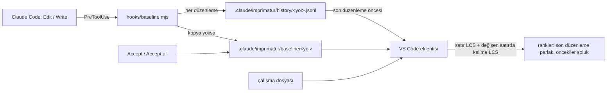

<!-- Generated by Imprimatur from its database; edit the decision's record in Imprimatur (its task, Tasks tab). -->

# 0001. Modül

## Context and Problem Statement

Task ADR: Mimari kararlar (ADR).

## Considered Options

The options are not listed apart; the decision below says what was chosen and why.

## Decision Outcome

Ajanın değiştirdiği dosyalar, kullanıcı kabul edene kadar editörde Word'ün
izlenen değişiklikleri gibi renkli görünür; git'e (stage, commit) bağlı
değildir, commit'ten sonra da durur. Bağımsız modül
([#3](https://github.com/halilural/imprimatur/issues/3),
[#5](https://github.com/halilural/imprimatur/issues/5), epic
[#2](https://github.com/halilural/imprimatur/issues/2)); 2026-10-03'ten beri ayrı public repoda:
[halilural/imprimatur](https://github.com/halilural/imprimatur) (kendi issue'ları ve panosu); aşağıdaki yollar o reponun köküne göredir. Bu makinede global kurulu
([#4](https://github.com/halilural/imprimatur/issues/4)).

## Consequences

Not listed apart; see the decision outcome.

## Sections

- No section links this decision yet.
