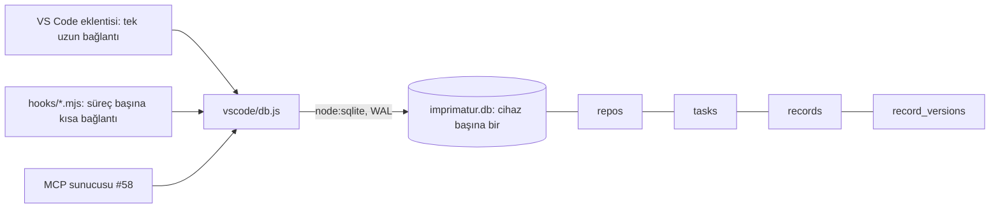

<!-- Generated by Imprimatur from its database; edit the decision's record in Imprimatur (its task, Tasks tab). -->

# 0044. Kayıt veritabanı (hedef hâl, #57)

## Context and Problem Statement

Task ADR: Mimari kararlar (ADR).

## Considered Options

The options are not listed apart; the decision below says what was chosen and why.

## Decision Outcome

Görevler, sorular, kararlar, notlar, ADR ve PDR'lerin asıl kaynağı Imprimatur'un kendi veritabanı; Markdown'dan üretilen görünüm yok (kullanıcı, 2026-10-09: "ne varsa bunların hepsi Imprimatur db'de"). Epic [#53](https://github.com/halilural/imprimatur/issues/53); MCP sunucusu (#58), Markdown'dan aktarma (#59), görünümler (#60) bunun üstüne kurulur.

## Consequences

Not listed apart; see the decision outcome.

## Sections

- [Architecture: Local database and data model](../ARCHITECTURE.md#database)
