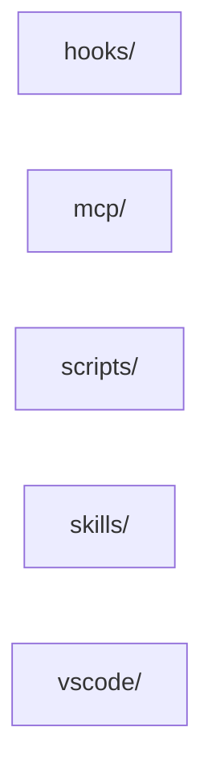

<!-- Generated by Imprimatur from its database; the wiki is written again from the code, ADRs and glossary: edit those. -->

# imprimatur wiki

Generated from the code's own comments, the ADRs and the glossary; written again when those change. Edit the sources, not these pages.

## Modules

- [hooks/](hooks.md): The `hooks/` module holds the scripts Claude Code invokes for each tool-call and session event in a repo using Imprimatur: recording activity and edits, trackin
- [mcp/](mcp.md): The `mcp` module implements Imprimatur's MCP server, the sole interface through which agents read and write Tasks and their Records (todos, questions, answers,
- [scripts/](scripts.md): - `scripts/analysis.mjs`: Imports a repo's past Claude session task analyses into Imprimatur's database; safe to re-run, only newer states are added. - `scripts
- [skills/](skills.md): The `skills/` module is Imprimatur's library of agent skills: self-contained `SKILL.md` procedures (plus supporting reference docs and a couple of helper script
- [vscode/](vscode.md): vscode/ is the VSCode extension for Imprimatur: it shows an AI coding agent's edits as tracked changes in the editor, keeps a per-repo Agent Change Graph and ta
