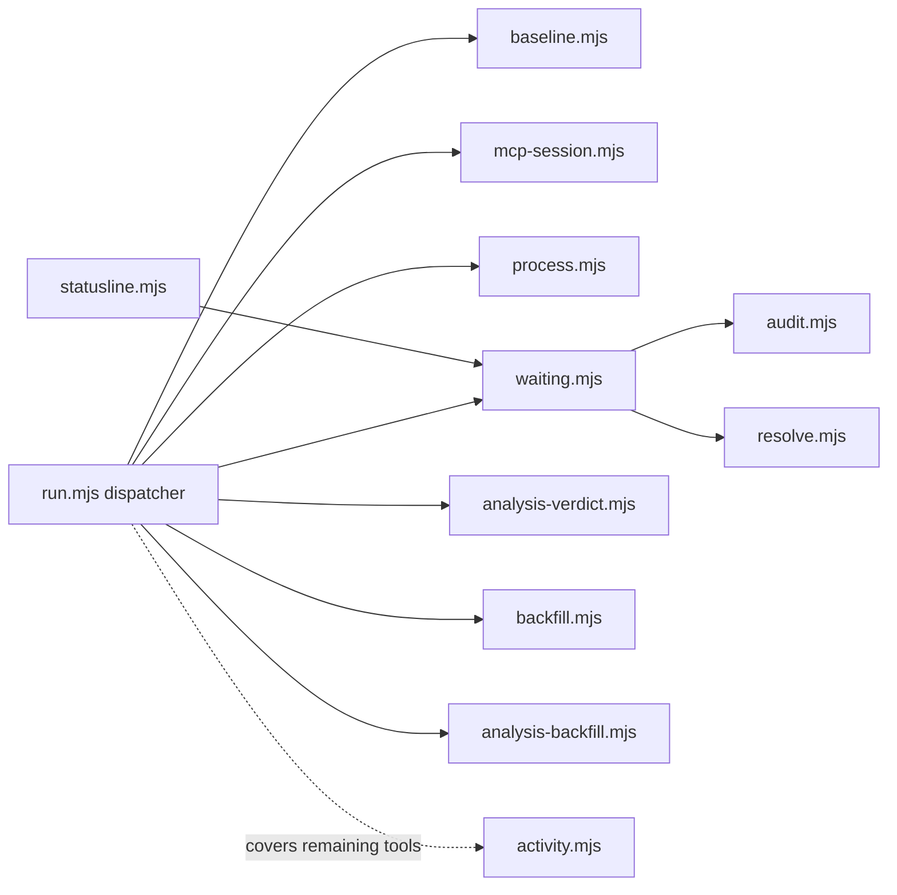

<!-- Generated by Imprimatur from its database; the wiki is written again from the code, ADRs and glossary: edit those. -->

# hooks/

The `hooks/` module holds the scripts Claude Code invokes for each tool-call and session event in a repo using Imprimatur: recording activity and edits, tracking what the agent is waiting on the user for, enforcing per-repo process checks, and kicking off one-time background work like design-doc and task-analysis backfills. It exists so that Imprimatur's view of a session (its "Waiting on you" list, edit baseline, activity log, status line) stays in sync with what Claude Code actually does, without slowing the agent down — most work here is either folded into one dispatcher process or pushed to a detached background process.

## Parts

- `hooks/run.mjs`: PostToolUse/PreToolUse/Stop/etc. dispatcher that runs all of a call's hook steps in one process, in the order `vscode/hook-plan.js` gives, merging their results into one answer.
- `hooks/activity.mjs`: logs PostToolUse/PostToolUseFailure for tools `run.mjs` doesn't handle, writing a row to the session's activity log asynchronously.
- `hooks/waiting.mjs`: records questions, permission requests, and other input the agent is waiting on the user for, into the session's waiting log, and triggers `audit.mjs`/`resolve.mjs`.
- `hooks/audit.mjs`: on Stop, has Haiku (or a rule-based fallback) check the agent's final message against the waiting list and adds missed items.
- `hooks/resolve.mjs`: on the user's next chat message, has a small model (or a fallback rule) decide which open waiting steps that message settles.
- `hooks/mcp-session.mjs`: PreToolUse for Imprimatur's MCP tools; stamps the tool input with `_session` since Claude Code doesn't pass it along.
- `hooks/process.mjs`: runs the per-repo process checks defined in `.claude/imprimatur.json`, doing nothing if that file or the check itself fails.
- `hooks/baseline.mjs`: PreToolUse/PostToolUse for Edit/Write/Bash; keeps a before/after copy of edited files (including Bash-driven edits) so changes can be diffed.
- `hooks/analysis-verdict.mjs`: detached process started on PostToolUse that has the model judge whether an edited file is a task's analysis.
- `hooks/analysis-backfill.mjs`: one-time, detached backfill of a repo's task analyses from past sessions, started on SessionStart.
- `hooks/backfill.mjs`: one-time, detached backfill of a repo's design documents, started on SessionStart.
- `hooks/describe.mjs`: manually invoked to describe a single agent edit, when the extension doesn't already do it.
- `hooks/statusline.mjs`: builds the Claude Code status line (waiting count, unaccepted edits, current task) from the repo's records and waiting logs.

## Decisions

- ADR 76: Design docs & glossary backfilled once per repo by a background agent
- ADR 81: Read markers (`section_reads`) are device-specific; unread means changed since last read version
- ADR 90: One dispatcher process per hook event (`run.mjs`) runs all steps in-process; `activity.mjs` covers the rest
- ADR 95: One Imprimatur version per machine; status line flags a version mismatch
- ADR 96: Per-repo data moved out of the repo to `<database folder>/repos/<name>-<hash>/`

## Terms

Accept, Audit, Hook, Imprimatur, Process checks, Record, Section, Session, Task, Waiting on you
