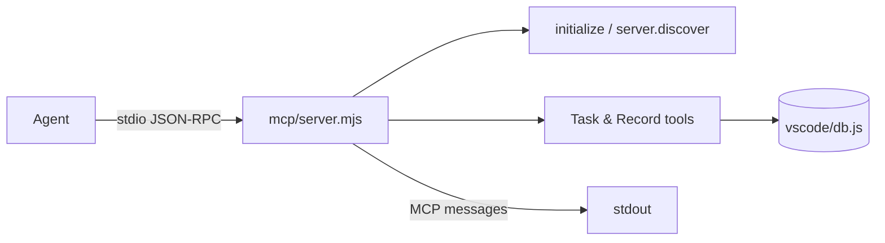

<!-- Generated by Imprimatur from its database; the wiki is written again from the code, ADRs and glossary: edit those. -->

# mcp/

The `mcp` module implements Imprimatur's MCP server, the sole interface through which agents read and write Tasks and their Records (todos, questions, answers, decisions, notes, ADRs, PDRs). It exists so agents never touch the database directly — `vscode/db.js` remains the single source of truth while the server mediates access through a fixed set of tools. It speaks newline-delimited JSON-RPC over stdio, supporting both the current protocol era (`server/discover` with per-request `_meta`) and the older `initialize` handshake, with no external dependencies.

## Parts

- `mcp/server.mjs`: Implements the MCP server — exposes task/record tools over stdio JSON-RPC, backed by `vscode/db.js` as the source of truth, supporting both protocol handshake styles.

## Decisions

- ADR 83: `/study` tool reads skill + salt as study_material, no migration; "study" section in task analysis
- ADR 92: MCP tool profiles via `IMPRIMATUR_TOOLS`/`mcp.tools` config — core, standard, all, or groups
- ADR 93: Answer search via index (no bodies, 160-char titles, 8 hits); `task_get` shows first line and acted-on fields
- ADR 101: Architecture/product sections carry a fixed chapter; chapters render as H2, sections as numbered H3
- ADR 118: Task analysis is a five-chapter design doc written with the analysis skill; sections land by heading name
- Document tools take every scoped kind (spec, map, capability) plus a section's delta; `task_upsert` takes `ticket_type` and `blocked_by`; `where_we_left_off` names a task's spec
- Search ranks with BM25 in JavaScript (no FTS5 in node:sqlite): in-memory index per connection, rebuilt on change, every word must match, Turkish letters folded

## Terms

ADR, Imprimatur, PDR, Record, Section, Task
