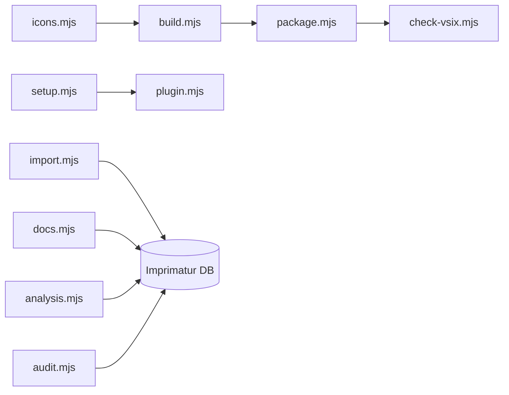

<!-- Generated by Imprimatur from its database; the wiki is written again from the code, ADRs and glossary: edit those. -->

# scripts/

```markdown
The `scripts/` module holds Imprimatur's standalone CLI tools: jobs that sync a repo's Markdown records, task analyses, and design documents with Imprimatur's database, read-only reports and audits over that data, and the build/package/release pipeline for the VS Code extension and Claude Code plugin. It exists so these operational tasks — importing data, auditing agent setups, bundling and packaging the extension, syncing with issue trackers — have one place to live outside the extension and hook runtime code. Most scripts are safe to re-run, and several support `--dry-run` so they can be checked before they write anything.
```



## Parts

- `scripts/analysis.mjs`: Imports a repo's past Claude session task analyses into Imprimatur's database; safe to re-run, only newer states are added.
- `scripts/audit.mjs`: Audits the agent setup with agnix, recording findings as records of the root's AUDIT task.
- `scripts/best.mjs`: Produces project best-practice recommendations (ISO/IEC 25010:2023, NIST SSDF) as records of the repo's RECS task.
- `scripts/build.mjs`: Bundles the VS Code extension into one file with esbuild, plus mermaid's browser build for diagram rendering.
- `scripts/check-vsix.mjs`: Checks a packaged .vsix contains exactly the needed files and stays under the size limit.
- `scripts/docs.mjs`: Syncs a repo's design documents with their Markdown files; safe to re-run.
- `scripts/icons.mjs`: Generates the panel's icons (vscode/icons.js) from Lucide, limited to the icons the panel uses.
- `scripts/import.mjs`: Imports a repo's Markdown records into Imprimatur's database; safe to re-run.
- `scripts/package.mjs`: Packages the extension into a .vsix in dist/, bundling README, CHANGELOG, and LICENSE for the Marketplace page.
- `scripts/plugin.mjs`: Generates the Claude Code plugin's files (hooks.json, plugin.json) from setup.mjs's hook list and the extension version.
- `scripts/prune-repos.mjs`: Removes repos and empty duplicates from this machine's Imprimatur database; dry run by default.
- `scripts/release-notes.mjs`: Prints a version's CHANGELOG section for the GitHub Release; fails if the version has no section.
- `scripts/setup.mjs`: Sets Imprimatur up on this machine: Claude Code hooks, status line, and an MCP server allow rule.
- `scripts/stale-epic-lines.mjs`: Read-only report of open epic records whose line task is already done or dropped.
- `scripts/tracker.mjs`: Syncs task status with the issue tracker (GitHub Issues, Jira).

## Decisions

- ADR 77: Panel look uses a custom design layer plus Lucide icons, not vscode-elements.
- ADR 83: `/study` skill uses a `study_material` MCP tool; no migration needed.
- ADR 90: One dispatcher process per hook event (hooks/run.mjs) runs every hook step in-process.
- ADR 91: Keys and tokens move from config.json to secrets.json (0600), hidden from Claude Code's file tools.

## Terms

Agent Setup, Audit, Epic, Hook, Imprimatur, Record, Section, Session, Task
