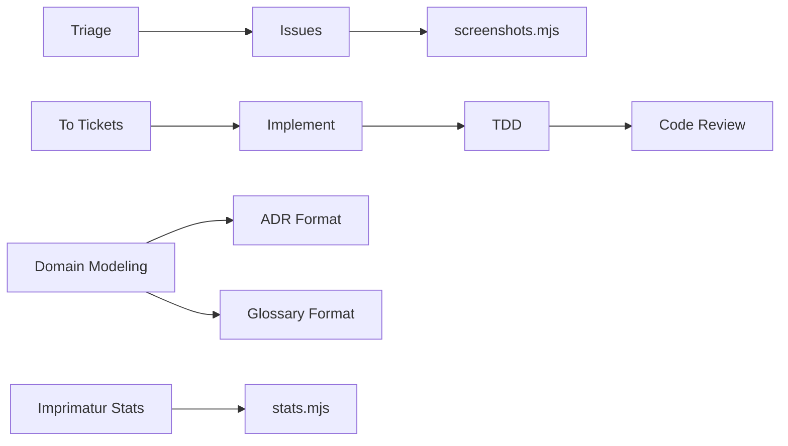

<!-- Generated by Imprimatur from its database; the wiki is written again from the code, ADRs and glossary: edit those. -->

# skills/

The `skills/` module is Imprimatur's library of agent skills: self-contained `SKILL.md` procedures (plus supporting reference docs and a couple of helper scripts) that guide the agent through phases of software work, from triage and issue handling through implementation, testing, code review, and documentation. It exists so that recurring procedures — how to write an ADR, how to run TDD, how to triage, how to publish issue screenshots — are documented once and reused consistently rather than re-derived each time. Many of these skills are carried in verbatim from Pocock's skill set (each with its own `NOTICE.md` crediting the source), alongside skills written for Imprimatur itself, such as `imprimatur-stats`.

## Parts
- `skills/triage/SKILL.md`: Triage skill for sorting and scoping incoming work.
- `skills/issues/SKILL.md`: Issues skill for working with GitHub issues.
- `skills/issues/screenshots.mjs`: Publishes an issue's screenshots to an orphan branch via the GitHub API and prints the Markdown for the issue's "See" steps.
- `skills/to-tickets/SKILL.md`: To Tickets skill, turns input into tickets.
- `skills/implement/SKILL.md`: Implement skill for carrying out implementation work.
- `skills/implement-spec/SKILL.md`: Implement Spec skill, implementation driven by a written spec.
- `skills/tdd/SKILL.md`: Test-Driven Development skill.
- `skills/code-review/SKILL.md`: Code Review skill.
- `skills/domain-modeling/SKILL.md`: Domain Modeling skill, paired with its ADR and glossary formats.
- `skills/codebase-design/SKILL.md`: Codebase Design skill, covering deepening and "design it twice".
- `skills/improve-codebase-architecture/SKILL.md`: Improve Codebase Architecture skill, producing an HTML report.
- `skills/documentation-writer/SKILL.md`: Diátaxis Documentation Expert skill for writing docs.
- `skills/docs-sync-audit/SKILL.md`: Docs Sync Audit skill, checking docs against code.
- `skills/imprimatur-stats/stats.mjs`: Prints Imprimatur's ASCII scoreboard for a repo, comparing the last 7 days to the prior 7, read-only, using the same stats module as the VS Code panel.
- `skills/ask-matt/SKILL.md`: Ask Matt skill, accompanied by its own phase-boundaries doc.

## Decisions
- ADR 83: Skill for `/study` backed by a `study_material` MCP tool.
- ADR 105: `/imprimatur-stats` prints an ASCII scoreboard from DB, review, and transcript data.
- ADR 118: Task analysis is a five-chapter design doc written with the analysis skill.
- ADR (unnumbered): 19 of Pocock's skills carried in verbatim with per-skill NOTICE files.

## Terms
ADR, Audit, Exercise, Hook, Imprimatur, Section, Task
