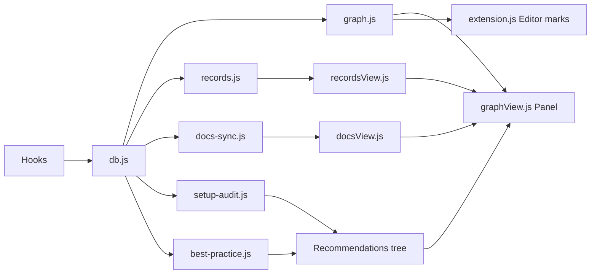

<!-- Generated by Imprimatur from its database; the wiki is written again from the code, ADRs and glossary: edit those. -->

# vscode/

vscode/ is the VSCode extension for Imprimatur: it shows an AI coding agent's edits as tracked changes in the editor, keeps a per-repo Agent Change Graph and task records, and syncs living design documents (Architecture, Product, Glossary) and setup/recommendation audits against a local SQLite database. It exists so the record of what an agent did, decided, and left waiting on the user survives across sessions and tools, instead of living only in a disappearing transcript. The database (vscode/db.js) is the single source of truth; everything else (Markdown exports, panel tabs, trees) is a generated or synced view of it.

## Parts

- `vscode/db.js`: Imprimatur's own SQLite database — the source of truth for tasks, todos, questions, answers, decisions, notes, ADRs and PDRs.
- `vscode/extension.js`: shows an agent's edits in the editor like tracked changes, against the pre-edit baseline copy.
- `vscode/graph.js`: builds the Agent Change Graph — every agent edit in a repo, newest first, one lane per task.
- `vscode/graphView.js`: the Imprimatur panel webview with its six tabs (Home, Tasks, Waiting on you, Architecture, Product, Agent changes).
- `vscode/records.js`: reads task records (titles, status, sessions, open items) from the database for the rest of the extension and hooks.
- `vscode/recordsView.js`: record commands — mark done, reopen, drop, move the 👉, edit title, add, search.
- `vscode/docs-sync.js`: keeps the database and the generated ARCHITECTURE.md/PRODUCT.md files in the same text, in either direction.
- `vscode/docsView.js`: the Architecture, Product and Glossary tabs of the panel, built from the database's living documents.
- `vscode/setup-audit.js`: runs agnix against agent files and turns its findings into AUDIT task records.
- `vscode/best-practice.js`: project best-practice recommendations by ISO/IEC 25010 and NIST SSDF, grounded in fetched docs and repo evidence.
- `vscode/activity.js`: records every agent tool call to a per-session log so the graph can show it in its task's lane.
- `vscode/import.js`: migrates older Markdown task records (TODO.md files) into the database.
- `vscode/data-dir.js`: resolves where a repo's Imprimatur data lives, next to the database rather than inside the repo.
- `vscode/search-index.js`: BM25 ranked search in JavaScript over records and document sections, for Cmd+K and MCP.
- `vscode/mcp-allow.js`: adds the allow rule that lets Imprimatur's MCP server skip Claude Code's permission classifier.

## Decisions

- ADR 95: One Imprimatur version per machine
- ADR 96: Per-repo data stored outside the repo
- ADR 98: Waiting logs cached per file version
- ADR 101: Fixed chapters for design-document sections
- ADR 102: Agent setup lists plugins and synced skills
- ADR 104: Agent setup shows last session's context
- ADR 107: Board theme recolors VS Code tokens
- ADR 118: Task analysis as a five-chapter design doc
- ADR 121: Pocock's artifacts stored in existing tables
- ADR: GLOSSARY.md and ADRs round-tripped in Pocock's format
- ADR: keepGoing, an epic-aware Stop hook
- ADR: .scratch/ written from spec and map documents
- ADR: pocock-files.js writes out-of-scope and capability docs
- ADR: Imprimatur carries 19 of Pocock's skills verbatim
- ADR: Search ranks with BM25 in JavaScript

## Terms

Accept, ADR, Agent Change Graph, Agent Setup, Audit, Epic, Exercise, Hook, Imprimatur, Living document, PDR, Process checks, Record, Section, Session
